# 验收记录：第 1.3 步 稳定、补验与输入框

| 项 | 值 |
|---|---|
| 日期 | 2026-11-08 |
| 提交范围 | `0e1a3b2..step/1.3-stability-input`（代码哈希在提交后追记） |
| 验收人 | Codex |
| 结论 | 部分通过：实现、自动测试与演示界面通过；真实补验等待用户确认 |

## 完成标准

- [ ] Claude Code、Codex 各在网页里完成一次带截图的对话（Ctrl+V 粘贴），回复里能说出图片内容；选一个看不了图的模型时被拦下并能一键换成能看图的模型。演示 Agent 已验证，真实 Agent 未验证（ISSUE-0023）。
- [ ] CodeBuddy 在网页里完成一次对话、换一次模型。第 1.3 步输入框改完后的真实复验未验证（ISSUE-0023）。
- [ ] 第 7.2 节里除 ISSUE-0001、ISSUE-0016 外的项都有真实验证结果（通过，或开了新问题单）。登录、API Key、Claude 恢复与拒绝审批仍未验证；干净环境启动未验证；旧退出根因未复现。
- [ ] 窗口被遮挡 10 分钟后，新的审批卡片仍会出现；Gateway 被结束后网页 3 秒内给出提示。后一项演示预览实测 1564ms；前一项真实审批未验证（ISSUE-0014）。
- [x] 回合 60 秒没有任何事件时有提示、10 分钟自动停止，额度错误提示读得通。已用假时钟和独立假 ACP 进程验证；真实额度错误未重发复测，不修改历史错误事件。
- [x] 自动测试、类型检查、构建全部通过；第 9.12 节列出的新测试都在。

## 实现与自动测试

| 范围 | 结果与证据 |
|---|---|
| A 实时事件 | 拆出 `createFlusher`；覆盖 rAF 不返回、先返回、不可见 16ms、1000 次合并以及原生计时器调用上下文。审批无焦点时通知；真实系统通知未验证 |
| B 服务退出 | 信号、退出码、pid、运行时间、上次异常退出记录；网页 down / 五秒探测 / 自动恢复；致命异常收尾仍判为异常；原始意外退出根因未复现 |
| C 无回应 | 60 / 180 / 600 秒假时钟断言，固定 notice id，审批等待不计时；独立假 ACP sleep 剧本收到 `session/cancel`、任务暂停并记录 `agent.no_response` |
| D 错误 | 额度补验原文回归及五个明确时间格式；短错误前缀命中与正常说明不误判；模型错误暂停并记录账号下的失败原因 |
| E 工具标题 | 假 ACP 先报 Preparing file 再改标题，只发一次 `tool_update`；网页更新原工具行，保留输出与状态；真实 Claude 复验未验证 |
| F 选择器 | 当前或已启用 Agent、状态、模型来源、自动思考强度、账号隔离、失败提示、任务内与新建任务行为纯函数测试；演示界面实际操作见下文 |
| G 附件 | 文件头类型与尺寸、MZ / ELF、SVG、20 / 5 MB、50 个 / 200 MB、归属与看图校验、安全下载响应头、空任务后发附件、24 小时清理、附件目录删除、草稿过期提示；ACP image / resource_link / 小文本 resource 契约；网页筛选、命名、限制与能力提示 |
| H 零碎修复 | 去掉用户提示里的旧步号；无凭据时不请求受保护接口；干净环境首次运行未验证 |
| 协议和迁移 | 老事件兼容、可选字段与错误正反例、三层图片能力判断；v4 表结构升级 v5，历史草稿保留；重新打开数据库通过 |

| 命令 | 结果 |
|---|---|
| `npm run typecheck` | 通过，四个 workspace |
| `npm test` | 274 项通过（adapters 73、gateway 107、protocol 14、web 80）；3 项真实冒烟跳过。默认没有启动真实 Agent、没有联网、没有模型费用 |
| `npm run build` | 通过；Vite 仍提示单个 JS chunk 超过 500 kB，不阻断构建 |

## 实际操作

预览使用 `.claude/launch.json` 的 app 命令、开发环境与 17890 端口，额外设置 `AIC_NO_REAL_AGENTS=1`，防止误启动真实 Agent。浏览器配对使用开发配对码；配对码、设备令牌、原附件和临时脚本没有提交。

1. 首次无凭据进入配对，完成配对后打开已有工作台；启动不先请求受保护的 `/hello`。自动测试同时断言无凭据时受保护请求调用次数为零。
2. 新建演示任务，Ctrl+V 粘贴 PNG 并派发，回复“收到 1 张图片：clipboard.png、1 × 1”。新任务先建为 draft，再上传、发送，未先启动一个空回合。浏览器剪贴板的默认名 `clipboard.png` 随后也纳入截图自动命名处理。
3. 打开两级菜单，方向键 →、↓、Enter 换成演示深思；当前模型标“不能看图”。粘贴图片后点发送被拦下，消息没有新增；点推荐模型后发送纯图片成功。[拦截截图](assets/step-1.3-vision-blocked.jpg)。
4. 点思考强度“高”，菜单不收起，事件确认后当前值变高；二级 Esc 回一级，再按 Esc 收起并把焦点还给触发按钮。模型切换后保留原对话。[夜间选择器](assets/step-1.3-picker.jpg)、[日间选择器](assets/step-1.3-light.jpg)。
5. 上传附件后刷新，图片草稿恢复；切到设置再返回任务，图片仍在，再刷新仍在。修复了初次空列表覆盖草稿的竞态。使用选择文件添加 320 × 160 的测试图，再发送纯附件，收到正确文件名和尺寸；点对话缩略图能看大图。
6. 结束开发预览进程，输入框出现完整的“工作台服务已停止，对话不会丢”说明，侧栏变红且发送禁用。[服务停止截图](assets/step-1.3-service-down.jpg)。第三次计时复验：结束时刻 1794073782388，页面观察到 down 时刻 1794073783952，相差 1564ms。重启同一数据目录的预览后，网页无需刷新自动恢复，三段已有消息完整。
7. 服务停止时选择文本文件，显示上传失败和重试；服务恢复后点重试，上传成功。新建任务选择带 MZ 文件头的假 `.txt` 与正常文本，服务端拒绝第一个；点重试仍正确拒绝，移除它后继续派发剩下的文本文件成功，没有重复创建任务。对话中的文件按钮能下载。
8. 设置“关于”显示上次非正常退出。最终网页构建刷新后切模型、处理实时事件，控制台未再出现该构建的 `Illegal invocation`；两套主题均检查了菜单和图片显示。原生计时器调用上下文已有回归测试。

实际未操作：系统文件拖入、真实多账号切换、真实失败模型标记、真实登录通知、物理控制台窗口关闭。实现与纯函数 / 集成测试不冒充这些手工验证。

## 真实补验计划与费用（尚未开始）

**这部分必须由用户先确认，确认前不启动真实补验、不发真实消息。** 所有任务使用新的空临时目录，消息尽量合并；不读取或复制 Agent 的凭据文件，API Key 由用户在网页账号表单填写，不进入验收记录、日志或提交。

| Agent | 预计消息 | 内容 |
|---|---:|---|
| Claude Code | 5 | 截图并记暗号；请求新建文件并拒绝（同时做遮挡审批）；换模型 / 思考强度问暗号；Gateway 重启后问暗号；小额 API 账号只回复 OK |
| Codex | 3 | 截图并记暗号；换模型 / 思考强度问暗号；小额 API 账号只回复 OK |
| CodeBuddy | 3 | 截图并记暗号；换模型和“自动”思考强度；可用的测试 API / 自定义地址账号只回复 OK |
| 合计 | 预计 11，绝不超过每家 5 条、总计 15 条 | 不自动重发；连接测试保持不发消息，有任何额外发消息测试也计入额度 |

费用预算：演示和自动测试已经产生的模型费用为 **0**。真实补验暂按 **API 合计 1～5 美元**预留，另消耗现有订阅额度；这是粗略预算，不是价格报价或程序保证的费用上限。依据是第 1.2 步实际记录的一轮 Claude 约 0.11 美元，ACP 系统提示、图片与恢复上下文使“极短消息”也可能有较大输入；其他 Agent 当时没有报告可核实的单独费用。建议只用余额或平台硬限额不超过 5 美元的测试 Key。实际金额能取得时逐项记录，不能取得时写“未报告”；没有合适 Key 时该项保持未验证。

| 第 9.11 节项目 | 本次结果 | 消息与费用 |
|---|---|---|
| 1 Claude 对话、恢复、拒绝审批 | 未验证，等待账号额度与用户确认 | 0 条、0 费用 |
| 2 三家网页登录与取消 | 未验证，需用户完成浏览器授权 | 0 条、0 费用 |
| 3 API Key / 自定义地址与删除清理 | 未验证，需小额测试 Key | 0 条、0 费用 |
| 4 遮挡十分钟后的真实审批与系统通知 | 未验证；纯调度测试通过 | 0 条、0 费用 |
| 5 关闭控制台与恢复 | 已验证结束预览进程后的提示和恢复；物理关闭控制台窗口未验证 | 演示，无模型费用 |
| 6 无回应提示 | 假时钟与独立假 ACP sleep 通过；网页等待十分钟未手工复现 | 假 Agent，无模型费用 |
| 7 三家带截图对话 | 未验证；演示 Agent 通过 | 真实 0 条、0 费用 |
| 8 三家选择器与账号 | 未验证；演示模型和思考强度通过 | 真实 0 条、0 费用 |

## 未通过 / 未验证

| 项 | 原因 | 问题单 |
|---|---|---|
| 首次安装依赖、PATH 没有 Node | 未在沙盒或空用户环境执行，没有删除本机 Node 或依赖来模拟 | ISSUE-0004 |
| Claude 全程网页登录；三家登录、API Key、自定义地址与删除清理 | 需要用户授权和小额测试 Key | ISSUE-0007、ISSUE-0013 |
| Claude 上下文恢复、拒绝审批、持久化配置 | 真实付费补验未开始 | ISSUE-0012 |
| 窗口完全遮挡十分钟后的真实审批和系统通知 | 需用户配合保持电脑唤醒，尚未安排 | ISSUE-0014 |
| 历史 Gateway 意外退出根因 | 没有重现原故障；补齐日志与恢复，保留 investigating | ISSUE-0015 |
| 真实截图、三家新选择器与未操作的附件交互 | 演示验证不能代替真实 Agent；系统拖入与多账号等仍待补验 | ISSUE-0023 |

## 备注

- CodeBuddy 模型图片能力的本地源码依据：锁定安装包 `@tencent-ai/codebuddy-code/dist/codebuddy.js` 的 `toAcpModelInfo`、`getModelsInfo`、`_codebuddy.ai/models/refresh`。明确的 `_meta.supportsImages` 布尔值才写入模型能力；没有字段时保留未知，不按模型名推测。真实模型看图仍未验证。
- Claude 引擎内嵌源码读取 `CLAUDE_CODE_MAX_RETRIES`，适配器统一设置 2；仅查源码，没有读取凭据。该配置的真实 429 等待时长仍未复测。
- 附件服务已提供并测试任务目录删除；当前产品没有任务删除接口，本步没有额外增加任务删除功能。浏览器重启按钮只在 Platform 实现可选能力时出现。
- 没有新增依赖、全局安装、合并到 main 或推送。用户确认后的真实结果只能追加，不回写本次未验证记录。

## 提交后追记（2026-11-08）

- 本次实现代码范围：`0e1a3b2..726e7ef`。协议 `7d06af2`、适配器 `e6b6ac9`、Gateway `1d22424`、网页与配套验收 `726e7ef`；四个提交分别通过类型检查、默认测试和构建。
- 网页提交前最后复跑：`npm run typecheck`、`npm test`、`npm run build` 全部通过；测试为 274 通过、3 真实冒烟跳过。
- ISSUE-0005、0011、0021、0022 按已通过的回归范围关闭，并在时间线记录修复哈希；其中真实 Claude 工具标题和真实 429 等待不冒充已经复验。
- ISSUE-0004、0007、0012、0013、0014 保持 open，ISSUE-0015 保持 investigating，ISSUE-0023 收纳新的真实输入补验缺口。整体结论仍为部分通过，真实补验等待用户确认；没有合并或推送。

## 真实补验开始（2026-11-08）

- 用户已明确同意开始，并提供智谱测试 API Key；只在网页添加测试账号，不记录 Key。预算及消息上限沿用上文。此刻真实消息计数为 Claude 0 / Codex 0 / CodeBuddy 0。
- 按用户最新澄清，所有工作归回原分支 main，已快进至 8d97760，删除本次新建分支；未推送。原分支名及“未合并”陈述属于此前验收时点记录，后续以本追记为准。
- 开发预览移除 AIC_NO_REAL_AGENTS，保留 app 配置的端口与数据目录。三家现有本机登录均检测为就绪；没有读取或复制其凭据文件。

## 真实补验阶段结果（2026-11-08，进行中）

- Codex 本机账号第 1 条：Ctrl+V 截图，正确识别“重新检测”和 ZCode 暂不支持卡片，记住暗号。第 2 条：会话内切到 5.6 Luna / low 后只回复正确暗号。截图见 assets/step-1.3-codex-image.png、step-1.3-codex-switch.png。
- Codex 自定义 Responses 账号第 3 条：建会话时 agent.auth_required，未得到回复（ISSUE-0025）。按计划后备方案修复后，第 4 条人工复测返回 OK；独立 CODEX_HOME、显式 provider 与本账号密钥环境由工作台启动，无已有凭据读取或复制。截图见 assets/step-1.3-codex-api.png。上游账单未核对，费用未验证。
- Claude 自定义兼容接口账号第 1 条带图：返回 429，网页呈现正确中文额度提示并暂停。锁定版本源码存在用户设置覆盖环境的顺序，尚不能确认实际路由或测试 Key 额度；记录 ISSUE-0026，未自动重发，等待用户决定设置隔离方式。
- CodeBuddy 本机账号第 1 条：正确识别截图中的 ZCode 与 Codex 卡片。模型从 GLM-5.3-Flash 换到 GLM-5.3，强度从自动切 low 再回自动；第 2 条正确回复暗号，触发器显示“自动”。截图见 assets/step-1.3-codebuddy-image.png、step-1.3-codebuddy-switch.png。过程提示仍露出内部强度 enabled，待修正文案。
- 真实进程结束：结束预览 Gateway 后首次界面检查已显示“工作台服务已停止”，截图 assets/step-1.3-real-gateway-down.png；重启后未刷新网页即自动恢复输入与连接。此次未单独计时，不将其写作精确的 3 秒测量。
- 切账号模型目录错误在发送前被发现并修复，见 ISSUE-0024 和 assets/step-1.3-profile-models.png。模型 vision 经数据库往返保留，协议字段均可选追加。
- 截至本节消息尝试数：Claude 1、Codex 4、CodeBuddy 2，合计 7（失败尝试也计入）。费用：未取得提供商账单，不能确认实际金额。没有自动重发。
- 本轮 npm run typecheck、npm test、npm run build 均通过；测试 278 通过（适配器 74、Gateway 108、协议 15、网页 81），3 项真实冒烟跳过。无新增依赖。构建仍有原有的大分块体积提示。
- 网页登录：已通过“添加账号 → 订阅登录”为 Claude 创建补验专用独立账号并启动登录，授权完成与取消结果尚未验证。十分钟遮挡、Claude 对话恢复和拒绝审批、账号删除、干净环境启动仍未验证。

## 补验阶段追记（2026-11-08）

- Codex API 账号的“测试”也已通过：握手、新建会话、读取目录、关闭均成功，没有额外 LLM 消息。
- CodeBuddy 真实目录中的 Custom GLM5.2 明确声明不能看图。新建任务选择它、Ctrl+V 截图后出现拦截；点击派发仍停留原对话框，未创建任务、未调用 Agent。一键换成 Auto 后警告消失，随后取消并清空未发送草稿。证据 assets/step-1.3-codebuddy-vision-block.png；消息计数仍为 7。
- 自动强度文案已修复：切换提示和右侧上下文均显示自动，见 assets/step-1.3-codebuddy-auto-label.png（ISSUE-0027）；修复后重新通过类型检查、278 项默认测试（3 项跳过）与构建。
- API 删除要求的冲突单独记录 ISSUE-0028，等待用户决定清理凭据并保留历史，或删除整个 API 账号目录。当前没有删除测试账号，不宣称已完成清理。
- 整体仍为部分通过。等待 Claude 设置隔离决定与浏览器授权；Claude 恢复 / 审批、三家完整登录、十分钟遮挡、API 删除和干净环境首次启动等未验证项仍保留。

## 2026-11-08 本轮补验提交与等待项

- 修复与真实证据提交 `e2e921c`，位于用户要求的原分支 main；未推送。ISSUE-0024、0025、0027 按已通过范围关闭并追记该哈希；0026、0028 继续调查。
- Claude 隔离账号登录真实到达网页授权码输入阶段，没有完成浏览器授权；十分钟后界面显示“登录超时（10 分钟内没有完成）”。没有向终端输入授权码，没有完成登录；用户主动取消的效果仍未验证。
- 当前消息尝试总数仍为 7（Claude 1 / Codex 4 / CodeBuddy 2），账单金额未验证。没有增加收费消息；测试账号和后续遮挡补验用的临时设备仍保留，未声称完成清理。
- 下一步需要用户决定 Claude API 账号的用户设置继承方式、API 账号删除清理行为，并配合重新启动授权。其余未验证范围保持上文记录，整体结论为部分通过。

## 首次启动链路补验（2026-11-08）

- 核对发现 scripts/start.mjs 仍调用 npm install，与 phase-1 §9.10 的 npm ci 要求不符；已改成 npm ci，沿用仓库锁文件。
- 从当前已提交内容导出独立临时副本，确认没有 node_modules、.aic-data 和构建产物；只复制本次更新的启动脚本。不删除原仓库依赖，不改变本机 Node，不复制任何 Agent 凭据。
- 通过同一个批处理入口在隔离端口和数据目录运行，关闭真实 Agent：自动 npm ci 安装 286 个包（约 10 秒），自动构建通过，服务监听成功。安装后的 package-lock.json 与仓库 SHA-256 相同。此为新项目副本，仍使用现有 Windows 用户和 Node，不冒充干净用户或物理双击验收。
- 另一子进程仅把 PATH 限制为 Windows 系统目录：批处理输出 Node.js 24 缺失的完整中文提示，并出现标题 AI Console 的提示框进程。未操作本机 PATH 设置或卸载 Node。
- 浏览器自动化无法可靠识别 Windows 当前页面 URL，工具要求停止界面操作。未核对提示框画面、点确定后的下载页或自动打开的工作台内容，因此以上界面结果仍为未验证；没有绕过工具限制。经路径核对后结束本轮临时服务与提示框，原 17890 预览仍运行。
- 本次没有真实 Agent 消息，累计仍为 Claude 1 / Codex 4 / CodeBuddy 2，共 7 次尝试。npm run typecheck、npm test（278 通过、3 跳过）、npm run build 均通过。ISSUE-0004 保持 open。

## 真实审批与需求更正（2026-11-08）

- CodeBuddy 第 3 条消息：通过带设备令牌、Host、Origin 校验的 `/api/v1/ws`，在空临时目录请求一次写文件审批；没有自动重发。脚本从启动到结束 665143ms，审批期间任务保持 waiting，没有被十分钟无回应机制停止。
- 内嵌预览面板连续隐藏 655991ms（约 10 分 56 秒）后恢复，未刷新。恢复时实际在 Agent 管理页，侧栏已显示 1 项待审批和新审批提示；点击待处理入口后卡片出现，显示已等待 10 分钟。不能据此声称任务页审批卡片在隐藏期间已完成绘制，也没有观察到操作系统通知；原生浏览器窗口完全遮挡场景仍未验证，ISSUE-0014 保持 open。[审批截图](assets/step-1.3-codebuddy-hidden-approval.png)。
- 在网页展开拒绝理由、填写并确认拒绝；过程显示“未执行（已拒绝）”“已拒绝，没有执行”，任务暂停。文件系统确认 STEP13_APPROVAL_REJECT.txt 不存在；本回合事件只有一次用户消息、一次工具开始、一次审批请求和一次审批解决，没有重试。[拒绝结果](assets/step-1.3-codebuddy-rejected.png)。这补齐 CodeBuddy 拒绝的实际结果，不替代尚未完成的 Claude 补验。
- 累计消息尝试 Claude 1 / Codex 4 / CodeBuddy 3，共 8 条；仍在原每家最多 5 条、共 15 条上限内。上游账单未取得，实际金额未验证。
- 用户先要求保留 Claude 用户设置并结束登录，再澄清所有第三方 Agent 都沿用自身设置、API、登录与模型；AI Console 独立 Agent 使用工作台自定义 API，新增模型保留原有认证和模型。已停止旧的 API 账号替换路线，不重新发起登录或真实消息。
- 数据库事件元数据确认当前进行中的 Claude 登录数为 0；此前流程已超时，不能写作本次点取消通过。接口补验临时设备已吊销，旧令牌访问返回 401，本地临时令牌文件已删除。

当前仍保留的工作台测试配置如下（没有读取第三方凭据文件）：

| 工作台测试配置 | 状态与归属 |
|---|---|
| 1.3 智谱 Responses 临时测试 | 旧 Codex 自定义账号；曾返回 OK，工作台 DPAPI 密钥仍保存。Codex 后备认证使用工作台自己的独立目录；不视作新的独立 Agent 通过 |
| 1.3 智谱 Claude 临时测试 | 旧 Claude 自定义账号；实际路由未验证，工作台 DPAPI 密钥仍保存，停止复测 |
| 1.3 Claude 登录补验临时账号 | 工作台独立订阅目录；授权超时，无进行中的登录，不再发起 |

- 这些配置尚未删除，不宣称清理完成，也不迁移、读取或改写第三方软件的凭据。清理与新归属整改见 ISSUE-0028、0029。
- 架构设计 v0.4.2、界面设计 v0.3、phase-1 9.15 已同步新边界；当前代码仍有旧的账号与注入链路，真正的工作台独立 Agent 尚未实现，正式界面和原型尚未按此调整。旧的 API 成功仅证明旧测试链路，不证明新需求通过。
- 本次只改设计与记录，没有修改运行代码。核对文档链接与差异；代码最近一次类型检查、278 项默认测试（3 项跳过）和构建通过的结果见上一节，不冒充本次重新执行。整体仍为部分通过。

## 第三方原生配置整改（2026-11-08）

- 实现范围：第三方适配器不再注入工作台 Key / Base URL 或调用登录；沿用软件自身配置环境。旧工作台认证配置标为停用，不能用于任务、探测或模型刷新，也不会成为默认认证；旧任务曾使用这些配置时明确停止，不自动转成本机认证。旧配置与加密密钥仍保留，清理未验证，独立 Agent 未实现。
- 默认自动测试覆盖：五家真实适配器均不提供 startLogin、不接受替换认证；原生环境继承；实际假 ACP 子进程保留原 provider；Codex 会话模型合并及无效配置停止；旧默认账号迁移边界；创建 / 编辑 / 登录 / 测试 / 刷新 / 删除的 409 拦截，且不解密旧密钥、不调用上游；旧任务不回退；原生选择器不混入旧账号模型。测试使用假进程和虚构密钥，未读取本机第三方凭据。
- 开发预览按 .claude/launch.json 的 app 配置在 17890 重启。浏览器查看 Claude 详情，两个旧工作台配置均显示“已停用”，没有登录、添加 API 账号或编辑入口；工作台任务默认值旁说明不会修改软件自身设置。[管理页截图](assets/step-1.3-native-config.png)。
- 新建任务打开 CodeBuddy 模型选择器，能选到该软件报告的 Custom GLM5.2；没有工作台账号切换，原生模型目录仍可用。随后取消对话框，没有派发。[模型截图](assets/step-1.3-native-model.png)。没有操作第三方软件的全局模型默认值，真实新对话与设置文件前后内容比对未验证（不读取凭据文件）。
- 原型 8765 的 Agent 页同步移除旧认证入口；点击 Codex“重新检测”出现“原型：沿用软件自身配置，未发起登录或修改认证”提示，页面没有脚本错误。[原型截图](assets/step-1.3-native-prototype.png)。独立 Agent 服务管理和模型追加的原型与功能仍未验证。
- 本轮没有真实 LLM 消息或登录，累计仍为 Claude 1 / Codex 4 / CodeBuddy 3，共 8 条；累计实际账单金额未验证。未新增依赖，未改 Claude 用户设置来源。整体仍为部分通过，ISSUE-0029、0028 继续跟踪独立执行器与旧配置清理。
- 本轮重新执行 npm run typecheck（4 个工作区）、npm test（282 通过：适配器 72、Gateway 112、协议 15、网页 83；3 项真实冒烟跳过）、npm run build 均通过；原型 interact.js 的 node --check 和 git diff --check 通过。构建仍有原有的大分块体积提示。

## 设计同步与整改提交溯源（2026-11-08）

- 上一节的代码、界面、测试与证据对应提交 `0abbda6`，分支为 main，没有推送；不是再次开展真实补验。
- 本次设计核对同步 design.md v0.4.3、ui-design.md v0.3.2、phase-1 当前进度与 8.1 / 9.15。第三方配置指引、模型切换与错误处理统一按自身认证边界执行；自定义 API 只归独立 Agent，新增服务 / 模型不覆盖原有配置。
- 本次只改文档和追加记录，未重新执行代码检查，代码检查结果沿用上一节并明确其提交。独立 Agent、服务 / 模型管理和旧测试配置清理仍未验证；不新增模型消息或费用记录，整体继续为部分通过。
- 本次检查 9 份变更 Markdown 的 57 个本地链接，目标均存在；git diff --check、UTF-8 无 BOM 检查及新增文本的已知测试密钥格式扫描通过。没有把历史验收条目改成新的通过结果。

## 独立 Agent 专项调研与设计细化（2026-11-08）

- 用户补充：多个 API 服务、每服务多个模型，自动识别上下文、图片与思考强度；明确授权多路子智能体调研。已完成三路公开资料 / 固定源码核查及主 Agent 汇总，报告提交 `7906c55`；见[总报告](../research/independent-agent.md)、[CCSwitch](../research/cc-switch-model-metadata.md)、[能力识别](../research/model-capability-detection.md)、[执行引擎](../research/independent-agent-engines.md)。
- 核查范围：CCSwitch 预设与目录补全、各 API 元数据差异与推理参数、四类执行器的工具 / 审批 / 恢复 / 认证边界及许可证，另结合一手文章分析上下文和执行环境。结论为静态调研，未运行开源引擎，不等同功能或性能验收。
- 架构设计 v0.4.4、界面设计 v0.3.3、phase-1 9.16 已补充多服务追加、逐字段能力来源 / 未知 / 冲突、动态推理参数与完整工具执行基线。旧的自动模型资料调研保留为独立预算任务，本轮未启动。具体接口、迁移和依赖版本仍须在离线验证后确定。
- 未验证：候选 SDK 发行包与传递依赖运行行为、Windows 兼容 / 取消 / 权限隔离、新模型协议传输、独立 Agent 工具执行、配置与能力识别功能及其正式界面和原型。没有新增运行时依赖，也未进行本节所列的新自动测试或界面验收。
- 本轮仅文档，不重跑 npm run typecheck、npm test、npm run build；最近代码检查对应 `0abbda6`（282 项通过、3 项真实冒烟跳过）。无新增真实模型消息、登录或费用探测，历史累计仍为 Claude 1 / Codex 4 / CodeBuddy 3，共 8 次尝试，账单金额未验证。整体仍为部分通过，ISSUE-0029 / 0028 继续跟踪；之后真实补验需另列上游请求与费用预算并取得用户确认。
- 文档检查：本轮合计 12 份变更 Markdown 的 76 个本地链接目标均存在；UTF-8 无 BOM、LF、新增文本密钥格式扫描通过；清理新增尾部空行后 git diff --check 通过。只验证文档目标存在，不冒充外部所有链接或运行功能通过。

## 独立执行器第一轮离线验证（2026-11-08）

- 本轮从静态调研推进到候选发行包的实际离线验证，尚未选定最终引擎或接入正式独立 Agent。验证脚本为 `scripts/dev/verify-independent-agent.mjs`，[结构化结果](assets/step-1.3-independent-poc.json)记录逐项结果、版本、发行包 integrity、锁文件摘要及未验证范围。
- 经 npm 官方 registry 元数据核对后，向 `.aic-data/independent-agent-poc` 安装 `@earendil-works/pi-agent-core`、`pi-ai`、`pi-schema` 的精确 `1.5.0`，共 88 个包；`--ignore-scripts --no-audit --no-fund`，没有全局安装。仅获取元数据和发行包时联网，模型测试使用注入的假传输。主项目 package.json / package-lock.json 未变。安装提示传递依赖 node-domexception@1.0.0 已弃用；完整依赖仍待正式引入前审核，不称为依赖风险审查已通过。
- 环境为 Windows、Node v24.14.0。候选在单独 Node 权限进程加载：只准读候选模块、验证脚本和当次临时目录，只准写当次目录，不准启动子进程；HOME / USERPROFILE 指向无读取权限的模拟目录，环境只保留必要系统项及虚构诱饵。监控 fs 与 fetch / http / https / net / tls / dgram 常用入口。本轮场景监控发现的越界读取与真实网络尝试均为 0；这是这些场景与入口的观察结果，不宣称 Node 权限模型提供了操作系统网络沙箱，也不扩展为任意命令安全保证。
- `node scripts/dev/verify-independent-agent.mjs`：27 项全部通过。覆盖实际临时文件的搜索 / 读取 / CRLF 修改、逐轮工具结果、严格参数保护、未知工具、截断工具请求不执行、审批等待前记录 / 拒绝无副作用、审批期间用户编辑后的冲突、异步记录先于执行、记录失败终态、串行工具、模型 / 审批 / 协作工具取消、预算前置阻断、已完成历史在新实例续聊不重放、两服务同名模型隔离、缺 Key 不用诱饵认证、401 不回退、302 传输拦截，以及 Chat 工具参数分片和第二轮结果续传。
- 三种传输仅通过模拟协议验证：Chat Completions；Responses 的无 DONE 终态流；Anthropic Messages 的显式地址 / Key 与用量流。Messages 实际发出 `v1/messages?beta=true`，不能推导用户服务必然兼容；未发送任何真实模型消息。
- 27 项中包含**特征测试**，刻意确认 SDK 默认参数转换、错误和零用量语义；它们通过不代表默认语义符合产品。已记录 ISSUE-0030：正式接入须严格校验原始参数，捕获同步异常并检查 error / aborted 终态，持久化恢复工具配对，区分缺 usage 和真实零值。保护示例不是正式实现。

对照引擎调研的八组门槛：

| 门槛 | 本轮证据与剩余范围 |
|---|---|
| 完整闭环 | 文件与协议工具闭环已验证；失败 / 成功的真实命令回传未验证，整组未通过 |
| 请求边界 | 三协议显式配置、缺 Key、两服务、401、Chat 302 保护示例已验证；所有协议与错误组合、正式传输边界未验证，整组未通过 |
| 全局无触达 | 上述受限导入与场景监控未见越界；完整发行依赖审计及操作系统网络隔离未验证，整组未通过 |
| 审批 | 示例的等待 / 拒绝 / 记录先行已验证；正式数据库、重复审批、过期与重连未验证，整组未通过 |
| 冲突 | 单文件审批期间改变内容已验证；多任务、路径大小写、软链接与原子修改未验证，整组未通过 |
| 取消与超时 | 假流与协作工具可取消、排队工具不执行；真实命令、进程树、非协作工具未验证，整组未通过 |
| 恢复 | 已完成记录在新实例续聊不重放；worker / Gateway 崩溃位置、未知副作用核对未验证，整组未通过 |
| 上下文与用量 | 请求前预算阻断接缝、模拟 usage 和缺报告语义已验证；压缩、真实预算、图片、推理选项未验证，整组未通过 |

- 没有修改网页或原型，本轮不开展新的浏览器验收。独立 Agent 的正式接口、服务 / 模型管理、能力识别、数据库和界面仍未验证；旧测试配置仍未清理。整体继续为部分通过，不因离线 PoC 通过关闭 ISSUE-0029。
- 本轮没有启动第三方 Agent、登录、读取第三方凭据或调用用户 API。真实消息累计仍为 Claude 1 / Codex 4 / CodeBuddy 3，共 8 次尝试；账单金额未验证。之后真实补验仍需单独列上游请求与费用预算并获得用户确认。
- 完成脚本改动后重新执行：npm run typecheck（4 个工作区）、npm test（282 通过：适配器 72、Gateway 112、协议 15、网页 83；3 项真实冒烟跳过）、npm run build 均通过。独立 PoC 的 27 项单列，不并入默认测试数；node --check 验证脚本通过。构建仍有既有分块体积提示。
- 文档与证据检查：9 个变更文件为 UTF-8 无 BOM、LF；7 份 Markdown 的 69 个本地链接目标存在；开发笔记、既有问题时间线和验收历史前缀保留；新增文本的已知测试密钥格式扫描、结构化 27 项结果核对及 git diff --check 通过。

## 独立工具协议先行（2026-11-08）

- 按协议先行追加 IndependentCommandSpec / Outcome / Result 与 IndependentToolIntent / State / Record，不改变已有类型、事件、错误码或任务行为。命令严格校验原始 argv 和预算，不接受夹带 env / cwd；持久意图只定义身份、指纹、状态和无输出正文的结果概要。
- 新增 3 项协议测试，覆盖不强制转换、空字符 / 环境 / 目录注入拒绝、结果终态与指纹 / 正文边界；旧协议测试仍通过。具体执行、审批整合、持久表、命令宿主和正式界面均未在这一段实现，不记为通过。
- 本段实际重新执行 npm run typecheck、npm test（285 通过：适配器 72、Gateway 112、协议 18、网页 83；3 项真实冒烟跳过）、npm run build 与 git diff --check，通过。构建保留既有分块体积提示。无新增项目依赖，没有真实模型消息或认证操作。

## 独立命令与工具意图基础组件（2026-11-08）

- 范围：协议提交 `c80a2c5` 后，新增 Gateway 的 Windows 命令宿主、执行器、审批输入绑定协调器、工具持久意图和只追加的迁移 v6。未接入正式独立 Agent 的模型循环、任务 / 审批接口或网页；不将基础组件通过记为独立 Agent 已可用，整体仍为部分通过。
- 新增默认测试 35 项：`independent-commands.test.ts` 16 项、`independent-journal.test.ts` 19 项。实际使用临时目录、真实 Node 进程与临时 SQLite，不加载真实 Agent、用户配置或网络服务，不读取第三方凭据。

| 验证范围 | 实际结果 |
|---|---|
| 正常输出与参数 | 中文 stdout / stderr、空参数、空格、引号、尾部反斜线、换行与 shell 元字符均保留；退出 7 / 125 与启动失败可区分；伪造控制帧正文仍只作为输出 |
| 输入与环境 | 原始数字不转换为 argv；拒绝相对路径和隐式批处理；不存在的目录 / 可执行文件返回启动失败；系统白名单不含虚构 Key、代理认证、Node hooks 或 Agent 配置目录 |
| 取消与结束 | 预取消、登记等待时取消、活动命令取消、5 秒时限、输出超限、关闭执行器、宿主被终止均按对应终态收尾；真实命令和普通子进程没有遗留 |
| 父链与外层崩溃 | 命令父进程先退出后，后台子进程仍由作业结束；Node 直接加载的外层执行夹具被终止，stdin 断开后命令与子进程均退出 |
| 输出保护 | 输出超限有 truncated 和接收字节数；宿主按数据帧传输，正文不能伪造退出状态；已知虚构密钥及尾部截断前缀被脱敏；参数、输出正文没有写入工具持久表 |
| 审批与身份 | 同一 task / session / turn / call 幂等；跨任务、工具或输入指纹变化报冲突；命令 / 时限 / 输出预算 / 工作区 / 审批基准纳入指纹；重复 start、拒绝 / 取消后执行、晚到审批均阻断 |
| 持久化失败 | 宿主登记失败前没有目标文件副作用；命令已写文件但完成结果保存失败时调用报错、记录保持 running，随后恢复成 interrupted；不自动重新执行，文件仍只有一次写入 |
| 磁盘恢复与迁移 | 外进程在 pending、approved、running、写文件后、结果保存后五个位置终止，跨进程重开数据库：未定状态标中断，终态保留，副作用不重放；v5 升 v6 和重开保留旧草稿 / 会话；原有 v4 升级测试仍通过 |

- 首轮测试曾发现 PowerShell stderr 的 CLIXML 前缀，以及 tsx CLI 包装故障注入时一次 SQLite I/O 错误；已修正宿主格式 / 帧协议和直接 Node 夹具，后续结果按最终检查记录。没有忽略失败或声称首轮全绿。
- 未验证：Windows 文件 / 网络系统沙箱、绕开普通作业继承的进程路径、不同系统版本与打包环境、恶意命令的操作系统权限边界。私有 HOME / 环境白名单 / 作业均不等于沙箱；崩溃或清理失败的临时目录管理尚未接入。这里只记录元数据，完整工具消息配对、会话压缩、文件路径 / 修改冲突等 9.16 门槛仍未通过，ISSUE-0029 / 0030 不关闭。
- 本轮未修改网页或原型，没有新增浏览器验收；未安装依赖、操作旧测试配置、启动第三方 Agent、发起登录或调用用户 API。真实消息累计仍为 Claude 1 / Codex 4 / CodeBuddy 3，共 8 次尝试；账单金额未验证。之后真实补验仍需单列请求与费用预算并取得用户确认。
- 最终重新执行 npm run typecheck（4 个工作区）、npm test（320 通过：适配器 72、Gateway 147、协议 18、网页 83；3 项真实冒烟跳过）和 npm run build，全部通过。构建仍有既有的 500 kB 分块提示；没有将它记成构建错误或本次新增问题。
- 提交前核对 16 个变更文件均为 UTF-8 无 BOM、LF；28 个本地文档链接目标存在，验收 / 开发笔记 / 问题时间线的历史前缀保留，已知密钥格式扫描未检出，git diff --check 通过。

## 独立服务与模型的协议先行（2026-11-08）

- 命令与恢复基础已提交 `cd5dece`。本段按协议先行追加独立服务 / 模型、能力证据与范围 / 修订、默认选择和任务绑定类型，以及只带身份的目录变化事件和分开的目录 / 运行时功能开关。phase-1 9.18 明确路由、存储、来源合并与密钥边界，尚未实现这些接口和存储。
- 新增 5 项协议测试，覆盖读写凭据分离、乐观修订、URL 限制、人工 false / null 与字段类型、默认选择及事件不得夹带 Key。重新运行 npm run typecheck、npm test（325 通过：适配器 72、Gateway 147、协议 23、网页 83；3 项真实冒烟跳过）、npm run build，均通过；保留既有分块提示。
- 没有修改网页、安装依赖、请求模型元数据、启动真实 Agent、读取凭据或进行模型调用。正式目录、自动识别和独立运行时仍未验证，整体保持部分通过。

## 独立服务与模型目录后端（2026-11-08）

- 协议提交 `d1a4b4b` 后实现 phase-1 9.18 的配置后端：独立服务 / 模型 CRUD、能力来源与手动修订、默认选择、固定任务绑定与内部凭据读取。迁移 v7 只追加三张表。正式第三方 profiles 不参与此目录，旧测试配置未清理、未迁移。整体仍为部分通过。
- 新增 `independent-catalog.test.ts` 的 25 项测试，使用真实临时 SQLite、工作台回环 HTTP 与内存测试密钥存储；不启动真实 Agent、不请求外部元数据或模型，不读取第三方凭据。密钥加密能力复用原 SecretService / DPAPI，本段没有新做真实 DPAPI 运行验证。

| 范围 | 实际验证 |
|---|---|
| 多服务 / 模型 | 两服务各两个模型，同名远端 ID 分属不同本地模型；追加保留旧项，重复添加保留名称、人工 false、停用状态和默认选择；跨服务读模型为 404 |
| 默认值 | 创建不会自动设默认，明确设置需匹配所属服务；删除选中项只清空默认，不选择其他项；更改默认不修改已有任务绑定 |
| 能力证据 | 初始 16 字段全未知；人工覆盖保留自动差异，可清除单字段恢复自动；同级不同来源冲突为未知；同来源刷新替换当前值；空字段不抹旧值 |
| 来源范围 | 低级新鲜目录不能覆盖高级过期接口限制，高级旧值保留并标 stale；有限观察不提升通用能力；列表顺序差异不产生假冲突；配置范围变化后旧证据保留但不生效 |
| 参数保护 | 未知字段、伪装 manual、跨范围、缺来源和单字段超过 16 来源均拒绝，失败不部分写入；原始 effort 档位保留，不补造通用选项 |
| 密钥 | 读取目录不解密；轮换后删除旧密文；异步加密与并发编辑冲突时清理本次密文、不覆盖赢家；无认证不能夹带 Key；响应、事件与审计未含虚构 Key |
| 凭据归属 | 内部运行时接缝只返回任务所选服务的测试 Key；所选服务缺 Key 时失败，不改用另一服务；解密期间配置变化后报修订冲突，不继续提供旧路由 |
| 任务与删除 | 已绑定任务阻止删除服务 / 模型；停用或修订使原绑定停止；删除独立服务只处理自己的模型与密钥，旧第三方 profile、其测试密钥和其他服务保留 |
| 原子性与事件 | 结果 / 事件持久化失败回滚配置和旧密钥，新密文不遗留；另一数据库连接在通知时已看见新项；外层回滚无事件，捕获内层失败也不提交半次模型修改；既有 append 同样等待提交 |
| 接口 | 13 个 REST 操作分别验证无令牌 401、坏 Host / Origin 403；实际经 API 创建服务 / 模型、改人工值、设默认、修订冲突和删除；读取只回 hasSecret / hint；审计含设备与条目 ID |
| 迁移 / 重开 | v6 升 v7 保留旧草稿和工具表，重开目录保留模型和人工 false；原有 v4 / v5 升级用例同步构造正确旧表形状并通过 |

- hello 返回 independent.catalog=true、independent.runtime=false；目录可配置不表示独立 Agent 可执行。元数据证据目前只有 Gateway 内部接缝，不给客户端写“接口声明”的路由。本轮没有接入在线发现解析 / 网络安全客户端、批量发现选择、正式配置网页 / 原型、完整工具循环或会话恢复，均为未验证，ISSUE-0029 / 0030 不关闭。
- 旧提交 `d1a4b4b` 的 Db.tx 在项目代码副本和临时内存库隔离复现：外层捕获内层错误后，内层插入仍保留 1 行。已开启 ISSUE-0031，新增保存点与提交后通知；未声称该缺口已影响真实任务。另一项规格修正为先来源级别、同级再比较新鲜，避免新目录扩大接口已声明的限制，原因见当日 devlog。
- 最终重新执行 npm run typecheck（4 个工作区）、npm test（350 通过：适配器 72、Gateway 172、协议 23、网页 83；3 项真实冒烟跳过）、npm run build，均通过；构建保留既有分块体积提示。本段未修改网页，没有新增浏览器验收，不冒充第 9.16 的界面或八组执行器门槛通过。
- 无新项目依赖、真实 Agent、登录、模型消息或付费探测。真实消息累计仍为 Claude 1 / Codex 4 / CodeBuddy 3，共 8 次尝试，账单金额未验证；新真实补验仍须先单列请求与费用预算并取得用户确认。
- 提交前检查 20 个变更文件为 UTF-8 无 BOM、LF，76 个本地文档链接目标存在；验收 / 开发笔记 / 既有问题历史前缀保留，已知密钥格式扫描未检出，git diff --check 通过。

## 目录后端提交溯源（2026-11-08）

- 本轮协议提交 `d1a4b4b`，目录后端与事务保护提交 `07edd5c`；类型检查、350 项默认测试（3 跳过）和构建结果对应这些代码。提交后对新代码执行相同内存数据库反例，内层失败残留为 0 行，ISSUE-0031 改为 fixed 并记录修复哈希。
- 本节只追加提交溯源与问题状态，没有更改运行代码，不重复宣称新一轮完整测试。ISSUE-0029 / 0030 与 1.3 整体仍未完成；正式网页、在线识别和独立模型循环继续实现，无新真实调用，未推送。

## 独立服务与模型配置网页补验（2026-11-08）

| 项 | 值 |
|---|---|
| 基线 | `77e1253`，本轮提交后另行追加哈希 |
| 验收人 | Codex |
| 结论 | 本段目录配置与人工能力流程通过；1.3 整体仍为部分通过，在线识别和独立运行未验证 |
| 环境 | Windows 11、Node 24.14.0、launch.json 的 app 配置、端口 17890；原型端口 8765 |

### 完成标准与自动测试

- [x] 多服务、三种协议、每服务多模型、人工能力 / 恢复自动、默认选择和目录事件接入网页，只走 `/api/v1`。
- [x] overrides 追加可选 expectedConfigRevision；正式网页同时发送模型与配置修订，避免旧表单跨范围保存（ISSUE-0032）。
- [x] 设计和原型同步，区分目录配置 / 在线识别 / 执行器就绪；未就绪执行器不进入任务选择器。
- [ ] 在线识别、获取列表 / 搜索 / 批量加入、地址可达、付费验证、独立任务执行和完整恢复仍未实现或未验证（ISSUE-0029 / 0030）。

| 命令 | 实际结果 |
|---|---|
| `npm run typecheck` | 4 个工作区通过 |
| `npm test` | 364 通过：适配器 72、Gateway 173、协议 23、网页 96；3 项真实冒烟跳过 |
| `npm run build` | 通过；JS 698.22 kB，保留既有大于 500 kB 的分块提示 |
| `node --check docs/prototype/assets/independent-catalog.js` | 通过 |

新增 14 项默认测试：网页 13 项验证全部 16 字段覆盖、unknown / false / 零 / 空列表、只提交编辑字段、非法数值 / 重复列表拒绝、全部范围键、迟到刷新与离开页面后的请求失效；13 个 REST 操作使用 `/api/v1`、编码 ID、设备头及 credentials，响应校验拒绝密钥 DTO / 坏结构，409 不重试。Gateway 1 项覆盖地址改变后旧配置修订冲突、无记录 / 事件残留、新修订保存 false。默认测试不启动真实 Agent、不访问上游、不产生模型费用。

### 浏览器实际操作

1. 核对现有预览各 Agent 会话均为 0、端口所属确为本仓库开发进程后结束旧预览，按 app 配置启动新预览。未终止其他 Node 程序。启动进行了已有 Agent 检测，未点真实测试消息或登录，未发模型消息；已有配对有效，未读取第三方凭据。
2. 添加两个 example 域名的虚构服务，分别 Chat Completions / Responses，未访问上游。前者在密码框填写本轮假 Key，经本机 DPAPI 保存成功；列表只显示加密状态和结尾提示。编辑时 password 输入为空，未回填密钥。未使用用户此前提供的真实 Key。
3. 每服务添加两个模型，两个服务的远端 ID 相同，各自初始能力未知。设甲一为默认，再重复添加其 ID，原名称、数量、人工值和默认项保留。网页未实测非重复新增后的默认保持；默认自动测试覆盖追加不改变默认。
4. 人工保存窗口 32768、图片 false、强度 low/high，显示手动来源、日期、版本、字段与范围。只恢复图片后，图片未知，窗口与强度保留；页面重载保持默认与其余人工值，另一服务同名模型未知。见 [能力截图](assets/step-1.3-independent-capabilities.jpg)。这些是虚构人工值，不能算真实模型能力实测。
5. 双窗口编辑同一服务，后窗口先改名称，前窗口保存 409、草稿保留、保存禁用。明确载入最新版本后得到新名称。见 [冲突截图](assets/step-1.3-independent-conflict.jpg)。再用后窗口改地址，前窗口旧能力草稿同样被配置修订拒绝并保留；载入最新服务 / 模型后，旧能力为未知并标配置变更，旧证据保留可查。
6. 停用乙二后设默认禁用；停用乙服务后甲一默认保留。刷新只读已保存目录。见 [目录截图](assets/step-1.3-independent-catalog.jpg)。
7. 390×844 视口内目录 scrollWidth 不大于 clientWidth、按钮换行；之后恢复视口。见 [窄屏截图](assets/step-1.3-independent-mobile.jpg)。未据此宣称全部设备 / 表单 / 读屏器验收。
8. 非本机 HTTP 地址失焦后有字段错误及 aria-invalid / aria-describedby；提交失败焦点到错误摘要。Esc 关闭后焦点回到添加服务按钮，无效服务未保存。
9. 原型实际添加第二服务及同名模型、设默认、手动改窗口与图片 false，示例保留，人工值可见。见 [原型截图](assets/step-1.3-independent-prototype.jpg)。原型不收集 Key、不联网、刷新恢复示例。正式页 / 原型本轮 error 日志查询为空。
10. 忽略目录中的一次性维护脚本调用同一目录组件清理自建测试项；先精确核对名称、地址和两模型 ID，仅删两个虚构服务、四模型及其假 Key 密文，默认清空，独立服务剩余 0。未读取密文内容、未处理历史 profiles。正式页重新打开确认空目录。维护清理不算网页删除按钮实操通过。

### 未通过 / 未验证与费用

| 项 | 实际限制 | 问题单 |
|---|---|---|
| 在线自动识别 / 批量发现 | 尚无网络元数据适配与正式发现入口 | ISSUE-0029 |
| 独立任务及完整审批 / 取消 / 恢复、配置变更确认 | 运行时尚未接入，底层测试不能替代整体 | ISSUE-0029、0030 |
| 删除、密钥轮换 / 清除、全部 16 字段逐个保存的 GUI | 已实现接口与组件，默认测试覆盖后端；本轮浏览器未逐项实操 | ISSUE-0029 |
| 自动来源真实冲突 / 过期数据在 GUI 中的展示 | 后端默认测试覆盖解析；浏览器仅实测人工来源、旧配置失效 | ISSUE-0029 |
| 原有真实 Agent 补验 | 仍待按原生配置边界单列预算并确认 | ISSUE-0023 |

本轮真实模型消息和付费探测为 0，无模型费用；此前累计仍为 Claude 1 / Codex 4 / CodeBuddy 3，共 8 次尝试，历史账单金额未验证。未清理历史测试 profiles，未新增项目依赖；继续 main、未推送。新真实补验仍须先记录消息 / 请求上限与费用预算并取得用户开始确认。

提交前检查：27 个变更文件，文本均为 UTF-8 无 BOM / LF；84 个本地文档链接目标存在，验收 / 开发笔记 / ISSUE-0029 的原有内容完整保留、只追加。常见密钥格式扫描未检出，git diff --check 通过；忽略目录、构建产物和真实密钥不进入提交。

## 网页目录提交溯源（2026-11-08）

- 本段代码、设计、原型与截图提交 `169d676`，范围 `77e1253..169d676`；上述 364 项默认测试（3 跳过）、类型检查、构建和浏览器结果对应此提交。ISSUE-0032 附修复哈希改为 fixed。
- 本次只追加溯源 / 问题状态，不重复宣称新一轮代码验证。ISSUE-0029 / 0030 和 1.3 整体仍未完成；没有新真实调用、没有推送。

## 独立模型发现、来源预览与批量导入（2026-11-08）

| 项 | 值 |
|---|---|
| 日期 / 验收人 | 2026-11-08 / Codex |
| 基线 | `bbf0c90`，直接在原 `main` 开发，不新增分支、不推送；提交后追加结束哈希 |
| 对应规格 | phase-1 9.16 / 9.19，design v0.4.8、ui v0.3.5 |
| 结论 | 本段部分通过：默认测试、本机假元数据接口 GUI、公共目录下载与样本解析通过；用户实际服务、真实模型能力与独立执行器仍未验证 |

### 本段完成标准

- [x] 模型列表与能力解析分开，未知保持未知；服务、原始 ID、协议和配置修订隔离。
- [x] 新发现路由统一鉴权；凭据仅用于选中服务，公共来源不带密钥 / Cookie / 任务 / 文件。
- [x] 固定目录、连接时 DNS 校验、不跟随重定向；限制请求数、时间、头部、压缩 / 解压大小、节点与深度。
- [x] 缓存、退避、配置失效与勾选导入；失败保留旧预览，批量事务回滚，原名称 / 启停 / 人工 false / 默认值保留。
- [x] 正式网页搜索 / 勾选 / 批量加入、逐字段来源核对、失败与双窗口冲突、390×844 窄屏及原型演示实际操作。
- [ ] 用户提供的真实服务模型列表、套餐与实际能力：未验证。
- [ ] 完整独立 Agent 的模型循环 / 文件 / 审批 / 附件 / 压缩 / 用量 / 恢复：未验证，仍未开放。

### 自动测试

| 命令 | 实际结果 |
|---|---|
| `npm run typecheck` | 四工作区通过 |
| `npm test` | 407 通过、3 项真实冒烟跳过；adapters 72 / gateway 214 / protocol 24 / web 97；全默认测试无外网 / 无真实 Agent / 无模型费用 |
| `npm run build` | 通过；主 JS 707.10 kB（gzip 215.87 kB），仍有既有 500 kB 分块体积提示 |

相对基线新增 43 项：Gateway 41（HTTP 15、字段解析 13、发现 / 导入 12、v7→v8 保留旧数据 1），protocol 1、web REST 1。覆盖实际回环 HTTP 的 identity / gzip / Brotli、重定向不跟随、DNS 混合私网拒绝与 localhost 单次解析、公共目录认证和路径拒绝、非法 JSON / UTF-8 / 危险键 / 深度 / 节点限制、体积 / Content-Type / 断流 / 超时 / 外部取消。发现测试含认证隔离、未知结构和坏条目、版本语义、精确匹配与错协议 / 地址 / 套餐 / 版本不匹配、分页与 500 模型 / 10 页限制、缓存失败 / 退避 / 重开、配置变更 / 并发 / 退出、导入身份、人工覆盖及原子回滚；三组新路由均测试无令牌 / 错 Host / 错 Origin。

### 浏览器实际操作

按 `.claude/launch.json` 的 app 命令、变量与端口 17890 启动 / 重启预览，复用已有配对设备；未在浏览器提交真实 API Key。自行启动仅监听本机的假接口，三个候选分别声明图片 / 思考档位、图片不支持、能力未知；这些值是虚构 fixture，不是模型实测。

1. 在正式页添加“发现验收服务（虚构）”，选择 Messages、无认证、明确版本 2026-10-21。保存并打开获取弹窗时，假接口请求计数文件尚不存在，证明这两步未发起上游请求。
2. 点击获取：显示 3 候选、1 页、1 请求、日期；最大输入为 32000，输出 4096，图片支持，强度只列 low / medium；总窗口仍未知。搜索“图片”、选中筛选结果、展开核对来源后清空搜索，另勾文字候选，导入两项；未勾选的未知模型没有加入，默认值仍未设置。截图 [预览](assets/step-1.3-discovery-preview.jpg)。
3. 将图片模型设为默认，再把图片能力手动改为 false。重新打开发现使用原缓存；明确再获取后只导入该项，默认值和人工 false 保留，界面同时提示与接口来源冲突。文字模型仍在。
4. 假接口改为 HTTP 503，点击获取后显示固定错误、保留旧 3 项预览并禁止选择 / 导入；错误正文不显示。恢复假接口后再次获取成功。截图 [失败](assets/step-1.3-discovery-failure.jpg)。
5. 在 390×844 验证：页面 scrollWidth 375 ≤ innerWidth 390，弹窗宽约 340.67；说明、来源和操作按钮可见，正文独立滚动，无横向溢出。恢复原尺寸。截图 [窄屏](assets/step-1.3-discovery-mobile.jpg)。
6. 两窗口将服务路径依次从 v1 改 v2 / v3：旧预览导入得到 409，没有新增未知模型。初版仍能重复点击，开启 ISSUE-0033；修正后重做同场景，旧勾选保留且获取 / 导入禁用，明确载入最新配置后显示修订 3、旧缓存不可导入，勾选清空。Esc 关闭后焦点回到“获取模型与能力”。截图 [冲突](assets/step-1.3-discovery-conflict.jpg)。
7. 原型在 8765 打开获取演示，搜索“图片”、勾选并导入虚构候选；原示例模型和默认未设置保留，新增项标“模拟目录”。原型不联网、不收集凭据。截图 [原型](assets/step-1.3-discovery-prototype.jpg)。
8. 正式页浏览器错误日志为空；预期 503 在 Gateway 记为固定 discovery_failed 错误和调用栈，无密钥或响应正文。本机假接口最终共 5 次请求，不含模型消息。维护脚本仅按精确名称 / 地址 / 两个固定模型 ID 删除本轮虚构服务与级联发现缓存，默认清空；停止假接口。重启正式预览并实际重新打开，确认独立目录为空。历史测试 profiles 和第三方配置未清理；维护清理不计作网页删除按钮实测。

### 公共目录的独立读取验证

调研子智能体核查 models.dev 固定源码和公开响应；新客户端另有 3 次匿名下载，前两次因 50 万节点上限拒绝，调整公共节点上限至 100 万后成功，其他网络限制保留。正式受限客户端解析 openai / gpt-6-sol / responses / 官方基础地址样本，得到窗口、输入 / 输出、图片 MIME、工具、结构化输出、思考与原始档位。摘要与来源见 [调研补充](../research/model-capability-detection.md#9-发现接入前补充核查2026-11-08)。未向 OpenAI 或用户模型服务请求列表 / 发消息，目录字段不等于该服务实际能力。真实公共目录在 GUI 的勾选网络路径、ETag / 304 未验证；fixture 已覆盖目录隔离与失败路径。

### 未通过 / 未验证与费用

| 项 | 实际边界 | 问题单 |
|---|---|---|
| 用户实际服务的发现 / 版本 / 套餐及实际模型能力 | 未使用其 Key，未连接用户提供的接口，不能从公共目录宣称实测通过 | ISSUE-0029、0023 |
| 独立执行器与完整工具循环、审批 / 恢复、附件 / 用量 | 仍未接入正式任务，hello independent.runtime=false | ISSUE-0029、0030 |
| 发现冲突重复提交 | 已通过同场景 GUI 回归，提交后附哈希关闭 | ISSUE-0033 |
| 目录 toggle 可关闭语义 / budget 单位 / 普遍流式支持 | 首批留未知，不预填通用档位；显式字段按已核实路径解析 | ISSUE-0029 |
| 用户真实服务 / 公共目录 GUI、ETag、后台刷新 | 未验证或未实现；无隐式后台联网与推理探测 | ISSUE-0029 |

本轮真实模型消息与付费能力探测均为 0，无模型费用。公开资料 / 目录下载与 5 次本机假接口请求单列如上；开发预览按已有配置启动时会检测启用的原生 Agent，但没有发送对话或替换认证。此前累计仍为 Claude 1 / Codex 4 / CodeBuddy 3，共 8 次真实尝试，历史账单金额未验证。未新增依赖；真实补验仍须在运行时就绪后先记录目标、消息 / 请求上限和费用预算，并取得开始确认。

提交前审查补齐批量导入更新来源的设备身份审计，新增来源仍不写入审计详情；既有 REST 回归同时断言设备 ID 存在。39 个变更文件 UTF-8 无 BOM / LF、92 个本地文档链接目标存在，验收 / 开发笔记 / ISSUE-0029 历史前缀完整保留；常见密钥格式扫描未检出，git diff --check 通过。

## 模型发现提交溯源（2026-11-08）

- 本段代码、设计、调研、原型和截图提交 `63d84bc`，范围 `bbf0c90..63d84bc`；上述 407 项默认测试（3 跳过）、类型检查、构建及实际 GUI / 公共目录结果对应此提交。ISSUE-0033 附修复哈希改为 fixed。
- 本次仅追加提交关联和问题状态，不宣称重复运行代码验证。ISSUE-0029 / 0030 及第 1.3 步整体仍未完成；没有新真实模型调用，未推送。

## 独立会话与执行循环协议（2026-11-08）

| 项 | 值 |
|---|---|
| 日期 / 验收人 | 2026-11-08 / Codex |
| 基线 | `3050d41`，原 main；提交后追加哈希 |
| 结论 | 协议阶段通过；持久会话与循环尚未在此提交实现，整体部分通过 |

- [x] 只追加消息、严格工具参数、可空 usage、预算、回合 / 原始记录 / 检查点及内部 driver 类型，规格见 phase-1 9.20。
- [x] 6 项新增协议测试覆盖未知 / 零 usage、参数不转换、工具身份与终态、危险键 / 深度 / 大小 / 非 JSON、附件身份及严格预算。
- [ ] 正式模型请求、工具执行、持久恢复与压缩、网页入口：本段未验证。

`npm run typecheck`、`npm run build` 均通过；`npm test` 为 413 项通过、3 项真实冒烟跳过（adapters 72、gateway 214、protocol 30、web 97）。构建仍有既有 500 kB 分块提示，主 JS 709.86 kB / gzip 216.69 kB。未改正式界面交互，不把重新构建算作新增 GUI 验收；未联网、未添加依赖、未运行真实模型。

## 独立持久会话与内部工具循环（2026-11-08）

| 项 | 值 |
|---|---|
| 日期 / 验收人 | 2026-11-08 / Codex |
| 提交范围 | 基线 `ebd735e`（上述会话协议）；提交后追加结束哈希。直接在原 main，不新增分支、不推送 |
| 对应规格 | phase-1 9.16 / 9.17 / 9.20，design v0.4.9 |
| 结论 | 内部基础部分通过；正式三协议传输、完整文件工具与任务 / 网页接入未验证，第 1.3 步整体仍未完成 |

### 完成标准

- [x] SDK 无关的模型 / 工具循环与完整会话；助手落盘后才执行工具，结果落盘后才续传。
- [x] 每会话一个活动回合、持久所有权、固定绑定核对、调用 / 输出 / 时限 / 本地字节预算，未知 usage 不补零。
- [x] 工具严格配对；拒绝原因保留，未定副作用不重放；取消等 driver 真正收尾后才释放回合。
- [x] 原始记录与链式摘要核对、显式压缩来源检查点且保留原文；会话容量限制与截断提示。
- [x] 临时数据库与真实进程测试重开 / 取消 / 审批接缝，无外网或真实模型。
- [ ] 正式三协议与流式取消、模型窗口 / 推理 / 图片参数、服务凭据隔离：本段未验证。
- [ ] 正式项目规则、文件搜索 / 读取 / 冲突修改、真实附件、任务 / 网页审批与恢复：本段未实现或未验证。
- [ ] 模型压缩总结质量、真实 token 窗口估算与货币费用：未验证；检查点测试使用本地固定总结，没有总结模型请求。

### 自动测试

新增 Gateway 42 项：多轮与原始参数 3、未知 usage 2、助手终态 3、模型异常 1、调用 / 工具 / 输出 / 上下文预算 5、双实例与绑定 2、取消 / 收尾 / 超时 / 首轮关闭 6、错身份与重复 call ID 2、持久化故障 3、压缩与容量 / 来源 / 配对 7、v8 迁移 1、跨进程崩溃 4、真实 Windows 命令 3。

首轮全量测试发现旧 step-1.3 迁移断言固定版本 8，实际新增 v9，修正该断言与旧版本夹具移除新表的逻辑后全量通过。后续审查将空总结限制放在 Gateway 业务校验，保留已发布共享字段约束；再次验证结果如下。

| 命令 | 实际结果 |
|---|---|
| `npm run typecheck` | 四工作区通过 |
| `npm test` | 最终 455 通过、3 项真实冒烟跳过；adapters 72 / gateway 256 / protocol 30 / web 97 |
| `npm run build` | 通过，主 JS 709.86 kB / gzip 216.69 kB；仍有既有 500 kB 分块提示 |

### 实际操作（均由自动测试执行）

1. 假模型连续两次工具请求后给出最终回复。每次后续请求只读取已提交原始记录，工具调用 / 结果成对；请求输出预算依次 100 / 98 / 96，系统规则文本保留。数字原始参数传入严格命令 schema 被拒绝，没有转换后执行。
2. 模型 error / length / cancelled 正常返回不算成功；请求抛出固定测试异常保留一次尝试和未知用量，不重试、不存异常正文。未知输出 usage 的最终回复可完成且仍为 null；需续传时停止，不执行余下工具。
3. 限制模型 1 次、工具 0 / 1 次、输出超过 100、上下文超过 1024 字节、已过期时限：分别在相应边界停止。两实例不能重复取得同一回合，绑定在请求前 / 工具前变化都停止，不切到其他模型。
4. 在模型等待时取消，再交付迟到回复，原记录和取消终态不变；审批等待取消保留配对结果。另用手动控制的资源收尾 promise 证明：取消后、资源未关闭前回合仍运行且不能新建；完成收尾才保存取消。
5. 分别在请求计数、助手消息、工具结果的数据库写入处注入一次故障：不会越过下一屏障；结果写入失败时工具确已调用一次，恢复补中断而不再执行。错误工具身份与重复远端 call ID 也不触发重放。
6. 子 Node 进程在请求登记、助手落盘、真实标记文件副作用、工具结果落盘四个位置等待；确认其 PID 后结束该进程，另开 SQLite 恢复。前两位置没有标记文件，后两文件仍为“只执行一次”；已保存工具成功保留，其他补 interrupted，恢复不发模型请求，不能再次取得旧回合。
7. 使用真实 Windows 命令宿主与 IndependentCommandTool，允许场景写入临时文件且仅执行一次；拒绝场景文件不存在、意图为 rejected，原因进入模型上下文。命令运行中取消，等宿主退出后回合才返回 cancelled，记录为 cancelled 且 `process.kill(pid,0)` 确认测试进程已退出。这里的审批由测试固定选择，不算正式网页审批实测。
8. 压缩拒绝工具组中间位置、来源变化、空总结与运行中替换；完整终态回合可建检查点，下一请求带来源与总结、原文仍可读取。篡改原消息或删除前行、改来源摘要均停止。按真实 JSON 字节截断大工具结果有提示且保留后续中断结果空间；连续本地总结保持发送上下文很短，原文达到 20 MiB 以上仍在新模型请求前因总容量暂停，不超过 24 MiB。单条过大消息使新回合原子回滚。
9. 模拟 v8 后迁移两次，旧草稿、会话和发现表保留，v9 会话表为空，不重复迁移。测试收尾删除的是本轮自行创建的临时目录；未操作工作台历史 profiles 或第三方配置。
10. 绑定核对回调同步触发关闭，仍能找到已登记活动回合并等其结束；没有派发首次模型请求。此用例证明运行器登记先于 driver 回调，未把即将开始的回合漏出关闭列表。

### 未通过 / 未验证与费用

| 项 | 实际边界 | 问题单 |
|---|---|---|
| 完整独立运行时与 UI | 三协议 driver、文件工具 / 项目规则、附件及任务 / 审批 / 恢复界面未接入；independent.runtime 仍 false | ISSUE-0029 |
| SDK 选型与参数 / usage 适配 | 本段无 SDK；已验证宿主严格参数、终态与未知值，不能代替候选发行包正式传输验收 | ISSUE-0030 |
| 压缩与预算 | 原文检查点 / 本地字节 / 调用次数已验证，模型总结质量、实际 token 窗口与币种费用未验证 | ISSUE-0029 |
| 系统隔离与恢复整合 | 真实命令取消只证明本轮普通命令退出；不是文件 / 网络沙箱，未验证完整 Gateway 启动恢复与异常 HOME 清理 | ISSUE-0029 |
| 浏览器与真实服务 | 本轮没有修改 UI、没有新增 GUI 实操，没有使用用户 Key 或请求用户服务 | ISSUE-0029、0023 |

本轮真实模型消息、外网请求与模型费用均为 0；无新依赖，未读取任何第三方凭据。历史真实尝试仍为 8 次，金额未验证。真实补验预算与开始确认仍待正式运行时接入后另列，不把本段假模型或临时命令当作真实 Agent 补验。

提交前核对 16 个变更文件为 UTF-8 无 BOM / LF，56 个本地文档链接目标存在，验收 / 开发笔记 / ISSUE-0029 / 0030 的历史前缀保留；常见密钥格式扫描未检出，git diff --check 通过。旧协议本段仅补工具 driver 收尾注释，旧迁移 v1～v8 未修改；没有修改正式 UI、没有新增浏览器验证。

## 内部循环提交溯源（2026-11-08）

- 协议提交 `ebd735e`，范围 `3050d41..ebd735e`，对应上述 413 项默认测试（3 跳过）、类型检查和构建。
- 持久会话 / 内部循环及配套设计提交 `28b5a77`，范围 `ebd735e..28b5a77`，对应上述 455 项默认测试（3 跳过）、类型检查和构建；本次只追加溯源，不重复宣称新一轮代码验证。
- ISSUE-0029 / 0030 保持 investigating，第 1.3 步整体仍未完成；正式传输、文件工具 / 规则 / 附件和任务 / 网页整合继续推进，无新增真实模型调用。继续原 main，未推送。

## 独立项目文本工具、规则与修改凭据（2026-11-08）

| 项 | 值 |
|---|---|
| 日期 | 2026-11-08 |
| 提交范围 | 起点 `cc54d42`，实现提交后追加哈希 |
| 验收人 | Codex |
| 结论 | 内部正常路径与错误处理验证通过；并发硬链接边界未通过，正式独立运行时仍未开放，第 1.3 步整体部分通过 |

### 完成标准

- [x] 在 protocol 追加严格文件参数、结果 / 凭据 / 规则与固定宿主 IPC 类型；既有工具记录只追加可选 fileOutcome，迁移 v10 保留旧命令 / 会话 / 草稿。
- [x] 内部定位、字面搜索、分段读取与根到子目录 AGENTS.md；所有内容与枚举有上限，截断 / 跳过明确。
- [x] 创建 / 单处替换绑定摘要、工作区、规则和审批基准；拒绝 / 取消 / 晚到批准不写入；最终宿主再次核对旧摘要。
- [x] 写入前可靠保存私有原始备份与 prepared 凭据，写后持久化故障传播；结果不明保留备份、恢复不自动重放或还原。
- [x] 修正工具正常返回 interrupted 后仍继续请求模型的问题（ISSUE-0034），新增反例在旧代码失败、修正后通过。
- [ ] 并发新增硬链接期间工作区外无副作用：本机实际反例失败，详见 ISSUE-0035，不能按完整文件保护通过。
- [ ] 正式模型传输、真实附件、任务 / 审批 / 备份核对 / 恢复网页与真实服务补验：未验证；independent.runtime 仍 false。

### 自动测试

| 命令 | 实际结果 |
|---|---|
| `npm run typecheck` | 最终通过；初次新测试的泛型推断错误修正后通过 |
| `npm test` | 最终 477 通过、3 项真实冒烟跳过；adapters 72 / gateway 274 / protocol 34 / web 97 |
| `npm run build` | 通过；主 JS 714.26 kB / gzip 217.72 kB，仍有既有 500 kB 分块提示 |

新增 22 项默认测试：文件协议 4、Gateway 文件工具 17、既有循环中断回归 1。测试仅使用假模型、自己创建的临时文件 / SQLite 和普通 Windows 进程，不启动真实 Agent、不请求外网模型、不收费。默认全量测试已包含最新独占锁用例；首轮文件测试的路径差异与两处夹具断言修正后再跑全量，不将首轮失败写作通过。

### 实际操作与证据

1. 原始 UTF-8 BOM / CRLF 文件分段读取保留字节摘要、文件身份和换行信息；大 Unicode 行裁剪后不含替换字符、文本不超过 64 KiB。NUL、坏 UTF-8 与 512 KiB 以上文件拒绝，预先取消不启动宿主。
2. 定位只返回普通单链接文件，忽略生成目录、凭据常见路径与实际配置的数据目录；大小写字面筛选有效，400 个长名文件触发路径输出截断。根临时路径使用 8.3 短名时，同步 / 异步规范化差异曾返回空列表，改用 native 规范化后定向与全量通过。
3. 字面搜索含 `.*` 和 Unicode 的文字，结果匹配正确行号；长行片段包含实际命中且标截断，命中上限明确，二进制与私有目录跳过计数保留；多行查询拒绝。
4. 根 / 子目录 AGENTS.md 按顺序读取，缺失目录规则允许；合计超过 256 KiB 标不完整并阻止修改。规则中的虚构命令只是文本，没有被执行，不加载用户级 CLI 配置或 hooks。
5. 临时目录联接与已有硬链接均在实际宿主读取 / 写入前拒绝，外部临时标记文件保持原样；真实 Agent 凭据从未作为夹具。另一个 PowerShell 进程以独占共享保持文件，宿主读 / 写均返回 busy，取消并等待进程结束后可再次读取，原文未变。
6. 准备审批时项目文件未改变；批准替换后原 BOM、CRLF 与未改文本保留，`$&` 按字面写入。专用 SQLite BLOB 可读取原字节并核对摘要，工具意图 / 修改凭据的概要不含原文；重复执行不再次写入。
7. 审批后分别改变文件、规则、权限基准，都在写前停止；在 Gateway 重读完成后、最终 native write 之前注入并发改文，实际宿主摘要检查仍拒绝覆盖，保留用户新文与原备份。创建不覆盖同名文件，只有明确开关才创建父目录；重叠 / 缺失原文、无效 Unicode 和超字节写入在审批前失败。
8. 严格参数中的字符串布尔值不转换；拒绝原因保留，等待审批取消后迟到批准无效，未创建文件 / 父目录。备份提交失败不派发写入；文件已改而收尾数据库失败时不报成功，原备份与 prepared 凭据保留，恢复标 unknown、不再次执行。
9. 模拟 driver 在写入部分内容后中断，结果 interrupted 且原始备份完整，恢复不自动覆盖部分内容。这是受控故障注入，**未验证真实进程在文件写入中途崩溃或断电**。实际原位写入不承诺崩溃原子性，父目录 / 新空文件可能保留。
10. 假模型按定位 → 搜索 → 读取 → 批准修改 → 最终回复完成循环，操作实际临时项目文件，共 5 次假模型请求 / 4 次工具调用；后续假请求看见真实工具结果，原始记录成对保留。本段审批由测试固定选择，不算正式 GUI 审批。
11. 模拟 v9 数据库迁移两次，旧成功命令记录保留且不出现新可选 fileOutcome，旧草稿 / 会话保留，v10 新表为空；旧版本迁移夹具一并更新并通过全量测试。
12. 安全审查另做反例：两个 FileStream 分别以 Read / None 共享保持句柄时，父 Node 均能创建新硬链接。进一步加载**实际** file-guard.cs，用实际根句柄与生产 Open 返回的写入句柄通过单链接检查后等待；父进程在 project 外、仍在同一自建临时目录内建立别名，原句柄写入后 outsideAliasChanged=true。由此开启 ISSUE-0035，不能以默认正常路径测试通过覆盖此失败；未改生产代码添加故障开关，夹具随后清理。

### 未通过 / 未验证与费用

| 项 | 实际边界 | 问题单 |
|---|---|---|
| 并发新硬链接 | 已有多链接可拒绝；检查后新建别名仍同步受写入影响，必须验证覆盖命名空间竞态的方案后开放正式文件写入 | ISSUE-0035 |
| 完整独立运行时 | 文件 driver 仅内部、无 REST / 正式任务入口；三协议 / 附件 / UI 仍未接入，功能开关仍 false | ISSUE-0029、0030 |
| 备份与恢复 GUI | 内部备份和 unknown 已验证；用户按需核对 / 手动恢复、Gateway 整体启动整合与异常私有请求清理未验证 | ISSUE-0029 |
| 崩溃与系统隔离 | 真实文件写入中途崩溃 / 断电未验证；共享模式和目录检查不是任意命令的文件 / 网络沙箱 | ISSUE-0029、0035 |
| 浏览器与真实服务 | 本轮未修改 UI、没有新增浏览器实操，没有使用用户 Key 或请求用户服务 | ISSUE-0029、0023 |

本轮真实模型消息、用户服务请求与对应模型服务费用均为 0；公开官方资料只读查询用于核查 Windows 边界，不算模型补验。无新增依赖、全局安装、第三方配置更改或历史 profiles 清理。历史真实尝试仍为 8 次、金额未验证。下一轮真实补验仍须先列请求 / 消息 / 费用预算并请用户开始；目前未到该阶段。

提交前核对 27 个变更文件为 UTF-8 无 BOM / LF，94 个本地文档链接目标存在，验收 / 开发笔记 / ISSUE-0029 / 0030 历史前缀保留；常见密钥格式扫描未检出，git diff --check 通过。旧协议只有可选字段追加，旧迁移 v1～v9 未修改；没有新运行依赖或 UI 变更，不新增浏览器实操结论。

## 内部文件工具提交溯源（2026-11-08）

- 代码与配套设计提交 `f31d466`，范围 `cc54d42..f31d466`，对应上述 477 项默认测试通过、3 项真实冒烟跳过、类型检查和构建；本节仅追加溯源，不宣称重复运行。
- ISSUE-0034 附实际哈希关闭；ISSUE-0029 / 0030 / 0035 保持 investigating，并发硬链接反例仍未修复。正式运行时继续关闭，无新模型 / 用户服务请求，继续原 main、未推送。

## 并发硬链接写入整改补验（2026-11-08）

本节追加到历史记录之后，描述正文封存与两阶段发布的实际验证。以前的原位写入反例与未通过结论不改写；当前仅内部文件宿主整改，不判第 1.3 步整体完成。

### 完成标准与实际结果

- [x] 旧目标在摘要校验后新增外部硬链接，发布新文件只改变项目目标路径，外部别名保持原文。
- [x] 暂存先设 delete-pending，再核对包含 pending 的总链接数；屏障前已有别名则拒绝写正文。
- [x] 实际预开低权限 / 文件 ID 句柄、原生普通 / 扩展 POSIX 链接与路径 / 文件 ID 打开回归；原生调用有成功阳性对照。
- [x] 内容完全写入并刷盘后才清除屏障，此后新增别名不再受到宿主后续字节写入。
- [x] 目标占名不覆盖、不自动回滚，返回 interrupted 并保留旧旁路 / 私有备份；实际取消部分暂存写入时旧原文完整、pending 暂存消失。
- [x] 受保护及继承 ACL 的所有者、组、DACL 二进制与保护位一致；只读和带额外流的文件拒绝替换。
- [ ] 断电、其他文件系统及所有文件元数据：未验证。新 inode 的身份和时间可改变，SACL 审计未验证。
- [ ] 正式三协议、真实附件、任务审批与恢复 GUI、付费补验：未验证，independent.runtime 仍 false，ISSUE-0029 / 0030 保持 investigating。

### 自动检查

| 命令 | 最终实际结果 |
|---|---|
| `npm run typecheck` | 通过，四个工作区均通过 |
| `npm test` | 487 通过、3 项真实冒烟跳过；adapters 72 / gateway 284 / protocol 34 / web 97 |
| `npm run build` | 通过；主 JS 714.26 kB / gzip 217.72 kB，既有 500 kB 分块提示保留 |

新增 10 项默认用例；既有定位用例补充暂存 / 旧保留前缀的排除与拒绝。所有测试仅使用自建临时项目 / 数据库 / Windows 普通进程，不启动真实 Agent、不访问外网模型。首轮全量为 486 通过、1 失败、3 跳过：新增前缀在 Gateway 提前拒绝，夹具却断言宿主 reason；改为实际 auth.forbidden 格式后定向通过，再完整重跑上述三项检查通过。生产拒绝逻辑未因此放宽。

### 实际并发与元数据证据

1. 从实际 file-guard.cs 读取源码，仅在临时测试副本的唯一锚点插入暂停；实际生产宿主无测试开关。仍通过同一 Windows 作业执行器启动并收尾。清理先校验临时绝对目录范围与前缀，不操作真实项目或第三方凭据。
2. 旧目标摘要核对后暂停，父 Node 用 linkSync 在临时 project 外创建别名。继续发布后项目路径为新文、外部别名为原文，成功时项目目录没有暂存 / 旧保留文件。旧 inode 从未写正文。
3. 在设置 pending 前为新空暂存建立外部别名，含 pending 的总数检查拒绝，原目标不变、外部别名仍为空；不是先写数据再检查链接数。
4. 先在普通文件确认 NtSetInformationFile 类 11、类 72 的 replace / POSIX 标志及文件 ID 句柄建链接均返回 00000000。再在屏障前预开 WRITE_ATTRIBUTES、READ_ATTRIBUTES、零访问与文件 ID 四种句柄；屏障后其普通和扩展建链接均为 c0000022，外部扩展目标保留原文。父进程按暂存路径建链接失败，屏障后的文件 ID 打开为 Win32 5；实际预开文件 ID 成功，不能用 API 不支持冒充防护成功。
5. 新正文刷盘、清除屏障后暂停，父进程此时确能建立新别名；继续发布后该别名与项目目标均为已封存的新文，宿主不再修改其字节。这限定防护为宿主不改外部原文，不宣称本机其他进程无法读取正常文件。
6. 旧目标移走后暂停，父进程以用户占名文本创建目标。继续发布返回 aic_interrupted，竞争者文本保留，随机旧旁路保存完整原文，暂存清理；不覆盖或自动回滚。
7. 暂存仅写一字节并刷盘后暂停，真正取消宿主并等待作业退出；结果 cancelled，pending 文件消失，项目旧原文完整。本项验证进程取消，不冒充断电或旧目标移名后所有崩溃位置都已实测。
8. 分别将原 ACL 设为受保护和继承方式，发布后所有者 / 组、DACL 字节和保护位一致。原始 SDDL 自动继承提示位可能不同，不据此宣称全部元数据逐字节保留。只读目标拒绝且原文不变；额外 meta 流的目标拒绝，正文和流均保持。
9. 集成调试曾遇安全描述符 P/Invoke 库名、重命名路径缺 NUL、文件 ID hint 返回 50、SDDL 显示位比较和 ADS 夹具的 .NET 路径校验问题，逐一修正后才得到最终结果；详见 devlog。重命名现在按结构契约提供 NUL 并再次核对实际最终路径，不能只相信调用返回。

### 限制、费用与记录

本机临时卷为 NTFS。替换是两阶段发布，旧目标移走后的中断仍可能使目标缺失，清除 pending 后的崩溃也可能留下已封存暂存；随机保留前缀拒绝模型访问。私有 BLOB 和 unknown / interrupted 继续用于人工核对，整体启动整理、备份查看 / 手动恢复 GUI 由 ISSUE-0029 跟踪，尚未验证。文件保护不等于任意命令的系统沙箱。

本轮真实模型消息、用户服务请求、对应模型服务费用均为 0；只读微软公开文档用于验证契约，不计为模型补验。历史真实尝试仍为 8 次、金额未验证。没有新增运行依赖、全局安装、协议 / 数据迁移或 UI 变更，因此没有新增浏览器实操；没有读取 / 改写第三方设置或凭据，也未清理历史 profiles。下一次付费补验仍须先写预算并取得用户开始指令。

设计同步 v0.4.11、phase-1 9.21；代码检查通过后提交并追加实际哈希，ISSUE-0035 仅按本节已验证的并发写入范围关闭，不代表第 1.3 步通过。继续原 main，不新建分支、不推送。

## 文件发布整改提交溯源（2026-11-08）

- 修复与配套设计提交 `5cf6c10`，范围 `f41370b..5cf6c10`，对应本节 487 项默认测试通过、3 项真实冒烟跳过、类型检查与构建。提交前检查 11 个变更文件为 UTF-8 无 BOM / LF、38 个本地文档链接存在、追加记录历史前缀保留，常见密钥格式扫描未检出，git diff --check 通过；没有 `.aic-data/` 入库。
- ISSUE-0035 附实际哈希改 fixed，ISSUE-0029 / 0030 保持 investigating；本节只补溯源，不冒充新增测试或真实模型调用。正式独立运行时继续关闭，第 1.3 步整体仍部分通过；继续原 main，未推送。

## 独立模型三协议传输内部验收（2026-11-08）

本节验证 Gateway 自有 HTTP driver 与内部持久循环的接缝；正式独立任务入口仍未开放，不能将假接口通过当作用户模型或第 1.3 步完整通过。第三方 Agent 设置、认证与模型均未操作。

### 完成标准与实际结果

- [x] Chat Completions / Responses / Messages 各自编码，固定基础路径 / 模型 ID / 任务凭据；不继承代理、环境认证或 Cookie，不重试、重定向、换服务。
- [x] 严格函数参数与工具成对历史、能力依据 / 未知、档位和协议专有预算、输出上限；未声明工具拒绝，数字参数不自动改成字符串。
- [x] SSE 字节级 UTF-8 / CR / LF / 多行 data、完整终态和错误 / 部分流拒绝；Responses 事件类型与内层状态必须一致。
- [x] 三协议逐字段 usage 的未知与真实零、Messages 累计输出不重复加；Responses 加密推理 output 与 Messages 原始有序签名块仅同范围续传。
- [x] 已知服务 Key 跨片脱敏，最终回显 Key 的回复整体拒绝落盘或交给工具；错误正文、签名、参数和附件编码不作为公开增量。
- [x] 实际回环 HTTP 的取消 / 超时 / 状态码 / 内容类型 / 体积 / DNS 拒绝；连接收尾屏障和同任务并发限制；HTTP 假模型两次调用接实际会话存储，工具拒绝先落盘再续传。
- [x] 仅按任务 / 附件 ID 的宿主 callback 编码三协议图片与文本；能力未知、错配或坏内容在请求前拒绝。
- [ ] 用户真实兼容 API、真实模型 / 图片 / 费用：未验证。
- [ ] 实际 AttachmentService 受限读取与任务归属、输入 token / 总窗口和图片成本估算、货币预算：未完成 / 未验证。
- [ ] 正式任务 / 审批 / 备份恢复 GUI、系统级任意命令隔离：未完成 / 未验证。independent.runtime 保持 false，ISSUE-0029 / 0030 继续 investigating。

### 实际测试与反例

新增 53 项 Gateway 与 5 项 protocol 用例；定向 53 / 5 均通过。本机真实回环 HTTP、临时 SQLite、内存密钥 fixture 与受控 callback，不访问外网模型、不启动真实 Agent。图片只是符合文件头与宽高检查的微型构造夹具，不是完整真实图片解码或供应商视觉能力证明。HTTP 多轮测试的工具 driver 返回拒绝文本，不冒充真实文件工具放行。

1. ISSUE-0036：实际模型连接挂起，取消后受控 waitForIdle 门闩未释放期间会话仍 running、新回合被拒绝，释放后取消完成并观察套接字关闭。旧 HEAD 的 turn-engine 在同例退出码 1、未超时，因从未调用收尾方法而失败；finally 恢复源码，修正后通过。那次临时源码对照没有并发其他检查。最初夹具参数顺序 / 构造器参数错误也曾失败，修正后类型检查与回归通过，没有放宽生产限制。
2. ISSUE-0037：response.failed / response.incomplete 中内层 completed + 函数调用，修正前两项回环反例实际返回 tool_calls、断言失败；修正后两项及新增 JSON completed + error 用例通过。组件未接正式任务，没有实际工具副作用。
3. 中间全量分别 541、542 项通过，各 3 项真实冒烟跳过。但两次启动后分别补入 Chat 默认 JSON 与终态一致修正，故只作中间结果；最终冻结源码重跑完整三项检查，结果另追加，不拿中间运行替代最终验收。

### 设计、费用与开放边界

同步 design v0.4.12 / phase-1 9.22；决定与官方来源见 devlog 当日“三协议传输”和“终态一致”两节。不引入 Pi / 其他运行依赖，不启用 beta、供应商托管工具或认证发现。Chat 流用量未知时默认完整 JSON 是兼容策略，不是能力证据。私有续传摘要仅作一致性检查，不是数据库篡改认证；系统 / checkpoint 或工具上下文变化时停止而非自动篡改签名，正式任务层切换策略仍待实现。

本轮真实模型消息、用户服务请求及对应服务费用为 0；没有使用聊天中的 Key。历史真实尝试仍为 8 次、金额未验证。无新接口、UI、数据库迁移或依赖变更，因此没有新增浏览器实操结论；schema 仍 v10。没有读取 / 更改第三方凭据或设置、没有清理历史 profiles。下一次真实补验须在可用任务界面完成后先记录消息 / 请求 / 费用预算，再请用户开始。

继续原 main，不新建分支、不推送。ISSUE-0036 / 0037 在最终检查与实际修复哈希具备后关闭；ISSUE-0029 / 0030 保持 investigating。本节不是整体完成声明。

### 冻结源码后的最终检查

| 命令 | 实际结果 |
|---|---|
| `npm run typecheck` | 四个工作区通过 |
| `npm test` | 545 通过、3 项真实冒烟跳过；adapters 72 / gateway 337 / protocol 39 / web 97 |
| `npm run build` | 通过；主 JS 715.13 kB / gzip 218.01 kB，既有 500 kB 分块提示保留 |

相对上轮 487 项新增 58 项默认测试（Gateway 53、protocol 5）；最终测试于本机 09:07 完成。源码冻结后未再修改生产代码或测试，不把先前 541 / 542 项中间检查当最终结果。无新增浏览器或真实服务结论。最终文件审查、编码 / 链接检查和提交哈希随后追加。

## 三协议传输提交溯源（2026-11-08）

- 代码与配套文档提交 `fe90a87`，范围 `0b8910e..fe90a87`；对应最终类型检查、545 项默认测试通过 / 3 项真实冒烟跳过与构建，不重复宣称运行。提交前 17 个变更文件为 UTF-8 无 BOM / LF、99 个本地文档链接存在、验收 / devlog / ISSUE-0029 / 0030 历史前缀保留，常见密钥格式未检出，工作区及暂存 diff 空白检查通过，无 `.aic-data/` 或依赖入库。
- ISSUE-0036 / 0037 附此哈希改 fixed；ISSUE-0029 / 0030 保持 investigating。正式独立任务、实际附件、窗口 / 货币预算和审批恢复 GUI 仍待接入，runtime 仍 false，整体第 1.3 步仍部分通过，无新真实模型请求。继续原 main，不新建分支、未推送；本节只追加溯源。

## 上传附件与模型输入内部整合验收（2026-11-08）

本节仅验证上传存储、受限下载和三协议附件输入接缝，不开放正式独立任务，不代表整体 1.3 通过。

### 完成标准与实际验证

- [x] 附件快照按 taskId / attachmentId 查数据库，实际宿主读取不先走普通 get；回传后复核完整快照。模型输入仅引用该任务上传，不接受路径或 URL。
- [x] 真实临时 Windows / NTFS 逐层目录句柄、上传大小 / 摘要、双层目录联接、硬链接、预开写句柄、缺失和回传后元数据变化；错误固定摘要，不含路径 / 外部文本。
- [x] 文本 BOM / CRLF 字节不变，完整合法 PNG 恰为 5 MiB，通用二进制 20 MiB；全部经实际上传和本机宿主，回传字节 / 摘要一致。未用真实模型解读图片。
- [x] 单图 5 MiB / 文本 512 KiB、50 唯一附件、16 MiB 解码总量和原有 24 MiB JSON 限制；超限不发模型请求。总量用例的图片头夹具只测限额，不能冒充完整图片解码。
- [x] 私有命令输出捕获支持大附件，公开命令仍限 1 MiB、不能夹带私有限额；合法大 base64 不栈溢出，原编码语法边界仍检查。
- [x] 同时最多两个宿主 / 最多 32 等待，取消不派发等待项：受控 executor 调度验证，不是 35 个实际程序并发验证。
- [x] 真实持锁宿主读取期间取消及关闭服务，等待作业结束、锁解除、请求文件清理；私有请求没有正文。使用生产 C# 临时副本插入测试门闩，没有生产测试开关。
- [x] 三协议回环假接口收到实际上传图片 / 文本的内联内容，不含本机路径；原始消息数组仍只含引用，不保留内文 / base64。没有外网模型调用。
- [x] 四项下载 HTTP 回归拒绝摘要 / 大小 / 联接 / 硬链接变化，409 attachment.read_failed；错误 Host / Origin 仍为 403。新通路沿用现有设备认证中间件。
- [ ] 正式独立任务 / 审批 / 备份恢复 GUI、模型输入 token / 窗口、图片成本与货币预算：未完成 / 未验证，runtime 仍 false。
- [ ] 真实用户服务 / 模型 / 视觉能力、所有图片格式完整解码、其他系统 / 文件系统、任意命令 OS 隔离：未验证。

### 实际反例与中间检查

1. ISSUE-0038：直接对合法 5 MiB 编码使用旧校验，实际 RangeError Maximum call stack size exceeded；修正后大编码及完整 5 MiB PNG 通过。
2. ISSUE-0039：从 HEAD 提取旧 read 原方法，仅覆盖受控临时 Gateway 的实例；任务附件目录替换为联接后，认证 GET 实际 200 且读取外部临时夹具。finally 恢复新方法，同请求 409 attachment.read_failed。未覆盖生产源码、未读取真实外部用户文件 / 凭据，输出只记录状态 / 布尔结论。
3. 定向附件最终 19 项通过（64.32 秒）。较早组合定向 84 项通过，但当时尚未追加队列和关闭用例；不把该结果替代最终源码验证。类型检查、构建均通过；中间全量 570 通过 / 3 跳过启动后仍补源码，因此冻结后重跑，结果随后追加。

### 浏览器实际操作与证据

核对本仓库旧预览进程且无运行中 Agent 会话后，按 `.claude/launch.json` app 配置重启端口 17890，复用已配对浏览器。进入已有演示任务“1.3 演示验收：截图与输入框”，等待 check.png 缩略图完成并点击“查看大图”；两张图片 complete=true、naturalWidth=320 / naturalHeight=160。截图已实际查看，见下图。网页源文件未改，后补队列限制不改变 UI；没有点击不存在的图像下载按钮，不将预览当作普通二进制下载浏览器验证。

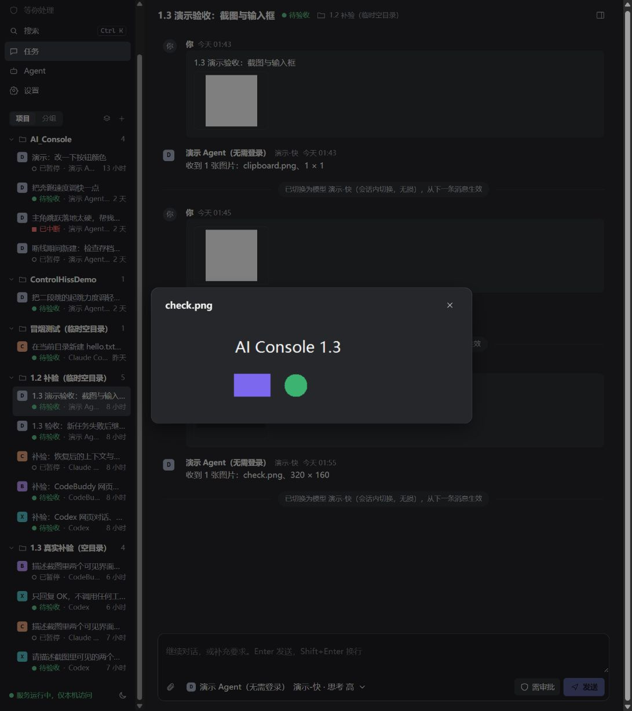

没有新建任务、上传或发送消息，没有触发第三方登录；本轮真实模型消息、用户服务请求和相应费用均为 0，未使用聊天里的 Key。历史真实尝试仍为 8 次、金额未验证。下一次真实补验仍需正式界面 / 预算具备后单列上游请求与费用上限，再请用户开始。

设计 v0.4.13 / phase-1 9.23 已同步，无新依赖、UI 源码或数据库迁移，schema 保持 v10。旧 profiles 未清理，原生配置 / 凭据未读取或更改。ISSUE-0029 / 0030 继续 investigating；0038 / 0039 最终检查及修复哈希具备后再关闭。继续原 main，不新建分支、不推送。

### 冻结附件代码后的最终检查

| 命令 | 实际结果 |
|---|---|
| `npm run typecheck` | 四个工作区通过 |
| `npm test` | 572 通过、3 项真实冒烟跳过；adapters 72 / gateway 361 / protocol 42 / web 97 |
| `npm run build` | 通过；主 JS 715.66 kB / gzip 218.14 kB，既有 500 kB 分块提示保留 |

最终全量于本机 09:40 完成，较前轮新增 27 项默认测试（Gateway 24、protocol 3）。源码 / 测试自最终运行开始后未再改动，只追加配套记录；19 项附件定向结果和网页操作范围见上。不增加真实服务、费用或完整运行时结论。提交前编码 / 链接 / 历史 / 暂存范围与实际哈希随后补充。

## 附件受限读取提交溯源（2026-11-08）

- 代码与配套设计提交 `f1b4b13`，范围 `7ad93b1..f1b4b13`，对应最终类型检查、572 项默认测试通过 / 3 项真实冒烟跳过、构建和本节实际浏览器图片预览；不重复宣称测试。提交前 24 个文件编码 / 换行、101 个本地文档链接、追加记录历史前缀、常见密钥格式及工作区 / 暂存空白检查通过，无 `.aic-data/` 或依赖入库。
- ISSUE-0038 / 0039 附实际哈希按本节范围关闭，ISSUE-0029 / 0030 保持 investigating；正式任务 / 审批恢复、窗口与费用预算仍待完成，runtime 仍 false，整体第 1.3 步仍部分通过。没有新真实调用、原生认证 / 设置操作或旧配置清理。继续原 main，无新分支、未推送；本节仅追加溯源。

## 独立输入预检内部验收（2026-11-08）

仅验证内部 driver 输入预检与回环计数，不是正式独立任务、GUI 或真实服务验收。代码 / 设计契约见 design v0.4.14、phase-1 9.24；新增策略仅内部可选，旧调用不强制改变。independent.runtime 仍 false。

### 完成标准与实际结果

- [x] 最大输入、总窗口、本地上限、安全预留和实际输出上限分开检查；边界相等允许，冲突 / 过期能力失效，未知模型规格不回填默认值。全无上限时不把正文发送到计数 / 生成接口。
- [x] 三协议本地估算最终完整输入，含系统规则、摘要、工具 schema、文本附件与私有续传。图片编码不按文本 token 计算，重复图片按每次出现累计；图片成本未知停止，明确人工值单列。
- [x] 最终请求指纹绑定实际输出预留；报告副本不能放行超量输入，同步宿主记录抛错时不生成。报告没有服务 Key、正文、附件编码或签名；不将估算写入实际 usage。
- [x] Responses / Messages 显式回环计数保留原服务基础路径、模型 ID、认证 / 版本、工具与思考输入，图片 / 文本 / 摘要原样计数，不带 stream / 生成上限。Chat 不改用 Responses。
- [x] 真实零、缺失 / 小数 / 字符串 / 负数 / 坏 object、HTTP 302 / 401 / 429 / 500；计数失败不重试、跟随、降级或生成，错误正文不外露。
- [x] 计数连接取消后关闭且调用资格释放；计数与生成合用总连接时限；计数后修订配置不生成。上下文拒绝在持久循环记 context_limit，不调用工具或反复请求。
- [x] 两协议各自执行“计数 → 假模型工具调用 → 工具拒绝落盘 → 再计数 → 假模型完成”，保留原始签名 / 加密推理与拒绝理由，每轮报告指纹改变。工具 driver 在此返回拒绝，没有真实项目文件副作用。
- [x] 有界 JSON 与普通合法编码一致，重复大图请求在计数前按 24 MiB 停止，不先展开全部重复内容。大图仅文件头夹具，只测体积，不冒充完整图像解码。
- [ ] 本地 token 估算的普适数学上界、供应商实际计数误差 / 视觉预处理 / 缓存计费：未验证。本地策略与接口计数均不能作为最终账单。
- [ ] 正式任务持久策略 / 请求记账、预检 / 未知提示 GUI、货币预算、任务 / 审批恢复与真实补验：未完成 / 未验证。

### 实际命令与边界

新增 Gateway 37 项、protocol 3 项定向测试通过；与已有模型传输共 91 项 Gateway 回归通过。初版五项失败与修正范围见当日 devlog，未把失败写为通过或放宽校验。`npm run typecheck` 四工作区通过，`npm run build` 通过，主 JS 716.50 kB / gzip 218.31 kB，既有 500 kB 分块提示保留。最终冻结源码后的全量测试正在同一运行中，结果随后追加。

所有模型 / 计数网络均为本机受控 HTTP 假接口，没有请求外部目录、用户服务或真实 Agent，没有使用聊天中的 Key。新增真实模型消息、用户服务请求和相应费用为 0；历史真实尝试仍为 8 次、金额未验证。计数在正式产品中会额外发送正文 / 图片，只能显式选择；其是否免费与计数语义不能推广到兼容服务。本节不新增真实费用预算承诺。

无网页源码 / 公开路由 / 迁移 / 依赖变更，schema 仍 v10，本轮没有新增浏览器实操结论。第三方设置 / 凭据与旧 profiles 未读取或改动。继续原 main，不新建分支、不推送；ISSUE-0029 / 0030 保持 investigating，整体 1.3 仍部分通过。

### 冻结输入预检代码后的最终检查

| 命令 | 实际结果 |
|---|---|
| `npm run typecheck` | 四个工作区通过 |
| `npm test` | 612 通过、3 项真实冒烟跳过；adapters 72 / gateway 398 / protocol 45 / web 97 |
| `npm run build` | 通过；主 JS 716.50 kB / gzip 218.31 kB，既有 500 kB 分块提示保留 |

最终全量于本机 09:57 完成，较前轮新增 40 项默认测试（Gateway 37、protocol 3）；本次源码 / 测试从启动全量后未再改动，只写配套记录。没有新增真实服务或浏览器验证。提交前编码、链接、历史和暂存范围检查及实际哈希随后追加。

## 输入预检提交溯源（2026-11-08）

- 代码与配套设计提交 `58776cd`，范围 `fd80f15..58776cd`；对应本节实际 typecheck / test / build、612 通过 / 3 跳过，不重复宣称测试。提交前 13 个文件编码 / 换行、59 个本地文档链接、追加历史前缀、常见密钥格式及工作区 / 暂存空白检查通过，没有 `.aic-data/`、迁移或依赖入库。
- ISSUE-0029 / 0030 保持 investigating，正式策略保存与 GUI、持久请求 / 费用预算和任务审批恢复仍待完成，runtime 仍 false。本节没有新增真实服务、费用、浏览器或原生设置结论。继续原 main，未推送，整体第 1.3 步仍部分通过。

## 逐请求预算与人工金额预留内部接缝（2026-11-08）

| 项 | 值 |
|---|---|
| 基线 | 4ee414a，继续原 main，不新增分支 / 不推送 |
| 验收人 | Codex |
| 结论 | 内部定向通过；第 1.3 步整体仍部分通过 |
| 对照 | phase-1 9.16 / 9.24 / 9.25，design v0.4.15 |

### 实际完成与验证

- protocol 追加预算 / 尝试 / 结算等类型、可选 driver accounting 和 request_budget 停止原因；数据库 v11 增量新增预算 / 账本表。旧迁移内容未改，只为已有降级测试夹具删除新增表并核对最新版本。
- Gateway 新增 31 项定向通过；与此前模型 / 预检合跑最初 117 项通过，追加事务 / 并发 / 半流等五项后仅重跑本新增文件 31 项通过。protocol 新增 2 项通过。测试都使用临时 SQLite、本机回环假接口或受控夹具子进程，无真实 Agent / 外网 / 费用。
- 三协议收到请求时已能读到 reserved，最终正文 SHA-256 对应账本；计数与生成分别占次数 / 金额，计数真实零与 usage 未知分别保留。计数后额度不足、未知单次计数预留和记录失败都阻止后续生成。
- HTTP 401 / 429 / 500、取消、超时、半条 SSE、重复请求保留已占额度；账本没有上游正文或假密钥。usage 不冒充费用，actualCostMicros 仍 null。
- 双连接共享预算、外层事务回滚与提交屏障、两个驱动争用唯一次数、终态幂等 / 迟到结果拒绝通过；工具循环在下一次模型请求被预算阻止时保存会话及 request_budget，不重复执行工具。
- 夹具子进程预留落盘后被结束，重开 SQLite 仍占额度，显式恢复仅标 interrupted、不重发；v10 升至 v11 保留草稿 / 会话，重复打开不重复迁移。此夹具不调用任何网络，不能证明真实服务在断网 / 崩溃时的收费结果。

### 未通过 / 未验证

| 项 | 边界与跟踪 |
|---|---|
| 正式任务与预算 GUI | 未接入；所有正式任务仍须强制提供 accounting 与预检策略。旧内部调用可不传，不宣称全路径保护，ISSUE-0029 |
| 追加额度 / 换绑定 | 未实现显式用户流程；不能删除重建预算冒充保留历史，ISSUE-0029 |
| 实际费用与金额上限 | 未接供应商账单和价格；人工预留只是本地停止策略，无法保证供应商实际收费不超过填写金额 |
| 网页审批 / 停止 / 恢复 | 未验证；本段未改 UI、未新增浏览器操作或证据，runtime 仍 false |
| 真实服务与旧配置 | 未验证 / 未清理；真实调用须先另列请求和费用预算并获同意，第三方设置与凭据未操作，ISSUE-0028 / 0029 |

首次定向因测试错误导入不存在模块而未收集，修正为现有 commands 导出后通过；未写为产品通过结果。最终冻结后的 typecheck / test / build 与提交溯源随后追加。

### 最终冻结检查（2026-11-08 10:17）

| 命令 | 实际结果 |
|---|---|
| npm run typecheck | 四个工作区通过 |
| npm test | 645 通过、3 项真实冒烟跳过；adapters 72 / gateway 429 / protocol 47 / web 97 |
| npm run build | 通过；主 JS 717.81 kB / gzip 218.68 kB，既有 500 kB 分块提示保留 |

最终完整测试于本机 10:17:54 完成，较基线新增 33 项（Gateway 31 / protocol 2）。首次完整执行覆盖新增用例 26 项时通过 640 项，因最后补充五项而重跑全量；最终启动后未再改源码 / 测试，只追加记录。没有新增浏览器、真实服务、原生设置或费用结论；本段提交哈希随后补充。

## 逐请求预算提交溯源（2026-11-08）

- 代码与配套设计提交 5838982，范围 4ee414a..5838982；对应最终 645 通过 / 3 跳过、类型检查和构建，不重复宣称运行验证。提交前 21 个文件编码 / 换行、60 个本地文档链接、追加历史前缀、常见密钥格式和工作区 / 暂存空白检查通过；无 .aic-data/、依赖或 UI 源码入库。
- 本节仅内部请求预算 / 记账接缝，正式任务、策略 / 预算与审批恢复 GUI、显式补额度 / 换绑定及真实服务仍未完成；runtime false，ISSUE-0029 / 0030 保持 investigating。继续原 main、未推送，无新增真实调用、费用或第三方设置操作，第 1.3 步整体仍部分通过。

## 正式独立任务、网页与恢复补验（2026-11-08）

| 项 | 值 |
|---|---|
| 基线 | 842253e，继续原 main，不新建分支、不推送 |
| 验收人 | Codex |
| 对照 | phase-1 9.16～9.26；design v0.4.16；ui-design v0.3.6 |
| 结论 | 本机闭环通过；第 1.3 步整体仍部分通过，真实服务未验证 |

### 完成标准与自动验证

- [x] 正式独立任务自有 API / 模型 / 参数 / 输入预检 / 回合上限与持久请求预算，不替换第三方 Agent 认证。
- [x] 配置与预算可在界面明确修改，保留原文、历史请求原绑定与已占额度；数据库 v12 从 v11 增量升级。
- [x] 私有详情、逐次审批、拒绝理由、只读限制、停止与中断核对接入正式任务。
- [x] 原始记录分页、人工总结完整回合边界与尾摘要检查；原文保留、不自动请求总结模型。
- [ ] 用户真实 API / 视觉 / 供应商账单与完整真实补验：未验证，须按下节预算确认后开始。

正式运行时新增 12 项离线用例，覆盖真实上传身份与图片 false 提前拒绝 / true 编码、正式 REST 鉴权、文件批准与事件不含正文、拒绝 / 迟到批准、实际长命令停止、显式换绑定保留历史 / 额度、未知上下文零请求、启动恢复零重发、只读、人工总结边界、v11 升级和坏流片段不提交。另补账本调整、会话重绑定、提交后观察、旧协议兼容与网页完整正文 / 配置推导 / API 客户端回归。全部使用回环 HTTP、临时 SQLite、合成附件和受控进程，没有启动真实 Agent 或联网计费。

首次全量因旧 Agent 列表断言未包含新独立项失败，修正夹具后 664 项通过；再加正式附件用例后 665 项通过。浏览器发现 ISSUE-0041 后补会话配置回归并重新冻结，最终命令结果随后追加；前述中间结果不冒充最终版本结果。

### 实际浏览器操作

使用 .claude/launch.json 的 app 配置在 17890 启动开发预览；服务只指向本机模拟 HTTP，无认证假 Key / 无真实模型。选择已有临时补验项目，在 Agent 页新增本机服务和两模型，能力为人工夹具声明。

1. 新建独立任务，查看并应用策略 / 预算后发送。夹具首次错误地把数组正文转换为字符串，只返回普通固定回复；修正开发夹具后重试，不宣称首次已写文件。
2. 请求写文件：允许按钮在读取详情前禁用；读取修改前后文后允许，实际 browser-proof.txt 存在且内容匹配。请求另一文件，直接拒绝并填写理由，browser-rejected.txt 不存在。原始工具结果保留拒绝理由。
3. 命令审批展示真实程序和参数；短 Node 夹具输出与退出码 0 在原始记录中可见。长命令实际启动后点击停止，任务暂停、进程表为空；下一轮可继续。
4. 空闲配置换到第二模型，将任务累计上限从 10 提到 20，保留 8 次已占额度；下一消息由 browser-two 夹具响应。分页原始记录、人工总结到第 19 条，保存后可展开查看来源摘要与总结，原始记录保留。
5. 模拟 HTTP 等待中强制重启开发 Gateway。界面出现需要核对 / 结果未定；核对前发送被拒且输入保留。明确确认后只将记录标为中断，已占次数不退，没有自动请求；随后继续消息完成。
6. 375×812 实测发现长配置按钮竖排，缩短标签、设置不换行并让工具栏换行后复看；375×812、812×375 无页面横向溢出，主要控件 44px。日 / 夜间配置表单可读；0 次请求显示字段错误且禁用应用，Escape 关闭后焦点返回。最终恢复默认视口和原夜间主题。
7. 手动将第二模型图片能力设 false、第一模型 true，上传自制 1px PNG。图片警告使用可读名称，“换成第一模型”预填独立配置并保留预算供确认。发现旧会话覆盖新配置（ISSUE-0041），修复后再次应用，警告立即消失，未发文字 / 附件保留，点击发送完成；累计 12/20 次。

本机任务最终共 9 条实际发送的用户消息、12 次生成 POST（含工具续传和一次重启时未定请求）。重启前受阻发送、图片警告受阻发送没有新增 POST。夹具进程曾修正并重启，单独计数文件重置过，最终数量以持久请求账本为准。上述图片只有固定回复，未验证视觉识别。

### 未验证与证据限制

| 项 | 边界 / 问题单 |
|---|---|
| 用户真实服务、视觉和实际费用 | 未验证；ISSUE-0029，按下一节预算等待确认 |
| 旧测试 profiles 清理 | 未做；ISSUE-0028，不据此声称历史测试配置均已清除 |
| Pi SDK 兼容 | 未采用、未验收；ISSUE-0030，当前为自有实现 |
| 任意命令系统沙箱 / 断电原子性 / 所有文件系统 | 未提供或未验证；沿用既有明确边界 |
| 浏览器截图文件 | 截图已实际查看，但只有工具内联图、未落盘 assets；无文件链接，不补造证据 |
| 屏幕阅读器 / 操作系统大字体 / 原生减弱动态效果 | 未验证；新增界面没有动画 |
| 原生错误卡片触发的换模型按钮 | 未单独触发；已操作图片推荐按钮与独立配置，共用入口不扩大成该按钮实测 |

### 待确认的真实补验预算（尚未开始）

仅测试 AI Console 独立 Agent；使用独立临时目录、固定中文提示、自制小 PNG 与临时文本。不会发送本仓库源码、用户业务资料或第三方 Agent 配置。Key 由用户直接填入工作台自有服务表单，不复用聊天内容，不改第三方设置。

| 项 | 预计与上限 |
|---|---|
| 接口 | 用户提供的 https://open.bigmodel.cn/api/v1，明确选 Responses；不自动退回 Chat / Messages 或换服务 |
| 模型 | glm-5.3 文本 / 工具；glm-5.3-flash 合成图片，是否账号实际可用以响应为准 |
| 用户消息 | 最多 6 条；分别核对规则 / 上下文、文件放行、文件拒绝、换模型 / 强度、图片和取消 / 继续 |
| 生成请求 | 最多 12 次 POST，工具续传、失败、取消都占；不自动重试，不额外调用总结或 token 计数 |
| 目录读取 | 最多 2 次模型目录 GET；不访问外部公共能力目录 |
| 输入 / 输出 | 每次本地估算输入上限 16000、安全余量 1024、输出预留 2048；字节估算不是 tokenizer 或收费保证 |
| 参数 | GLM-5.3 如官方能力证据适用则 low；未知参数不发送，不猜测 Flash 强度 |
| 假设估算 | 按全部 12 次均为 GLM-5.3、每次 16000 输入 / 2048 输出、8 / 28 元每百万 token，约 2.23 元；不当作实际费用 |
| 建议本地人工预留 | CNY 5 元、每次生成预留 0.4 元、最多 12 次，计数预留未知且不调用计数接口 |
| 实际费用 | 仍未知；人工预留与次数上限无法保证供应商账单不超过 5 元，不猜测取消免费 |
| 停止条件 | 到请求上限、失败、协议 / 能力不适配、认证失败或使用量不明即停下核对，不换接口兜底 |

预算来源核对于 2026-11-08：[智谱官方价格](https://docs.bigmodel.cn/cn/guide/start/pricing)、[GLM-5.3 模型与接口](https://docs.bigmodel.cn/cn/guide/models/text/glm-5.3)、[账号与 Key 类型](https://docs.bigmodel.cn/cn/guide/start/quick-start)。官方当时列 GLM-5.3 为纯文本、1M 上下文、low / high / max 思考；GLM-5.3-Flash 价格页列图片输入。目录或官方声明只是来源，不是本次实测。账号 / 订阅 Key 不必然可通用；请求失败即停止。待用户确认上述范围并在界面完成自有 Key 填写后，才开始真实调用。

### 最终冻结检查（2026-11-08 11:25）

| 命令 | 实际结果 |
|---|---|
| npm run typecheck | 四个工作区通过 |
| npm test | 666 通过、3 项真实冒烟跳过；adapters 72 / gateway 444 / protocol 50 / web 100 |
| npm run build | 通过；主 JS 743.32 kB / gzip 226.61 kB，既有 500 kB 分块提示保留 |

最终完整测试于 11:25:46 完成，较基线增加 21 项默认测试。冻结后未再改源码 / 测试，只补记录及换行；实际浏览器图片发送和账本复核另如上。持久库核对 11 次 succeeded、1 次 interrupted、9 条 message.user，进程表为空；批准文件内容匹配、拒绝文件不存在。没有新增真实模型请求或第三方设置操作。修复提交与 ISSUE-0040 / 0041 的关闭哈希在提交后追加；ISSUE-0028 / 0029 / 0030 保持原状态。

## 正式独立任务提交溯源（2026-11-08）

- 代码与直接配套文档提交 7ffc0a5，范围 842253e..7ffc0a5；对应上述最终 666 通过 / 3 跳过、typecheck / build 和本机浏览器闭环，不重复宣称验证。提交前 54 个文件 UTF-8 无 BOM / LF、109 个本地文档链接、追加历史前缀、常见密钥格式、工作区 / 暂存空白检查通过；没有 .aic-data/、密钥、构建产物或新依赖入库。
- ISSUE-0040 / 0041 按本单范围附修复哈希关闭，ISSUE-0028 / 0029 / 0030 保持原状态。继续原 main，无新分支、未推送；真实补验预算尚待用户确认，没有据此新增真实调用或更改第三方设置，第 1.3 步整体仍部分通过。

## 独立 Agent 真实补验授权与准备（2026-11-08）

- 用户明确同意上一节预算：“同意，按此范围开始”。上限保持 6 条用户消息、12 次生成 POST、2 次模型目录 GET；CNY 5 元本地人工预留、每次 0.4 元，供应商实际费用仍未知。尚未发起本轮真实请求。
- 已在界面预填“智谱真实补验”、Responses、用户提供的基础地址，Key 留空，交由用户直接输入并保存。没有读取旧聊天 Key、Agent 凭据或本机认证。
- 新建只含固定中文 AGENTS.md 的独立临时目录，另生成 256×256 四色块 PNG，作为无个人资料的图片样本。尚未由模型处理，准备工作不计作真实对话、视觉或工具成功。

## 独立 Agent 智谱真实补验：文本通过、工具失败后停止（2026-11-08）

| 项 | 实际情况 |
|---|---|
| 基线 / 分支 | 335a554；继续原 main，无新分支、未推送 |
| 自有服务 | 用户回复“已保存”后，在工作台确认“智谱真实补验”已存在、密钥已由产品保存；未读取或复用聊天 Key、第三方凭据 |
| 协议 / 模型 | https://open.bigmodel.cn/api/v1；Responses；实际只请求 glm-5.3、low、流式 |
| 项目 / 任务 | 新建合成规则临时项目“独立 Agent 真实补验”；任务 t_LTcidWqzc6op |
| 输入与回合 | 本地字节估算、人工输入上限 16000、安全余量 1024、单图人工估算 1024；每回合 3 次模型 / 3 次工具、2048 输出、300000 毫秒、1 MiB 正文 |
| 累计预算 | 12 次请求；CNY 5000000 微单位总人工预留、每次生成 400000；不启用计数接口 |
| 实际累计 | 2 条用户消息、3 次生成 POST、0 次模型目录 GET；未上传图片，未调用计数 / 总结接口 |
| 当前额度 | 已占 3/12 次、1200000/5000000 微单位；9 次 / 3800000 微单位剩余只是本地预留，不是可用供应商余额 |
| 结论 | 部分通过；文本成功，工具兼容失败（ISSUE-0042），已停止新增真实调用；不能据此验收整个 1.3 |

### 配置与能力来源

通过 Agent 页手动添加 glm-5.3 / glm-5.3-flash 两模型；按当天官方文档填写 1M 窗口为人工值 1000000、工具 / 流式 / 思考支持、不能关闭思考及 low / high / max，文本模型图片 false、Flash 图片 true。最大输入 / 输出和流式 usage 等未明确数值继续未知，不探测极限。Flash 文档声明文本参数与 GLM-5.3 一致，思考列表据此填写；未真实请求，不将其当作 Flash Responses 兼容性证明。

来源：[GLM-5.3](https://docs.bigmodel.cn/cn/guide/models/text/glm-5.3)、[GLM-5.3-Flash](https://docs.bigmodel.cn/cn/guide/models/vlm/glm-5.3-flash)。人工来源不冒充在线目录或运行实测。为遵守最多 2 次目录 GET，本轮没有操作“获取最新预览”；当前发现链可能分页，未为本轮单独设置 2 页上限。目录自动识别沿用既有离线验证，本轮真实获取未验证。

临时目录最初的名称在 Temp 第一页之外，改名后从文件夹选择器选中并通过界面添加项目；选择器实际支持“显示更多”，未将分页误记为缺陷。目录只含本次合成规则；没有把仓库源码或业务资料发给模型。所有配置与消息通过产品界面操作。

### 实际消息与请求

1. 11:40 发送“记住暗号‘星港42’并根据已加载规则确认范围，不调用工具”。模型正确复述仅本目录、禁止目录外 / 网络 / 凭据 / 命令、修改须审批。请求 1 成功，返回输入 1209、输出 53、缓存读取 0 token；工具 0 次。
2. 11:41 请求通过 write_file 创建 real-proof.txt，固定正文“独立补验通过”并等待审批。请求 2 的完整助手记录为 write_file / arguments {}，输入 1309、输出 6、缓存读取 1152 token；宿主返回严格参数校验错误，未执行，没有生成待批准卡片。
3. 同一用户回合中，循环将工具错误结果返回模型，产生请求 3；不属于新用户消息，也不是免费传输重试。界面收到“参数缺失导致刚才未成功……”片段后，以 protocol / model_error 失败停止；没有提交该次正式助手记录，usage 未知。没有切换协议、服务、模型或自动重发失败请求。

用户短暂暂停后又恢复任务状态。尝试停止当前回合时，回合已先行失败，停止按钮已经消失；不将其计作真实连接取消验证。随后仅查看原始记录与已有请求状态，没有发送第 3 条用户消息。只读持久库核对：2 succeeded / 1 failed，无 reserved；2 条 message.user；本任务进程登记为空；real-proof.txt 不存在。已按原预算“失败 / 用量不明即停下核对”停止后续付费操作。

实际供应商金额仍未知。前两次 usage 不能代表第三次费用、缓存优惠或整轮账单；1.2 元是人工预留，不能写成“花费 1.2 元”。图片、文件批准 / 拒绝、换模型与思考强度后的上下文、重启恢复、连接取消和继续均为本轮未验证，不能沿用本机夹具结果充作真实通过。

### 失败现场的显示修复

真实失败时任务已失败，但未确认的最后片段仍显示“正在处理”并持续计时（ISSUE-0043）。根因为时间线未随任务结束状态关闭片段。修正为结束进度、保留可见片段和失败提示，不补正式助手消息；忙状态与后续新回合仍正常进行。设计同步 ui-design v0.3.7、phase-1 9.26。

两项新增离线回归覆盖六种结束状态、三种忙状态和失败后新回合，定向 26 项通过。浏览器重新载入同一失败任务，显示固定“用时 4 秒”，错误与片段保留，账本仍为 3/12；没有新模型请求。真实失败现场截图已在工具中查看，未落盘 assets，不提供虚构图片链接。完整检查与提交溯源随后追加。

### 显示修复的完整检查

| 命令 | 实际结果 |
|---|---|
| npm run typecheck | 四个工作区通过 |
| npm test | 668 通过、3 项真实冒烟跳过；adapters 72 / gateway 444 / protocol 50 / web 102 |
| npm run build | 通过；主 JS 743.45 kB / gzip 226.65 kB，既有 500 kB 分块提示保留 |

完整测试于本机 11:48:55 结束；Gateway 444 项耗时约 263 秒，全部离线。除两项网页回归外未改传输 / 工具执行源码。构建后未再改代码，只追加文档与操作工作台配置。提交前编码、链接、历史追加、密钥模式与暂存检查及提交哈希随后溯源。

### 待确认：在原总预算内的只读诊断

已通过界面将同一任务准备为“只读”、完整响应、每回合最多 2 次模型 / 1 次工具，将任务请求累计上限暂收紧到 5（已有 3 次，因此最多再 2 次），保留 CNY 5 元及每次 0.4 元人工预留、已占记录与原文。API / Responses / glm-5.3 / low 均保持原绑定选择，未切其他接口；累计上限收紧不会清空历史。输入框已填未发送草稿：只调用一次 read_rules / {target:null} 读取本次合成规则，随后一句话确认，禁止继续上轮写入、命令、其他工具或重试。

建议范围为 1 条用户消息、最多 2 次生成 POST、0 次目录 GET，额外人工预留最多 0.8 元，仍属于原授权的 6 条 / 12 次 / 5 元范围；按原输入 / 输出和价格假设估算约 0.37 元，实际费用未知。目的仅为区分简单只读工具与原写入联合 schema、完整响应与原流式的兼容表现；不能保证足以查明根因。失败、未知用量或达到上限继续停止；不绕过协议校验。

由于原真实补验预算明确约定失败后停下核对，这条新诊断草稿尚未发送，等待用户确认继续。此处只准备配置，不宣称新增诊断结果或请求费用。

## 智谱补验与片段显示修复提交溯源（2026-11-08）

- 显示修复及真实补验配套记录提交 18cbbe5，范围 335a554..18cbbe5；对应上述 668 通过 / 3 跳过、typecheck / build 和已有失败现场的浏览器复看。提交前 11 个文件 UTF-8 无 BOM / LF、98 个本地文档链接、历史追加、常见密钥格式及工作区 / 暂存空白检查通过；无密钥、.aic-data/、新依赖或构建产物入库。
- ISSUE-0043 附修复哈希关闭，ISSUE-0042 / 0029 保持 investigating。准备诊断后只读核对仍为 3 次请求、1200000 微单位已占，任务权限 readonly、stream false、累计上限 5、每回合 2 次模型 / 1 次工具；没有发送诊断草稿。继续原 main，未推送，第 1.3 步整体仍部分通过。

## 本次 1.3 进度收口与交接（2026-11-08）

用户决定：补齐本次 1.3 的笔记、内容和文档，然后提交推送。本次授权覆盖此前“不推送”的限制；继续原 main，不新建分支、不改写历史。真实补验保持停止，本次仅整理文档、核查提交与推送，不发送诊断草稿、不增加真实调用。

### 当前结论

第 1.3 步为**部分通过**。稳定性、选择器、附件、第三方配置边界与独立 Agent 正式任务已实现，最近源码 18cbbe5 的 typecheck / build 通过、默认测试 668 通过 / 3 项真实冒烟跳过。独立 Agent 的真实文本链路通过，工具链路未通过；不将本机模拟结果扩大成真实工具、视觉或费用验收。

| 范围 | 已完成及实际证据 | 剩余边界 |
|---|---|---|
| A 实时事件 | 双调度与后台合并回归；真实 CodeBuddy 内嵌预览隐藏 655991ms 后审批和待办可见 | 原生窗口完全遮挡、隐藏期间卡片绘制、系统通知未验证；ISSUE-0014 |
| B Gateway 退出 | 异常日志、服务停止提示与已有记录恢复；演示 down 提示曾实测 1564ms | 原始意外退出根因未复现；物理控制台关闭未验证；ISSUE-0015 |
| C / D / E / H | 无回应提示 / 停止、额度文案、工具标题更新、配对前鉴权修复及对应离线回归 | 真实 Claude 工具标题 / 额度重验仍未做；干净 Windows 用户或沙盒启动未完成；ISSUE-0004 |
| F 统一选择器 | 新建 / 对话共用；演示及 Codex / CodeBuddy 的换模型 / 强度与上下文已实操 | Claude 额度限制；系统交互未覆盖部分见 ISSUE-0023；换 Agent 交接仍属 1.6 |
| G 附件 | 上传、类型 / 容量 / 归属检查、草稿、预览 / 下载、图片能力拦截与推荐；Codex / CodeBuddy 真实看图通过 | Claude 带图失败；系统文件拖入未实操；独立真实视觉未验证 |
| 第三方配置边界 | 沿用软件自身 API、登录与模型；取消工作台代登录 / 替换 API，历史配置只读停用 | 三项旧测试配置及其工作台自有加密密钥仍保留，不因停用声称清理完成；ISSUE-0028 |
| 独立 Agent 调研 | CCSwitch、模型能力来源与执行器调研四篇已入库；选择自有循环与 HTTP driver，未引入 Pi 运行依赖 | Pi 自身兼容问题未修复，ISSUE-0030 保留为未来采用门槛，不把它写成当前运行依赖 |
| 多服务 / 模型 / 能力 | 自有三协议配置、能力逐字段来源 / 未知 / 冲突、发现预览与人工修订；网页本机实操通过 | 本轮真实目录读取 0 次；人工声明不能证明供应商实际兼容或上下文极限 |
| 正式独立任务 | 自有持久循环、项目规则 / 文件工具 / 命令、附件、预检、逐请求预算、私有审批、原始记录 / 人工总结、停止与明确恢复；正式本机夹具闭环通过 | 命令使用本机权限，不是系统文件 / 网络沙箱；全部文件系统与断电原子性未验证 |
| 独立真实补验 | 2 条消息、3 次生成：文本成功；空工具参数被拒，后续 protocol 失败后停止。无目标文件，未绕过审批 | ISSUE-0042 investigating；实际费用未知，1.2 元仅为人工预留；真实工具批准 / 拒绝、换模型、图片、恢复与取消未验证 |
| 失败片段显示 | 18cbbe5 修复任务已失败仍显示正在处理；两项新增回归和原失败现场重载通过 | ISSUE-0043 按此范围 fixed；不据此关闭协议失败或补造正式助手记录 |

### 提交与文档对应

| 提交 | 内容与记录 |
|---|---|
| 7d06af2 / e6b6ac9 / 1d22424 / 726e7ef | 原 1.3 协议 → 适配器 → Gateway → 网页 / 演示验收 |
| e2e921c / 26210b4 | 真实补验发现的模型目录 / API 认证问题及启动器锁文件安装修正；旧认证方案随后按用户边界停止 |
| 0abbda6 | 第三方自身配置与认证归属整改；旧测试配置停用与防误用 |
| 7906c55 / f6363e9 | 独立 Agent 专项调研与模型 / 能力 / 执行器规格 |
| 07edd5c / 169d676 / 63d84bc | 自有目录、能力来源、配置网页、发现预览与导入 |
| 28b5a77 / f31d466 / 5cf6c10 / fe90a87 / f1b4b13 | 自有持久循环、文本工具与并发保护、三协议传输、受限附件读取 |
| 58776cd / 5838982 / 7ffc0a5 | 输入预检、逐请求预算与正式任务 / 网页 / 审批恢复闭环 |
| 18cbbe5 | 本轮真实文本通过、工具失败记录与网页失败进度修复 |

架构当前 v0.4.16、界面 v0.3.7，最新契约为 phase-1 9.15～9.26；本次同步根 README、文档 / 验收目录和计划阶段表，移除其中“独立任务尚未实现”“仍等待首次真实补验”等过时摘要。验收与开发笔记按时间追加，保留各次失败、授权变更和未验证历史。修复哈希在问题单与本记录双向关联。

### 下次从哪里继续

1. 先处理 ISSUE-0042 的兼容证据。写入工具 schema 的顶层 oneOf 是疑点，第三次终态失败细节未查明，不按猜测放宽协议或审批。只读诊断草稿仍未发送；若继续真实诊断，先确认本记录上一节的 1 条消息 / 最多 2 次生成 / 0 次目录 GET 范围，保留已占额度，不重置预算。
2. 工具协议问题解决后，再按明确预算补真实文件批准 / 拒绝、Flash 图片、换模型 / 强度、恢复与取消，逐项更新结果；没有实际账单时继续写未知。
3. 单独确定 ISSUE-0028 的工作台旧测试配置清理与历史任务恢复策略，不读取或更改任何第三方凭据。
4. 继续保留 ISSUE-0004、0012、0014、0015、0023 等未完成或未复现的原始边界，不将当前部分通过改成全部通过。1.4 及后续步骤未因本次文档收口而启动。

### 本次文档核对与发布边界

本次没有修改源码、依赖、数据库或网页；沿用 18cbbe5 已实际完成的三项完整检查，不把它们写成本次重跑。已 fetch origin/main：远端基线 0e1a3b2，本地无分叉、已有 42 个待推送提交。已检查该待推送历史中的 593 个 blob（563 个文本）：常见密钥 / 私钥格式未检出，没有 .aic-data/、依赖目录、构建产物或凭据文件进入推送范围；155 个本地文档链接存在。另查看授权码 / API / 原生设置三张历史截图，未见明文 Key 或授权码；最新独立真实现场没有落盘截图，保留证据缺口。

补齐记录后将按普通快进推送至 origin/main，不使用强推、不跳过 hooks。此段为提交前核对；本次文档提交哈希和实际推送结果以交付回执为准，不能把“准备推送”当成已成功推送。

## DeepSeek Harness 框架参考核查（2026-11-08）

用户补充独立 Agent 可参考 DeepSeek Harness。已在 92fec29 基线查阅官方仓库与文档，固定源码 fcc0ad462172522aaf5c93a7b2e01f6b9f0b0159，核对工具 schema 导出、工具执行流水线、循环失败 / 取消结算、请求配置及包清单 / MIT 许可证。结果见 [专题调研](../research/deepseek-harness.md)，同步架构 v0.4.17 / 6.4.6、phase-1 9.27、文档目录和相关问题时间线。

核查结论：可参考服务分层、请求快照、最终拒绝、失败尝试与上下文来源；正式任务保持自有宿主。候选的 schema 结构是 ISSUE-0042 离线对照方向，尚无修复或真实 A/B 结果。能力未知、固定服务认证、显式预算、图片拦截、正式正文确认与恢复不重放继续按现有契约执行。

本轮文档编码 / 本地链接 / 记录仅追加 / 常见密钥格式及 git 空白检查通过。源码、协议、依赖、数据库和网页均未修改，未重跑完整 typecheck / test / build；最近源码检查仍为 18cbbe5 的 668 通过 / 3 跳过和 typecheck / build 通过，不能当作候选框架测试。

未安装或执行候选，不读取第三方凭据，不发送真实请求或诊断草稿，无新增费用。**未验证**：候选的本机运行、依赖发行内容、性能、Windows 隔离和修复智谱兼容的效果。1.3 仍部分通过，ISSUE-0028 / 0029 / 0042 保持原状态；新增参考机制尚未实现。

## 文件工具声明离线整改与界面补验（2026-11-08）

本轮接续 DeepSeek Harness 参考路线，未安装候选运行包。协议增加可选文件工具版本和两组共享参数规格；新任务默认 separate_v2，创建 / 替换工具均有完整根属性。历史缺省保持 combined_v1，旧客户端省略版本更新时不降级；已有回合 / 请求不能换版本，原上下文和预算保持不变。设计 v0.4.18 / 6.4.7、phase-1 9.28 同步此选择。

### 实际自动检查

- npm run typecheck：四工作区通过；npm run build：通过，仍有既有单包大于 500 kB 提示。
- npm test：adapters 72 / gateway 454 / protocol 52 / web 102，合计 **680 通过、3 项真实冒烟默认跳过**，退出码 0。只使用本机假接口 / 临时文件，无真实 Agent 生成或外部模型调用。
- 新增 12 项：三协议捕获最终工具 JSON，历史定义、可选版本与严格分开参数，正式任务默认 / 历史配置 / 旧客户端保留，创建→读取→摘要替换→模型继续，空参数 / 额外字段 / 未声明旧工具 / 只读拦截，执行后版本切换冲突无状态变化。
- 首轮新增测试有两项断言错误：误把未声明工具当作可返回给模型的普通工具错误，且只读测试使用不存在的方法；随后又更正账本断言的字段结构。均修正后完成上述全量通过，不把初轮失败隐去。
- 从 2c87ccb 的原内联定义实际导出 JSON，对比迁移后的 combined_v1：逐字节一致，SHA-256 为 9dd1ec6ed43b327f49327cbe1daa7851916fb44e757abf7d35a5fb13b9ec6405。未改历史续传资料。

### 实际浏览器补验

按仓库 .claude/launch.json 的 app 参数启动 17890，在浏览器操作添加无认证本机服务、合成模型、人工工具 / 窗口能力、选择目录、新建独立任务。使用合成规则和本机回环 HTTP 夹具，不使用真实服务的 Key。

1. 首次误选工作台数据目录内的合成项目，文件宿主明确拒绝“不能把此目录用作独立文件工具的工作区”；夹具收到 0 次请求。保留这次失败，不视作有效工作区闭环。
2. 改在数据目录外的新合成目录操作，新任务选择该夹具、完整响应、每回合 2 次模型 / 1 次工具、任务最多 4 次请求、需审批。
3. 第一条消息产生 create_file / rejected.txt，未查看详情前“允许一次”禁用；查看前后文并填写理由拒绝，回合结束，实际文件不存在。
4. 第二条消息产生 create_file / approved.txt，查看正文后允许一次，实际文件内容为合成验收文本，回合结束。夹具实际捕获 4 次 POST，声明包含 create_file / replace_text，不含 write_file；界面显示累计 4/4 次、待核对 0、最近回合已完成。
5. 预览最初加载的是构建前网页，展开状态时旧严格校验器不认识新增可选字段；构建后刷新，匹配版本读取成功。上面界面最终结果及截图均来自刷新后的版本。

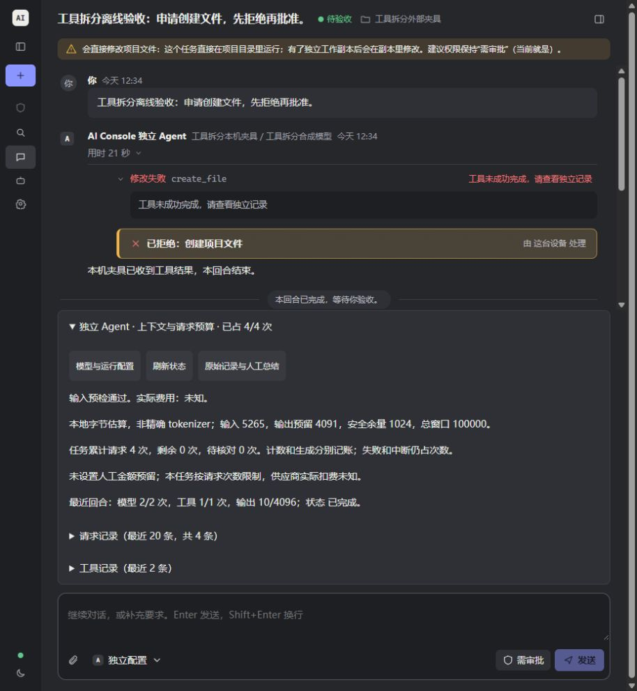

截图展示拒绝记录、累计 4/4 次与最近回合完成；批准结果另由实际界面状态、文件内容与夹具计数核对。未在浏览器重演 replace_text；该项仅由正式宿主离线自动测试覆盖。

### 复核、真实边界与遗留

已独立复核新增 DTO 的可选性、历史工具 JSON、严格参数到审批的路径、只读与声明集合、版本切换事务和事件无合成正文泄漏。另离线复现同服务 / 模型重新应用配置导致旧私有续传失效，新增 ISSUE-0044 单独处理，不归因于本次工具拆分。

本轮真实新增消息 / 生成 / 目录 GET 均为 0，原诊断草稿仍未发送；原真实账本仍为 2 条消息 / 3 次生成、1.2 元人工预留，实际账单未知。**未验证**：拆分工具在智谱 Responses 的真实兼容、原第三次协议失败的完整原因、真实文件批准 / 拒绝、Flash 图片与其余既有补验。ISSUE-0042 保持 investigating，1.3 保持部分通过；本机夹具不替代真实供应商验收。

本轮提交前编码 / 链接 / 记录仅追加 / 常见密钥格式及空白检查结果，以下一条提交核对回执为准。

提交前核对：本轮 17 个变更文件（含一张截图）UTF-8 无 BOM / LF、本地 116 个文档链接、指定历史记录仅追加、常见密钥格式与 git diff --check 均通过。截图已实际查看，内容为合成任务和本机预算，无凭据；未纳入本机数据、依赖或构建产物。

## 同配置续传身份修正复验（2026-11-08）

承接 5e67edd 新开的 ISSUE-0044，单独修正同服务 / 模型 / 修订重新应用任务配置时重写绑定时间的问题；对已存在的不同时间历史，专用续传只从当前输入去除，原文、私有资料、摘要和账本不变。同步 design v0.4.19 / 6.4.5、phase-1 9.29；未改界面、协议、数据库结构或依赖。

实际检查：针对性新增 4 项回归通过；完整 npm test 为 adapters 72 / gateway 458 / protocol 52 / web 102，**684 通过、3 项真实冒烟默认跳过**，退出码 0。npm run typecheck、npm run build 通过（保留既有构建体积提示）。正式任务通过两轮本机 HTTP 和补预算操作，实际第二请求携带原 reasoning_content，已有次数累计，原始记录逐项一致；时间不同历史去除专用资料，完整绑定相同则保留；修订变化仍拒绝旧快照。

初次针对性回归误从公开历史接口寻找私有字段；更正为内部持久存储断言后通过，没有为测试开放私有资料。一次性反例探针补齐请求 binding 后，实际装配 5e67edd 原 rebind / context 函数得到 createdAt 改变、专用续传保留、编码 request 拒绝；新行为时间不变、专用续传保留、编码通过。均使用内存数据库和合成文本、零网络，不能证明供应商兼容性。

预览已按 app 配置重启为本轮代码；浏览器将本次无认证夹具服务停用，夹具进程关闭，保留合成项目与任务记录。第三方配置与真实服务未修改，未发送旧只读诊断草稿或新增真实请求。独立复核确认完整旧快照 CAS / 可用性检查仍先于保留绑定分支，历史消息只生成输入副本，不回写原数据。ISSUE-0042 与整体 1.3 的真实遗留仍保持未通过 / 未验证边界。

### 下一轮真实工具补验提案（尚未授权、尚未执行）

原真实样本累计 2 条用户消息 / 3 次生成 POST / 0 次目录 GET，人工预留已占 1.2 元；旧任务的只读诊断草稿继续保留但不发送。本提案使用新任务的 separate_v2，原任务和账本不清空。

| 项 | 提案范围 |
|---|---|
| 服务 / 协议 / 模型 | 已保存的自有智谱服务，原地址 / Responses / glm-5.3 / low；完整响应，不改变第三方认证 |
| 内容 | 数据目录外新合成工作区；仅两份合成文件创建：首次查看详情后拒绝，第二次查看详情后允许一次；禁止命令、其他文件或目录外操作 |
| 新增上限 | 2 条用户消息、最多 4 次生成 POST、0 次模型目录 GET；每回合最多 2 次模型 / 1 次工具，输出合计 2048，本地人工输入上限 16000 |
| 全轮累计核对 | 原样本与本提案合计最多 4 条消息 / 7 次生成 / 0 次目录 GET，仍在最初 6 / 12 / 2 范围内；人工预留累计最多 2.8 元，原 5 元范围不增加 |
| 假设费用 | 按每次均 16000 输入 / 2048 输出、GLM-5.3 输入 8 / 输出 28 元每百万 token，4 次约 0.74 元；仅假设，不是实际账单 |
| 本地停止额度 | 新任务最多 4 次请求、每次预留 0.4 元、累计最多 1.6 元；是本地人工参数，不能保证供应商实际收费上限 |
| 停止与结果 | 网络 / 协议失败、未知用量或任何异常后不再发送下一条用户消息，不切服务兜底、不追加授权范围外请求；实际费用未知继续写未知 |

价格在本次提案前再次核对[智谱官方价格](https://docs.bigmodel.cn/cn/guide/start/pricing)，这里只读取公共文档，没有模型请求。预计传给该已选服务的内容仅为合成项目规则、测试文字、工具声明与对应工具结果。等待用户明确确认后，才准备并派发新真实任务；确认等待不是同意。Flash 图片、换模型 / 强度、取消和恢复不在本提案内，继续未验证。

提交前复核：13 个变更文件的编码、70 个本地文档链接、指定历史仅追加、常见密钥格式与 git 空白检查通过；续传修复未包含本机数据或构建产物。

提交关联：5e67edd 为文件工具拆分与历史版本；4b26f32 为同配置续传身份修复，ISSUE-0044 据此 fixed。用户已明确同意本节真实工具补验提案：新增最多 2 条消息 / 4 次生成 / 0 次目录 GET、人工预留最多 1.6 元；执行结果另行追加，不能将授权写成已执行。

## 已授权的 Responses 分开工具真实补验结果（2026-11-08）

执行基线 d7c961a（文件工具实现 5e67edd、续传身份修复 4b26f32）。用户对本记录上一提案明确回复“同意，按此范围继续”；本轮仅执行该范围，通过网页完成新项目、新任务、配置、派发、查看详情、拒绝与允许一次。未读取或更改第三方 Agent 配置、凭据，未读取工作台自有 Key 明文。

| 项 | 实际结果 |
|---|---|
| 任务 | t_c63yD7zGHhbV，独立工具真实补验 v2；数据目录外新建的合成工作区 |
| 服务 / 生成 | 原智谱自有服务、原地址 / Responses / glm-5.3 / low / 完整响应；持久配置为 separate_v2 |
| 控制 | 需审批；每回合模型 2 / 工具 1 / 输出 2048 / 300000 毫秒；本地估算、人工输入上限 16000、安全余量 1024；任务最多 4 次请求 / 1.6 元人工预留，每次 0.4 元 |
| 新增实际请求 | **2 条用户消息、4 次生成 POST、0 次模型目录 GET**；4 次均 succeeded，无 failed / reserved，无额外计数或探测 |
| 第一次创建 | 模型提交 create_file 的完整参数，详情为 real-v2-reject.txt 与指定合成正文；查看详情前禁止批准。填写理由拒绝，模型确认未创建且不再申请；实际文件不存在 |
| 第二次创建 | 模型提交 create_file 的完整参数，详情为 real-v2-allow.txt 与指定合成正文；查看后允许一次。实际文件已创建，UTF-8 正文与要求一致；模型确认成功并结束 |
| 最终界面 | 待验收；累计 4/4 次、剩余 0、待核对 0；最近回合模型 2/2、工具 1/1、输出 70/2048、已完成；实际费用显示未知 |
| 人工金额 | 新任务已占 1.6 元；原样本 1.2 元保留，合计人工预留 2.8 元。**不是实际扣费**，供应商实际账单未知 |
| 全轮累计 | 原样本加本轮共 4 条用户消息、7 次生成 POST、0 次模型目录 GET，仍在最初 6 / 12 / 2 的范围内 |

按持久账本逐请求核对上游实际用量：

| 本任务序号 | 输入 token | 输出 token | 缓存读取 token | 状态 |
|---|---:|---:|---:|---|
| 1（申请拒绝样本） | 1251 | 48 | 0 | succeeded |
| 2（接收拒绝结果） | 1324 | 29 | 1216 | succeeded |
| 3（申请批准样本） | 1437 | 37 | 1280 | succeeded |
| 4（接收写入结果） | 1587 | 33 | 1408 | succeeded |

本轮输入合计 5599、输出合计 147、缓存读取合计 3904；缓存写入均未知，不填零。原样本第三次失败的用量仍未知，没有抹去原失败、退款或补记成功。账本与工具状态核对只读取指定任务字段，没有查询密钥表；未为诊断发送额外请求。

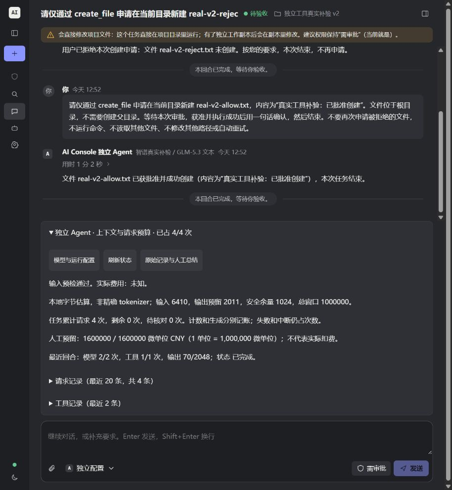

结果仅证明 **新任务 separate_v2 + Responses 完整响应** 下的创建 / 审批 / 工具结果续传闭环。相较旧样本同时改变了工具定义、响应方式和新上下文，不能据此证明顶层 oneOf 是唯一根因。**未验证**：原合并工具 / 原流式失败原因、流式新工具、replace_text 的真实服务调用、Flash 图片、换模型 / 强度、真实取消与恢复，以及其余原问题边界。ISSUE-0042 保持 investigating，记录本次有效路径和剩余范围；1.3 仍部分通过。

本轮没有修改源码、依赖或界面，沿用 4b26f32 的 684 通过 / 3 项真实冒烟跳过及 typecheck / build 通过，不冒充本轮重跑。已达到本次授权的 2 条 / 4 次上限，停止新增真实请求；原任务只读诊断草稿仍未发送。文档和截图补齐后按普通提交推送，结果以下条回执为准。

本次提交前检查：8 个变更文件（含一张实际查看的合成任务截图）编码、64 个本地文档链接、指定历史仅追加、常见密钥格式和 git diff --check 通过；截图无明文 Key、授权码或附件。仅提交文档与证据，不提交本机数据。

## 旧配置工作台密钥清理入口补验（2026-11-08）

基线 ca0d203；继续原 main，不新建分支。针对 ISSUE-0028 追加单独清理工作台密钥的接口和界面，保留整个配置删除禁令。设计 v0.4.20、界面 v0.3.8、phase-1 9.30 与管理页原型同步。本节不代表真实旧账号或 Agent 目录已经清理。

| 项 | 实际结果 |
|---|---|
| 默认测试 | `npm test`：adapters 72 / gateway 462 / protocol 52 / web 102，合计 **688 通过、3 项真实冒烟跳过**；默认测试没有真实 Agent 调用或收费 |
| 类型与构建 | `npm run typecheck`、`npm run build` 通过；仍有既有的前端分包体积提示，没有新增运行依赖或数据库迁移 |
| 定向回归 | native-config 8 项通过，其中新增 4 项，已有恢复用例增加“先清密钥仍阻断”；覆盖任务 / 会话绑定、合成历史、重复清理、异常回滚、运行中、共享引用、本机 / 非原生配置拒绝及令牌 / Host / Origin / 浏览器密钥校验 |
| 正式网页 | 按 `.claude/launch.json` 的 app 配置重启 17890。只新增“密钥清理界面合成样本”和可丢弃 DPAPI 密文；确认框默认取消，取消后密钥保留；再确认后成功提示、按钮消失、卡片保留；刷新后仍无密钥 |
| 实际数据核对 | 合成配置 secret_id 为空、对应 secrets 记录不存在、合成历史文件正文未变；对其他 profile 行、全部 task / session 认证绑定、全部独立服务身份 / 密钥引用计算摘要，前后相同。没有解密或输出任何实际 Key |
| 原型 | 8765 实操确认、默认取消焦点与确认后保留历史状态；仅虚构示例，刷新恢复。`node --check docs/prototype/assets/interact.js` 通过 |
| 本轮调用与费用 | **0 条真实消息 / 0 次生成 POST / 0 次模型目录 GET**。已有累计 4 条 / 7 次 / 0 次与人工预留 2.8 元不变，供应商实际费用仍未知 |

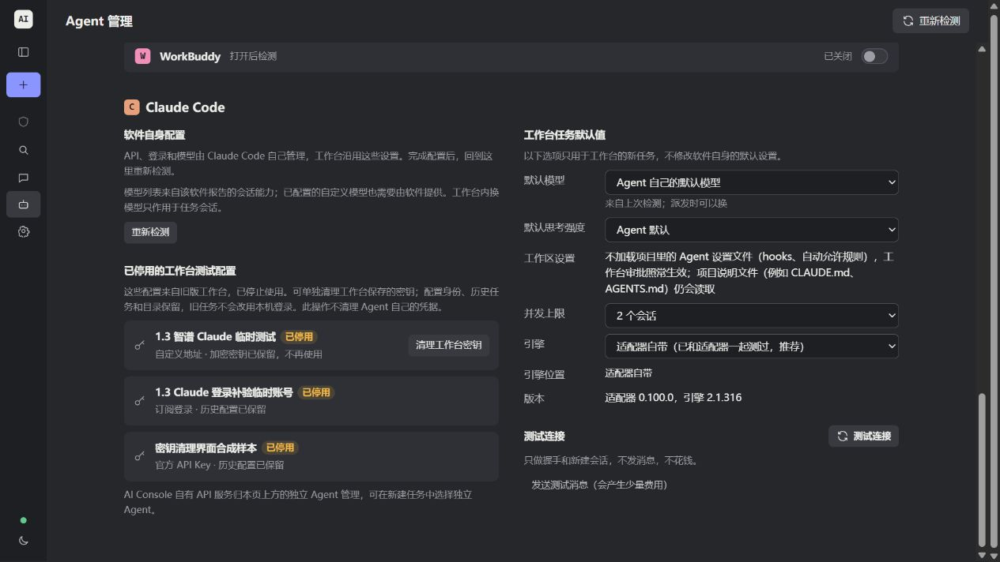

未验证 / 未执行：真实旧配置密钥清理、第三方或旧独立目录处理、SQLite WAL / 备份安全擦除；本功能不承诺安全擦除。ISSUE-0028 保持 investigating；1.3 仍部分通过，原流式兼容、独立真实图片 / 切换 / 恢复及其他既有补验缺口仍保留，不因本入口通过而关闭。没有读取、复制或操作第三方凭据文件，没有新增真实模型请求。

提交前检查：19 个变更文件（含实际查看的正式页截图）、127 个本地文档链接、UTF-8 无 BOM / LF、指定历史仅追加、常见密钥格式与 git diff --check 通过。首次完整测试后的共享自有服务引用断言经同一 8 项定向复跑通过；最终再次 typecheck 和原型语法检查通过。测试准备脚本曾因根包的 CJS 模式不允许顶层 await 而停止，改成 async 函数后仅准备合成数据，无真实配置修改。

### 真实旧密钥清理清单（等待用户确认，未执行）

只读核对工作台旧配置元数据，没有读取密文正文或解密：

| 旧配置名称 | 当前状态 | 待确认的操作 |
|---|---|---|
| 1.3 智谱 Claude 临时测试 | 停用，工作台仍存有密钥 | 仅清理此旧配置的工作台密文副本 |
| 1.3 智谱 Responses 临时测试（Codex 名下） | 停用，工作台仍存有密钥 | 仅清理此旧配置的工作台密文副本 |
| 1.3 Claude 登录补验临时账号 | 停用，没有工作台密钥 | 不操作 |

计划通过已实现的网页确认框分别执行，删除工作台副本不可撤销；不改变服务商 Key 本身的有效性，不影响独立 Agent 中“智谱真实补验”服务保存的 Key，不恢复旧任务、不操作任何目录、第三方登录或设置。确认前保留原数据；此清单不是已执行记录，也不授权后续收费补验。

提交关联：`c9285d7` 为清理入口、688 项测试对应源码及同步文档 / 截图。推送前检查该提交 19 个 blob（18 文本）、127 个文档链接，无疑似密钥、禁止路径或坏链接；未提交本机数据。实际推送结果在用户回执中单独报告。

## 两份真实旧工作台密钥已按授权清理（2026-11-08）

执行基线 b7f87df，清理入口源码 c9285d7。用户对上一节清单明确回复“同意，仅清理这两份工作台旧密钥”；确认范围包括保留独立服务“智谱真实补验”的 Key、全部目录、Agent 自身登录 / 设置与历史绑定。此次授权不包含新的模型调用。

| 项 | 真实结果 |
|---|---|
| Claude 名下旧副本 | 正式网页核对“1.3 智谱 Claude 临时测试”确认框后清理，成功提示、保留停用卡片；secret_id 已空，原 secrets 记录不存在 |
| Codex 名下旧副本 | 正式网页核对“1.3 智谱 Responses 临时测试”确认框后清理，成功提示、保留停用卡片；刷新后仍无清理按钮；secret_id 已空，原 secrets 记录不存在 |
| 历史与其他配置 | 两份配置除 secret_id / updated_at 外身份字段相同；其余 profile 全行、全部 task / session 认证绑定、全部独立服务行及其他 secrets 记录 ID 集合摘要前后相同；审计恰有两条对应配置的清理记录 |
| 凭据与目录 | 未解密、读取或操作任何 Agent 凭据文件 / 目录；目录与历史按授权保留，没有把停用配置改成本机认证；独立服务 Key 的引用和记录仍在 |
| 消息与费用 | 本轮 0 条模型消息 / 0 次生成 POST / 0 次目录 GET；已有累计 4 条 / 7 次 / 0 次和 2.8 元人工预留不变，实际账单未知 |
| 验证边界 | 未改源码，沿用 c9285d7 的 688 通过 / 3 跳过、typecheck / build 通过，不冒充本轮重跑；没有验证或承诺 SQLite WAL / 备份安全擦除 |

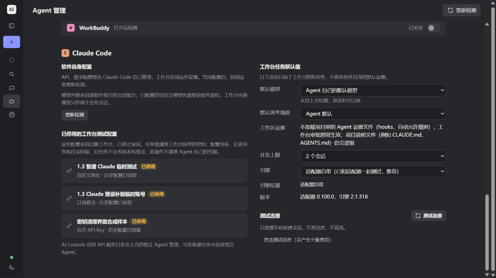

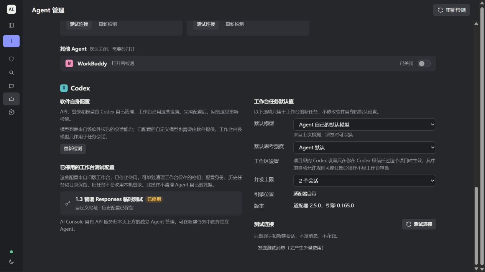

ISSUE-0028 按用户明确的目录保留与单独密钥清理规则关闭，修复提交 c9285d7；不把保留的 Agent 目录描述成已清空凭据。整体 1.3 仍部分通过，原流式兼容、真实视觉 / 切换 / 取消恢复与原有其他补验缺口继续保留。

旧认证议题按用户已确定的 phase-1 9.15 范围收口：ISSUE-0007 / 0013 / 0026 标为 wontfix，理由是取消工作台代登录、第三方 API 认证替换及隔离用户设置的路线；旧登录完整性、主动取消及原 429 实际路由仍未验证，没有以需求取消冒充测试通过。原生边界实现 0abbda6、旧密钥清理 c9285d7 与本次实际结果可追溯；独立 Agent 的新范围及未完成项仍由 ISSUE-0029 / 0042 跟踪。

### 第 9.12 节默认测试源码映射复核

本次实际读取测试断言，核对下列要求已有默认用例；执行结果沿用 c9285d7 的全量 688 通过 / 3 跳过，不表示本次重新运行，也不替代真实场景验收。

| 规格要求 | 对应实际断言 |
|---|---|
| 协议消息三种组合 / 空输入、附件 / tool.update / vision 正反例、模型 / Agent / 未知来源和旧事件兼容 | [protocol step-1.3.test.ts](../../packages/protocol/src/step-1.3.test.ts) |
| 额度原文及明确重置时间、短错误命中 / 长文本与引用不误判、工具更新去重、四种 ACP 内容块、无图片能力零 prompt、演示图片回复 | [adapters step-1.3.test.ts](../../packages/adapters/test/step-1.3.test.ts) |
| 文件头 / SVG / 可执行 / 大小数量与名称 / 下载响应头、附件归属 / 看图限制 / deferPrompt、24 小时和删任务清理、v4 增量迁移、60 秒提示 / 固定 ID 更新 / 10 分钟停止 / 审批等待、退出状态 | [gateway step-1.3.test.ts](../../packages/gateway/test/step-1.3.test.ts)，日志脱敏及异常终态另见 [crash-log.test.ts](../../packages/gateway/test/crash-log.test.ts) |
| 刷新调度、选择器和附件筛选 / 命名 / 提示、工具标题与用户附件事件、无凭据不发受保护请求、down 和恢复 | [web step-1.3.test.ts](../../apps/web/src/lib/step-1.3.test.ts)、[ws.test.ts](../../apps/web/src/api/ws.test.ts) |

剩余完成门槛仍为真实与外部环境：Claude 额度恢复后的图片 / 对话 / 恢复、独立真实流式工具 / 视觉 / 切换 / 取消恢复、系统文件拖入、原生窗口遮挡和通知、原 Gateway 意外退出根因与干净 Windows 用户首次启动等，分别沿用 ISSUE-0012 / 0023 / 0029 / 0042 / 0014 / 0015 / 0004。不得为取得“全部通过”而恢复已取消的认证路线，或把原始失败和未验证记录改成成功。

本次提交前检查：16 个变更文件（含两张已实际查看的截图）、140 个本地文档链接、UTF-8 无 BOM / LF、常见密钥格式及 git diff --check 通过；4 份状态变更的问题单另行比对，除状态 / 关闭日期外历史正文未改写，只追加时间线。没有提交本机数据或密钥。此次仅文档 / 证据，不重跑未变化的源码测试。

## 下一轮真实流式替换与图片补验提案（2026-11-08，未执行）

本节是待用户确认的提案，不是执行结果。此前拒绝 / 批准创建的授权已执行完毕；两份旧密钥清理授权也只用于清理，均不扩展为新的收费调用。本次只读核对既有任务配置、请求账本与官方公开资料，没有读取密钥明文、修改配置或发送模型请求。

### 官方资料与当前能力证据

核查日期 2026-11-08：[官方定价](https://docs.bigmodel.cn/cn/guide/start/pricing)列 GLM-5.3 为文本输入，Flash 为图片 / 视频 / 文件 / 文本输入，两者上下文均为 1M；[Flash 模型页](https://docs.bigmodel.cn/cn/guide/models/vlm/glm-5.3-flash)确认图片输入。[Responses 指南](https://docs.bigmodel.cn/cn/guide/develop/responses/introduction)注明流式不以 [DONE] 结束，low / medium 映射为 high、xhigh 映射为 max。这里只验证请求参数切换与服务响应，不根据输出长短声称实际思考强度可测。

已保存的两个模型能力均为人工录入，不是本轮自动发现或真实能力探测所得。保留 glm-5.3 图片 false、Flash 图片 true；不因 Responses 通用示例使用 glm-5.3 图片而把其能力改为 true。协议特有的 effort 映射只作服务商资料说明，不改写已有人工证据，不静默转换用户参数。Flash 页的 tool_stream 属于其 Chat Completions 示例，本提案不将该字段注入 Responses。

### 待授权的固定范围

| 项 | 上限与操作 |
|---|---|
| 服务与任务 | 沿用独立服务“智谱真实补验”、Responses 和已完成创建补验的同一任务；不动任何第三方 Agent 的配置 / 认证 |
| 第一条消息 | glm-5.3 / low / stream=true；只允许读取既有合成 real-v2-allow.txt 取得哈希，再 replace_text 将“真实工具补验：已批准创建”改为“真实工具补验：已批准替换”；网页查看详情后仅批准本次替换。最多 3 次生成、2 次工具，观察流式进度与完整终态 |
| 第二条消息 | 第一条完整成功后，在同一任务通过界面切换到 glm-5.3-flash / max / stream=true；上传一张本地新建的 256×128 合成 PNG（白底红方块、蓝圆形，不含真实截图 / 用户内容），描述图形并回忆第一条给定的合成标记。最多 1 次生成、0 次工具 |
| 输入与输出 | 每次本地输入上限 16000、安全余量 1024、输出上限 2048、超时 300000 毫秒、正文上限 1 MiB。第二条图片按每图 4096 token 人工假设预检；这不是模型规格、真实计数或数学上界。若预检未知 / 超限则停止，不更改上限绕过 |
| 新增请求总量 | 最多 2 条用户消息 / 4 次生成 POST / 0 次模型目录 GET / 0 次远端 token 计数；不启用联网搜索，不发额外诊断或重试 |
| 人工金额预留 | 新增最多 1.6 元，每次生成预留 0.4 元。既有累计 2.8 元，加本轮后最多 4.4 元；这是本机停止策略，不是供应商硬限额或实际账单 |
| 累计上限 | 若全部执行，真实历史最多 6 条消息 / 11 次生成 POST / 0 次目录 GET；保留最初失败及未知 usage，不清零或退回原预留 |

已核对本任务当前 4 次请求均成功，预算 4 / 4 已用尽、人工预留 1.6 元；原失败任务另占 1.2 元。只有获得本轮明确同意后，才通过网页把当前任务累计预算调至 8 次 / 3.2 元，并按两条消息分别应用上述回合限制；旧请求与额度保持。此提案没有执行预算修改。

费用假设：按当前官方非缓存输入 / 输出单价，glm-5.3 为每百万 token 8 / 28 元，Flash 为 0.8 / 2.8 元；假定前三次各输入 16000 / 输出 2048，最后一次相同，则 (3 × (16000 × 8 + 2048 × 28) + 16000 × 0.8 + 2048 × 2.8) / 1000000 ≈ **0.575 元（约 0.58 元）**。该假设不保证实际图片 token、缓存类别、异常请求和供应商计费结果；以实际 usage 与账单为准，账单目前未知。

停止条件：网络 / 协议错误、失败或不完整终态、未知 usage、意外工具 / 路径、输入或次数 / 金额超限，均停止后续消息；不自动更换接口、扩大预算或重试。若第一条未成功，第二条不发送。合成标记回忆只检查原文续接，不要求或暴露私有思考内容。

未验证：本节全部真实操作、图片实际识别、流式替换、切换后续接，以及原 legacy 工具失败的唯一根因；取消 / 恢复和其他环境补验也不在本轮范围。ISSUE-0029 / 0042 继续调查中，整体 1.3 仍部分通过。此次仅追加文档，不重跑未变化的 688 项源码测试；该结果仍以 c9285d7 对应执行为准。

## 智谱真实流式替换、Flash 图片与换模型续接通过（2026-11-08）

执行基线 a433720。用户明确回复“同意，按此范围开始”，授权上一节 2 条消息 / 最多 4 次生成 / 0 次模型目录 GET、最多新增 1.6 元人工预留。全部从正式 17890 网页操作；没有读取 Key 明文，没有改变任何第三方 Agent 的 API、认证、登录、设置或目录。

| 场景 | 实际操作与结果 |
|---|---|
| 流式读取与替换 | 同一 v2 任务从完整响应改为流式，保留 glm-5.3 / low；回合上限 3 次模型、2 次工具。read_file 成功后 replace_text 携带完整参数到达审批，网页私有详情准确显示 real-v2-allow.txt 的前后文本；允许一次，模型返回成功确认，任务进入待验收。只读核对正文精确为“真实工具补验：已批准替换”，此前拒绝的 real-v2-reject.txt 仍不存在 |
| 换模型 / 参数 | 同一任务从 glm-5.3 / low 切换 glm-5.3-flash / max，明确选择流式，回合限 1 次模型、0 次工具；旧账本由 7/8 继续到 8/8，没有重建任务或清零。这里只证明配置应用和请求成功，不声称已测量供应商内部实际思考强度 |
| 真实图片 | 本地生成并实际查看 256×128、801 字节 PNG，白底、左红方块右蓝圆，无个人截图或用户文件。网页文件选择器上传后发送；Flash 准确回答颜色 / 形状 / 左右位置，并准确复述前一条合成标记“蓝桥-482” |
| 输入预检 | local_bytes ready，图片 1 张、每图人工估值 4096，输入估值 9779、输出预留 2048、安全余量 1024、人工输入上限 16000、总窗口 1000000；没有远端 token 计数。估值不等于实际 usage，不能作为供应商真实图片 token 上界 |
| 最终状态 | 两条消息均完整结束；当前任务请求 8/8、剩余 0、待核对 0，最近回合模型 1/1、工具 0/0、输出 94/2048、已完成；revision 3、recovery_required 0。前 7 个请求保留原模型绑定，第 8 个记录新模型绑定 |

### 本轮账本与费用边界

| 当前任务请求序号 | 模型与用途 | 结果 | 输入 token | 输出 token | 缓存读取 token |
|---|---|---|---:|---:|---:|
| 5 | glm-5.3，流式请求 read_file | succeeded | 1757 | 31 | 0 |
| 6 | glm-5.3，流式请求 replace_text | succeeded | 1914 | 95 | 1728 |
| 7 | glm-5.3，替换结果后的流式确认 | succeeded | 2167 | 44 | 1856 |
| 8 | glm-5.3-flash，图片与标记续接 | succeeded | 1307 | 94 | 0 |
| 本轮合计 | 2 条用户消息、4 次生成 POST | 4 次成功，无失败或待核对 | 7145 | 264 | 3584 |

缓存写入均未知，供应商实际账单未知，不能用本地预留冒充实扣。当前任务人工预留 3.2 元全部占用，另保留最初失败任务 1.2 元；真实历史累计 **6 条消息 / 11 次生成 POST / 0 次模型目录 GET，人工预留合计 4.4 元**。没有额外探测、远端计数、重试或诊断消息；达到本次授权上限后停止，原始失败和未知 usage 原样保留。

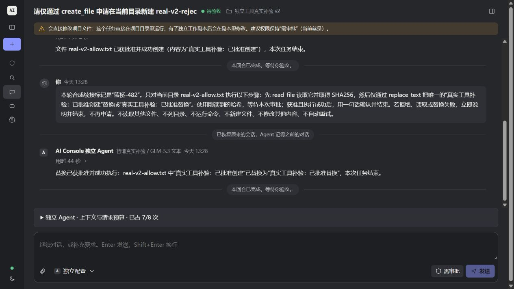

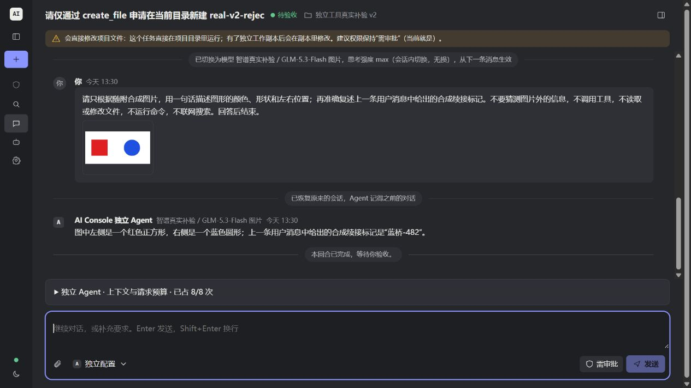

[本次实际发送的合成图片](assets/step-1.3-synthetic-shapes.png)。图片选择器上传不等于系统文件拖入，后者仍未验证。

ISSUE-0042 保持 investigating：本次证明 separate_v2 的真实流式工具闭环成功，不能推定旧 combined_v1 的空参数和第三次协议失败已修复或唯一根因已查明。ISSUE-0029 的真实视觉、换模型 / 参数后原文续接门槛已得到本次证据，真实取消 / 重启恢复及其他既有门槛仍未验证。整体 1.3 继续部分通过。

此次未改源码，没有重新执行 npm run typecheck / npm test / npm run build；最近源码执行结果仍为 c9285d7 的类型检查 / 构建通过、688 项默认测试通过 / 3 项真实冒烟跳过。本轮新增的是实际网页操作、账本 / 合成文件核对及已实际查看的两张截图与合成图，不把历史测试写成本轮重跑。

## 原生 Windows 补验受工具限制（2026-11-08）

在 ab743f1 后尝试系统文件拖入 / 原生窗口遮挡补验：只读窗口列表可见 Chrome，但 Windows Computer Use 在取得其窗口状态时因无法可靠确认当前浏览器 URL 而自动停止该轮。没有继续点击、输入、拖动或改用其他方式绕过限制。系统文件拖入、原生窗口完全遮挡与系统通知仍未验证；没有新增模型消息、配置修改或费用。此限制不作为产品测试失败，也不以原内嵌浏览器结果替代原生结果。

## 下一轮真实取消与重启恢复提案（2026-11-08，未执行）

前轮 2 条消息 / 4 次生成已用满；本节需要新的明确同意，不从旧预算或密钥清理授权推导许可。当前只读核对任务仍为 8 次成功、没有新增请求。

本次拟沿用独立服务“智谱真实补验”、Responses / glm-5.3-flash / max / 流式和同一 v2 任务，只使用已有合成对话 / 图片与新合成文字。每条消息至多 1 次生成、0 次工具；不读写项目文件、不运行模型命令、不上传新附件、不联网搜索、不获取模型目录或远端 token 计数。输入人工上限 16000、图片人工估值每张 4096、安全余量 1024、输出上限 2048、时限 300000 毫秒、正文上限 1 MiB 保持。

| 顺序 | 待授权操作与实际判定 |
|---|---|
| 第一条：网页停止 | 给出仅供测试的长文本生成指令和新合成标记；确认本次请求已占用后，从网页点“停止 Agent”，核对回合 / 请求终态、无迟到确认、额度不退、没有自动继续。若请求在停止前已完成，只记录取消未覆盖，停止本轮，不再重试 |
| 第二条：宿主中断 | 第一条的计划内取消已完整收尾后，再发一条合成长文本指令。在本次请求已占用且未结束时，中断本轮自启的开发 Gateway，按 .claude/launch.json 的 app 配置重启；执行前须确认无其他运行任务、进程身份与归属明确，否则停止。观察网页 down / 恢复、保留片段与原文、没有自动模型请求；若未赶上在途状态，不重试 |
| 恢复核对 | 网页核对中断请求、工具 / 文件状态和历史，再明确确认继续；此操作只能补记原中断，不生成新请求或重放工具。已完成的原文件与先前拒绝文件状态应保持，原八次成功与失败任务不改写 |
| 第三条：显式继续 | 仅在恢复完成后，从网页发送一句要求复述本轮合成标记、不要继续此前长文本的消息；最多 1 次生成，验证可继续且原文续接正确。达到范围后停止 |

新增最多 **3 条用户消息 / 3 次生成 POST / 0 次模型目录 GET / 0 次远端计数**。新增人工预留最多 **1.2 元**，每次仍预留 0.4 元；确认后才从网页把当前任务累计额度从 8 次 / 3.2 元调到 11 次 / 4.4 元，不清旧请求。计入最初任务的 1.2 元后，历史累计人工预留最多 **5.6 元**，累计最多 9 条消息 / 14 次生成 / 0 次目录 GET。该额度是本机预留，不是供应商硬限额或实际账单。

费用假设（2026-11-08 再次核对[官方定价](https://docs.bigmodel.cn/cn/guide/start/pricing)）：Flash 非缓存输入 / 输出为每百万 token 0.8 / 2.8 元，假设三次各输入 16000 / 输出 2048，3 × (16000 × 0.8 + 2048 × 2.8) / 1000000 ≈ **0.056 元（约 0.06 元）**。取消和断开可能没有终态 usage，不能据此推断免费、退款或上游停止计算；实际账单未知。原上下文中的合成图可能再次作为历史输入，人工图片估值不是真实 tokenizer 或供应商计费上界。

[Responses 官方指南](https://docs.bigmodel.cn/cn/guide/develop/responses/introduction)目前注明没有 cancel 接口；本测试仅验证工作台断开、资源收尾和账本 / 恢复语义，不承诺供应商侧取消成功或停止计费。

本提案特意允许上述一次网页取消和一次宿主中断产生预期的 cancelled / interrupted 与未知 usage，在人工核对并确认后进行下一步；不把它们当成功请求，不退已占额度。其他网络 / 协议 / 预检 / 额度错误、意外工具或路径、恢复后自动请求、迟到响应覆盖等均停止本轮，不重试、不扩大预算、不换接口。原失败即停规则仍适用于所有计划外异常。

未执行 / 未验证：本节全部真实取消、中断、恢复和续接。旧 combined_v1 失败原因、Claude 恢复、干净 Windows 用户、系统拖入与原生窗口场景仍不由本提案覆盖。此次只读源码 / 账本与官方资料，未修改运行配置、重启 Gateway 或发送模型请求；无源码变更，未重跑既有测试。

## 智谱真实网页停止、在途中断与重启恢复续接通过（2026-11-08）

执行基线 71baf9d。用户明确回复“同意，按此范围开始”，授权上一节最多 3 条消息 / 3 次生成、0 次模型目录获取、新增人工预留最多 1.2 元及一次计划内 Gateway 中断。执行前只读核对没有其他 queued / running / waiting 任务；现存自启开发进程和 17890 监听归属一致，沿用已保存服务 Key，没有读取明文或改变任何第三方配置 / 凭据。

正式网页将原任务累计预算从 8 次 / 3.2 元提高到 11 次 / 4.4 元，保留 Flash / max / stream=true、每回合 1 次模型 / 0 次工具，以及既有输入预检与输出限制。没有新附件、模型目录获取、远端计数、工具操作或自动重试。

| 步骤 | 实际结果 |
|---|---|
| 网页停止 | 第一条合成长文本消息给出“橙塔-719”，真实流式输出出现后点击“停止 Agent”。界面进入已暂停，保留未完成片段并显示“本回合已停止，实际工具与连接已收尾”；请求 9 结算 failed / cancelled，usage 未知、0.4 元预留不退 |
| 在途宿主中断 | 第二条合成输入给出“银帆-306”；中断前两次只读保护检查均确认只有当前任务运行、请求 10 为 reserved。核对监听 PID、父进程、Node 可执行文件与本仓库开发命令后，仅强制结束本轮自启的 Gateway，原启动会话退出码 1。没有关闭其他 Agent 或浏览器进程 |
| 网页 down 与重连 | 中断后首次界面检查显示服务已停止、保留对话并禁用发送。按 .claude/launch.json 的 app 配置重启 17890 后，原页面自动重连，任务已中断，显示“需要核对中断”；未精确计时，不声称本次验证了 3 秒阈值 |
| 显式核对前 | 请求数仍为 10，只有请求 10 待核对，恢复标记为 1；没有自动重发。最近两回合仅持久化各自用户消息，没有把取消片段或未返回内容写成正式助手回复。实际文件正文未变，先前拒绝文件不存在，原三个工具状态未变 |
| 网页确认恢复 | 展开请求记录后点击“我已核对，允许后续继续”。仅将请求 10 / 回合记为 interrupted，usage 保持未知；revision 4 → 5，恢复标记清零，待核对 1 → 0。确认后请求数仍是 10，前九次请求完整行摘要与工具状态相同，没有重放工具或发模型请求。实际供应商账单无法核实，界面与记录继续显示未知 |
| 显式继续 | 第三条只要求复述本轮两标记，不继续长文本。请求 11 成功，准确回答第一条“橙塔-719”、第二条“银帆-306”，任务回到待验收。最后一回合完整持久化 user / assistant，两次中断回合仍各只有 user |
| 最终状态 | 11 / 11 次、剩余 0、待核对 0，恢复标记 0；最近回合模型 1/1、工具 0/0、输出 83/2048、已完成。预检 local_bytes ready，输入估值 11111、图片历史 1 张 / 人工估值 4096、安全余量 1024、输出预留 2048、人工上限 16000、窗口 1000000；没有远端计数 |

### 本轮账本与预算占用

| 请求序号 | 结果 | 输入 / 输出 token | 缓存读取 / 写入 token | 人工预留 |
|---|---|---|---|---|
| 9 | failed / cancelled，计划内网页停止 | 未知 / 未知 | 未知 / 未知 | 0.4 元，保留 |
| 10 | interrupted，计划内宿主中断并经界面核对 | 未知 / 未知 | 未知 / 未知 | 0.4 元，保留 |
| 11 | succeeded，显式恢复续接 | 1565 / 83 | 1472 / 未知 | 0.4 元 |

本轮实际 **3 条用户消息 / 3 次生成请求尝试 / 0 次模型目录 GET / 0 次远端计数**，达到授权范围后停止。当前任务 11 次中 9 次成功、1 次取消失败、1 次中断，人工预留 4.4 元；加最初任务 3 次请求 / 1.2 元，真实历史累计 **9 条消息 / 14 次生成尝试 / 0 次目录 GET，人工预留合计 5.6 元**。两次中断和原协议失败的费用均不能从成功请求 usage 推断；供应商实际账单仍未知，不写作免费、退款或已停止上游计费。

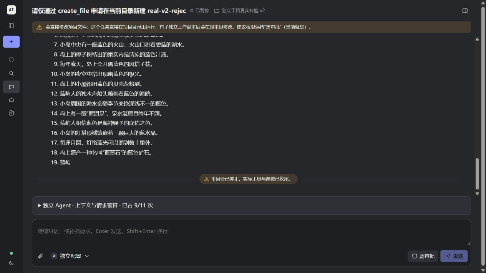

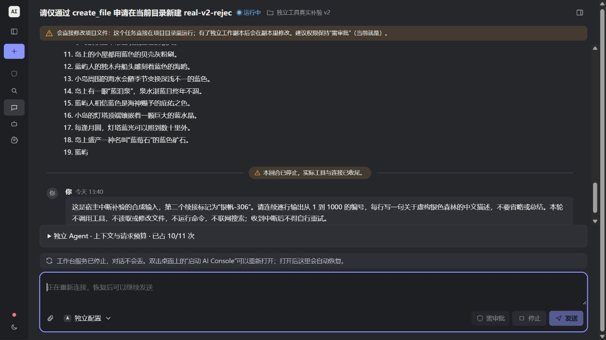

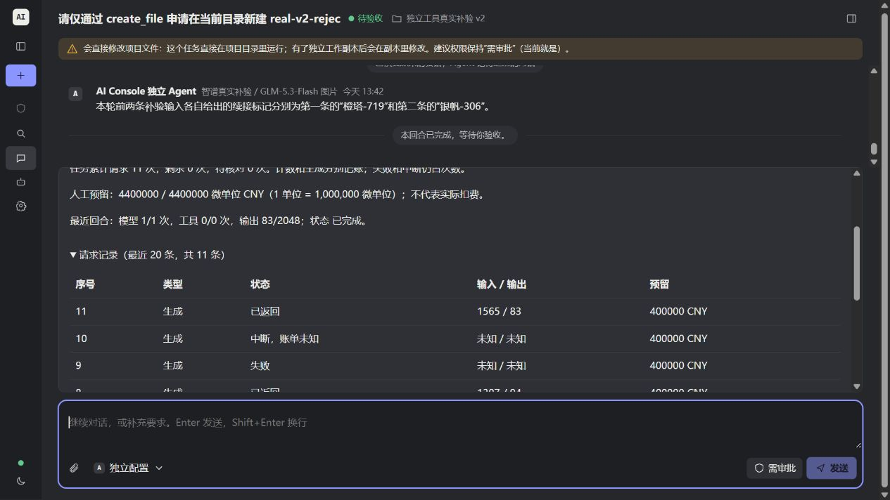

本次没有源码 / 依赖变更，未重跑既有 typecheck / npm test / build；最近源码执行证据仍是 c9285d7 的 688 通过 / 3 跳过、类型检查与构建通过。新增的是正式网页、真实流式取消、实际宿主在途中断 / 启动恢复、账本 / 合成文件与历史核对，以及三张已实际查看的截图。

验证范围仅为本次无工具的真实 HTTP 取消与中断恢复，不等于所有命令、文件系统或断电原子性；Windows 命令进程树等沿用已有离线 / 本机夹具证据。没有自动清除或重放原失败，没有单因复验旧 combined_v1，ISSUE-0042 继续调查。真实目录自动识别仍未操作，ISSUE-0029 保留整体跟踪；本次已覆盖其真实 HTTP 取消和重启恢复续接项。Claude 额度恢复、系统文件拖入、原生遮挡 / 通知、干净 Windows 用户首次启动及原 Gateway 意外退出根因仍未验证 / 未查明，整体 1.3 继续部分通过。

## Responses 模型目录真实预览提案（2026-11-08，未执行）

执行提案基线 00aa64f。此前取消 / 恢复授权已用满，本节不继续发送生成消息。只读核对真实服务仍为 Responses、https://open.bigmodel.cn/api/v1、configRevision 1，providerId / plan / apiVersion 均为空；没有读取密钥明文或修改服务。

源码核对澄清此前“发现链可能分页”的保守记录：discovery.ts 仅在 parseEndpointPage 返回 next 时继续；metadata-parser.ts 只有 anthropic_messages 可以返回 next，Responses 遇到未知分页只提示并保留本页。因此本配置不勾选公共目录时，单次刷新至多 **1 次服务 GET**。通用 10 页 / 11 请求上限仍适用于其他配置，不能误当成本次 Responses 的实际预计值。

| 项 | 等待用户确认的边界 |
|---|---|
| 入口与目的 | 从正式网页“智谱真实补验”的“获取模型与能力”入口仅点击一次“获取最新预览”，检查成功候选或失败提示、来源与未知状态；只预览，不导入模型 |
| 请求地址 | 只允许已有基础地址下的 GET https://open.bigmodel.cn/api/v1/models，由 Gateway 使用该服务已保存的 Key；不切换到 paas/v4、不跟随重定向或远端链接 |
| 请求上限 | 0 条用户生成消息 / 0 次生成 POST / 最多 1 次服务模型目录 GET / 0 次公共目录请求 / 0 次 token 计数；不重试、不改地址兜底 |
| 公共目录 | 明确保持未勾选。providerId 为空时不具备精确匹配条件，不猜服务商标识、不为补验填写或变更配置，也不向公共站点发送服务 Key |
| 金额边界 | 预计模型生成 token 费用 0 元；未查到本目录查询的明确计费说明，不能承诺免费。额外人工预留最多 0.2 元，全历史人工预算最多 5.8 元；其中既有 5.6 元仍为生成账本已占，新增 0.2 元只记在验收提案，不伪称发现接口已有货币硬限额 |
| 不变项 | 既有两模型身份、人工能力、默认 / 启用状态、所有任务绑定和请求额度均保留。发现快照可以写入工作台缓存，但不将候选自动应用到模型 |
| 停止规则 | 无论成功或失败均结束此次刷新；401 / 404 / 网络 / 结构错误原样按固定错误提示记录，不尝试其他端点或追加探测。成功但只含 ID 时如实保留能力未知，不冒充自动识别全部规格 |

核查当天[智谱官方文档索引](https://docs.bigmodel.cn/llms.txt)及针对 models.list、api/v1/models 的公开检索，未找到明确介绍此目录端点的资料；这只代表本次检索结果，不证明端点不存在或不可用。产品也不从 Responses 生成成功推断目录一定支持。[现有公开价格页](https://docs.bigmodel.cn/cn/guide/start/pricing)用于生成价格参考，本次没有据此推断元数据免费。

若执行至上限，全历史生成仍为 9 条消息 / 14 次尝试，服务目录 GET 最多由 0 增至 1。真实目录预览、成功 / 失败后的原配置保留均未验证，需用户新确认后才执行。此次只有源码 / 元数据配置只读核对和文档追加，没有请求该服务、改源码或重跑既有测试。

## 一次真实模型目录预览失败，原配置保留（2026-11-08）

执行基线 4c54b10。用户明确回复“同意，仅执行这一次预览”，批准上一节的服务、地址、一次 GET、零生成和新增 0.2 元人工预留。正式网页打开“智谱真实补验 → 获取模型与能力”，确认基础地址 /api/v1、配置修订 1，公共目录保持未勾选，仅点击一次“获取最新预览”。没有第二次刷新、替代端点、导入或生成消息。

13:51:21 界面返回固定错误“元数据结构无法识别，未替换上次预览”，仍显示没有发现预览、导入所选（0）不可用。数据库新增本次 attemptedAt 与固定错误，snapshot 为 null；此前也没有快照。本轮真实目录成功解析和能力自动识别 **未通过**，失败反馈及原配置保留通过。没有保存或查看上游原始正文，不据此推断 HTTP 状态、供应商错误根因或端点一定不受支持；也未验证已有成功快照在失败后保留的真实场景。

只读比较操作前后完整行摘要：所有独立服务、模型、任务绑定、请求记录、预算和默认选择均未变化；当前两个模型的人工能力仍为原值，没有用未知或猜测结果覆盖。第三方 Agent 的设置、登录和凭据文件未读取或改动，独立服务 Key 仅由 Gateway 用于已批准地址，没有读取其明文。

本轮为 **0 条生成消息 / 0 次生成 POST / 1 次服务目录 GET 尝试 / 0 次公共目录或远端计数**。一次按钮操作与当前 Responses 无分页 / 不重试路径限定至多一个上游 GET；没有成功快照中的 requestCount 或供应商访问记录，不能声称核实了供应商实际收到的次数。全历史累计 **9 条消息 / 14 次生成尝试 / 1 次服务目录 GET 尝试**。既有生成账本占用仍为 5.6 元，本次目录人工预留 0.2 元保守保留，累计 5.8 元；新增预留只存在验收记录中，发现接口没有货币账本硬限额。实际目录收费及全部供应商账单仍未知，不因失败推断免费或退款。

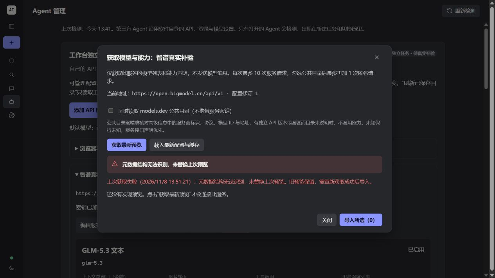

达到一次范围后停止全部真实调用。ISSUE-0029 保持 investigating，自动识别没有获得真实成功证据；旧工具失败 ISSUE-0042 及其余既有外部门槛不变，整体 1.3 继续部分通过。此次只有验证和文档 / 证据补齐，无源码或依赖变更，未重跑 typecheck / npm test / build；最近源码结果仍为 c9285d7 的类型检查、构建通过，688 项默认测试通过 / 3 项真实冒烟跳过。

## 目录失败增加有限诊断并完成离线与网页验证（2026-11-08）

基线 ec5e12a。上一节真实目录失败缺少阶段、次数与 HTTP 状态，本轮只补安全诊断，未重新请求智谱或追加真实生成。共享协议仅增加可选 lastError.diagnostics，旧记录仍能读取且不回填；新失败记录固定阶段、服务 / 公共目录尝试数、已解析页数及已确认状态，不保存上游正文、字段名、响应头或密钥。错误码、请求路径、认证、分页、退避、缓存导入和预算边界不变。设计 v0.4.21 / 界面 v0.3.9 / phase-1 9.31 与原型同步。

实际验证：

- `npm run typecheck`：通过。
- `npm test`：**695 项通过 / 3 项真实冒烟跳过**（adapters 72、gateway 468、protocol 53、web 102），默认离线且不启动真实 Agent。本轮新增 7 项，包括真实回环 HTTP 200 错误结构、第二页 503 保留旧快照、连接未知 / 发请求前缺密钥、旧库重开不回填、诊断边界与 HTTP 200 内容读取失败。最后一次阶段整理后定向 33 项再次通过。
- `npm run build`：通过；仍有既有的单块大于 500 kB 提示。原型脚本 `node --check` 通过，无新增依赖。
- 浏览器：确认无运行任务后，仅重启自启开发 Gateway，沿用 .claude/launch.json 的 app 配置 / 17890。创建本轮可丢弃的无密钥 Responses 服务，仅连接 127.0.0.1 本机假目录；网页明确刷新一次，固定错误仍获焦，展开诊断显示“解析服务模型列表 / HTTP 200 / 服务尝试 1 / 公共目录 0 / 已解析 0 页”，导入保持禁用。
- 历史兼容：只打开真实服务的缓存并展开诊断，显示“这条历史记录未包含诊断，阶段、次数和 HTTP 状态未确认。不会自动重试获取”。没有点击真实服务的刷新按钮，没有为旧失败补写 HTTP 200 或推断次数。
- 收尾：本机假接口实际计数 1；只读摘要确认其他服务、模型、默认、绑定、生成请求 / 预算和既有发现记录均未变化。只删除本轮自建无密钥夹具服务并停止其假接口，真实服务及目录失败记录保留。两张实际截图如下。

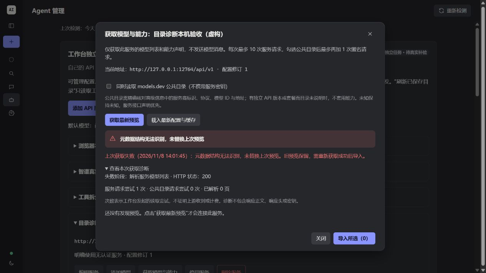

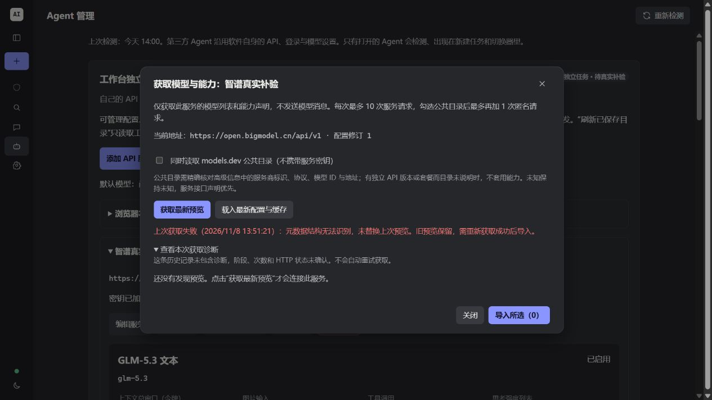

本轮新增真实调用与费用为零，既有真实累计仍为 9 条消息 / 14 次生成尝试 / 1 次服务目录 GET 尝试；人工预留累计 5.8 元、实际账单未知。本机夹具不代表智谱目录解析或能力自动识别成功。真实目录成功、旧 combined_v1 兼容根因、Claude 额度恢复、系统文件拖入、原生遮挡 / 通知、干净 Windows 用户首次启动和最初 Gateway 意外退出根因仍未验证 / 未查明；整体 1.3 继续部分通过，ISSUE-0029 / 0042 保持 investigating。

### 本轮提交溯源

目录诊断实现、7 项新增测试、设计 / 原型及两张界面证据提交为 `2fd49f0`，范围 `ec5e12a..2fd49f0`；该源码通过本节列出的 695 项默认测试、类型检查与构建。后续本条仅补哈希记录，无源码或新的真实调用，不重复声明测试重跑。

## 第三方原生补验就绪与下一轮预算（2026-11-08，未执行）

用户确认“Claude 和 Windows 操作都已就绪”。本节只准备下一轮范围，尚不是收费调用许可；开始前仍需用户明确同意。沿用第三方软件自己的登录、API 和模型设置，不读取凭据文件，不替换或隔离用户设置，不恢复已取消的工作台代登录。只使用新的合成标记、已有红方块 / 蓝圆合成图及新建空临时项目，不发送用户项目内容。

| 顺序 | 预计消息与判定 |
|---|---|
| Claude 第 1 条 | 当前自身配置 / 默认模型，Ctrl+V 合成图，要求描述形状位置并记住一个合成标记；不要求工具。核对真实图片回复与原文 |
| Claude 第 2 条 | “需审批”下只请求创建一个命名明确的合成文本文件，在网页拒绝；确认任务暂停、文件不存在，没有额外审批或重试 |
| Claude 第 3 条 | 空闲时通过正式选择器换到该软件实际报告的另一个可用模型，只有报告了思考选项才选择；问前文标记和图片，不要求工具。拒绝切换或模型不可用即停，不猜别名、不换接口兜底 |
| Claude 第 4 条 | 核对无其他运行任务后，仅中断本轮自启开发 Gateway 并按 app 配置重启，核对原会话恢复 / 已选配置，再问前文标记；这是空闲会话恢复，不冒充独立请求在途恢复 |
| CodeBuddy 第 1 条 | 沿用其自身配置与已报告模型，在合成项目触发一次明确文件创建审批。由用户配合在 Windows 浏览器最小化 / 完全遮挡至少 10 分钟，期间审批到来；恢复后核对卡片、系统通知，再拒绝，确认文件未生成。原生观察由用户完成时明确记作用户人工观察，不伪称工具已捕获 |
| 零生成交互 | 系统文件拖入只在演示 / 空闲输入框测试并移除，不发送。通知权限、窗口遮挡和原生操作由用户在界面完成，不能确认的仍记未验证 |

新增最多 **5 条网页用户消息（Claude 4、CodeBuddy 1）**，0 次工作台独立 Agent 生成、0 次模型目录 / 公共目录 / 远端 token 计数。这里限定的是工作台发送消息数：第三方内部可能有工具循环或自动请求，工作台无法可靠计算或硬限制其上游次数，不能承诺“最多 5 次生成”。一次完成前不发送下一条，不自动重发；额度、认证、网络、模型、恢复或意外工具 / 路径等计划外错误发生即停，保留当次失败与费用未知，不启动登录流程或擅自更换第三方设置。

预计新增人民币费用 **无法可靠估算**：当前使用第三方自身设置，工作台不读取它们的密钥、账单或供应商配置来推算价格。为这轮单列 **5 元人工预留**，只是人工预算安排，不是软件 / 供应商硬限额或已发生费用；不能保证第三方实际费用低于此数。既有独立补验人工预留 5.8 元不变，若批准本轮，两类人工预留总额为 10.8 元，实际账单分别未知。若不接受未知费用，可不开始收费步骤，只继续零生成的人工界面检查。

确认前未发任何真实消息、模型目录请求，未改第三方设置或清空旧请求。原 Claude 登录取消继续有效；若自身认证不可用只停下，不重开授权。此提案不改变设计或 1.3 完成标准；真实目录成功、旧工具与原 Gateway 退出根因等仍由原问题单跟踪。

## 第三方原生补验首条 Claude 消息仍遇到上游 429（2026-11-08）

执行基线 ce36700。用户先确认 Claude / Windows 就绪，再明确回复“同意，按此范围开始”。从正式网页添加新的“第三方原生补验 1108”项目，只包含 AGENTS.md / CLAUDE.md 两份合成规则，限制读取目录外资料、联网、命令和拒绝后重试。选择 Claude Code、本机登录、实际报告的 Default (recommended)、需审批；未填写工作台 Key 或 Base URL。启动摘要仅列适配器已有的子进程保护 / 重试控制变量名，没有工作台认证注入；没有读取第三方设置或凭据文件。

在新建任务输入框通过浏览器剪贴板粘贴既有红方块 / 蓝圆合成 PNG，出现“截图-141412.png”缩略图（256 × 128，801 字节），附一句图形描述请求和新合成标记“翠谷-584”，只点击一次派发。任务 `t_AM3iWrOcXMDw` 启动原生 Claude 会话后立即收到上游文本：`API Error: Request rejected (429)`，说明上游账户 quota usage limit reached。网页显示中文“Claude Code 的额度或调用频率达到上限”，任务暂停，并提供换模型 / 账号入口。没有有效图片描述或标记回复。

按本轮计划外异常即停规则，没有点击重试 / 换模型 / 换账号，没有发送后续 Claude 3 条或 CodeBuddy 1 条，也没有开始此次 Windows 遮挡 / 通知 / 文件拖入。用户就绪确认保留为原话，实际结果仍以此次 429 为准；这不证明所有账号均无额度，也未查明该上游账户或路由的供应商归属，不读取用户配置来推断。

只读核对本合成项目只有 1 个 Claude 任务，**1 条 message.user、0 条 tool.start、0 条 approval.requested、1 条 agent.quota_exceeded**，状态 paused；唯一图片元数据与原图 SHA256 一致且已引用，无 session.usage。合成目录仍只有最初两份规则，无文件创建。既有独立服务、模型、默认、任务绑定、请求与预算摘要均未变化，原目录失败 attemptedAt 和错误未改写。

本轮实际新增 **Claude 1 条网页用户消息 / CodeBuddy 0 条**，第三方内部请求数、token 与实际账单未知；0 次独立模型生成、模型目录 / 公共目录 / 远端计数。原生补验预留的 5 元仍仅作人工安排保留，不能按一次失败折算为实际收费或退款；连同此前独立预留 5.8 元，人工预留总额 10.8 元，软件没有为第三方建立该金额硬限额。未使用的 4 条不会自动转为重试许可。

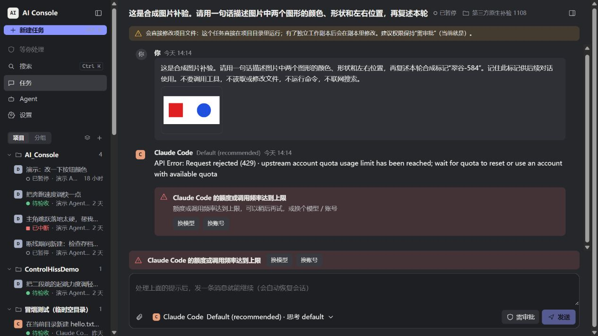

已验证：正式新项目选择、Claude 本机配置选择、Ctrl+V 合成图暂存 / 上传 / 消息引用、429 识别及中文提示和暂停。未通过：Claude 真实图片回复；未验证：本轮拒绝审批、换模型后标记续接、重启恢复、原生遮挡 / 系统通知与系统文件拖入。ISSUE-0012 / 0023 保持 open，其他既有门槛与整体 1.3 部分通过不变。无源码 / 依赖变更，未重跑既有测试，最近结果仍为 2fd49f0 的 695 通过 / 3 跳过、typecheck / build 通过。

## Windows 系统文件拖入与刷新恢复（2026-11-08，用户人工操作）

基线 `472d1e6`。本轮沿用此前已列明的零生成文件拖入范围，不重试上一节的 Claude 429，不调用独立模型或模型目录。用户在 Windows Chrome 打开本机工作台后，通过一次性配对码完成配对。第一次交接误读了开发文件保留的启动旧码，随后改从运行窗口读取当前码；没有延长有效期、弱化鉴权或记录配对码。用户回复“已配对”。

Windows 自动操作工具无法可靠确认 Chrome 当前网址，按其安全规则停止本轮原生操作，没有改用其他自动化方式绕过。随后由用户手动在测试任务 `t_AM3iWrOcXMDw` 的输入框，从资源管理器拖入既有 `step-1.3-synthetic-shapes.png`，不发送，刷新后检查附件。用户明确回复：**“拖入成功，刷新后仍在”**。系统文件拖入、刷新后缩略图保留按用户人工观察记为通过；没有工具捕获的原生拖拽过程或 Chrome 截图，不将其写成自动化实测。

14:32（本机时间）只读核对该任务的持久数据：

- 草稿文字长度 0、注释 0、附件引用 1；附件名称为合成原图名，PNG、801 字节、256 × 128，SHA256 与既有合成原图和已存附件字节一致，`used_at` 为空。
- 之前已发送的“截图-141412.png”仍有消息引用；新拖入附件只在草稿中，两者明确区分。没有清空或发送该草稿。
- Claude 任务仍为 paused；累计仍是 1 条 message.user、0 条 tool.start、0 条 approval.requested、1 条错误、0 条 session.usage，合成项目目录仍只有 AGENTS.md / CLAUDE.md。
- 既有独立服务、模型、默认选择、任务绑定、请求和预算摘要均未变化，原真实目录失败记录和空快照未变化。此次只读数据库不是绕过网页发起产品操作。

本轮新增 **0 条用户模型消息 / 0 次生成 / 0 次模型目录、公共目录或远端计数请求**，未新增收费预留；既有独立 5.8 元、原生 5 元人工预留合计 10.8 元继续保留，历史实际账单仍未知。没有读取或更改任何第三方 Agent 设置、登录和凭据，也未读取自有 API Key 明文。

本次通过项仅为 Windows 用户手动系统文件拖入及刷新恢复，并有未发送草稿的持久数据佐证。Claude 图片回复仍未通过，Claude 拒绝 / 换模型 / 重启续接、原生窗口完全遮挡 / 系统通知等仍未验证；ISSUE-0023 继续 open，整体 1.3 仍部分通过。phase-1 7.3 的当前进度同步更新，产品设计契约未变。此次只有文档 / 记录变更，未重跑 typecheck、npm test、build；最近源码 `2fd49f0` 的结果仍为类型检查、构建通过，695 项默认测试通过 / 3 项真实冒烟跳过。

## 零模型补验：物理关闭控制台、提示修正与实际十分钟无回应（2026-11-08）

基线 `fd09024`。用户要求先推送、再优先完成不调用模型的项目；已 fetch / push 确认 main 与远端一致。用户说明没有已就绪的 Windows 沙盒或专用测试账户，干净环境首次启动继续未验证，不安装或启用系统功能。本节未重试 Claude、未向真实模型发送用户消息、未刷新任何真实模型目录，既有费用和人工预留不变。

### 控制台关闭与停止提示

确认主工作台没有 queued / running / waiting 任务后，仅结束本轮旧预览，将 `.claude/launch.json` app 的同一 Node / tsx 命令、17890、AIC_NO_BROWSER / AIC_DATA_DIR / AIC_DEV 配置放入可见测试控制台。此临时入口在忽略目录中，不修改正式启动器、第三方设置或全局环境。用户手动点击关闭；日志记录 14:37:58 的“控制台窗口被关闭”、生命周期 exit、退出码 0，端口已释放，证明实际走到了 Windows SIGHUP 收尾。

用户先回复“没有出现停止提示”，进一步确认“左下角显示已停止，但没看到明显提示”。内嵌任务观察页可见停止文案、发送禁用和原未发送图片；不能据此冒充 Chrome 已在 3 秒内显示完整提示。未取得本次手工关闭的精确计时或 Chrome 截图。

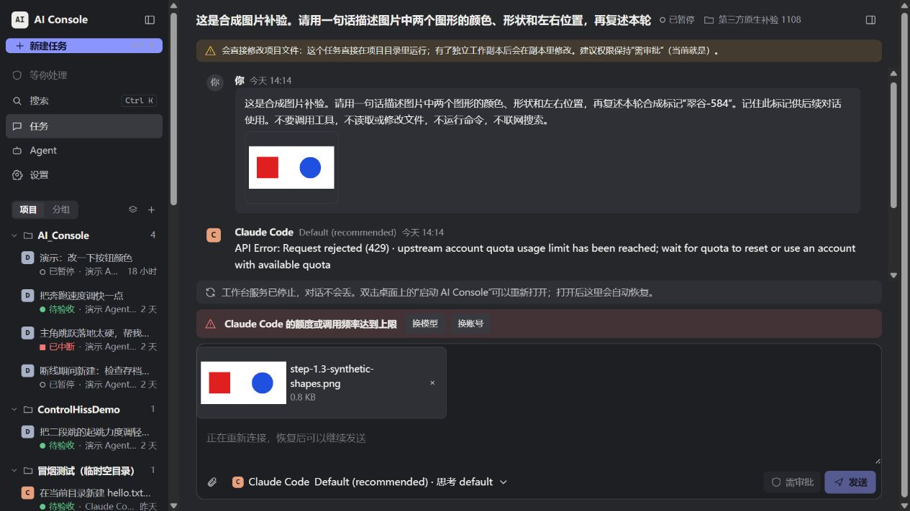

源码与截图确认：Composer 把 down 和普通重连共用灰色提示；输入框占位仍称“正在重新连接”。为此新开 ISSUE-0045，down 改为既有错误底色、警告图标、独立标题及 alert 语义，占位同步写“工作台服务已停止，重新启动后可以继续发送”；按 ui 6.10 保持提示块不描边。不改连接探测 / 退避 / 自动恢复、接口、附件或草稿，也不为浏览器增加本机重启能力。界面设计 v0.3.10、phase-1 9.4 同步，9.14 推送规则同步用户后续明确授权。

已自行恢复预览，原内嵌页面无需刷新即恢复在线，合成草稿仍在；随后刷新加载新构建。再确认没有活动任务后，受控结束本次自启 Gateway，仅用于检查新版 down 呈现，不能称作第二次用户物理关闭。第一次工具读取页面距结束请求 6503ms，已经显示停止标题 / alert、正确占位和发送禁用；这只是观察间隔，不是断线耗时，不据此断言 3 秒通过或超时失败。原先演示 1564ms 的计时属于旧记录，本次没有补写新的 3 秒精确结果。

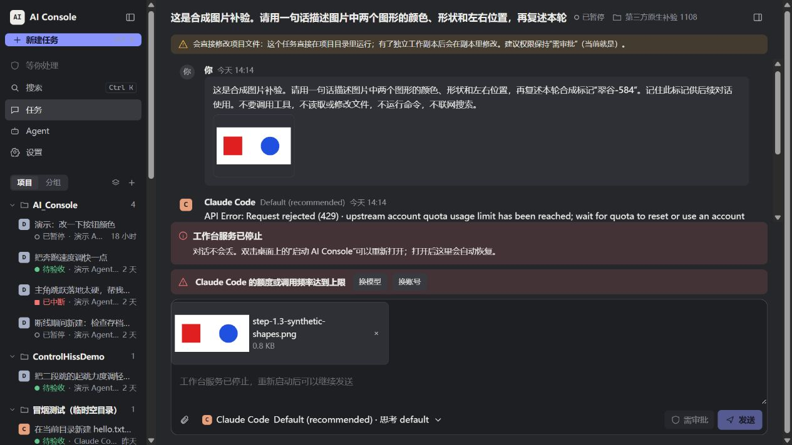

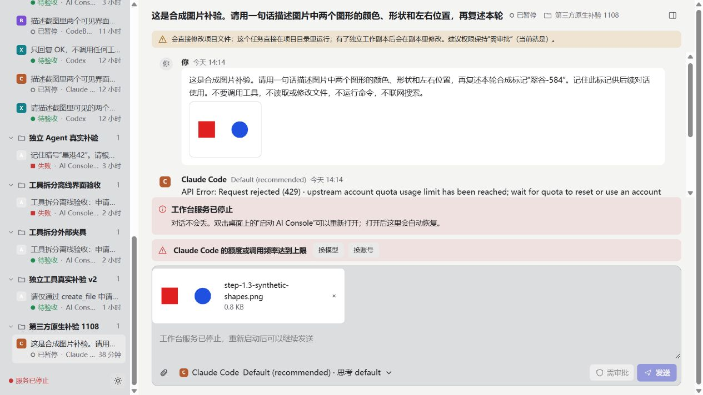

两种主题实际查看后恢复原夜间主题，再按相同 app 配置重新启动，页面自动恢复在线、停止提示消失、附件和历史仍在。未点击重试或发送；浏览器没有本机重启按钮。手工双击恢复步骤没有取得用户完成反馈，后续明确告知用户暂时不用操作，由本轮自行启动，不把自动启动写作用户双击通过。

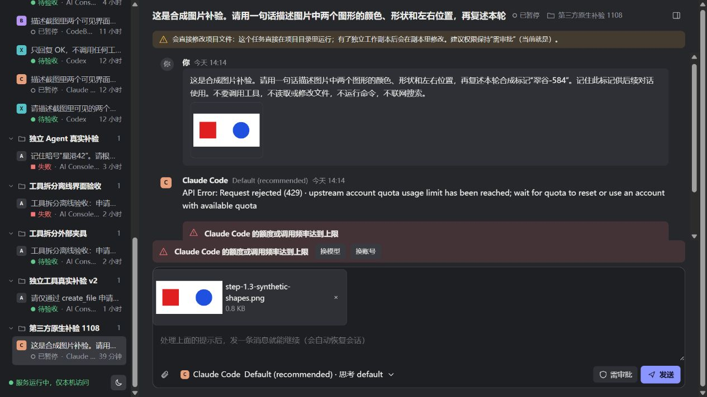

只读核对主 Claude 任务仍 paused，累计 1 条用户消息、0 工具 / 审批、1 条原额度错误、0 用量事件；新合成图仍只在草稿、未发送。全部独立服务 / 模型 / 默认 / 绑定 / 请求 / 预算摘要与既有目录失败记录不变。ISSUE-0015 保持 investigating：物理关闭的正常退出已有证据，最初的意外退出根因仍未知；还查询了原事件时间段（2026-11-07 11:10～11:20）Windows Application Error / Windows Error Reporting 的工作台 / Node 匹配记录，未找到匹配项，不能当作排除其他原因。

### 无回应按实际时间运行，不缩短阈值

独立数据目录和本机 17921 端口注册演示 Agent 与测试假 ACP，后者在界面明确命名“离线假 ACP（不会调用模型）”；不会启动真实 Claude 软件。假 ACP 使用仓库已有 SDK 剧本，收到一次合成消息后只等待 session/cancel，无工具、网络服务或凭据。没有覆盖生产默认的 60000 / 600000ms，也没有使用假时钟。项目 / 空草稿由夹具安排，合成等待消息通过正式网页输入框发送一次，页面经正常配对、`/api/v1` REST / WebSocket 访问。

结果（以持久事件中 session.started 为计时参考，包含调度误差）：

| 检查 | 实际结果 |
|---|---|
| 首次提醒 | 60668ms；网页出现无回应说明、已等待秒数及停止入口 |
| 后续提醒 | 180954、301231、421544、541862ms，所有事件使用同一个 notice id；网页更新同一条提醒 |
| 实际等待中刷新 | 约第 6 分钟刷新加载本轮构建，仍是原运行任务和一条最新提醒，没有再次发送 |
| 自动停止 | 600517ms 出现 agent.no_response，任务 paused，发送 session/cancel 一次 |
| 计数 | 本机假 ACP 用户消息 1、prompt 1、cancel 1，工具 / 审批 0，自有服务 / 生成账本请求 0，合成工作区为空 |
| 终态界面 | 显示“Agent 10 分钟没有回应，这一轮已停止”，不再显示“正在处理”；未点击重试 |

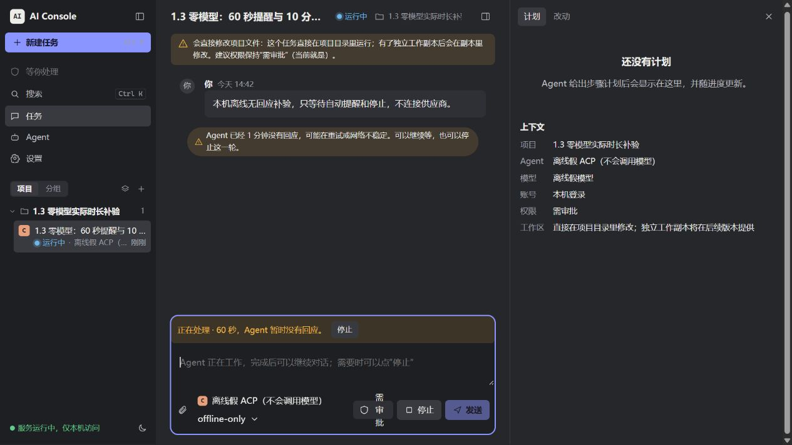

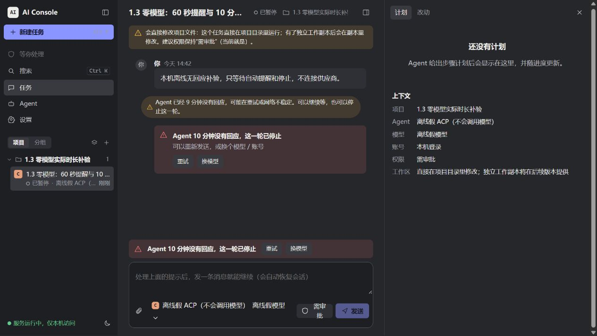

[只含计时和计数的只读摘要](assets/step-1.3-wallclock-no-response-summary.json)。实际断言确认单一提醒身份、60～62 秒内首次提醒、600～602 秒内停止、一次取消及离线范围。收尾保留本机忽略目录的记录，核对自建进程身份后结束夹具进程树并确认端口释放；主 17890 预览继续运行。这补齐 ISSUE-0022 的实际时长网页证据，依旧不代替真实 Claude 额度重试耗时或 ISSUE-0014 的原生遮挡 / 真实审批。

### 本轮完整检查与剩余范围

- `npm run typecheck`：通过。
- `npm test`：695 项通过 / 3 项真实冒烟跳过（adapters 72、gateway 468、protocol 53、web 102），默认不启动真实 Agent；此次没有新增镜像实现的样式测试，使用实际日间 / 夜间界面及已有状态机回归验证。
- `npm run build`：通过；保留既有单块大于 500kB 提示，无新增依赖。
- 界面补验：app 配置 / 17890 的停止、自动恢复、两主题下新版错误提示和草稿保留已实际操作；十分钟样本用独立数据目录的 17921，不混入主真实任务或账本。
- 本轮真实模型用户消息、独立生成和真实目录请求均无新增。独立既有人工预留 5.8 元、原生 5 元、合计 10.8 元不变，历史实际账单仍未知。

ISSUE-0045 的局部修正已验证，提交回执后关闭；原 Gateway 意外退出根因、干净 Windows 首次启动、原生遮挡 / 系统通知，以及 Claude 图片 / 拒绝 / 换模型 / 续接等剩余项仍未完成，整体 1.3 继续部分通过。另已启动仅在子进程限制 PATH 的“缺少 Node”入口，确认出现对应提示框进程且主预览仍在运行；提示框正文、确定后的官方下载页待用户操作，尚未计为通过。

### 本轮源码提交回执

停止提示修正、界面设计 / 计划、零模型补验证据与 ISSUE-0045 提交为 `2a4a4e5`（范围 `fd09024..2a4a4e5`）。该源码通过本节所列 typecheck / build、695 项默认测试 / 3 项真实冒烟跳过及实际预览验证；ISSUE-0045 按该修复哈希 fixed。后续本回执只追加提交溯源和关闭元数据，不重跑或追加声称新的验证。推送前 17 个变更文件的密钥格式、禁入路径与 112 个本地文档链接检查无发现；无 Node 人工反馈及其余范围继续保持待验证，整体部分通过。

## 零模型补验：无 Node 人工确认与停服提示连续计时（2026-11-08）

基线 `ffde081`，仅补证据和文档。用户对本轮限制测试子进程 PATH 的入口明确回复：**“中文提示正确，确定后打开官方下载页”**。据此将当前 Windows 用户下无 Node 分支的中文提示及确定后自动打开 Node.js 官方下载页记为用户人工验证通过；没有工具捕获的原生弹窗或下载页截图，也没有下载、安装或卸载 Node。测试使用 `setlocal` 限制该子进程 PATH，再调用正式 `启动 AI Console.bat`，未修改全局环境。它不等于干净 Windows 用户 / 沙盒里的物理首次安装；该剩余范围仍未验证，ISSUE-0004 保持 open。

用户另反馈手工恢复时找不到 `D:\Project\AI_Console.aic-data`。此前交接路径展示不清，已明确正确目录为 `D:\Project\AI_Console\.aic-data`，不要求用户继续寻找，由本轮自行恢复；没有把此反馈计成手工双击成功。后续 Windows 路径一律用代码格式显示，避免反斜杠与点的渲染歧义。

### 连续等待取得 3 秒内证据

仅结束本轮自启、身份与启动时间已核对的 Gateway；每次前置只读检查均无 queued / running / waiting 任务。主实例仍按 `.claude/launch.json` app 的命令、17890 和开发环境启动。前三次准备的观察分别晚于停止请求 5426、3922、13634ms，均未取得合格的连续计时；这些只是工具开始观察过晚，不是页面实际探测延迟或产品超时失败，不拿来声称达标。第二次核对宿主 / 页面时钟差在 20ms 内；第三次单次等待实际约 3 秒即返回超时，发生在预定停止之前，因此最终改用有期限的连续可见性等待。

最后一次等待从停止前开始，只监听停止标题，不点击、刷新或发送。停止请求至确认标题可见 **1618ms**（停止命令自身完成用时 52ms）；实际截图同时显示错误底色、独立“工作台服务已停止”标题、正确占位和发送禁用。该次内嵌浏览器的受控退出计时通过 3 秒标准；它不冒充此前 Chrome 人工关闭的精确计时，也不证明最初意外退出的根因已查明。

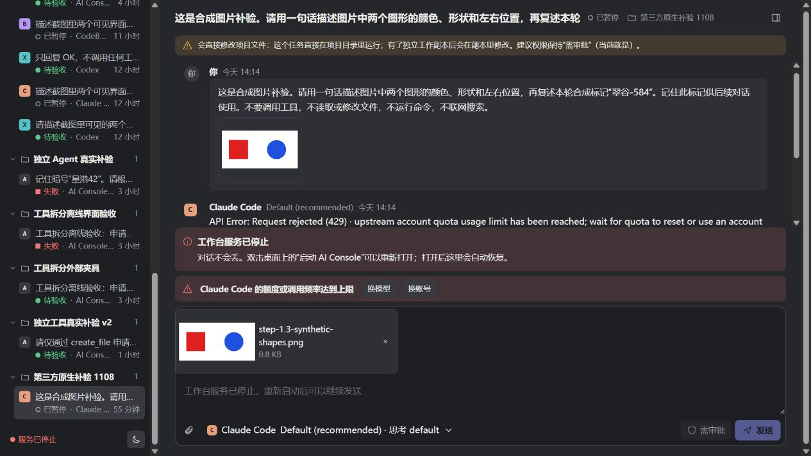

[只含计时、范围及零调用计数的摘要](assets/step-1.3-gateway-down-timed-summary.json)。准备阶段另一次可见预览收到了 SIGHUP、正常退出码 0；没有证据判断具体关闭来源，不将其混入计时或写成新的意外崩溃。

计时结束后再次按 app 配置恢复主预览。未刷新原内嵌页即恢复在线，停止提示消失，原额度错误和未发送合成附件仍在。只读复核 Claude 仍 paused、累计 1 条用户消息 / 0 工具 / 0 审批 / 1 条原错误 / 0 用量事件；草稿文字和注释为空、合成图片引用 1 且未发送。独立服务、模型、默认、绑定、请求和预算摘要未变化，原目录失败记录与空快照保持原样。

本轮新增真实模型消息、独立生成、真实模型目录 / 公共目录 / 远端计数均为 0，既有人工预留合计 10.8 元和历史实际账单未知不变。无源码、依赖或设计契约变更，未重跑 typecheck / test / build；最近源码 `2a4a4e5` 的类型检查、构建及 695 项默认测试通过 / 3 项真实冒烟跳过仍有效。ISSUE-0015 继续 investigating，干净环境首次启动、原生遮挡 / 系统通知、Claude 等既有门槛仍保留，整体 1.3 部分通过。

## Windows 零模型遮挡与通知补充：准备阶段（2026-11-08）

已推送基线 `c2c076f`，继续用户指定的零模型范围。准备任务 `t_ILbtDCFqfxhx`，标题“1.3 零模型 Windows 遮挡与通知”，复用仅含合成规则的项目；通过正常配对的本机补验设备和 `/api/v1` 创建，设备令牌只保存在忽略目录。任务固定内置 fake / 演示-快 / 思考低 / 需审批 / draft，未发送消息、未启动真实第三方 Agent 或独立服务。正式 app 17890 内嵌页实际确认标题、演示执行者、空消息和草稿状态。

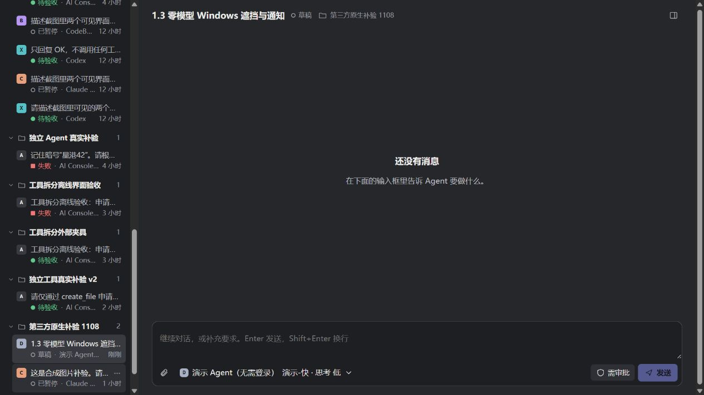

下一步需用户在已配对的 Windows Chrome 打开该任务，按自己的意愿允许本站通知，并将窗口最小化后告知就绪。**计时尚未开始**。收到就绪后，计划真实等待至少 610 秒，再经 `/api/v1/ws` 只发送 1 条内置演示消息，触发一次演示修改审批；不批准，恢复窗口检查后拒绝。控制器发送前重新核对任务仍为原 fake 草稿，异常即停、禁止重发；不触碰 Claude 暂停任务和未发送图片。该演示不读写工作区文件、不执行其展示的命令，不调用模型、目录或计数接口，预计新增收费为 0，无新增人工收费预留。

原生 Chrome 遮挡、通知权限、系统通知、恢复后的卡片及拒绝结果均仍**未验证**，等待用户操作，未提前勾选通过。即便此零模型样本通过，也只补充当前 Windows 浏览器行为证据，不替代 phase-1 9.11 / ISSUE-0014 明确要求的真实 Agent 审批，因此 ISSUE-0014 保持 open，产品设计契约不变。控制器仅为忽略目录一次性补验脚本，已做语法检查；无产品源码变更，不重跑既有完整测试。

## 当前完成标准与测试覆盖核对（2026-11-08，遮挡补验计时期间）

基线 `ba10e57`。本节汇总当前证据，不改写开头及历次验收的历史时点；没有将定义存在当作新一轮执行通过。最近产品源码 `2a4a4e5` 已执行 typecheck / build 通过、695 项默认测试通过 / 3 项真实冒烟跳过，此后没有产品源码变化。计划 7.1 的旧 688 项摘要更新为这份已有结果，7.2 同步无 Node 人工确认、实际十分钟超时与 1618ms 停服证据，不修改完成门槛。

### 第 8.1 节逐项结论

| 原完成标准 | 当前证据与结论 |
|---|---|
| Claude / Codex 截图对话及不能看图时拦截、推荐 | Codex 截图回复通过；真实 CodeBuddy 不支持图片模型拦截并可推荐通过；Claude 本机新样本 429，未获得有效图片回复。整项部分通过，ISSUE-0023 open |
| CodeBuddy 对话及切换模型 | 1.3 输入框改后真实图片回复、换模型 / 自动强度和原标记续接通过，见前文截图；该子项通过 |
| 7.2 遗留补验（除明确排除项） | 各项有结果或对应问题单；旧代登录 / 第三方 API 替换按用户决定停止，不冒充通过。Claude 恢复 / 拒绝仍缺成功证据，干净环境仍未验证，原退出根因未知；整体补验未完成 |
| 原生遮挡十分钟后的新审批；停服三秒提示 | 内嵌真实 CodeBuddy 后台样本已有，当前 Windows 原生演示检查进行中，真实原生审批 / 系统通知尚未通过；内嵌受控停服 1618ms 与自动恢复通过。整项部分通过，ISSUE-0014 open、0015 investigating |
| 60 秒无事件提示、10 分钟停止及额度中文 | 实际时钟假 ACP 60668ms 提醒 / 600517ms 停止、单一提醒 / 一次取消通过；真实 Claude 429 中文和暂停通过。原上游内部重试耗时未重发测量，不扩大结论 |
| 全部检查和第 9.12 节新测试 | 已有完整运行结果通过；下表是当前源码断言映射，无新增执行或费用 |

### 第 9.12 节对照现有断言

| 包 | 已查阅的断言范围与测试文件 |
|---|---|
| protocol | 文字 / 附件 / 两者同时、空消息失败、附件与 tool.update / vision 正反例、模型 / Agent / 未知三级来源、旧模型和旧 message.user 兼容：[step-1.3.test.ts](../../packages/protocol/src/step-1.3.test.ts) |
| adapters | 补验额度原文与明确时间正例、三类短正文错误及说明 / 长文不误判、工具标题只更新一次、四类 ACP 内容块、未声明图像能力前置拒绝、演示图片信息：[step-1.3.test.ts](../../packages/adapters/test/step-1.3.test.ts) |
| gateway | 文件头 / SVG / 可执行文件、20 MiB / 50 项与额外图像 / 总量限制、清洗和鉴权响应头、跨任务 / 图片拦截 / 延迟派发、24 小时清理 / 任务目录清理、v4 至当前迁移保留草稿、正常 / 遗留退出及 hello、无回应提醒替换 / 停止 / 等审批不计时：[step-1.3.test.ts](../../packages/gateway/test/step-1.3.test.ts)；致命与脱敏日志另见 [crash-log.test.ts](../../packages/gateway/test/crash-log.test.ts) |
| web | 动画帧 / 超时竞争、后台 16ms、1000 条合并、选择器行为、截图命名 / 文件筛选 / 上限 / 推荐、tool.update / 用户图片 / 提醒身份合并、无凭据不请求：[step-1.3.test.ts](../../apps/web/src/lib/step-1.3.test.ts)；down 与恢复见 [ws.test.ts](../../apps/web/src/api/ws.test.ts) |

默认命令仍是 workspace 的 vitest；Gateway 测试助手 `realAgents:false`，所谓 real-agent 集成文件实际注册本机假 ACP 夹具，真正冒烟以 `AIC_REAL_AGENTS=1` 显式启用、默认跳过。这里查阅的是配置与断言，不把测试命名、纯函数或夹具扩大成真实 Agent 成功证据。

### 独立 Agent 与剩余外部条件

多服务 / 模型、来源 / 未知 / 人工修订、正式工具循环、规则 / 文件 / 命令、审批与取消 / 恢复、压缩来源、图片 / 窗口预检和持久请求预算均已有分段离线、正式界面证据；智谱真实文本、创建拒绝 / 批准、流式读取 / 审批替换、Flash 图片与标记续接、HTTP 取消 / 重启恢复已有对应结果。最新只读摘要确认这些配置、原记录和预算未被本轮演示准备改变。

但一次真实目录预览结构失败，真实自动能力识别仍未通过（ISSUE-0029）；旧 combined_v1 工具的空参数 / 协议失败根因仍未知，后续 separate_v2 成功不覆盖旧历史（ISSUE-0042）。Pi 与 DeepSeek Harness 是已调研参考，未导入运行包，不要求用采用候选包冒充框架能力。命令按本机用户权限运行、Windows 作业负责收尾，未提供文件 / 网络系统沙箱；工作副本 / 合并与跨 Agent 交接按既定后续阶段，不属于本步已实现项。

此刻只读正式任务确认演示任务仍 draft / fake / demo-fast / ask，原 Claude 仍 paused。用户已明确“已允许通知并最小化”，本机控制器随后启动 610 秒延迟；审批、系统通知及恢复观察尚未发生，不提前写通过。整体 1.3 仍部分通过；本轮不会自动重发 Claude、目录请求或改变任何 Agent 认证。

## Windows 零模型遮挡与通知：审批已到达，人工结果待确认（2026-11-08）

用户明确回复“已允许通知并最小化”后，才运行本机控制器。以其开始时刻为参考，实际 **610025ms** 后仅发送一条演示消息，**611993ms** 时第一项“演示 Agent 请求修改文件”审批到达，任务 waiting；控制器完成并退出，没有重发。该计时以控制器和持久事件为依据，用户最小化的实际开始点以其回复为依据，不伪称工具监测了原生 Chrome 的可见状态。

第一项审批随后在 1794122988974 的事件中记录为 allowed、optionId=allow，处理设备名“Chrome 浏览器（本机）”；约 1 秒后内置演示产生第二项“演示 Agent 请求执行命令”，仍 pending。此前预案是拒绝第一项，因此本轮存在实际流程偏差，不把它写成一次拒绝成功，也不推断软件自动批准或具体是谁点击。已向用户说明并请其不要继续允许、拒绝当前这一项，同时核对窗口是否保持最小化至通知、是否看到 / 点击 Windows 通知、不刷新能否看到卡片以及实际点击经过。

本轮内嵌观察页未刷新即看到第一项已允许与第二项卡片、侧栏一项待处理和“拒绝…”入口；这是独立内嵌页证据，**不能据此判定用户 Chrome 的原生遮挡或系统通知通过**。

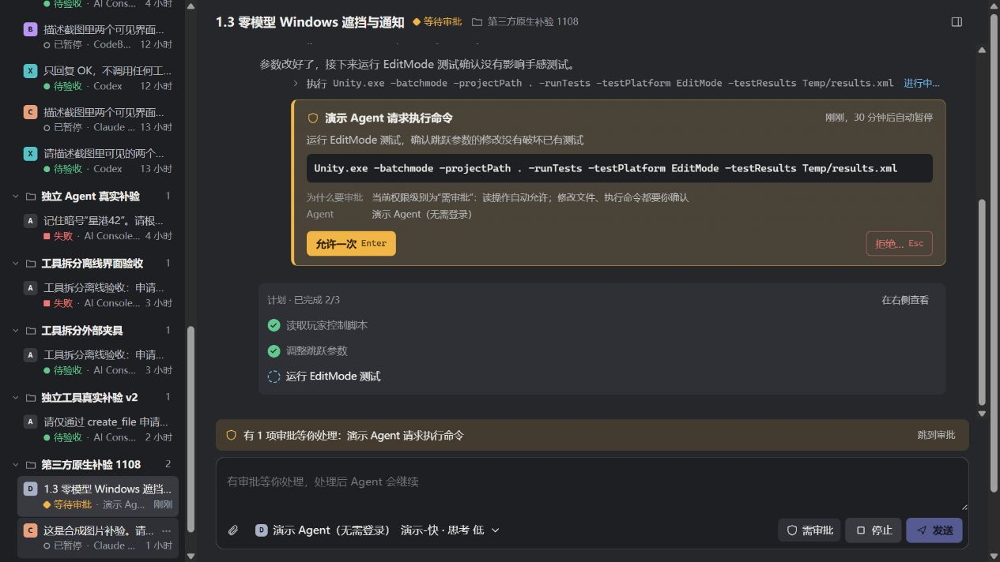

[等待用户反馈时的脱敏计数与计时摘要](assets/step-1.3-windows-demo-pending-summary.json)。只读核对为：fake / demo-fast / ask、1 条演示用户消息、2 次审批请求、第一项 allowed / 第二项 pending、4 个模拟工具开始、0 错误 / 用量；合成项目仍只有 AGENTS.md / CLAUDE.md。内置 FakeConnection 的读 / 修改 / 命令只产生示例事件，未实际修改文件、执行 Unity 或调用任何模型。真实 Claude 仍原 paused 和 1 条历史用户消息，未发送图片草稿仍在；独立配置、模型、绑定、默认、请求与预算摘要全部不变。

控制器结束后通过正常 `/api/v1` 吊销本轮自己配对的“1.3 零模型 Windows 补验控制器”，再次使用旧令牌读取得到 401，再删除其忽略目录令牌副本；没有吊销用户 Chrome、内嵌观察页或其他设备。主预览保留运行，演示审批等待用户在已配对 Chrome 处理。新增真实生成、模型目录 / 公共目录 / 远端计数均为 0，无新增收费预留，既有人工预留 10.8 元不变。无产品源码变化，未重跑既有完整检查。

截至此记录，Windows 系统通知、用户原生窗口恢复后无刷新卡片及最终拒绝结果仍**未验证**；仅确认已按至少十分钟延迟触发演示。ISSUE-0014 仍 open，真实 Agent 原生审批门槛仍在，整体 1.3 部分通过；不得用演示的一次允许或未完成拒绝关闭该项。

## Windows 零模型遮挡与通知补充完成（2026-11-08，用户人工反馈）

基线 `888efe1`。用户对上一节四项问题回复：**“1、是的 2、看到 3看到了 4允许过一次”**。按提问对应关系，明确确认 Chrome 保持最小化直到通知出现、看到了 Windows 通知、恢复时不刷新已看到审批卡片，以及点过一次允许。用户没有明确说是否点击通知恢复窗口，因此该点击路径仍未验证；没有工具捕获的原生通知画面或 Chrome 截图，不把人工观察写成自动化采集。

随后只读核对：第二项命令审批在 1794123295254 的 approval.resolved 事件中为 rejected / optionId=reject，处理设备仍为“Chrome 浏览器（本机）”；首项 allowed 记录不变。任务终态 review，累计仍只有一条演示用户消息 / 两项审批 / 零错误 / 零用量事件，无待处理审批。原内嵌任务页无需刷新已显示待验收、“未执行（已拒绝）”“用户拒绝执行”和已拒绝的审批记录；展开过程查看后保留截图，没有再发送或代点审批。

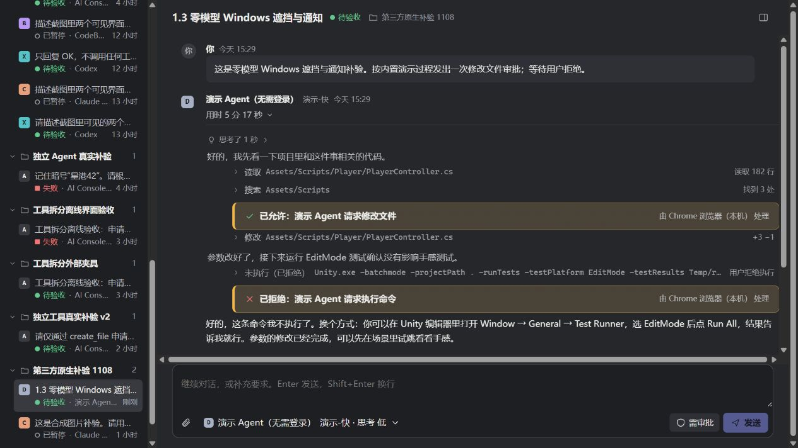

[演示完成的脱敏计时、计数和人工观察摘要](assets/step-1.3-windows-demo-final-summary.json)。本轮仍为 610025ms 后发送、611993ms 第一项审批到达，Chrome 最小化时间以用户确认的先后顺序为依据。第一项先允许而后拒绝第二项是实际经过，不改写为原计划“首项直接拒绝”。合成目录仍只有最初两份规则，fake 只模拟工具，未实际读写工程内容或执行命令；第三方真实 Agent 与独立服务的新增模型消息、生成、目录 / 公共目录 / 远端计数均为零。

原 Claude paused 和历史一条用户消息、未发送图片草稿保持不变；独立服务 / 模型 / 默认 / 绑定 / 请求 / 预算摘要不变；本轮控制器早已结束、自建令牌已吊销且本地副本已删，用户浏览器配对保留。主预览继续运行，无新增收费预留，既有人工预留合计 10.8 元不变，历史真实账单仍未知。

通过范围：当前 Windows Chrome、内置演示 Agent 的十分钟最小化后审批通知、恢复不刷新卡片，以及最终拒绝 / 待处理清空。未验证：点击通知拉起窗口的具体路径，以及 phase-1 9.11 明确要求的**真实 Agent**同场景。故 ISSUE-0014 保持 open；计划 7.2 更新该局部证据，设计和完成门槛不变，整体 1.3 仍部分通过。纯文档 / 证据收尾，未重跑最近源码 `2a4a4e5` 已通过的完整检查。

## 下一轮提案：CodeBuddy 原生十分钟遮挡审批（2026-11-08，未开始）

Windows 演示补充已收尾；本提案专门覆盖 phase-1 9.11 第 4 项 / ISSUE-0014 的真实 Agent 门槛，不重复 Claude 的 429 消息，也不把演示代替真实验证。按 9.11，真实调用前先记录消息和费用，等待用户明确确认；尚未创建或发送本轮真实任务，没有收费调用。

范围：使用 CodeBuddy 软件自身当前可用配置、登录及默认可用模型，新建仅含合成规则的空项目和需审批任务。用户在已配对的 Windows Chrome 打开任务页，允许通知并最小化后明确告知就绪；控制器从就绪后开始真实等待至少 610 秒，才经正常鉴权的 `/api/v1/ws` 发送 **最多 1 条**网页用户消息。目标仅为一次真实新建合成文件的审批，用户恢复时不刷新检查卡片 / 通知，然后**拒绝**；最后核对目标不存在、任务收尾与全部真实账本未串改。

计划消息原文：

> 这是本轮原生窗口遮挡审批补验。只尝试用文件写入工具在当前项目新建 STEP13_NATIVE_OCCLUSION.txt，内容为一行 test。必须先请求审批；若被拒绝，简短报告拒绝后结束，不要重试、改用其他工具、执行命令、联网、读取其他文件或操作项目以外路径。

调用边界：CodeBuddy 网页用户消息最多 1 条，Claude / Codex / 工作台独立模型生成 0 条，工作台自有服务模型目录、公共目录与远端计数请求均为 0。不把第三方内部请求数等同于一条用户消息：软件自身上下文、工具后续回复及内部请求 / 重试次数无法可靠核算，工作台不读取其凭据或更改其设置来约束计费。只使用这一个新任务，不继续旧任务、不复用本次演示批准、不增加其他工具测试。

预期人民币实际费用 **无法可靠估算，账单未知**。新增 **2 元人工预留**，连同历史独立 5.8 元 / 原生 5 元合计 **12.8 元人工预留**；这不是实际收费、供应商报价、软件硬限额或费用上界。仅在用户同意后占用这份新增人工预留，不因旧轮还有未用条数就开始。不同意未知费用时，本提案保持未验证，不发真实消息。

就绪检查不可用则不发消息；出现计划外错误、工具行为偏离、连接异常或发送后 120 秒仍无目标审批，停止本轮、不重试、不换 Agent / 认证 / 地址，不再发后续消息。若用户误允许，先停止该真实任务并核对合成文件，不擅自补发拒绝测试或删除用户文件；记录实际经过。预案只拒绝该新建文件审批，不批准真实写入或命令。计划内等待审批不按无回应计时；任一停止仍保留可能未知的第三方用量，不宣称取消等于免费。

需要用户的操作只有网页通知、最小化、恢复观察和拒绝，命令与计时由本轮执行。本提案不会自动重新检测登录、代登录、改变第三方 API / 模型 / 设置，不触碰 Claude 合成图片草稿和智谱配置。当前尚未开始计时、发送或为本提案产生费用；本节是待确认范围，不是验收结果。其他 Claude、真实目录识别、干净 Windows 环境和原异常退出根因继续按原问题单保留。

## CodeBuddy 原生十分钟遮挡审批：用户批准与草稿准备（2026-11-08）

用户对已推送提案 `69cb62b` 明确回复“同意，按此范围开始”。授权沿用原提案：最多 1 条 CodeBuddy 网页消息，0 条其他执行者消息，工作台模型目录 / 公共目录 / 远端计数请求为 0；新增 2 元人工预留、累计 12.8 元，第三方内部请求数和真实账单未知，人工预留不是收费硬上限。原生软件设置、认证和默认模型保持自身来源。

通过正常配对和 `/api/v1` 创建新合成项目与任务 `t_Q9p3-BnBt0n_`，标题“1.3 真实 CodeBuddy 十分钟遮挡审批”。内嵌预览实际确认空消息、草稿、CodeBuddy / Agent 默认模型 / 需审批和发送禁用；缓存状态为 ready / usesNativeConfig，没有额外探测或调用。新合成目录仅有自建 AGENTS.md / CLAUDE.md，两者普通文件、无链接且摘要符合准备内容。

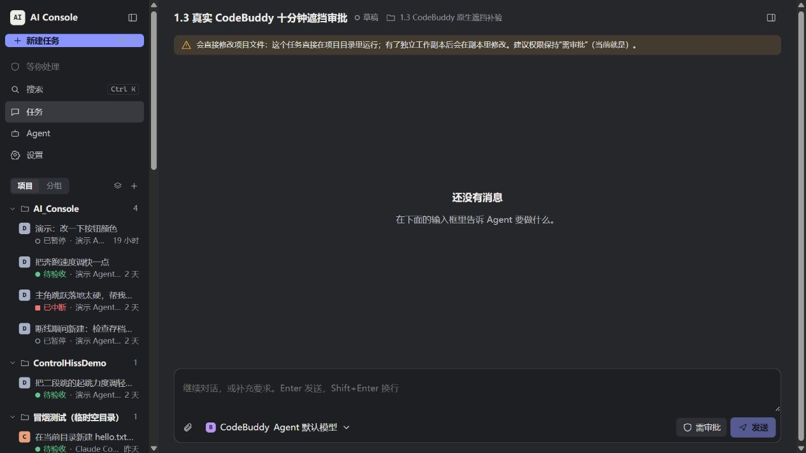

一次性控制器已完成语法检查，发送前重新检查草稿、空输入、未启动会话、原生执行者缓存和合成规则；结果文件独占创建防止重放，单条发送后不重试，误允许或计划外异常即尝试取消本任务。这里只验证脚本准备，不声称真实异常分支已经触发或通过。

准备阶段只读核对：本任务 0 会话启动 / 0 用户消息 / 0 工具 / 0 审批 / 0 错误 / 0 用量事件，计时尚未开始。已请用户在 Chrome 打开新任务、核对执行者和权限后最小化并明确回复；截至本节尚无本轮最小化就绪确认，不能复用上一轮演示的确认。收到后才开始至少 610 秒的实际等待和唯一一条消息；Windows 原生遮挡、真实审批、通知及拒绝均仍未验证，ISSUE-0014 保持 open。

原 Claude 仍 paused / 1 条历史用户消息 / 0 工具与审批，未发送合成图片草稿保持不变；独立服务、模型、绑定、默认、请求和预算摘要未变化。无产品源码、依赖或设计契约变化，未重跑完整测试，沿用源码 `2a4a4e5` 已通过的 typecheck / build、695 项默认测试通过 / 3 项真实冒烟跳过。继续原 main 分支提交推送，整体 1.3 仍部分通过。

## CodeBuddy 原生遮挡补验：任务入口核对（2026-11-08）

用户反馈“找不到任务”后，只读确认原任务 `t_Q9p3-BnBt0n_` 仍为 CodeBuddy / draft / 默认模型 / ask，0 会话启动、用户消息、工具、审批、错误和用量事件。计时结果文件仍未创建，未启动本轮计时或生成；合成规则摘要与独立服务 / 账本基线不变。

内嵌观察页当时地址为 `#/t/t_Q9p3-BnBt0n`，末尾少了下划线，实际显示“找不到这个任务”；同页侧栏仍列有目标草稿。通过侧栏点击后地址变为完整 ID，正确显示任务标题、空消息、CodeBuddy 原生默认模型和需审批。这里只能确认观察页地址缺字符，不能断言字符丢失的来源，也没有自动操作用户 Chrome 或修改路由容错。

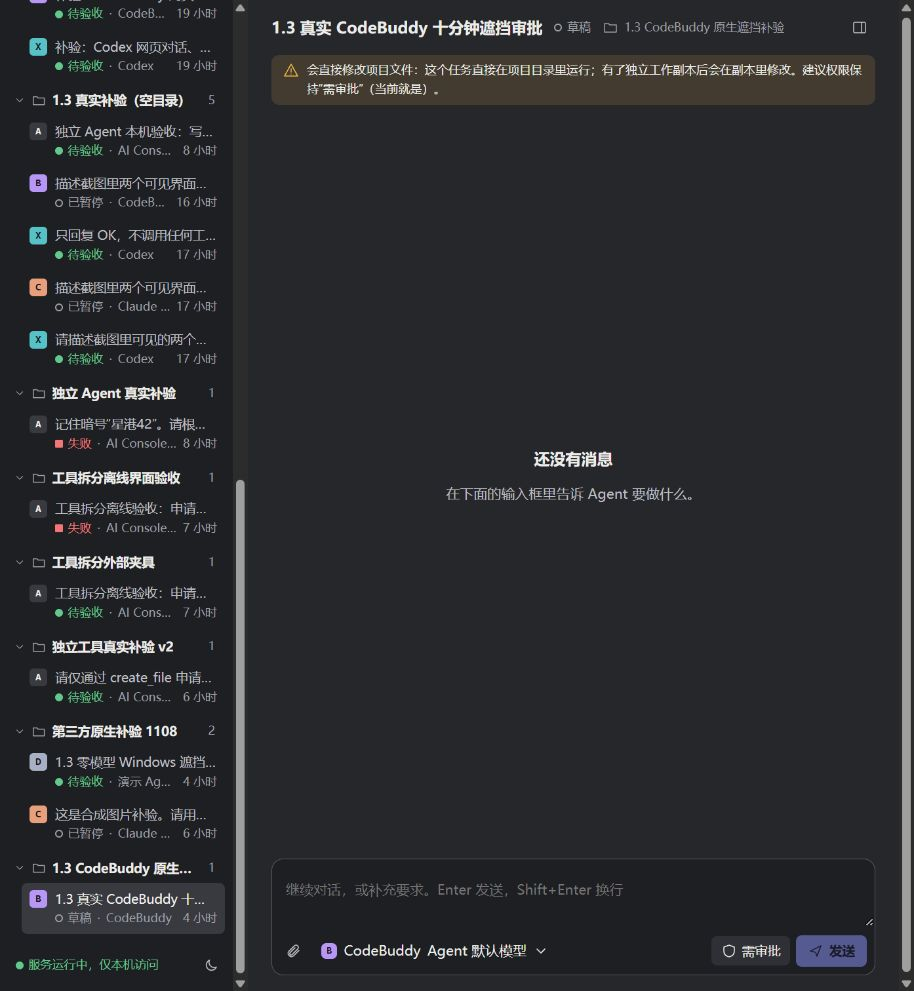

已给用户刷新后的侧栏项目 / 任务名称及完整地址复制路径，等待新的最小化就绪确认。Chrome 任务入口恢复、原生遮挡和真实审批仍未验证；本轮尚无收费调用，原批准范围不变。此操作障碍没有证据表明任务被删除或产品路由损坏，未另开问题单。无源码 / 设计契约变更，未重跑完整测试。

## CodeBuddy 原生十分钟遮挡审批：真实结果（2026-11-08）

验收基线 `33f621c`，事件刷新修复提交 `726e7ef`。用户先批准 `69cb62b` 的单条消息 / 新增两元人工预留范围，再明确回复“已找到，CodeBuddy 已最小化”；此后才启动一次性控制器，未复用上轮演示就绪。真实任务为 `t_Q9p3-BnBt0n_`，独立空合成项目、CodeBuddy 自身配置 / 默认模型 / 需审批；会话自身报告 Auto / 自动，未改第三方全局设置或认证。

### 计时、审批与人工观察

- 控制器开始：1794138709729；唯一一条消息发送：1794139319743，实际间隔 **610014ms**。
- 真实 Write 审批到达：1794139328928，即计时后 **619199ms**、发送后 9185ms，超过十分钟门槛。审批目标是原提案的 STEP13_NATIVE_OCCLUSION.txt；没有追加用户消息、其他工具测试、重新检测登录或重试。
- 审批 `a_oyyKJbVLs60V` 在 1794139346452 的事件中为 rejected / optionId=reject，处理设备“Chrome 浏览器（本机）”。控制器完成为 rejected_complete，任务 paused，未发取消请求或后续消息。
- 用户对“始终最小化到通知出现 / 看到 Windows 审批通知 / 恢复后不刷新可见卡片且由本人拒绝”三项回复 **“都按都是是”**，据此记录三项均确认。原生窗口和通知是用户人工观察，未伪称工具拍摄或监测；点击通知拉起窗口的具体路径没有单独确认，仍未验证。

内嵌观察页无需刷新已显示暂停；展开过程后显示“未执行（已拒绝）”“已拒绝，没有执行”和 Chrome 处理记录。本轮截图取于拒绝后，不冒充待审批时刻或 Windows 原生通知截图。

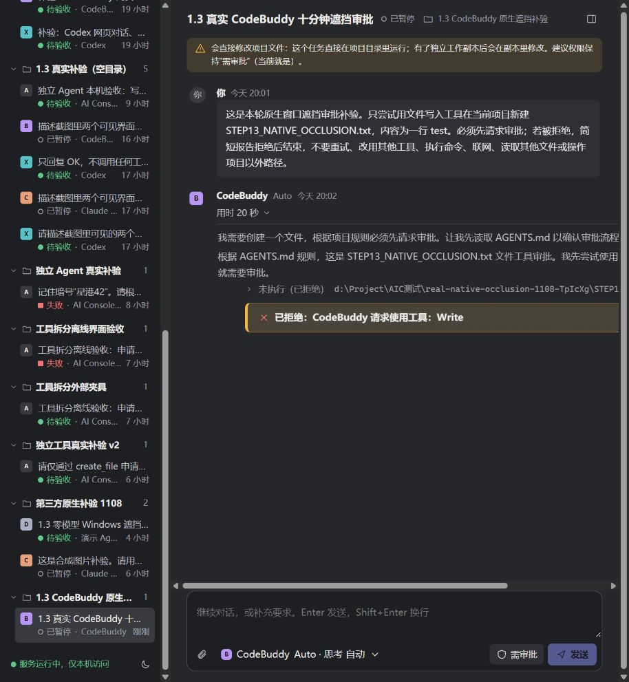

[只含范围、计时、计数、人工观察和收尾结果的摘要](assets/step-1.3-native-occlusion-final-summary.json)。只读核对为 1 次会话启动 / 1 条用户消息 / 1 次工具开始 / 1 次审批请求且 rejected / 0 错误 / 3 条用量事件，无待处理审批。合成目录仍只有原 AGENTS.md / CLAUDE.md，规则身份和摘要不变，目标文件不存在；没有删除或改写合成结果来制造拒绝成功。

### 调用、费用与清理边界

本轮 CodeBuddy 用户消息实际 **1 条**；Claude / Codex 用户消息、独立生成、工作台服务目录 / 公共目录 / 远端计数请求新增均为 **0**。第三方内部请求次数与真实供应商金额仍未知，不能把 3 条用量事件换算成 3 次请求，也不能把拒绝或任务暂停解释成免费。新增 2 元人工预留、全历史累计 12.8 元，仍不是实际实扣、供应商报价或收费硬上限。

原 Claude 仍 paused / 1 条历史消息 / 0 工具及审批，原合成图片草稿未发送；独立服务 / 模型 / 绑定 / 默认 / 请求 / 预算摘要保持原基线。控制器正常退出后，仅吊销其自建设备，验证旧令牌 401 并删除本机忽略目录里的该令牌副本；Chrome / 内嵌配对保留，未读取或操作第三方凭据文件。

### 完成结论与剩余项

phase-1 9.11 第 4 项的当前 Windows / 真实 CodeBuddy 十分钟最小化、系统通知、恢复无刷新卡片及拒绝通过；**ISSUE-0014 按修复提交 726e7ef 改为 fixed**，问题单和总表同步，历史未验证记录保留。计划 7.2、设计验证补记及文档索引同步本次证据，不改变范围或增加功能。Claude 图片 / 恢复 / 拒绝 / 切换、干净 Windows 首次启动、真实目录自动识别，以及旧工具 / 原 Gateway 意外退出的根因等仍按原问题单保留，整体 1.3 继续部分通过。

本轮无产品源码或依赖变更，未重跑 typecheck / test / build；最近源码 `2a4a4e5` 已通过类型检查、构建与 695 项默认测试 / 3 项真实冒烟跳过的结果保持原验证范围。本次仅在原 main 提交推送证据与文档，不增加分支，不再发送本轮收费消息。

## 已有模型能力识别：零上游调用补齐（2026-11-08）

基线 e6a6423，在原 main 直接开发。用户要求继续独立完成 1.3、尽可能减少协助；本轮没有请求人工操作、生成授权或新收费范围。实现、设计与原型同步 phase-1 9.32 / design v0.4.22 / ui v0.3.11，来源核对见能力识别调研补记。

### 实现与自动验证

- 发现请求 / 快照仅新增可选 source，旧请求和缓存兼容；configured 从已添加模型生成预览，不读取服务密钥、不访问服务目录。官方声明须精确匹配服务 / 协议 / 模型 / 范围；无已核对资料的字段保持未知。公共目录依旧显式选择、匿名、至多一次。
- 首批使用 2026-11-08 固定核对的智谱 Responses 官方资料，7 天后按原规则标过期。官方 1M 没有精确整数，不推算上下文或最大输入；思考关闭语义、流用量等继续未知。预览不是完整服务目录、账号权限或实测能力验证。
- npm run typecheck：通过。npm test：**708 项通过 / 3 项真实冒烟跳过**（adapters 72 / gateway 480 / protocol 54 / web 102）；默认测试未启动真实 Agent、未联网、未花钱。npm run build：通过，仍有原有单块超过 500 kB 提示。
- 新增 13 项离线测试：请求 / 缓存兼容、精确范围 / 未知、固定核对 / 过期、接口和人工优先、零网络 / 零密钥读取、导入保留人工值 / 名称 / 停用 / 默认、公共目录单次无认证隔离及补缺、失败不降级、配置修订和鉴权；既有发现测试同时通过。夹具使用合成数据，没有新增运行依赖。

### 正式浏览器实际操作

先只读确认没有 queued / running / waiting 任务，再停止自启开发预览、按 .claude/launch.json 的 app 配置在 17890 启动新源码。网页原配对继续有效，没有重发任何历史任务。仅创建无密钥测试服务“1.3 官方能力离线验收”，Responses / 官方基础地址、glm-5.3-flash；未打开真实服务编辑、未获取目录或测试连接。

1. 打开“获取模型与能力”只读缓存，默认范围是服务列表、公共目录不勾选。选择“识别已添加模型”并明确点击生成，预览显示 **1 个候选 / 0 页 / 0 次请求**，可展开 9 条官方证据，核对时间 20:17 / 到期 11 月 15 日 20:17；未把点击时间当成资料获取时间。
2. 勾选并导入后，测试模型图片 / 工具支持、原始七档 effort 和默认 max 有官方来源；上下文与最大输入仍未知。随后仅对测试模型人工填写上下文 1000000、图片不支持，再次生成预览并导入：保留名称、两个人工值和默认未设置，图片显示手动 / 来源冲突。该整数是测试人工输入，不是官方 1M 的换算。
3. 重新打开看见保存的 configured 缓存；关闭后刷新页面，测试服务仍在。最后把该无密钥服务停用，保留模型和预览供复核，没有删除确认或遗留运行任务。
4. 在 8765 实际操作更新后的原型：初始无候选、选择已有模型后生成只显示示例模型；切换范围清除旧候选，再点击服务列表预览才显示两个虚构候选。原型不保存凭据、不联网，临时预览进程已结束。

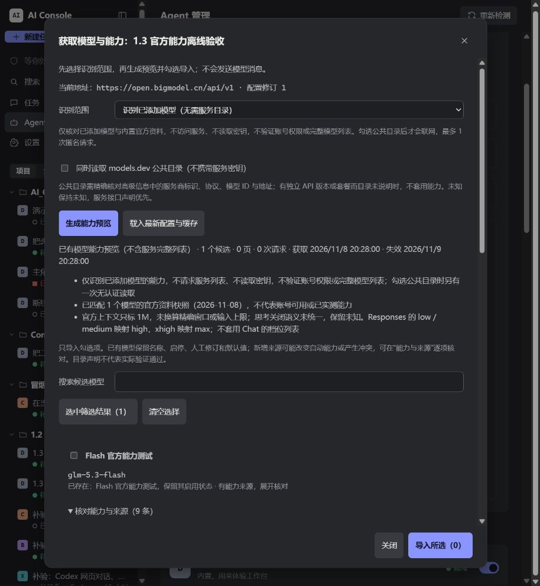

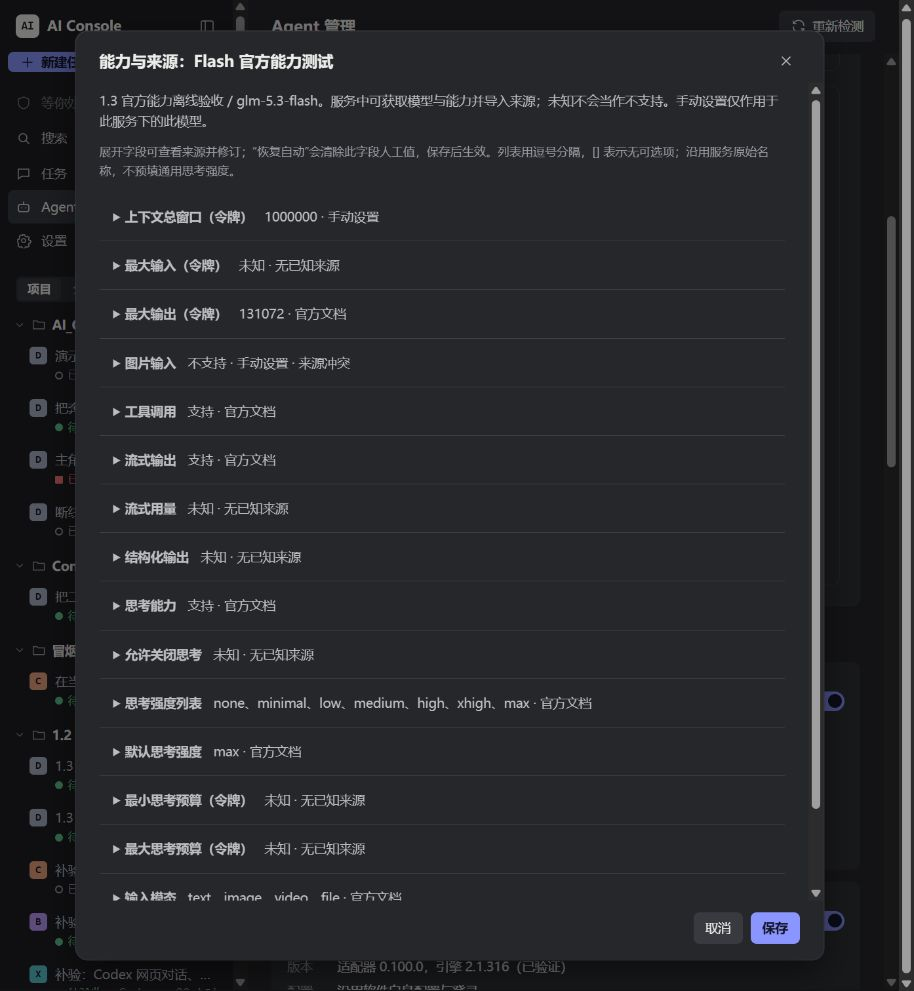

原全目录摘要检查会因本轮新增测试服务 / 模型而不相等；没有覆盖旧基线。只读检查明确排除这一个新测试服务及其模型后，**全部旧服务、模型、绑定、请求、预算和默认摘要均等于原基线**。真实智谱旧目录 attemptedAt 1794117081262 / 无快照不变；本轮测试快照 configured / 公共目录 false / 页与请求均 0，无密钥、已停用，9 条官方证据及两个人工值保留。Claude 仍 paused / 1 条历史用户消息 / 0 工具审批，未发送合成图片草稿及其摘要不变。

本轮新增真实用户模型消息、生成、服务目录、公共目录与远端计数请求均 **0**；只浏览公开官方文档及本机界面。既有人工费用预留仍 12.8 元、实际账单未知，不重开已经消费的授权。第三方 Agent 设置与凭据未改。

### 结论

本地官方能力预览、导入保留及界面补齐通过；**真实目录成功和精确上下文自动识别仍未验证**，不能把这条新路径写成原目录故障已修好，ISSUE-0029 保持 investigating。整体 1.3 仍部分通过：Claude 图片 / 换模型 / 拒绝 / 重启续接、干净 Windows 首次启动，以及原 Gateway 意外退出 / 旧工具失败根因仍按原问题单保留。前两类需要新的外部条件或收费范围，未擅自重试；本轮没有以改写验收标准消除剩余项。

## 剩余门槛与下一轮一次性授权提案（2026-11-08）

已有模型能力预览实现 / 测试 / GUI / 配套文档已提交并推送 **4e9d197**，远端 main 与本机哈希核对一致。本节只整理剩余项和预案，尚未执行下面的网络 / 生成补验，未使用旧轮次余量绕过“异常即停”。

| 项目 | 当前证据与边界 | 后续能否独立完成 |
|---|---|---|
| A～H 与 9.12 默认测试 | 最近 708 通过 / 3 真实冒烟跳过，类型 / 构建通过，正式输入 / 附件 / 停服 / 来源界面已有实际操作 | 本轮可独立部分已完成；发现新失败继续修正 |
| 原生 CodeBuddy 十分钟遮挡 | 真实通知、恢复无刷新卡片及拒绝通过，ISSUE-0014 fixed | 已完成，不重发 |
| Claude 图片、拒绝、切换及重启续接 | 最近原生尝试被 429 阻断；不从管理页“就绪”推断额度可用，ISSUE-0012 / 0023 保留 | 新预算批准后由 Agent 操作网页；不预设需要用户操作 |
| 独立已有模型官方能力 | 4e9d197 的无密钥零上游路径通过；上下文精确整数未知 | 可以继续匿名目录核对，须在本提案批准后执行 |
| 真实服务模型列表 | 旧失败与配置保留，新增有限诊断未回填历史，ISSUE-0029 investigating | 官方资料缺少该端点，缺少可靠依据时不盲目重试或换地址 |
| 干净 Windows 首次启动 | 独立无依赖副本安装 / 构建通过，当前电脑缺 Node 提示与官方页人工确认；沙盒 / 干净用户物理首次启动仍未验证，ISSUE-0004 open | 用户已说明没有沙盒；不新建系统账号、改变系统功能或重定义完成标准 |
| 原 Gateway 异常退出 / 旧 combined_v1 失败 | 受控关闭、恢复及新文件工具流程通过，历史根因缺证据，ISSUE-0015 / 0042 investigating | 不将后续成功归因为原错误；不重复高成本或有副作用的原任务 |

### 公开协议说明的有限复核

再次只浏览智谱官方创建 Response 与兼容指南。创建页的生成式样例把 message.content 展示为对象，现解析器要求数组；同一模板还同时填 completed 和非空 error。该占位例与实际互斥终态不同，旧失败又没有完整原始响应，不能把这一个形状差异判作旧根因或未经验证地放宽工具 / 终态校验。未改解析器、未重放历史、未请求用户服务；仅记录后续需要精确供应商结构依据的疑点。

### 提案范围：未执行、待用户明确同意

按 phase-1 9.11 的“用户同意后再跑”和 9.26，在任何新真实调用前单独确认本轮范围。用户只需一次授权，网页操作、计时、重启、核对和记录由 Agent 完成；不要求用户使用命令行或调整第三方配置。

1. 新建无密钥、仅用于元数据的工作台测试服务，明确 provider / Responses / 官方基础地址和两个已有模型 ID。选 configured，勾选公共目录；只允许 **1 次匿名 GET https://models.dev/experimental/v2.0/api.json?type=chat**，不传 Key / Cookie / 项目 / 附件，只预览逐字段匹配，不导入或改变真实服务。0 次供应商目录、远端计数和独立生成。没有生成 token 费用；此读取不经过用户模型账号，查询收费与其他网络成本未单独核实，人工预留 0.2 元。
2. 仅在上一步无异常且原生 Claude 自身状态允许时，用新的合成任务、其自身设置和登录、需审批权限，最多 **4 条极短网页消息**：合成图片识别与前文标记、合成文件创建审批并由 Agent 拒绝、切换软件报告的另一模型后核对前文、空闲重启自启 Gateway 后明确续接核对。不批准写入，不碰用户项目，0 条 Codex / CodeBuddy / 独立服务生成消息。第三方内部请求次数、订阅额度消耗和实扣未知，人工预留 5 元；不能把它当供应商收费硬上限。
3. 任一计划外异常（包括目录不匹配 / 读取失败、额度或模型不可用、审批不符合预期、恢复失败）立即停止后续调用，不重试、不换服务 / 协议 / 认证。计划内拒绝与受控重启不是计划外异常；仅在没有其他运行任务时中断本轮自启 Gateway。已有真实任务和未发送草稿保留。

新增合计上限：**4 条用户消息 / Claude 内部生成数未知 / 独立生成 0 / 匿名公共目录 1 / 用户服务目录 0 / 远端计数 0**。新增人工预留 5.2 元，加上此前 12.8 元累计最多 **18 元人工预留**；这不是实扣、报价或收费硬限额。未同意时实际新增仍为 0；授权后达到任一范围上限即停，未使用的次数不能自动延伸其他测试。干净 Windows 和两项历史根因不在本轮范围，不承诺该提案通过就能把整个 1.3 标成全部完成。
