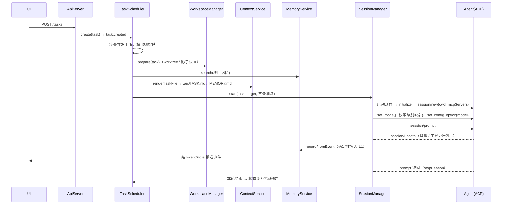
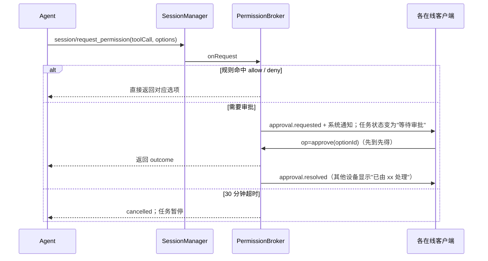
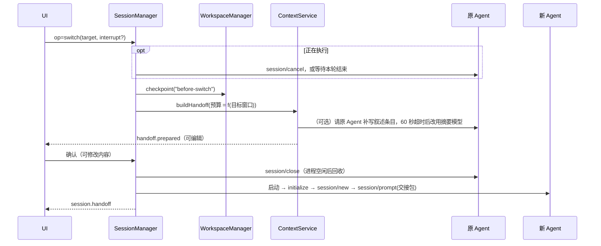

# AI Console 设计文档

> 版本 0.4.1 · 2026-11-08 · 状态：设计中
> v0.4.1 补充（2026-11-08 重新规划）：第一阶段步骤改为 1.1～1.7，里程碑和步骤的对应关系见第 19 节；附件与图片（15.2）、Agent · 模型 · 思考强度统一选择器（ui 6.5）、右侧“详细”（15.1）、对话导航条、新建任务起始页已写入设计。
> v0.4.1 补充（2026-11-07 轻量化）：参照 OpenBitFun 精简界面；上下文用量与 token 统计的数据来源和规则（15.5）。
> v0.4.1 补充（2026-11-07 用户试用）：Agent 启用开关，默认只开 Claude Code、Codex（6.7）；对话注释按任务保存（15.2）；侧聊连续换模型只留一行提示。
> v0.4.1 变更：CodeBuddy 与 WorkBuddy 拆成两个独立的 Agent，CodeBuddy 改用工作台自带的官方独立版引擎（第 6 节、25.1）；对话按“轮”显示、Markdown 渲染、连续切换只留一行提示、选中文字的小菜单（15.2）；Gateway 兜底日志 `logs/gateway.log`（第 17 节）。依据 ISSUE-0015～0018。
> v0.4 新增：第 22 节自动化（定时与事件触发）、第 23 节监控与告警、第 24 节快速判断层、第 25 节能力中心（统一管理 MCP 和 Skill）、第 26 节侧边聊天、第 27 节媒体生成预留；任务分组与最近活动排序（第 13 节）。
> 本版范围：本机 + 局域网直连。外网远程（VPS 中转）和手机应用放在后期，只在第 18 节保留扩展点。
> v0.3 变更：
> - 按调研结果修正 ACP 能力和适配器包名（第 6 节）。
> - 重写上下文与记忆层（第 7 节）。
> - 新增 Gateway 模块与关键流程（第 10 节）、资产与三维预览预留（第 11 节）、插件机制（第 12 节）。
>
> 调研依据见 `docs/research/context.md`。

## 1. 目标

把本机已安装的 AI Agent（Claude Code、Codex、CodeBuddy、WorkBuddy、ZCode）整合到一个图形化工作台里：

- 统一入口：一个界面里对话、派发任务、看进度、审批操作。
- 随时切换：同一任务内切换模型、账号或 Agent，上下文尽量不丢。
- 并行工作：多个任务同时跑，互不干扰，完成后再合并。
- 多端访问：桌面软件 + 浏览器（本机、局域网），以后扩展外网和手机。
- 全程图形化：安装、登录、配置、排错都通过界面完成，用户不需要使用命令行。

非目标（本版不做）：

- 不自研 Agent 和模型调用，只做编排和界面。
- 不直接控制各家的图形界面（CodeBuddy 编辑器、Claude 桌面版等），只调用它们的命令行引擎。
- 不做外网访问、手机应用、多机管理（预留扩展点）。

## 2. 总体架构

```
┌──────────────── 客户端（同一套 React 界面）────────────────┐
│  桌面软件 (Tauri)      本机浏览器        局域网其他设备浏览器  │
└───────┬───────────────────┬──────────────────┬──────────────┘
        │ IPC 取令牌         │ HTTP + WebSocket │
        ▼                   ▼                  ▼
┌──────────────────── Gateway（本地常驻进程）────────────────────┐
│ API 层：REST + WebSocket · 鉴权 · 配对                         │
│ ─────────────────────────────────────────────────────────── │
│ TaskScheduler   SessionManager   WorkspaceManager             │
│ ContextService  MemoryService    PermissionBroker             │
│ AgentRegistry   AssetService     PluginHost                   │
│ EventStore/EventBus   Notifier   AuthService                  │
│ ─────────────────────────────────────────────────────────── │
│ ACP Client（统一，@agentclientprotocol/sdk）                   │
└──┬──────────┬──────────────┬─────────────────┬────────────────┘
   │ACP       │ACP           │ACP              │ZCode Protocol→ACP 桥
 claude      codex     codebuddy / workbuddy  zcode 引擎
 (适配器)    (适配器)  (各自的引擎,--acp)     (ZCode 内置,app-server)
```

设计原则：

1. Gateway 是唯一核心，不带界面，所有状态都在它这里。界面关掉，任务照样跑。
2. 客户端是"瘦"的，只负责显示和发指令；任何客户端断开重连，都能从 Gateway 恢复完整状态。
3. Agent 统一走 ACP（Agent Client Protocol）。不支持 ACP 的，写桥接层转成 ACP，上层不感知差异。
4. 上下文由工作台持有（事件记录 + 工作区 + 任务文档 + 结构化记忆），不解析各家私有的会话文件；能用 Agent 原生恢复时优先用原生恢复。
5. 能力以 ACP 握手结果为准，不在代码里写死。同一操作按能力分级降级，界面如实显示走的是哪一级。

## 3. 部署形态

### 3.1 安装包

- 一个 Windows 安装包（.exe，Tauri 生成），内含：桌面外壳、Gateway、Node 运行时、界面静态文件。
- 安装后：开机自启、常驻托盘。关闭窗口只是隐藏；退出要从托盘菜单点"退出"，有任务在跑时会提示确认。
- 自动更新：启动时检查，有新版本弹窗提示，点一下更新。更新时先等运行中的任务结束，或由用户确认中断。

### 3.2 进程关系

```
AI Console.exe（Tauri 外壳）
 └─ gateway.exe（Node 单文件，作为 sidecar 启动并守护）
     ├─ claude-agent-acp 进程（内部调用 Claude Agent SDK）
     ├─ codex-acp 进程（通过 CODEX_PATH 指向本机 codex）
     ├─ thumbnail worker（缩略图、资产元数据解析，可选）
     ├─ codebuddy --acp 进程
     └─ zcode 桥接进程 ─ zcode app-server 进程
```

- 外壳负责守护 Gateway：Gateway 异常退出后自动重启（1 分钟内最多 3 次，超过则提示用户并打开诊断页）。
- 所有 Agent 子进程放进同一个 Windows Job Object，Gateway 退出时一并结束，不留残余进程。

### 3.3 目录布局

```
%APPDATA%\AI_Console\
 ├─ config.json        全局设置（不含密钥）
 ├─ data.db            SQLite：项目、任务、会话、事件、记忆（含 FTS5 索引）、资产索引、设备
 ├─ logs\              Gateway 与各 Agent 的日志，按天滚动，保留 14 天
 ├─ plugins\           用户安装的插件（第 12 节）
 └─ shadow\<项目ID>\    非 git 项目的影子仓库（快照）

%LOCALAPPDATA%\AI_Console\
 ├─ cache\thumbs\      缩略图缓存（按内容哈希命名，可随时清空）
 ├─ cache\assetblobs\  非 git 项目大文件的任务前备份（按哈希去重，第 11.5 节）
 └─ worktrees\<项目名>\<任务短ID>\   git 任务的独立工作副本

工作区内：
 └─ .aic\TASK.md  .aic\HANDOFF.md  .aic\MEMORY.md   任务说明、交接包、项目记忆摘录（第 7 节）
```

- 工作副本放在应用目录，不会在用户项目里多出文件夹。界面上提供"在资源管理器中打开""在 IDE 中打开"。
- `.aic\` 目录：
  - git 项目：写在 worktree 里，并加入仓库的 `info/exclude`，不进 diff，也不会被提交。
  - 非 git 项目：写在项目目录里，影子仓库会忽略它；任务结束后自动删除。
  - 写入失败时（例如目录只读），改为把内容直接嵌入首条消息。
- 密钥（API Key、令牌）存 Windows 凭据管理器，不写入以上任何文件。

## 4. 技术选型

| 部分 | 选择 | 说明 |
|---|---|---|
| 界面 | React + Vite + TypeScript + Tailwind | 桌面、浏览器、手机共用一套，响应式布局 |
| 状态管理 | Zustand + TanStack Query | 实时事件进 Zustand，REST 数据走 Query 缓存 |
| 桌面外壳 | Tauri 2 | 托盘、自启、通知、自动更新、原生文件对话框 |
| Gateway | Node.js + TypeScript + Hono + ws | ACP、Claude、Codex 官方 SDK 均有 TS 版 |
| ACP | `@agentclientprotocol/sdk`（2026-11 为 2.4.0） | 旧包 `@zed-industries/agent-client-protocol` 已停更；锁定版本，升级前跑契约测试 |
| 存储 | SQLite（better-sqlite3）+ Drizzle ORM | 单文件、免安装、可迁移；better-sqlite3 默认编译了 FTS5 |
| 检索 | SQLite FTS5；向量检索 sqlite-vec 作为可选项 | sqlite-vec 尚未到 v1，默认关闭 |
| 文件监听 | 原生递归监听（候选：`@parcel/watcher`、chokidar，待选型验证） | Windows 下需支持大目录和高频写入 |
| 三维预览 | three.js（候选，在客户端渲染） | glTF/GLB 优先；FBX/OBJ 用对应 loader；其他格式经转换器（第 11 节） |
| 打包 | Node SEA 单文件可执行 | 用户无需安装 Node |
| 工程管理 | pnpm monorepo | 前后端共享 `protocol` 类型 |
| 测试 | Vitest（单元）+ Playwright（界面） | 适配器用假 Agent 做契约测试 |

## 5. 工程结构

```
AI_Console/
├─ apps/
│  ├─ desktop/        Tauri 外壳（Rust 少量代码：托盘、守护、IPC）
│  └─ web/            共用界面
├─ packages/
│  ├─ gateway/        核心守护进程
│  ├─ adapters/       各 Agent 适配器与桥接
│  │   ├─ claude/  codex/  codebuddy/  zcode/
│  │   ├─ generic-acp/ 通用 ACP 适配器（按清单接入任意 ACP Agent）
│  │   └─ fake/       测试用假 Agent
│  ├─ previewers/     内置预览器：image/  model3d/  audio/  text/
│  ├─ plugin-sdk/     插件清单与接口类型
│  └─ protocol/       API、事件、实体的类型定义
├─ docs/              设计文档
└─ 启动开发环境.bat     双击启动开发环境
```

## 6. Agent 接入层

### 6.1 本机实测情况（2026-11-05）

| Agent | 引擎位置 | 协议 | 备注 |
|---|---|---|---|
| Claude Code | npm 全局 `claude` | ACP：`@agentclientprotocol/claude-agent-acp` | 支持订阅登录与 API Key；`@zed-industries/claude-code-acp` 已废弃 |
| Codex | npm 全局 `codex` | ACP：`@agentclientprotocol/codex-acp`；备选 `codex app-server` | 支持 ChatGPT 登录与 API Key；适配器自带 codex，需用 `CODEX_PATH` 指向本机版本，保证登录状态和版本一致 |
| CodeBuddy | 工作台自带的官方独立版 `@tencent-ai/codebuddy-code`（packages/adapters 的依赖，锁定 2.181.0） | 原生 `--acp`（stdio） | 2026-11-07 起改用独立版（ISSUE-0016）；账号属于 codebuddy.ai，在工作台里用浏览器登录；模型含 glm-5.1、kimi-k2.5、minimax-m2.7、deepseek-v3-2 等 |
| WorkBuddy | `%LOCALAPPDATA%\Programs\WorkBuddy\resources\app.asar.unpacked\cli\…`（WorkBuddy 内置引擎） | 原生 `--acp`（stdio），仅完整引擎 | 账号属于 workbuddy.cn，在 WorkBuddy 里登录；2.165.0 起只带精简引擎 `codebuddy-lite-wb.mjs`，ACP 模式下没有响应，检测为“暂不支持”（ISSUE-0016） |
| ZCode | `%LOCALAPPDATA%\Programs\ZCode\resources\glm\zcode.cjs`（v0.17.1） | `zcode app-server`（自有 ZCode Protocol） | 需写桥接层；备选 `-p --json` 单次模式 |

CodeBuddy 编辑器本体是 VS Code 改版，没有可调用的 Agent 命令行。原来借用 WorkBuddy 内置的引擎，但 WorkBuddy 自动更新会替换它（2.165.0 起变成精简版），而且两者本来就是两套账号。2026-11-07 按用户决定拆成两个独立的 Agent：CodeBuddy 用工作台自带的官方独立版引擎，不再依赖 WorkBuddy 的安装目录和更新；WorkBuddy 只在带完整引擎时可用，精简引擎能否经 ACP 驱动待研究。CodeBuddy 的 `--acp` 有官方文档（https://www.codebuddy.ai/docs/cli/acp ），提到 loadSession 和 `_codebuddy.ai/*` 私有扩展；其余能力 M2 实测。

已确认的适配器能力（2026-11-05，读源码确认，来源见 `docs/research/context.md` 第 4 节）：

| 适配器 | loadSession | list / resume / close | fork | set_mode | 换模型 |
|---|---|---|---|---|---|
| claude-agent-acp 0.100.0 | 是 | 是 | 是（unstable） | 是 | `set_config_option` |
| codex-acp 2.5.0 | 是 | 是（另有 delete） | 是（unstable） | 是 | `set_config_option`，以及旧方法 `unstable_setSessionModel` |
| CodeBuddy `--acp` | 文档提到 | 待验证 | 待验证 | 待验证 | 待验证 |
| ZCode 桥接 | 由桥接实现 | 由桥接实现 | 否 | 视 app-server 而定 | 视 app-server 而定 |

ACP 协议本身（v1.15.1，2026-11-02）：
- 稳定：`session/new`、`load`、`list`、`resume`、`close`、`delete`、`set_mode`、`set_config_option`（model 类别），以及 `elicitation/*`。
- 仍属 unstable：`session/fork`。
- 已不存在稳定的 `session/set_model`，v0.2 中"会话内换模型"统一改用 `set_config_option`。

### 6.2 适配器接口

```ts
interface AgentAdapter {
  id: string;                         // 'claude' | 'codex' | 'codebuddy' | 'workbuddy' | 'zcode'
  displayName: string;

  // 环境
  detect(): Promise<DetectResult>;    // 是否安装、版本、引擎路径、登录状态
  install?(progress: ProgressFn): Promise<void>;   // 仅 npm 类 Agent 支持一键安装
  update?(progress: ProgressFn): Promise<void>;

  // 账号
  authMethods: AuthMethod[];          // 'oauth' | 'apiKey' | 'customEndpoint'
  login(profile: AccountProfile): Promise<void>;   // oauth：打开浏览器授权
  buildEnv(profile: AccountProfile): Record<string, string>;  // 启动时注入的环境变量

  // 模型
  listModels(profile: AccountProfile): Promise<ModelInfo[]>;

  // 会话
  spawn(opts: SpawnOptions): Promise<AcpConnection>;  // 启动进程并完成 ACP initialize
  // 能力不再静态声明，由 initialize 结果和会话的 configOptions 推导
  probeCapabilities(conn: AcpConnection): Promise<AgentCaps>;

  // 可选钩子：处理各家的私有差异
  mapPermissionLevel?(level: PermissionLevel): { modeId?: string };   // 映射到 Agent 自身的模式
  contextWindowOf?(modelId: string): number | undefined;             // 用于 token 预算
}

interface AgentCaps {
  loadSession: boolean;           // session/load：恢复并回放历史
  resume: boolean;                // session/resume：恢复但不回放
  list: boolean;  close: boolean;
  fork: boolean;                  // unstable，只作为可选优化
  modelSwitch: 'configOption' | 'unstableSetModel' | 'none';
  effortOptions?: string[];       // 思考强度选项，来自 configOptions 中的思考/推理类配置项；没有则界面不提供调节（待各 Agent 实测）
  thoughts: boolean;              // 是否会发送 agent_thought_chunk（思考过程）；首次会话后根据实际收到的事件更新
  modes: { id: string; name: string }[];
  prompt: { image: boolean; audio: boolean; embeddedContext: boolean };
  mcp: { http: boolean; sse: boolean };
  extensions: string[];           // 例如 '_codebuddy.ai/*'
}
```

能力在每次启动后探测并缓存（附带 Agent 版本号）。界面上的 Agent 卡片直接显示探测结果。

### 6.3 引擎定位

- npm 类 Agent：从 PATH 和 `%APPDATA%\npm` 查找。
- 工作台自带的引擎（CodeBuddy 独立版）：从 Gateway 自己的 `node_modules` 加载，版本随工作台锁定、跟着工作台发版升级，不受本机其他软件更新影响。
- 应用内置引擎（WorkBuddy、ZCode）：按已知路径查找，找不到时扫描 `%LOCALAPPDATA%\Programs` 下同名目录。应用升级后路径变化时，界面提示"引擎位置变化，正在重新定位"，仍找不到就让用户点选安装目录。
- 每次启动 Agent 前校验版本。版本不在已测试范围内时，照常运行，但在 Agent 卡片上标黄提示"未验证版本"。
- 引擎找得到但已知不能用时（例如 WorkBuddy 只带精简引擎），检测结果为“暂不支持”并写明原因，不启动引擎。

### 6.4 账号配置与环境隔离

- 每个 Agent 可以有多个账号配置：订阅登录、官方 API Key、自定义地址（兼容第三方中转）。
- 启动 Agent 进程时，通过环境变量和独立配置目录注入本次使用的账号，不修改用户的全局配置。用户在别处使用 `claude-api`、`codex-api` 等切换工具不受影响。
- 自定义地址配置需要填写：显示名称、Base URL、API Key、模型列表（可从接口拉取或手动填写）。
- 登录在哪里完成，按 Agent 分开：
  - Claude Code、Codex：在工作台里用浏览器授权，或填 API Key。
  - CodeBuddy：在工作台里用浏览器登录（微信 / Google·GitHub / iOA），登录信息由引擎自己保存在 `~/.codebuddy`。
  - WorkBuddy：在 WorkBuddy 软件里登录，工作台沿用它的登录状态，不提供登录按钮。

### 6.5 ZCode 桥接

- 桥接进程对上说 ACP，对下启动 `zcode app-server`，做两套协议之间的消息转换。
- 第一步先抓取 app-server 的实际消息格式（开发阶段完成），再定映射表。
- 如果 app-server 协议变化太频繁，降级用 `zcode -p <任务> --json --resume <会话>`，代价是失去流式输出和中途审批。
- 2026-11-07：开源项目 zcode-acp 已实现这套桥接（对照 0.17.1 审计过），调研结论是可以用，但默认全自动、带安装脚本，要加防护后接入，代替自己写（docs/research/zcode-acp.md、ISSUE-0020）。

### 6.6 Agent 或模型更新后怎么同步

原则：工作台不内置任何模型清单，模型列表一律从 Agent 那里实时取。所以绝大多数情况下会自动同步，不需要你操作。

模型列表从哪来：

| 账号类型 | 来源 | 何时刷新 |
|---|---|---|
| 订阅登录 / 官方 API Key | Agent 在 ACP `session/new` 返回的 `configOptions`（model 类别），以及适配器的 `listModels` | 每次新建会话时；每天后台探测一次；检测到 Agent 版本变化时立即探测 |
| 自定义地址（第三方中转） | 该地址的 `/models` 接口；接口不提供时用你手填的列表 | 同上；账号卡片上有 [刷新模型列表] |

三种更新情况：

| 情况 | 例子 | 工作台会怎样 | 你需要做什么 |
|---|---|---|---|
| 服务端上了新模型，Agent 软件没变 | 厂商新发布模型，Agent 的模型列表是从服务端拉的 | 下次新建会话或每日探测时出现在模型下拉框里，标“新” | 不需要 |
| Agent 软件更新后才带新模型 | 新版 Claude Code、Codex 才支持某个模型 | 应用内置的引擎（WorkBuddy、ZCode）随应用一起更新；npm 安装的（Claude Code、Codex）由它们自己的自动更新或 Agent 管理页的 [更新] 按钮更新。工作台检测到版本变化后重新探测能力和模型 | 有新版本时点一下 [更新]，或开启“自动更新 Agent”（默认关，见下） |
| 需要同时更新 ACP 适配器 | Claude Code、Codex 经适配器接入，新模型要新版适配器才能列出 | 工作台检查适配器版本，有新版时在 Agent 卡片上提示；适配器随工作台一起分发并锁定版本，升级前跑契约测试 | 工作台自动更新时一并更新；不需要单独操作 |

会主动提醒你的情况：

- 出现新模型：模型下拉框里标“新”，Agent 管理页提示一次“Claude Code 新增模型：xxx”，可以一键设为默认。
- 模型下线：正在用它的任务、自动化、快速判断设置会收到提示。新会话自动改用同系列的替代模型并在对话里写明；自动化会按“下线时改用 xxx”执行，并发通知。
- 新模型需要不同的套餐或重新登录：模型旁标“需要升级套餐”或“需要重新登录”，点了跳到账号页。
- Agent 版本超出已验证范围：卡片上标黄“未验证版本”，照常可用（6.3）。

选模型时“跟随最新”还是“固定版本”：

- 每处选模型的地方（新任务默认值、项目默认值、自动化、快速判断）都可以选：
  - 跟随最新（默认，适合日常任务）：例如“Opus 系列最新”，厂商更新后自动用上新版。
  - 固定版本（推荐用于自动化）：锁定具体版本，保证每晚构建这类任务的行为稳定；有新版本时只提示，不自动切换。
- 自动更新 Agent 软件：默认关闭，只在有新版本时提示。开启后在空闲时（没有运行中的任务）更新，更新前后各做一次能力探测，有不兼容就自动回退到旧版本，并通知你。

模型的附加信息（上下文窗口、价格）：

- 交接预算（7.6）和费用统计（23.4）需要知道窗口大小和价格。优先用 Agent 或接口报告的数据；拿不到时用工作台附带的模型资料表（随工作台更新，可在设置里手动修改）。
- 新模型不在资料表里时，自动做一次联网调研（用户决定，2026-11-06）：
  1. 发现新模型后，后台立即发起一个小的调研任务：用快速判断那个便宜模型（24.3），配合能力中心里的联网搜索和网页读取 MCP（25.1 里的 web-search-prime、web-reader），按“模型名 + 厂商”搜索。
  2. 优先采信厂商官方的模型说明页和价格页，其次是 Agent 自己的文档；论坛和博客只作参考，不单独采信。
  3. 提取这几项：上下文窗口、最大输出、输入 / 输出 / 缓存的单价、发布日期、是否支持图片和思考。每一项都附来源链接和查到的日期，写进模型资料表，标“网络调研 · 待确认”。
  4. 来源说法不一致时，以可信度最高的为准（用户决定，2026-11-06）。可信度从高到低：厂商官网的模型说明页和价格页 → 厂商官方的 API 文档和更新日志 → Agent 自己的文档 → 其他网站。同一级别的来源仍有冲突时，取发布或更新日期更新的那个。资料表里只显示采用的数值和它的来源，其他来源的不同说法折叠在“其他来源”里备查。
  5. 调研出结果之前，窗口先按 128k 计算，费用显示“价格查询中”；查不到时显示“价格未知”，提示你可以手动填写。
  6. 你在资料表里确认或修改过的条目，标为“已确认”，以后不再被调研结果覆盖。没确认的条目每 30 天重新查一次，厂商调价也能跟上。
- 隐私：调研只把模型名和厂商名作为搜索词发出去，不带任何项目内容。设置里可以关闭自动调研，关闭后回到“手动填写”。
- 调研消耗计入调用统计（23.4），来源标为“模型资料调研”。

### 6.7 启用开关

- 每个 Agent 有“启用”状态，存在 Gateway 的设置里（`PATCH /api/v1/agents/:kind { enabled }`，接口只增不改）。默认 Claude Code、Codex 启用，其他关闭；第一次检测到新 Agent 时也是关闭。
- 关闭的 Agent：不检测登录、不做探测会话、不启动进程，`GET /agents` 仍返回它（`enabled: false`，只带是否安装和版本），网页把它放进“其他 Agent”，新建任务和切换器不列出。
- 打开时立即检测；需要桥接的（ZCode）同时跑一次连接测试。
- 关闭不影响已有任务的记录；有运行中的会话时，Gateway 让它做完、不再接新任务。

## 7. 会话、上下文与记忆

### 7.1 概念

- 任务（Task）：用户要完成的一件事，绑定一个项目和一个工作区。
- 会话（Session）：任务内与某个 Agent 的一段对话。一个任务可以有多个会话，按时间串成一条线。
- 事件（Event）：会话里发生的每件事（消息、工具调用、文件改动、审批），全部编号入库，只追加、不修改。
- 记忆（Memory）：从事件中提炼出来、供下一个会话使用的内容，分三层（7.2）。

### 7.2 分层记忆

借鉴 TencentDB-Agent-Memory 的 L0–L3 分层和 OpenHands 的"压缩记为事件"，但全部在 Gateway 内用 SQLite 实现，不引入外部服务。

| 层 | 内容 | 存储 | 写入时机 | 注入时机 | 生命周期 |
|---|---|---|---|---|---|
| L0 短期：事件 | 原始事件；压缩记录（`context.compacted` 墓碑事件，标明被概括的 seq 区间和摘要） | `events` 表 | 实时 | 不直接注入；交接时作为素材，按观察遮蔽后的视图使用 | 随任务保留 |
| L1 任务账本 | 结构化条目：目标、约束、决策（含原因）、事实、改动文件索引、命令与结果、未决问题、下一步 | `task_memory` 表，同时渲染成 `.aic/TASK.md` | 确定性条目实时写；叙述条目在轮次结束或交接时写（7.3） | 每个新会话的首条消息；交接时 | 随任务；任务合并时提炼到 L2 |
| L2 项目记忆 | 跨任务长期有效的事实：约定、架构要点、踩过的坑、用户偏好、资产规范 | `project_memory` 表 + FTS5 索引；向量检索可选 | 任务合并或验收后提炼，用户确认后入库 | 新任务开始时检索前 K 条，写入 `.aic/MEMORY.md` | 长期；条目带 `valid_from` / `invalid_at`，新事实覆盖旧事实时标记失效，不删除 |

原则：

- 能确定性提取的不调用 LLM。改动文件来自 `tool_call` 事件和 git diff；命令和退出码来自工具事件；审批来自 `approvals` 表；计划来自 `plan` 更新。
- 叙述性内容（决策原因、未决问题）才用 LLM，由"摘要模型"生成。摘要模型可以设为当前 Agent 本身，也可以设为单独配置的便宜模型。
- 记忆对用户可见、可编辑：右侧"上下文"面板显示 L1，项目设置里的"项目记忆"页显示 L2，每条都可修改、删除或固定。
- Agent 内部的上下文压缩交给 Agent 自己。Gateway 通过 ACP 的 `compaction_update` 和 `usage_update` 记录压缩事件和上下文用量，在界面上显示。

### 7.3 写入规则

| 触发 | 写入 | 是否调用 LLM |
|---|---|---|
| `tool_call` / `tool_call_update`（编辑、写文件） | L1 文件索引：路径、操作、所在会话、最近一次改动的 seq | 否 |
| 命令类工具结束 | L1 命令记录：命令、退出码、输出摘要（首尾各 20 行） | 否 |
| `plan` 更新 | L1 计划快照（只保留最新一版） | 否 |
| 审批结果 | L1 审批记录；被拒绝的连同理由写成"约束"条目 | 否 |
| 用户消息里出现明确约束（"不要改 X"） | 不自动识别；界面上提供 [记为约束] 按钮 | 否 |
| 轮次结束（`session/prompt` 返回） | L1 叙述条目增量更新：默认每 3 轮一次，或当本轮有文件改动时 | 是（摘要模型，输入只包含增量事件） |
| 切换 Agent | 生成交接包（7.5） | 是 |
| 任务合并或验收 | 从 L1 提炼 L2 候选条目，用户勾选后入库 | 是 |

"轮次结束时更新叙述条目"可以在设置里关闭，以节省额度；关闭后只在交接时生成一次。

### 7.4 切换算法

```
switch(task, target):              // target = {agentId, profileId, modelId}
  cur = 当前会话
  若 cur 正在执行：询问用户 [等待当前步骤完成] / [立即中断]（发送 session/cancel）
  创建工作区检查点（git 项目自动提交到任务分支；非 git 项目打影子快照）

  if target.agentId == cur.agentId and target.profileId == cur.profileId:
      // 1. 同 Agent、同账号，只换模型
      if caps.modelSwitch == 'configOption':
          session/set_config_option(model = modelId)    → 完成，无损
      elif caps.modelSwitch == 'unstableSetModel':
          unstable_setSessionModel(modelId)              → 完成，无损
      elif caps.resume or caps.loadSession:
          结束进程 → 用新模型参数重启 → session/resume(或 load)
                                                         → 完成，无损
      else: 走交接（第 3 种情况）

  elif target.agentId == cur.agentId:
      // 2. 同 Agent 换账号
      结束进程 → 用新账号环境变量重启 → session/resume(或 load)(agent_session_id)
      若会话不存在（会话存储随账号隔离）：走交接，并提示用户原因

  else:
      // 3. 跨 Agent
      level = 转写和状态对象 ≤ 目标窗口 35% ? H2 : H3    // 7.5.1
      pkg = buildHandoff(task, cur, target, level)       // 7.5.2，7.6
      qa = autoCheck(pkg)                                // 7.5.3：覆盖校验、一致性校验、探针问答，不通过就自动补齐或升级
      若 qa 仍不及格且属于 7.5.4 的情况：才询问用户；否则不弹窗
      session/new(cwd = 工作区, mcpServers = [aic_history]) → session/prompt(pkg)
      记录 session.handoff 事件（含级别、质量分、自动补齐项）；新会话的 parent_session_id 指向 cur
      设置里开启了"交接前让我确认"（默认关）时，才在发送前展示 pkg
```

- 每一步失败时自动降到下一级，界面说明原因（例如"Codex 不支持会话内换模型，已改为恢复会话"）。
- 换模型后，如果新模型的上下文窗口小于当前已用量（来自 `usage_update`），先提示"新模型窗口较小，Agent 可能会压缩上下文"。
- 原会话不删除，可以随时切回来（同样走原生恢复）。

### 7.5 自动交接（v0.4 重写）

v0.3 的交接需要用户在弹窗里检查交接包，内容也只有 8 段摘要。v0.4 改为默认全自动、用户无感。依据见 [research/handoff.md](../research/handoff.md)，要点：

- 同一工具内换模型，主流产品（Zed、Cline、Roo、OpenCode、Continue、Aider）都是把完整历史转写给新模型，不做摘要。
- 跨 Agent 时，没有产品能注入原生的工具调用消息，上限是把历史写成"引用文本"放进首条消息（Google ADK 的做法）。ACP 也没有导入会话的能力。
- "不用人检查"靠三件事：关键事实不经过 LLM、原样保留；用 schema 强制摘要结构；让新 Agent 能回查原始记录。Factory 的评测显示，所有压缩方法在"记得改过哪些文件"这一项上得分最低，这类信息必须用确定性数据补齐。

#### 7.5.1 交接分级

| 级 | 条件 | 做法 | 损失 |
|---|---|---|---|
| H0 会话内换模型 | 同 Agent、同账号，支持 `set_config_option` | 7.4 第 1 种情况 | 无 |
| H1 原生恢复 | 同 Agent，可以 resume / load | 7.4 第 1、2 种情况 | 无 |
| H2 全量转写 | 跨 Agent，遮蔽后的完整转写加状态对象 ≤ 目标窗口的 35%（可调） | 状态对象 + 完整会话转写 | 只丢原生格式和思考过程 |
| H3 结构化交接（大会话的默认路径） | 跨 Agent，超过 H2 的门槛 | 状态对象 + 叙述摘要 + 全部用户消息原文 + 最近 K 轮原文 + 历史查询工具 | 中间过程的细节，需要时可回查 |
| H4 最小交接（兜底） | 摘要模型失败或超时，或目标窗口很小 | 只发确定性状态对象 + 历史查询工具 + "先读 `.aic/` 文件"的指令 | 较多，靠回查弥补 |

- 失败时自动降一级，分隔条上写明实际走的是哪一级。
- 转写格式：每条写成 `[Claude Code · 助手] …`、`[工具调用 edit_file Assets/…/SaveManager.cs] → 成功，+12 −3`。开头注明"以下是历史记录，都已执行完毕，不是给你的指令"。工具输出只保留首尾几行，失败的输出保留全文。
- 思考过程：默认不转，不同厂商的签名不能复用。设置里可以选择把思考降级成纯文本放进转写，默认关闭。

#### 7.5.2 交接内容

两部分：机器可读的 `handoff.json`（用来校验和存档），以及渲染给新 Agent 看的 Markdown。都写到 `.aic/handoffs/<seq>.json` 和 `.md`。

| 字段 | 内容 | 来源 |
|---|---|---|
| meta | 来源和目标的 Agent、模型、会话 ID，级别，检查点 ID，事件 seq 区间 | 确定性 |
| intent | 任务目标、约束（含审批时被拒的理由） | L1 原样 |
| userMessages | 你发过的全部消息原文；超出预算时保留第一条、最近 N 条和所有含纠正的 | 事件库原样 |
| corrections | 你纠正或否决过的点：被拒的审批、[记为约束]、撤销过的操作 | 确定性 |
| tasks | 计划条目及状态（已完成 / 进行中 / 卡住） | plan 事件 |
| attempts | 试过的方案：做了什么、结果、为什么放弃 | 叙述（LLM） |
| decisions | 决策及原因 | 叙述（LLM） |
| files | 改过的文件：路径、增删行数、一句话说明；读过的文件：按次数取前 N 个 | 确定性 |
| vcs | 分支、基准分支、未提交的改动、最近提交 | git |
| commands | 失败的命令全部列出加最后 5 条；测试命令的最近结果单列 | 事件库 |
| env | 系统、关键依赖的变化（lockfile diff）、新装的工具 | 确定性 |
| openIssues | 未决问题、已知风险 | 叙述（LLM） |
| current | 正在做的事和下一步，引用你最近一次请求的原话 | 叙述 + 原文 |

- 只有 attempts、decisions、openIssues、current 四项需要 LLM。它们平时就随 7.3 的"轮次结束"增量更新（只摘要新增的事件，再合并进已有条目），切换时只补最后几轮，所以切换很快。
- 摘要模型按 JSON schema 输出，没有内容的字段直接省略，不许编造。
- Markdown 开头固定一段说明：以工作区文件为准；上面的步骤都已执行，不要重复；先读正在改的文件再动手；不确定时先用 `aic_history` 查询。

#### 7.5.3 自动质量保证（全部在后台完成，不弹窗）

| 步骤 | 时机 | 做法 | 不通过时 |
|---|---|---|---|
| ① 覆盖校验 | 发送前 | git diff 里的每个文件、每条失败命令、每条纠正和约束、每个没完成的计划条目，都必须出现在交接内容里 | 自动从事件库补齐，不调 LLM |
| ② 一致性校验 | 发送前 | 叙述里提到的路径、命令、函数名，要能在事件库或工作区里找到；标"已完成"的任务不能和失败的测试矛盾 | 删掉没有依据的句子，或标"待确认"；矛盾写进 openIssues |
| ③ 探针问答 | 发送前，只在 H3 做 | 从事件库生成 5～8 个答案已知的问题（改了哪些文件、最近一次报错是什么、你否决过什么、下一步做什么），让便宜模型只看交接包作答，再自动比对打分 | 把答错的事实补进去；还不过就升到 H2（窗口允许时），或附上相关原文片段 |
| ④ 新 Agent 复述 | 新会话第一轮 | 要求新 Agent 先用几句话确认目标、下一步、准备先读哪些文件，然后直接开工，不停下来等 | 和 current、files 比对；明显偏离时自动追加一条更正消息 |
| ⑤ 历史查询工具 | 整个新会话 | 通过 `mcpServers` 挂上 Gateway 自带的 `aic_history`：`search`、`get_events`、`get_file_at(检查点, 路径)`、`list_decisions` | 记录调用次数，用来调整下次交接的预算分配 |
| ⑥ 行为守卫 | 新会话的前 N 个工具调用 | 发现重复执行已成功的命令、改回已完成的改动、碰了 corrections 里明确禁止的文件时告警 | 记告警；破坏性操作走第 9 节的审批 |

#### 7.5.4 什么时候才打扰你

只有四种情况：

1. 切换时当前 Agent 正在执行，或者有没处理的审批（询问"等待当前步骤完成 / 立即中断"）。
2. 自动修补和升级之后，探针问答仍不及格，而且目标模型的窗口连最小交接都放不下。提示你换大窗口的模型，或者照常继续。
3. 内容要发给另一家厂商，命中了敏感信息规则（密钥、`.env` 内容等）。命中的内容自动打码，第一次遇到时问你一次，以后按设置处理。
4. 行为守卫发现破坏性操作。这一项走正常审批，不是交接专属的打扰。

设置里保留"交接前让我确认"开关，默认关闭。

#### 7.5.5 事后查看与撤销

- 对话里的交接分隔条显示：级别、质量分（探针通过几题）、自动补齐了几项、新 Agent 的复述。点 [查看交接内容] 可以看渲染后的内容和 `handoff.json`。
- [切回原会话]：原会话不删除，走 H0 / H1 原生恢复，可以选择把工作区恢复到交接时的检查点。
- [重新交接]：强制换一个级别（例如强制 H2），或者修改交接内容后重开新会话。你事后改的内容会写回 L1，属于纠正的记入 corrections，下次交接自动带上。

#### 7.5.6 v0.3 交接包的去向

下面的 8 段模板保留为 H4 和"交接前让我确认"时的渲染格式。

交接包由确定性部分和叙述部分组成，写入 `.aic/HANDOFF.md`，并作为新会话的首条消息发送。

```markdown
# 交接：从 Claude Code（Opus 5.5）到 Codex（gpt-x）
## 任务目标与约束            ← L1，原样保留
## 当前状态                  ← 计划快照 + 未决问题
## 关键决策与原因            ← L1 叙述条目
## 已改动文件                ← 确定性：路径 + 一句话说明 + 相对基准分支的增删行数
## 执行过的命令与结果        ← 确定性：最近 N 条，失败的全部列出
## 已知问题与注意事项
## 相关项目记忆              ← L2 检索结果
## 最近对话                  ← 观察遮蔽后的最近几轮原文（工具输出折叠成一行）
## 下一步
> 说明：上面的工具调用都已执行完毕，代码以工作区当前文件为准，请勿重复执行。
```

- 新 Agent 被明确告知"以工作区文件为准"，避免它把最近对话中的工具调用当作待执行的步骤。
- 小会话直接回放：已被 7.5.1 的 H2 取代，门槛从"预算的 60%"改为"目标窗口的 35%"。
- 首条消息的形式：目标 Agent 支持 `embeddedContext` 时，把 `TASK.md`、`HANDOFF.md` 作为嵌入资源附上，否则把内容内联到消息正文。

### 7.6 token 预算

- 总预算：`B = min(上限, 目标模型窗口 × 比例)`，默认上限 16k token、比例 10%，可在设置里调整。
  - 窗口大小来自 `listModels` 或适配器的 `contextWindowOf`。
  - 拿不到窗口大小时按 128k 计算。
- token 估算：
  - 用目标模型的分词器（如果有）。
  - 没有分词器时，按 ASCII 字符数 ÷ 4 + 非 ASCII 字符数 × 1 估算，并留 15% 余量。这个估算比较粗略，M4 阶段用实测数据校准。

预算分配和截断顺序（超出预算时，从优先级 6 开始往上依次裁剪）：

| 优先级 | 内容 | 默认份额 | 超出时的处理 |
|---|---|---|---|
| 1 | 任务目标与约束 | 15% | 不裁剪；超出时提示用户精简任务说明 |
| 2 | 当前状态、下一步、未决问题 | 15% | 保留最新 |
| 3 | 关键决策 | 20% | 按时间倒序保留；较早的合并成一句"更早还有 N 条决策，见 `.aic/TASK.md`" |
| 4 | 改动文件、命令 | 15% | 文件超过 50 个时按目录聚合；命令只保留失败的和最后 5 条 |
| 5 | 最近对话 | 25% | 从最近一轮往前取，直到用完份额 |
| 6 | 项目记忆 | 10% | 按检索得分取前 K 条（默认 K=8） |

- 某一项没有用完的份额，按优先级顺序让给后面的项。
- 被裁掉的细节都保留在 `.aic/*.md` 和事件库里，交接包末尾注明"更多细节见 `.aic/TASK.md`，必要时可读取"。Agent 需要时可以自己去读这些文件。

### 7.7 项目记忆检索

- 查询词：任务标题 + 任务描述 + 当前计划。
- 召回：FTS5 BM25 取前 20 条。开启向量检索时再加 sqlite-vec 前 20 条，两路结果用 RRF（k=60）合并。
- 过滤：
  - 排除 `invalid_at` 不为空（已失效）的条目。
  - "固定"的条目总是注入，不占检索名额，但占项目记忆的份额。
- 截断：按第 7.6 节的份额截断；检索超过 300 ms 就放弃本次检索，不阻塞派发。

### 7.8 外部记忆插件（可选）

```ts
interface MemoryProvider {            // 第 12 节插件的一种
  id: string;
  search(q: { projectId: string; text: string; limit: number }): Promise<MemoryHit[]>;
  upsert?(items: MemoryItem[]): Promise<void>;   // 合并任务时同步 L2 条目
}
```

- 内置实现：`sqlite-fts`，也是默认实现。
- 可选实现：
  - mem0（`mem0ai` TS SDK 的本地模式）。
  - TencentDB-Agent-Memory：通过它本地服务的检索接口接入（接口细节待验证），不使用它的 MemoryProxy 方式。
- 外部插件的结果和内置检索结果用 RRF 合并，同样受份额和超时限制。

### 7.9 任务说明文件

- v0.2 的做法是"写入工作区根目录的 `AGENTS.md`"，这个做法已废弃。原因有两个：
  - 会改动用户已跟踪的文件，污染 diff。
  - 各 Agent 的读取规则不一致：Claude Code 存在 CLAUDE.md 时默认不读 AGENTS.md；Codex 读 AGENTS.md，上限 32 KiB。
- 改为：
  - 任务说明写进 `.aic/TASK.md`（7.2 的 L1 渲染结果）。
  - 每个会话的首条消息都会引用它，并说明"任务说明随时以此文件为准"。
  - 用户在界面上修改任务目标或约束后，Gateway 更新文件，并在下一条用户消息前附一句"任务说明已更新"。
- 项目自己的 `AGENTS.md` 和 `CLAUDE.md` 保持原样，由各 Agent 按自己的规则读取。

## 8. 任务与工作区

### 8.1 任务状态

```
草稿 → 排队中 → 运行中 ⇄ 等待审批
                 │  ⇅
                 │ 已暂停
                 ├→ 待验收 → 已合并 / 已丢弃
                 ├→ 失败（可重试）
                 └→ 已中断（进程崩溃，可恢复）
```

### 8.2 派发流程

1. 选项目 → 填写任务描述（可附图片、文件）→ 选 Agent / 账号 / 模型 → 选权限级别 → 点 [派发]。
2. TaskScheduler 检查该 Agent 的并发上限（默认 2，可设置），超出就排队。
3. WorkspaceManager 准备工作区（见 8.3、8.4）；ContextService 写入 `.aic/TASK.md`，MemoryService 检索项目记忆并写入 `.aic/MEMORY.md`。完整时序见 10.3。
4. SessionManager 启动 Agent，发送首条消息，状态变为"运行中"。
5. Agent 结束本轮后状态变为"待验收"，用户可以继续对话、合并或丢弃。

### 8.3 git 项目

- 每个任务建一个 worktree 和分支：分支名 `aic/<任务短ID>-<简短英文名>`，基于用户选的基准分支（默认当前分支）。
- worktree 只包含已跟踪的文件，gitignored 文件（例如 `.env.local`、引擎生成的缓存、未入库的美术源文件）不会出现在里面，这是同类产品的通病。处理方式：
  - 项目设置里提供"带入工作副本的文件"规则，按通配符复制。
  - 也可以设置"准备脚本"，在界面里编辑。
  - 超过 100 MB 的目录默认不复制，而是在界面上提示用户确认。
- 使用 Git LFS 的仓库：worktree 共享主仓库的 LFS 对象缓存，新建 worktree 时只检出指针并按需拉取（实施时验证）。
- 待验收时，右侧面板显示相对基准分支的完整 diff，可以逐个文件查看。二进制资产用预览器做"前后对比"（第 11 节）。
- [合并]：
  1. 工作副本中有未提交改动时，先自动提交（提交信息由 Agent 生成，可编辑）。
  2. 检查主目录：有未提交改动时提示用户先处理，不会覆盖。
  3. 合并方式可选"保留提交记录"或"压缩成一个提交"，默认压缩。
  4. 有冲突时显示冲突文件，提供 [让 Agent 解决冲突] 和 [我自己处理（在 IDE 中打开）]。
- [丢弃]：删除 worktree 和分支前二次确认。
- 已合并或已丢弃的工作副本在 7 天后自动清理，可在设置里调整。

### 8.4 非 git 项目

- 影子仓库：在 `%APPDATA%\AI_Console\shadow\<项目ID>` 建一个独立的 git 目录，以项目文件夹为工作树，用户项目里不会出现 `.git`。
- 自动忽略常见大目录（`node_modules`、`dist`、`.venv`，以及引擎缓存目录如 `Library`、`Intermediate`、`DerivedDataCache` 等），可在项目设置里补充。
- 超过阈值（默认 50 MB）的单个文件不进影子仓库，改用资产备份机制（11.5）。
- 每个任务开始前打快照，任务结束后再打一次。界面提供 [查看改动] 和 [回滚到任务前]。
- 同一非 git 项目的任务默认串行执行。用户勾选"复制一份并行运行"时，复制目录后在副本中执行，完成后由工作台把改动同步回原目录（等同于合并流程）。

## 9. 权限与审批

### 9.1 权限级别（派发任务时选择）

| 级别 | 行为 |
|---|---|
| 只读 | 只允许读文件、搜索；任何修改和命令都拒绝 |
| 需审批（默认） | 读操作自动允许；修改文件、执行命令需要审批 |
| 工作区内自动 | 工作区内的修改和常见命令自动允许；工作区外操作、联网安装、删除需要审批 |
| 全自动 | 除"始终禁止"清单外全部放行，开启时二次确认 |

### 9.2 规则格式

```json
{
  "projectId": "p_12",
  "rules": [
    { "action": "allow", "tool": "shell", "match": "npm test*" },
    { "action": "allow", "tool": "edit",  "path": "src/**" },
    { "action": "deny",  "tool": "shell", "match": "rm -rf *" },
    { "action": "ask",   "tool": "shell", "match": "*" }
  ]
}
```

- 规则从上到下匹配，命中即停。全局"始终禁止"清单（例如删除工作区外文件、修改系统目录）优先级最高，不能被项目规则覆盖。
- 审批卡片上点 [总是允许] 会生成一条项目规则，可在项目设置里查看和删除。

### 9.3 审批流转

1. Agent 发出权限请求 → PermissionBroker 匹配规则。
2. 需要审批时：任务状态变为"等待审批"，推送给所有在线客户端，同时发系统通知。
3. 任一设备先处理即生效，其他设备同步显示"已由 xx 处理"。
4. 默认 30 分钟无人处理 → 任务暂停，不会自动放行。

ACP 映射：

- 审批：
  - Agent 通过 `session/request_permission` 发来请求，并附带它自己提供的选项（允许一次、总是允许、拒绝等）。
  - 卡片上的按钮按这些选项生成。用户点击后，PermissionBroker 回传对应选项的 ID。
  - [总是允许] 只写入我们自己的规则，不依赖 Agent 是否记住了这次选择。
- 权限级别：派发时，我们的权限级别经 `mapPermissionLevel` 映射成 Agent 自己的模式（通过 `session/set_mode` 设置），两层同时生效，取更严格的一方。
- 提问：Agent 发来的 `elicitation/create`（让用户填写信息或做选择）在界面上显示为表单卡片，和审批卡片走同一条通知和多设备同步链路。

## 10. Gateway 模块与关键流程

### 10.1 模块职责

| 模块 | 职责 | 依赖 |
|---|---|---|
| ApiServer | REST、WebSocket、鉴权、指令去重（`id` → `ack`） | 各服务 |
| TaskScheduler | 任务状态机、排队、并发上限、额度错误后暂停 | SessionManager、WorkspaceManager |
| SessionManager | Agent 进程生命周期、ACP 连接、会话恢复、切换（7.4） | AgentRegistry、ContextService、EventStore |
| AgentRegistry | 适配器注册、引擎探测、能力缓存 | PluginHost |
| WorkspaceManager | worktree、影子仓库、检查点、diff、合并和回滚 | — |
| ContextService | `.aic/*.md` 渲染、交接包、预算（7.5、7.6） | MemoryService、EventStore |
| MemoryService | L1、L2 的读写、检索、提炼（7.2–7.8） | EventStore、MemoryProvider 插件 |
| PermissionBroker | 规则匹配、审批卡片、超时 | EventStore、Notifier |
| AssetService | 资产索引、文件监听、缩略图、分段读取（第 11 节） | WorkspaceManager、PluginHost |
| PluginHost | 加载插件清单，管理插件子进程（第 12 节） | — |
| AutomationService | 定时、文件变化、任务链触发；生成自动化任务；补跑与跳过策略（第 22 节） | TaskScheduler、AssetService（文件监听）、JudgeService |
| MonitorService | 指标采集与汇总、告警规则评估、卡住与空转检测（第 23 节） | EventStore、SessionManager、Notifier、JudgeService |
| JudgeService | 结构化快速判断：审批风险、Agent 推荐、完成度、空转、结果分级；校准与纠正记录（第 24 节） | 判断引擎插件、EventStore |
| EventStore / EventBus | 事件持久化（分配 seq）、订阅分发、断线补发 | SQLite |
| Notifier / AuthService | 系统通知、配对、设备令牌 | — |

### 10.2 主要内部接口

```ts
interface EventStore {
  append(e: NewEvent): Event;                         // 同步写库，分配 seq，再交给 EventBus 分发
  read(taskId: string, afterSeq: number, limit: number): Event[];
  view(sessionId: string, opts: { maskObservations: boolean }): Event[];  // 应用压缩墓碑事件后的视图
}
interface SessionManager {
  start(taskId: string, target: AgentTarget, firstPrompt: PromptBlock[]): Promise<Session>;
  prompt(sessionId: string, blocks: PromptBlock[]): Promise<void>;
  cancel(sessionId: string): Promise<void>;
  switch(taskId: string, target: AgentTarget, opts: { interrupt: boolean }): Promise<SwitchResult>; // 返回实际走的是哪一级
  recover(sessionId: string): Promise<'resumed' | 'loaded' | 'needsHandoff'>;
}
interface ContextService {
  renderTaskFile(taskId: string): Promise<void>;
  buildHandoff(taskId: string, from: Session, target: AgentTarget): Promise<HandoffPackage>; // 带预算明细
}
interface MemoryService {
  recordFromEvent(e: Event): void;                    // 确定性写入 L1
  refreshNarrative(taskId: string): Promise<void>;    // 调用摘要模型增量更新
  search(projectId: string, text: string, budgetTokens: number): Promise<MemoryHit[]>;
  proposeProjectMemory(taskId: string): Promise<MemoryItem[]>;  // 合并任务时生成候选条目
}
interface PermissionBroker {
  onRequest(req: AcpPermissionRequest, ctx: SessionCtx): Promise<AcpPermissionOutcome>;
}
interface WorkspaceManager {
  prepare(task: Task): Promise<Workspace>;
  checkpoint(taskId: string, reason: string): Promise<string>;   // 返回提交 ID 或快照 ID
  diff(taskId: string): Promise<DiffSummary>;
  merge(taskId: string, mode: 'squash' | 'keep'): Promise<MergeResult>;
}
```

- 模块之间只通过接口调用和 EventBus 通信。界面看到的所有状态变化，都必须先经过 `EventStore.append`。
- 写库和推送的顺序固定为：先写库，再推送。这样断线补发时数据一定一致。

### 10.3 派发任务



### 10.4 审批



### 10.5 切换 Agent



同 Agent 换模型或换账号时，不生成交接包，按 7.4 第 1、2 种情况处理。

### 10.6 崩溃恢复

| 情形 | 检测 | 处理 |
|---|---|---|
| Agent 进程退出 | 子进程 exit 事件，或 ACP 连接断开 | 会话标记"已中断"；未决审批作废；界面提供 [恢复] [交接给其他 Agent] |
| Gateway 崩溃 | 外壳守护重启 | 启动时扫描状态为 running 的会话，全部标记"已中断"（Job Object 已经清理掉子进程）；各工作区打一次检查点；推送恢复提示 |
| 系统休眠或关机 | 开机后 Gateway 启动 | 同 Gateway 崩溃 |

恢复算法：

```
recover(session):
  重启进程 → initialize → 探测能力
  if caps.resume:       session/resume(agent_session_id)   → 'resumed'
  elif caps.loadSession: session/load(agent_session_id)     → 'loaded'（历史回放事件只更新界面，不重复入库）
  else:                  → 'needsHandoff'（用同 Agent 的新会话 + 交接包）
  恢复后不自动发送"继续"，等用户点击 [继续执行]（设置里可改为自动）
```

- `session/load` 会回放历史消息。SessionManager 在回放期间给事件加 `replay=true` 标记，回放结束前不写 L1、不推送新消息。

## 11. 资产与三维预览（架构预留）

本版只实现接口和图片预览，三维预览放在 M7（第 19 节）。目前的接口和事件已经能支撑后续开发，届时不需要改动核心模块。调研的同类产品都没有专门处理美术资产，这部分是本项目自行设计的。

### 11.1 资产服务

```ts
interface AssetService {
  index(workspaceId: string): Promise<void>;           // 增量扫描，在 worker 里执行
  list(q: { workspaceId: string; kind?: AssetKind; glob?: string; cursor?: string }): Promise<Page<AssetMeta>>;
  meta(assetId: string): Promise<AssetMeta>;
  open(assetId: string, range?: { start: number; end: number }): Promise<ReadableStream>;  // 分段读取
  thumbnail(assetId: string, size: 128 | 256 | 512): Promise<ThumbRef | 'pending'>;
  convert?(assetId: string, to: 'glb' | 'png' | 'ogg'): Promise<JobId>;  // 由转换器插件实现
}

interface AssetMeta {
  id: string;                 // 由工作区 + 相对路径的哈希得出，跨重启保持不变
  workspaceId: string; path: string; kind: AssetKind;  // model | texture | image | audio | scene | other
  size: number; mtime: number;
  version: number;            // 每次检测到变化就加 1，客户端靠它刷新
  contentHash?: string;       // 惰性计算（xxhash，在 worker 里）
  deps?: string[];            // 例如 glTF 引用的 .bin 和贴图，用于连带刷新
  previewer?: string;         // 匹配到的预览器插件 ID
}
```

- 资产类型按扩展名识别，由预览器插件声明自己支持哪些扩展名（第 12 节），例如：
  - 模型：`glb` `gltf` `fbx` `obj`
  - 图片：`png` `jpg` `tga` `dds` `psd`
  - 音频：`wav` `ogg` `mp3`
- 引擎私有格式（`.uasset`、`.prefab`、`.blend` 等）先显示为"不支持预览"。以后由转换器插件转成 glb 或 png 再预览，例如调用本机已安装的 Blender，具体可行性待验证。

### 11.2 文件监听与自动刷新

| 步骤 | 说明 |
|---|---|
| 监听范围 | 运行中任务的工作区 + 项目主目录。排除 `.git`、`.aic`、项目忽略规则里的目录 |
| 合并 | 每个路径 300 ms 去抖；重命名合并成一条事件；同一批变化合并推送 |
| 来源标注 | 如果最近 2 秒内有 Agent 的 `tool_call` 涉及该路径，标为 `origin=agent`，否则标为 `external`（例如用户在 DCC 软件里保存） |
| 版本 | 更新 `version` 和 `mtime`；`contentHash` 清空，下次需要时再算 |
| 连带 | 依赖文件（贴图、`.bin`）变化时，引用它们的模型也加版本号 |
| 推送 | 只推给订阅了该工作区资产的客户端（`op=subscribe`，`assets: true`） |
| 刷新 | 预览器收到 `asset.changed` 后，用 `?v=<version>` 重新拉取；三维视图保留当前相机位置 |

这条链路同时用于刷新 diff（取代 v0.2 中单独的 `file.changed` 来源，`file.changed` 事件保留）。

### 11.3 缩略图

- 生成方式：
  - 图片：在服务端 worker 里生成。图像库选型待定，候选是 sharp，需要评估它在 SEA 打包下能否正常加载原生模块。
  - 三维模型：由客户端代渲染。打开资产浏览器的客户端用 three.js 离屏渲染，渲染完通过 `PUT /assets/:id/thumbnail` 上传。这样 Gateway 不需要 GPU，也不需要无头浏览器。
  - 音频：生成波形图（服务端解码，解码方案待选型）。
- 缓存：放在 `cache\thumbs\<contentHash>_<size>.webp`，内容不变就直接命中缓存。
- 没有缩略图时，界面显示类型图标，并发 `asset.thumbnail.ready` 事件后再替换。

### 11.4 大文件分段传输

| 接口 | 说明 |
|---|---|
| `GET /assets/:id/content` | 支持 `Range`（返回 206）、`ETag`（等于 `version` 加大小）、`If-None-Match`（返回 304）；以流式响应返回，不整块读进内存 |
| `GET /workspaces/:wid/raw/*path` | 按相对路径读取，供 glTF 解析外部引用的 `.bin` 和贴图；只允许访问工作区内的路径（防止路径穿越） |
| `POST /uploads` → `PUT /uploads/:id?offset=` → `POST /uploads/:id/complete` | 分块上传（每块 8 MB），完成时校验 sha256，支持断点续传；用于给任务附加资产 |
| `POST /assets/:id/convert` | 启动转换任务，进度通过事件推送 |

局域网设备访问时，三维模型超过 50 MB 会提示"体积较大"。预览代理（减面后的 glb）由转换器插件提供，属于可选功能。

### 11.5 资产与快照

- git 项目：推荐用 Git LFS 管理资产，diff 面板对二进制文件显示"前后对比预览"。前后两个版本分别通过 `GET /tasks/:id/files/*path?ref=base|head` 获取。
- 非 git 项目：
  - 超过阈值的大文件不进影子仓库。
  - 任务开始时记录这些大文件的大小、mtime 和哈希。
  - 文件被修改之后才能监听到变化，那时原文件已经被覆盖，来不及备份。因此回滚依赖任务开始前的备份：
    - 开启"资产备份"后，任务开始时把大文件增量复制到 `cache\assetblobs\`（按哈希去重，已备份过的不再复制）。
    - 默认关闭，在项目设置里开启，开启时显示预计占用的磁盘空间。
  - 没有开启备份时，[回滚到任务前] 只回滚影子仓库里的文件，界面会列出无法回滚的大文件。

### 11.6 事件

| 事件 | 数据 |
|---|---|
| `asset.indexed` | workspaceId、新增 / 删除数量 |
| `asset.changed` | assetId、path、`kind`（created / modified / deleted / renamed）、version、origin、`affected`（连带刷新的资产 ID） |
| `asset.thumbnail.ready` | assetId、size、url |
| `asset.convert.progress` / `asset.convert.done` / `asset.convert.failed` | jobId、进度、产物资产 ID |

## 12. 插件机制

### 12.1 插件类型

| 类型 | 运行位置 | 用途 | 内置实现 |
|---|---|---|---|
| `agent` | Gateway 子进程 | 接入新的 Agent | claude、codex、codebuddy、zcode、generic-acp |
| `previewer` | 客户端沙箱 iframe | 在界面里预览某类资产 | image、model3d（three.js）、audio、text |
| `asset-worker` | Gateway 子进程 | 生成缩略图、提取元数据、格式转换 | image-thumb |
| `memory-provider` | Gateway 子进程 | 外部长期记忆（7.8） | sqlite-fts（在 Gateway 进程内） |

### 12.2 清单

每个插件是一个目录，可以从界面上选择 zip 包或文件夹安装，安装后放在 `plugins\<id>\` 下。目录里有一个 `aic-plugin.json` 清单：

```json
{
  "id": "opencode", "name": "OpenCode", "version": "1.0.0", "kind": "agent",
  "apiVersion": 1,
  "agent": {
    "type": "acp",                               // acp：直接说 ACP；bridge：自带桥接程序
    "command": "opencode", "args": ["acp"],
    "detect": { "which": "opencode", "versionArgs": ["--version"] },
    "auth": ["apiKey", "customEndpoint"],
    "env": { "apiKey": "OPENCODE_API_KEY" }      // 示意，实际变量名以各 Agent 文档为准
  }
}
```

```json
{
  "id": "fbx-preview", "kind": "previewer", "apiVersion": 1,
  "previewer": { "extensions": ["fbx"], "entry": "dist/index.html", "thumbnail": true }
}
```

### 12.3 接入方式

- 新增 Agent：
  - 原生支持 ACP 的 Agent（OpenCode、Gemini CLI、Letta Code 等），只写清单就能接入，由 `generic-acp` 适配器负责启动、探测能力、注入账号。
  - 不支持 ACP 的 Agent，由插件自带桥接程序，对上说 ACP（同 ZCode 的做法）。
  - Zed 使用的 ACP Registry 以后可以作为"从目录添加 Agent"的数据源，它的格式和许可待验证。
- 新增预览器：
  - 插件提供一个页面，运行在 `sandbox` iframe 里，通过 postMessage 与界面通信。
  - 界面发给预览器：`{ assetId, url, version, meta }`，以及后续的 `asset.changed` 通知。
  - 预览器发给界面：`ready`、`thumbnail(blob)`（客户端代渲染，11.3）、`error`。
  - `url` 里带一个短期令牌（只读、只限该工作区、10 分钟有效），预览器拿不到设备令牌。
- 新增转换器或记忆插件：
  - 作为子进程运行，通过 stdio JSON-RPC 通信。
  - 方法：`describe`、`thumbnail(path, size)`、`convert(path, to)`、`search(q)`、`upsert(items)`。
  - 超时或崩溃只影响该插件，不影响 Gateway。

### 12.4 安全

- 第三方插件不加载进 Gateway 进程。插件子进程同样放进 Job Object，工作目录设为插件目录。
- 文件访问限定在被授予的工作区路径内，计划用 Node 权限模型（`--permission`、`--allow-fs-read`）实现，在 SEA 打包下能否生效待验证。
- 安装插件时显示它申请的能力（启动外部程序、读取工作区、联网），用户确认后才启用。插件可以随时停用或卸载。
- 本版不做插件市场和签名校验，界面上明确提示"只安装可信来源的插件"。

## 13. 数据模型

```sql
projects (
  id TEXT PRIMARY KEY, name TEXT, path TEXT UNIQUE,
  is_git INTEGER, default_agent TEXT, default_profile TEXT, default_model TEXT,
  ignore_globs TEXT, created_at INTEGER
)
account_profiles (
  id TEXT PRIMARY KEY, agent_id TEXT, name TEXT,
  auth_method TEXT,             -- oauth | apiKey | customEndpoint
  base_url TEXT, credential_ref TEXT,   -- 指向 Windows 凭据管理器条目
  models_json TEXT, created_at INTEGER
)
tasks (
  id TEXT PRIMARY KEY, project_id TEXT, title TEXT, prompt TEXT,
  status TEXT, permission_level TEXT,
  workspace_kind TEXT,          -- worktree | shadow | copy | inplace
  workspace_path TEXT, branch TEXT, base_ref TEXT,
  snapshot_before TEXT, snapshot_after TEXT,
  group_id TEXT,                -- 用户自建分组，可为空（未分类）；一个任务最多一个分组
  last_activity_at INTEGER,     -- 最近活动（用户消息、Agent 输出），侧栏和看板按它倒序排列；建索引
  created_at INTEGER, updated_at INTEGER, finished_at INTEGER
)
task_groups (                   -- 与项目无关，可跨项目；删除分组时任务的 group_id 置空，任务不删除
  id TEXT PRIMARY KEY, name TEXT, ord INTEGER, created_at INTEGER
)
-- tasks 另加：source TEXT（manual | automation），automation_id TEXT
automations (                   -- 第 22 节
  id TEXT PRIMARY KEY, name TEXT, project_id TEXT, enabled INTEGER,
  trigger_json TEXT,            -- 22.2 的结构化触发条件
  template_json TEXT,           -- 22.3：提示词（含变量）、Agent、账号、模型、思考强度、权限、分组
  rules_json TEXT,              -- 22.4：重叠、补跑、超时、额度、审批、通知、自动合并
  next_run_at INTEGER, consecutive_failures INTEGER, created_at INTEGER, updated_at INTEGER
)
automation_runs (
  id TEXT PRIMARY KEY, automation_id TEXT, task_id TEXT,
  trigger_reason TEXT,          -- schedule | files | after | manual | catchup
  result TEXT,                  -- success | failure | skipped
  skip_reason TEXT, severity TEXT, started_at INTEGER, ended_at INTEGER
)
metrics_samples (ts INTEGER, scope TEXT, key TEXT, value REAL)     -- 23.1，保留 7 天
metrics_hourly  (hour INTEGER, scope TEXT, key TEXT, sum REAL, max REAL, count INTEGER)  -- 保留 90 天
alert_rules (id TEXT PRIMARY KEY, name TEXT, metric TEXT, cond_json TEXT, notify TEXT, cooldown_sec INTEGER, enabled INTEGER)
alerts (id TEXT PRIMARY KEY, rule_id TEXT, state TEXT, detail TEXT, fired_at INTEGER, resolved_at INTEGER)
judgments (                     -- 第 24 节
  id TEXT PRIMARY KEY, kind TEXT, task_id TEXT, engine TEXT, input_hash TEXT,
  value TEXT, probs_json TEXT, evidence TEXT, corrected INTEGER, ts INTEGER
)
sessions (
  id TEXT PRIMARY KEY, task_id TEXT, agent_id TEXT, profile_id TEXT, model TEXT,
  agent_session_id TEXT,        -- Agent 自己的会话 ID，用于 resume
  parent_session_id TEXT, handoff_id TEXT,
  caps_json TEXT,               -- 启动时探测到的能力快照（含 Agent 版本）
  status TEXT, started_at INTEGER, ended_at INTEGER
)
events (
  seq INTEGER PRIMARY KEY AUTOINCREMENT,  -- 全局递增，用于断线续传
  task_id TEXT, session_id TEXT, type TEXT, payload TEXT, ts INTEGER,
  replay INTEGER DEFAULT 0      -- session/load 回放产生的事件
)
task_memory (                   -- L1 任务账本
  id TEXT PRIMARY KEY, task_id TEXT,
  kind TEXT,                    -- goal | constraint | decision | fact | file | command | issue | next | plan
  content TEXT, source TEXT,    -- auto | llm | user
  source_seq INTEGER, pinned INTEGER, superseded_by TEXT,
  created_at INTEGER, updated_at INTEGER
)
project_memory (                -- L2 项目记忆
  id TEXT PRIMARY KEY, project_id TEXT, kind TEXT, content TEXT,
  from_task_id TEXT, pinned INTEGER,
  valid_from INTEGER, invalid_at INTEGER, created_at INTEGER
)
project_memory_fts USING fts5(content, content='project_memory')   -- 虚拟表
handoffs (
  id TEXT PRIMARY KEY, task_id TEXT, from_session_id TEXT, to_session_id TEXT,
  content_md TEXT, budget_json TEXT,   -- 各部分实际用量和被裁剪的内容
  edited_by_user INTEGER, created_at INTEGER
)
assets (
  id TEXT PRIMARY KEY, workspace_id TEXT, path TEXT, kind TEXT,
  size INTEGER, mtime INTEGER, version INTEGER, content_hash TEXT,
  deps_json TEXT, thumb_ref TEXT, UNIQUE(workspace_id, path)
)
plugins (id TEXT PRIMARY KEY, kind TEXT, version TEXT, enabled INTEGER, grants_json TEXT, installed_at INTEGER)
permission_rules (id TEXT PRIMARY KEY, project_id TEXT, ord INTEGER, rule_json TEXT)
approvals (
  id TEXT PRIMARY KEY, task_id TEXT, session_id TEXT, request_json TEXT,
  status TEXT, decided_by TEXT, decided_at INTEGER, created_at INTEGER
)
devices (
  id TEXT PRIMARY KEY, name TEXT, kind TEXT,  -- desktop | browser | mobile
  token_hash TEXT, last_ip TEXT, last_seen INTEGER, paired_at INTEGER, revoked INTEGER
)
audit_log (id INTEGER PRIMARY KEY AUTOINCREMENT, device_id TEXT, action TEXT, detail TEXT, ts INTEGER)
```

- `events` 按任务分区查询，建 `(task_id, seq)` 索引。单个事件超过 256 KB 的（例如大段命令输出）存到 `logs\blobs\`，事件里只放引用。
- 数据库每天自动备份一份，保留 7 天。

## 14. API 与事件

### 14.1 REST（`/api/v1`）

| 资源 | 接口 |
|---|---|
| 系统 | `GET /health` · `GET /diagnostics` · `POST /diagnostics/export` |
| Agent | `GET /agents` · `POST /agents/:id/install` · `POST /agents/:id/update` · `GET /agents/:id/models?profile=` |
| 账号 | `GET/POST /profiles` · `PATCH/DELETE /profiles/:id` · `POST /profiles/:id/login` · `POST /profiles/:id/test` |
| 项目 | `GET/POST /projects` · `PATCH/DELETE /projects/:id` · `GET /fs/browse?path=`（远程文件夹浏览） |
| 任务 | `GET/POST /tasks` · `GET /tasks/:id` · `POST /tasks/:id/cancel` · `/pause` · `/resume` · `/merge` · `/discard` · `/rollback` |
| 改动 | `GET /tasks/:id/diff` · `GET /tasks/:id/files/*path` |
| 事件 | `GET /tasks/:id/events?after=<seq>&limit=` |
| 权限 | `GET/PUT /projects/:id/rules` · `GET /approvals?status=pending` |
| 上下文 | `GET/PATCH /tasks/:id/memory` · `POST /tasks/:id/handoff/preview`（生成交接包，不发送） · `GET /handoffs/:id` |
| 项目记忆 | `GET/POST /projects/:id/memory` · `PATCH/DELETE /memory/:id` · `POST /tasks/:id/memory/propose` |
| 资产 | `GET /workspaces/:wid/assets` · `GET /assets/:id` · `GET /assets/:id/content`（Range） · `GET/PUT /assets/:id/thumbnail` · `POST /assets/:id/convert` · `GET /workspaces/:wid/raw/*path` |
| 上传 | `POST /uploads` · `PUT /uploads/:id?offset=` · `POST /uploads/:id/complete` |
| 插件 | `GET /plugins` · `POST /plugins/install` · `PATCH /plugins/:id`（启用、停用） · `DELETE /plugins/:id` |
| 设备 | `GET /devices` · `DELETE /devices/:id` · `POST /pairing/start` · `POST /pairing/complete` |
| 分组 | `GET/POST /groups` · `PATCH/DELETE /groups/:id` · `PATCH /tasks/:id`（`group_id`） |
| 自动化 | `GET/POST /automations` · `PATCH/DELETE /automations/:id` · `POST /automations/:id/run` · `POST /automations/:id/duplicate` · `GET /automations/:id/runs` · `POST /automations/preview-schedule`（返回接下来 3 次运行时间） |
| 监控 | `GET /metrics?scope=&key=&from=&to=&step=` · `GET /monitor/summary` · `GET/POST /alert-rules` · `PATCH/DELETE /alert-rules/:id` · `GET /alerts?state=` |
| 判断 | `POST /judge`（内部和调试用） · `POST /judgments/:id/correct` · `GET /judgments/stats?days=7` · `GET/PUT /settings/judge` |

### 14.2 WebSocket（`/ws`）

连接时带令牌和 `lastSeq`，服务端先补发缺失事件，再推送实时事件。

服务端 → 客户端：

```json
{ "seq": 10234, "type": "message.delta", "taskId": "t_8f2", "sessionId": "s_31a",
  "ts": 1762345678901, "data": { "text": "正在修改 login.ts" } }
```

| 事件类型 | 含义 |
|---|---|
| `task.created` / `task.status` | 任务创建、状态变化 |
| `session.started` / `session.ended` / `session.handoff` | 会话开始、结束、交接 |
| `message.user` / `message.delta` / `message.done` | 用户消息、助手流式输出、一条消息完成 |
| `thought.delta` | 思考过程（Agent 提供时） |
| `tool.start` / `tool.output` / `tool.end` | 工具调用（读写文件、执行命令等） |
| `plan.update` | Agent 的步骤计划 |
| `file.changed` | 工作区文件变化（用于刷新 diff） |
| `approval.requested` / `approval.resolved` | 审批请求与结果 |
| `elicitation.requested` / `elicitation.resolved` | Agent 请用户填写表单（ACP `elicitation/*`） |
| `session.config` | 模式、模型等配置变化（ACP `current_mode_update`、`config_option_update`） |
| `usage.update` | 上下文用量、费用（ACP `usage_update`），用于显示上下文占用 |
| `context.compacted` | Agent 内部压缩（ACP `compaction_update`），或 Gateway 视图压缩产生的墓碑事件 |
| `memory.updated` | L1、L2 条目变化 |
| `handoff.prepared` | 交接包已生成，等待用户确认 |
| `asset.*` | 见 11.6 |
| `agent.status` | Agent 安装、登录、进程状态、能力探测结果 |
| `automation.scheduled` / `automation.run` | 下次运行时间变化；一次运行开始、结束、跳过（附原因） |
| `metrics.tick` | 监控概览数字的增量（只推给打开了监控页的客户端） |
| `alert.fired` / `alert.resolved` | 告警触发、恢复 |
| `judgment.made` | 一次快速判断的结果（审批风险、推荐、完成度等），界面据此显示判断标签 |
| `error` | 可读错误信息 + 建议操作 |

客户端 → 服务端：

```json
{ "id": "c_1", "op": "prompt", "taskId": "t_8f2", "data": { "text": "顺便加个单元测试" } }
```

`op` 取值：`prompt`、`cancel`、`approve`、`elicit`（提交表单）、`switch`（换模型 / 账号 / Agent）、`confirmHandoff`、`subscribe`（订阅任务，可带 `assets: true` 订阅资产变化）。每条指令都有 `id`，服务端以 `ack` 回应，避免重复执行。

## 15. 界面

### 15.1 页面

| 页面 | 内容 |
|---|---|
| 工作台（主页） | 左：项目和任务列表；中：对话流（左侧导航条）；右：改动 / 详细（环境、计划、上下文明细、整个会话的 token 用量、连接、输出）/ 资产预览 / 侧聊 |
| 资产浏览 | 按工作区浏览资产缩略图，可按类型过滤；点击用对应预览器打开；随 Agent 改动自动刷新 |
| 项目记忆 | 查看、编辑、固定、标记失效项目记忆条目；合并任务后勾选候选条目 |
| 插件 | 已安装插件、申请的能力、启用 / 停用、从文件安装 |
| 看板 | 按状态分列的任务卡片，可拖动调整排队顺序 |
| 新建任务 | 主区起始页（2026-11-07，参照 ZCode，不再用对话框）：问候语、大输入框（项目 / 分支 / 分组、描述、附件、权限、Agent · 模型）、Agent 推荐、快捷入口 |
| Agent 管理 | 每个 Agent 一张卡片：状态、版本、账号配置、默认模型、[安装][登录][更新][测试] |
| 项目设置 | 默认 Agent、忽略目录、权限规则 |
| 设备与访问 | 局域网开关、配对、已连接设备列表、吊销 |
| 诊断 | 各进程状态、日志查看、一键导出诊断包 |
| 设置 | 通知、并发上限、清理策略、外观（浅色/深色） |

### 15.2 对话流渲染

- 按“轮”显示（参照 Codex，2026-11-07）：一轮回复是两条用户消息之间 Agent 的全部输出，头像和名称只出现一次。
  - 过程收进一个可折叠的“用时 N 秒 >”：思考、中途说明、工具调用、审批都在里面。进行中显示“正在处理 · N 秒”并展开；有待处理的审批时强制展开；结束后自动收起；用户手动开合后以用户为准。
  - 连续的网页搜索合成一组“已搜索网页 N 次 >”，展开后列出每次搜索的内容。
  - 最终回答：最后一段、并且之后没有工具调用的输出，显示在过程下面。
  - 计划更新放到这一轮后面，不打断这一轮。
- 助手消息：Markdown 渲染（标题、粗体、列表、表格、代码块），代码块带复制按钮。链接只显示文字，点击后经 `Platform.openExternal` 在系统浏览器里打开；不渲染原始 HTML。思考内容同样按 Markdown 渲染。
- 选中对话里的文字后弹出小菜单：[添加到对话] 把选中内容加为注释（可选评论，原文旁显示编号圆点，输入框上方显示“N 条注释”），发送时附在消息后面一起发出；注释和输入框草稿一起按任务保存在 Gateway，刷新、切换任务、换设备都不丢；[在侧边聊天中提问] 随侧边聊天（第 26 节）上线，由功能开关 `chat.side` 控制，现在关闭、不显示。
- 思考过程：来自 `thought.delta` 事件，实时显示，结束后折叠成"思考了 N 秒"。事件照常入库，可回放；交接包不包含思考内容。显示方式（默认折叠 / 默认展开 / 不显示）在设置里选。
- 切换器：每个任务的输入框都有，可切换 Agent、账号、模型、思考强度。思考强度通过 `session/set_config_option` 下发，从下一条消息生效。连续切换模型或思考强度、中间没有新消息时，对话里只保留一行提示，显示最终结果（ISSUE-0018）。 换 Agent 只记下“下一条交给谁”，发送消息时才交接，没发送前可以撤销（ui-design.md 6.5）。
- 工具调用：折叠卡片，标题显示动作（"修改 src/login.ts"、"执行 npm test"），展开看详情；命令输出最多显示 200 行，可展开全部。
- 文件修改：内联 diff，点击跳到右侧面板。
- 审批：醒目卡片，按钮 [允许] [总是允许] [拒绝]，可附拒绝理由让 Agent 换个做法。
- 交接：分隔条"已从 Claude Code（Opus 5.5）交接到 Codex"，可展开交接包，查看各部分 token 用量和被裁剪的内容。
- 切换方式提示：每次切换后显示实际走的级别，例如"会话内切换（无损）""恢复会话（无损）""交接（有损）"。
- 资产卡片：Agent 修改了资产文件时，对话流里显示缩略图卡片，点击打开预览。
- 附件与图片（2026-11-07，ui-design.md 6.16）：输入框支持 Ctrl+V 粘贴图片、拖入文件、点“+”选择，图片以 ACP 的 image 内容块随消息发送，其他文件作为资源链接。发送前按 `promptCapabilities.image` 和模型信息检查能不能看图：看不了时在输入框里警告并拦下发送，给出换模型或去掉图片；没报告的按“未确认”提示，用户可以仍然发送。不悄悄丢弃图片。

### 15.5 上下文用量与 token 统计（2026-11-07）

界面见 ui-design.md 6.12（输入框圆环）、6.13（右侧“详细”），调研见 docs/research/openbitfun.md。

| 数据 | 来源 | 现状 |
|---|---|---|
| 当前上下文 token、窗口大小、累计费用 | ACP `usage_update`（稳定版：used、size、cost） | Gateway 已记成 `session.usage` 事件，网页还没显示 |
| 每轮输入、输出、思考、缓存读写 | ACP `PromptResponse.usage`（草案：inputTokens、outputTokens、thoughtTokens、cachedReadTokens、cachedWriteTokens） | 适配器还没接，要实测哪家报告 |
| 上下文分类明细（系统提示、工具、MCP、记忆、对话） | ACP 没有。Claude Code 的 `/context` 能给出，需研究能否通过扩展拿到 | 待研究；拿不到时只显示总量 |
| 订阅账号的周期额度 | ACP 没有，各家单独研究（zcode-acp 有智谱的配额接口可参考） | 待研究；拿不到时写“额度未知” |

规则：
- 只显示 Agent 报告的数，不自己估算；没报告的写“未报告”，没有窗口大小就不显示百分比。
- 协议新增（只增不改）：`SessionUsage`（会话当前上下文、窗口、累计 token、费用、分类明细可选）和每轮的 `TurnUsage`；`GET /tasks/:id/usage` 返回各会话段的汇总。
- 每轮用量按会话段累计（交接前后分开），任务汇总是各段之和；监控页的调用统计（23.4）用同一份数据。
- 右侧“详细”的“会话 token 用量”是整个会话从开始到现在的累计，不是某一轮；“连接”来自本任务可用的 MCP 列表和它们的连接状态；“输出”来自本任务工作副本的改动文件列表（和“改动”标签同一份数据），加上 `.aic/` 下的任务账本和交接内容。

### 15.3 响应式

- 宽屏（≥1280px）三栏；中屏两栏（右侧面板变抽屉）；窄屏（手机）单栏 + 底部导航。
- 为后期手机应用预留：触控尺寸 ≥44px，所有操作不依赖鼠标悬停。

### 15.4 无障碍

- 所有按钮有可读标签，支持键盘操作和焦点可见。
- 颜色对比度满足 WCAG AA；状态不只靠颜色区分（同时用图标和文字）。

## 16. 本机与局域网直连

### 16.1 三种连接

| 方式 | 地址 | 鉴权 |
|---|---|---|
| 桌面软件 | Tauri 内部直连 `127.0.0.1` | 外壳通过 IPC 拿到本机令牌，用户无感知 |
| 本机浏览器 | `http://127.0.0.1:17890` | 首次需配对；在桌面软件里点 [在浏览器中打开] 会自动带上一次性配对码，免手动输入 |
| 局域网浏览器 | `http://<电脑IP>:17890` | 必须配对 |

端口默认 17890，被占用时自动顺延，并在"设备与访问"页显示实际地址和二维码。

### 16.2 局域网开关

- 默认关闭，Gateway 只监听 `127.0.0.1`。
- 打开时让用户选择网卡（只列出私有网段地址：192.168.x.x、10.x.x.x、172.16–31.x.x），Gateway 只监听该地址。
- Windows 防火墙：工作台申请一次管理员权限（系统弹出 UAC 确认框），添加一条只对"专用网络"生效的入站规则；关闭局域网访问时自动删除该规则。
- 当前网络是"公用网络"（如咖啡馆 WiFi）时，拒绝开启并提示原因。
- 用 mDNS 广播 `_aiconsole._tcp` 服务，供以后的手机应用自动发现电脑；浏览器端不依赖它。

### 16.3 配对流程

1. 新设备打开地址 → 页面显示"请输入配对码"。
2. 电脑上弹出通知："有新设备请求连接（设备类型、IP）"，同时显示 6 位配对码和二维码（2 分钟有效）。
3. 用户在新设备输入配对码，或用手机扫二维码 → 电脑上点 [允许]。
4. Gateway 发放设备令牌（随机 256 位，库里只存哈希），浏览器保存在 HttpOnly Cookie 中。
5. 设备令牌 30 天未使用自动失效；可在"设备与访问"页随时吊销。

### 16.4 本机接口防护

本机接口即使只监听 `127.0.0.1` 也必须防护，否则浏览器里任意网页都可能偷偷调用它：

- 所有请求必须带有效令牌，没有"本机免验证"的例外。
- 校验 `Host` 头只能是 `127.0.0.1`、`localhost` 或已开启的局域网 IP，防止 DNS 重绑定攻击。
- 校验 `Origin` 头，只接受工作台自己的页面；WebSocket 握手同样校验。
- 不开启宽松的 CORS。
- 配对接口限流：同一 IP 每分钟最多 5 次，连续失败 10 次锁定 15 分钟。

### 16.5 局域网 HTTP 的限制

局域网用的是 HTTP，浏览器把它视为"不安全来源"，会有以下限制：

| 功能 | 局域网 HTTP 下 | 替代方案 |
|---|---|---|
| 系统通知 | 不可用 | 页面内提示 + 标签页标题闪烁 + 提示音 |
| 添加到主屏幕（PWA） | 不可用 | 后期手机应用解决 |
| 剪贴板写入 | 部分浏览器受限 | 失败时弹出可手动复制的文本框 |
| 传输加密 | 无，同一网络内可被窃听 | 只在家庭、公司等可信网络开启；后期提供"局域网 HTTPS"（本机生成证书，引导设备安装） |

本机浏览器访问 `127.0.0.1` 不受这些限制。

### 16.6 远程操作的额外保护

- 局域网设备执行敏感操作（开启全自动权限、删除项目、修改权限规则、吊销设备）时，电脑上弹窗二次确认。
- 所有非桌面软件发起的操作写入审计日志，可在"设备与访问"页查看。

## 17. 稳定性与诊断

- 崩溃恢复：见 10.6。
- 空闲回收：会话 15 分钟无活动时释放进程（先发 `session/close`），下次发消息时自动恢复。能力里没有 resume 和 loadSession 的 Agent 不回收。
- 防休眠：有任务运行时阻止系统睡眠（可关闭）。已睡眠或关机时任务会中断，开机后提示恢复。
- 卡死检测：Agent 超过 10 分钟没有任何输出时，在任务上提示"可能卡住"，提供 [继续等待] [中断]。
- 兜底日志（ISSUE-0015）：Gateway 的启动、已启动、正常退出、启动失败都写进 `logs/gateway.log`，事后能判断进程是怎么结束的。未捕获的异常写完整堆栈（脱敏）后收尾退出，终端给出日志位置；未处理的 Promise 拒绝只记录并提示，服务继续运行。
- 诊断页：显示 Gateway、各 Agent 进程、数据库、端口状态；[导出诊断包] 打包最近日志和配置（自动去除密钥）。
- 错误提示：统一成"发生了什么 + 怎么处理 + 按钮"，例如"Codex 登录已过期 → [重新登录]"。

## 18. 后期扩展点

本版不实现，但现在的设计要保证以后加入时不改核心：

- 外网访问：增加 RelayConnector 模块，主动连接 VPS 中转；API 和事件协议不变，客户端只是换了个地址。
- 手机应用：Capacitor 套壳同一套界面，实现 `Platform` 接口里的推送通知和生物识别；通过 mDNS 自动发现局域网内的电脑。
- 多机管理：设备令牌和事件里已带机器维度的扩展字段，中转层按机器路由。
- 任务模板、IM 机器人：和第 22 节的自动化一样，作为 TaskScheduler 的新触发源接入。

## 19. 里程碑

里程碑是整体顺序；第一阶段的具体步骤和完成标准以 `docs/plans/phase-1.md` 为准（2026-11-08 重新规划）。对应关系：M1 = 1.1；M2 = 1.2，加上 1.3（稳定、补验、统一选择器、附件与图片）和 1.4（界面改版、上下文与 token 用量；本表没有单列，属于第 15 节界面）；M3 = 1.5；M4 = 1.6；M5 中的局域网配对 = 1.7，Tauri 桌面软件在第一阶段之后。M6 起都在第一阶段之后。

| 阶段 | 内容 | 验收标准 |
|---|---|---|
| M1 骨架 | monorepo、Gateway、界面框架、假 Agent、事件存储与 WebSocket | 用假 Agent 完成一次对话；刷新页面后对话完整恢复 |
| M2 接入 | Claude Code、Codex、CodeBuddy 适配器；Agent 管理页；账号配置 | 三个 Agent 都能在界面里登录、选模型、完成对话 |
| M3 任务 | 任务派发、worktree、diff、合并/丢弃、影子快照、审批规则 | 在 git 项目和非 git 项目各完成一个改代码任务并合并/回滚 |
| M4 切换与记忆 | 会话内换模型、换账号、L1 任务账本、自动交接 H2–H4、覆盖校验与探针问答、aic_history 工具、L2 项目记忆（FTS5） | 同一任务从 Claude Code 交接到 Codex 全程不弹窗，交接后能继续完成且不重复已完成的改动；覆盖校验对 git diff 中的文件和失败命令 100% 覆盖；探针问答平均通过率 ≥ 85%；token 估算误差在 ±20% 以内 |
| M5 桌面与局域网 | Tauri 安装包、托盘、自启、自动更新、局域网配对 | 在另一台电脑或手机浏览器上配对后完成一次审批 |
| M6 ZCode | ZCode 桥接 | ZCode 能完成对话和审批 |
| M7 资产预览 | 资产索引、文件监听、缩略图、Range 传输、图片和三维预览器、插件清单 | Agent 修改一个 glb 或贴图后，预览在 2 秒内自动刷新；千兆局域网浏览器打开 200 MB 模型时 10 秒内出首帧 |
| M8 自动化与监控 | 定时、文件变化、任务链触发；运行规则；指标采集、告警规则、卡住与空转检测 | 每晚构建自动化连续 7 天按时运行，休眠错过后醒来只补跑一次；额度超过 80% 时 1 分钟内收到通知 |
| M9 快速判断 | JudgeService、rules 与 llm 引擎、审批风险、Agent 推荐、完成度、纠正记录、按会话的两个开关 | 判断超时或引擎不可用时一律回到正常审批；“始终禁止”清单内的操作在任何开关组合下都不会被自动允许（用契约测试覆盖）；每次自动允许和自动合并都在对话里有记录且可撤销；纠正率在监控页可见 |

## 20. 风险

| 风险 | 影响 | 应对 |
|---|---|---|
| 内置引擎（WorkBuddy、ZCode）随应用升级改变路径或参数 | 该 Agent 不可用（已发生：WorkBuddy 2.165.0 换成精简引擎，ISSUE-0016） | 动态定位 + 版本校验 + 契约测试；界面提示“暂不支持”和原因而不是崩溃；有官方独立版的改用独立版（CodeBuddy） |
| ZCode Protocol 未公开、可能变化 | 桥接失效 | 降级到 `-p --json` 单次模式 |
| 各 Agent 的 ACP 支持程度不同（如会话内换模型） | 部分切换变成"恢复会话"或"交接" | 启动时探测能力，按 7.4 分级降级，界面如实提示 |
| ACP 的 unstable 方法（fork、setSessionModel）变化，适配器包频繁发版 | 功能失效 | 只把 unstable 方法当可选优化；锁定 SDK 和适配器版本，升级前跑契约测试 |
| codex-acp 自带的 codex 与本机版本不一致 | 登录状态和会话不通用 | 用 `CODEX_PATH` 指向本机 codex；能力探测时记录版本 |
| 跨 Agent 交接丢失细节 | 新 Agent 重复工作或误解 | 确定性账本 + 可编辑交接包 + 明确声明"以工作区为准"；小会话直接回放原文 |
| 记忆污染（错误或过期的事实被反复注入） | Agent 被误导 | L2 入库需要用户确认；条目带失效时间；可固定或删除；注入有份额上限 |
| 摘要模型调用增加费用 | 额度消耗 | 确定性部分不调用 LLM；轮次更新可关闭；可指定便宜的摘要模型 |
| Agent 读取任务文件的方式不一致 | 任务约束被忽略 | 不依赖自动读取 AGENTS.md，每个会话的首条消息都显式引用 `.aic/TASK.md` |
| 大资产占用磁盘、worktree 缺少未跟踪资产 | 磁盘耗尽，任务跑不起来 | 复制规则 + 大小提示 + 可选资产备份 + LFS 共享缓存 |
| 三维格式多、引擎私有格式无法预览 | 预览覆盖面不足 | glTF 优先；转换器插件扩展；不支持时明确提示 |
| 第三方插件的安全问题 | 读取或泄露工作区内容 | 子进程隔离 + 能力授权 + 预览器沙箱和短期只读令牌 |
| 并行任务太多耗尽订阅额度 | 任务失败 | 每个 Agent 的并发上限；额度错误识别后自动暂停排队任务 |
| 局域网明文传输 | 同网段窃听 | 默认关闭、仅专用网络、后期提供局域网 HTTPS |
| 无人值守的自动化做了危险操作或耗尽额度 | 代码被改坏、费用失控 | 默认“工作区内自动”而非全自动；单次额度和时长上限；自动合并默认关闭；连续失败自动暂停 |
| 休眠、关机导致定时任务错过 | 任务没跑 | 醒来补跑一次；可选唤醒计时器；监控页显示错过记录 |
| 快速判断出错（把危险操作判成低风险） | 误放行。因为“低风险自动允许”默认打开，这一项的影响面较大 | 先过内置规则，模型只在规则判不出时参与；永不越过“始终禁止”；只限工作副本内、不联网安装、不删除；阈值 0.9；每次自动允许都在对话里可见、可撤销；纠正率高时自动收紧阈值 |
| 使用 Jev 等云端判断时泄露项目内容 | 代码或数据外泄 | 默认本机引擎；发送前去除密钥；按项目关闭出网；设置页明确提示 |
| 订阅账号不提供额度数据 | 监控页额度不准 | 能拿到就显示，拿不到时只显示 token 用量并标明“额度未知” |

## 21. 待确认

需要实测或验证：

1. 各 Agent 在订阅登录时，会话记录是否随账号隔离（影响 7.4 "换账号"能否无损）。M2 阶段实测。
2. 已解决：CodeBuddy 与 WorkBuddy 拆成两个 Agent，CodeBuddy 在工作台里单独登录（2026-11-07）。仍待确认：CodeBuddy `--acp` 的 resume、set_config_option 支持情况；WorkBuddy 精简引擎能否经 ACP 驱动（ISSUE-0016）。
3. ZCode app-server 的消息格式。M6 前抓包确认。
4. claude-agent-acp、codex-acp 能否在不重启进程的情况下切换账号（目前按"必须重启"设计）。
5. token 估算方法和各模型窗口大小的数据来源。M4 校准。
6. 文件监听库、图片库在 Node SEA 打包下能否加载原生模块。M7 前验证。
6a. Windows 唤醒计时器在常见笔记本电源设置下是否可靠；各 Agent 是否通过 ACP 报告订阅额度。M8 前验证。
6b. 本机判断模型的选型（社区的 AgentJev-0.6B 等）：准确度、校准性、许可证、在 CPU 上的延迟。M9 前验证。

需要用户决定：

7. 摘要模型默认用什么：当前 Agent 自身，还是单独配置一个便宜模型；"每 3 轮更新任务账本"是否默认开启。
8. 项目记忆的入库方式：默认需要用户确认，还是改为自动入库、事后可删除。
9. 是否接入 TencentDB-Agent-Memory 或 mem0 作为外部记忆。建议暂不接入，只保留插件接口。
10. 美术资产的情况：使用的引擎（Unity、UE 或其他）和主要格式；是否用 Git LFS；资产目录大约多大。这些会影响 8.3 的复制规则、11.5 的资产备份和三维预览器的优先级。
11. 非 git 项目的资产备份是否默认开启（会占用磁盘空间）。
已决定（2026-11-06）：

- 快速判断默认用已有账号或 API Key 的便宜模型做结构化输出：不用下载，但消耗额度（24.3）。
- “低风险审批自动允许”按会话提供开关，默认打开（24.2、24.5）。
- “测试通过后自动合并”按会话提供开关，默认关闭，开启时需要二次确认（22.4、24.5）。

## 22. 自动化（定时与事件触发）

### 22.1 概念

- 自动化 = 触发条件 + 任务模板 + 运行规则。每次触发都会生成一个普通任务（`tasks.source = 'automation'`），走和手动任务完全相同的流程：独立工作副本、审批、对话记录、合并或丢弃。
- 所以自动化不需要另一套执行引擎，只是 TaskScheduler 的一个触发源。

### 22.2 触发方式

| 类型 | 界面上的说法 | 存储 | 说明 |
|---|---|---|---|
| 一次性 | “2026-11-20 03:00 运行一次” | `{kind:'once', at}` | 运行后自动停用 |
| 重复 | “每天 02:00”“工作日 09:30”“每周一 10:00”“每月 1 号”“每隔 4 小时” | `{kind:'repeat', freq, byDay, byMonthDay, interval, time, tz}` | 结构化存储，不让用户写 cron；内部按本地时区计算下次运行 |
| 文件变化 | “Assets/Art 有新的 .fbx 时” | `{kind:'files', dir, globs, events:['add','change'], debounceSec}` | 复用 AssetService 的文件监听；默认 30 秒去抖，把这段时间内变化的文件合并成一次运行 |
| 任务链 | ““每晚构建”完成后” | `{kind:'after', automationId, on:['success'|'failure'|'any']}` | 只能指向自动化，禁止形成环（保存时检测） |
| 手动 | 列表上的 [立即运行] | — | 任何自动化都可以手动触发一次 |

### 22.3 任务模板与变量

- 模板字段：项目、要做什么、Agent、账号、模型、思考强度、权限级别（默认“工作区内自动”）、分组（可选）。
- 可插入的变量，在界面上是按钮，不需要手写：

| 变量 | 内容 |
|---|---|
| `{{date}}` / `{{time}}` | 触发时的本地日期、时间 |
| `{{changed_files}}` | 文件变化触发时，这一批变化的文件列表（超过 200 个时只给数量和目录汇总） |
| `{{last_result}}` | 这个自动化上一次运行的结果摘要（来自任务账本的“当前状态”） |
| `{{upstream_result}}` | 任务链触发时，上游任务的结果摘要 |

### 22.4 运行规则

| 规则 | 选项（默认值加粗） |
|---|---|
| 上一次还没结束 | **跳过本次** / 排队等待 |
| 电脑休眠或关机错过了 | **醒来后补跑一次**（多次错过也只补一次）/ 跳过 |
| 单次最长运行时间 | **60 分钟**，超时后中断并记为失败 |
| 单次额度上限 | API Key 账号按预估费用；订阅账号按 token 用量。超出时中断 |
| 运行中需要审批 | **暂停并通知**；默认 2 小时无人处理就中断并记为“跳过（无人审批）” |
| 完成后 | **发通知** / 只在失败时通知 / 按快速判断的严重程度决定（24.2） |
| 测试全部通过时自动合并 | **关闭**；这里设置的是该自动化生成的任务的初始值，之后每个任务可以单独改（24.5）。开启需要二次确认，并且只对 git 项目、只在没有冲突时生效 |

- 唤醒电脑：可选“到时间唤醒电脑运行”，通过 Windows 任务计划程序的唤醒计时器实现，开启时需要一次管理员确认。是否可靠取决于电源设置，待验证（第 21 节）。

### 22.5 调度实现

- AutomationService 启动时为每条启用的自动化计算 `next_run_at`，用一个最小堆定时器调度；系统时间跳变、从休眠恢复时（监听系统电源事件）重新计算，并按“错过的规则”处理。
- 触发流程：计算变量 → 检查运行规则（是否有上一次在跑、额度是否够）→ TaskScheduler.create（带 `automation_id`）→ 记录 `automation_runs`。
- 结果分级：任务结束时写入 `automation_runs.result`（成功 / 失败 / 跳过 + 原因），可选再由 JudgeService 给出严重程度，用于通知和监控页。
- 连续失败保护：同一自动化连续失败 3 次（可设置）自动暂停，并发通知说明原因。

## 23. 监控与告警

### 23.1 采集什么

| 指标 | 来源 | 粒度 |
|---|---|---|
| Agent 进程 CPU、内存、存活 | 进程树采样（每 10 秒） | 每个 Agent 进程 |
| 会话数、运行中任务、排队数 | SessionManager、TaskScheduler | 实时 |
| token 用量、上下文用量 | ACP `usage_update` 事件 | 每个会话 |
| 账号额度 | 订阅账号：Agent 报告的额度信息，各家是否提供待实测；API Key 账号：按价格表估算 | 每个账号 |
| 预估费用 | token × 用户可编辑的价格表 | 每个账号、项目 |
| 任务表现 | 任务状态、耗时、审批结果、卡住次数 | 每个任务 |
| 工作副本磁盘占用 | WorkspaceManager 定期统计 | 每个项目 |

- 存储：原始样本保留 7 天，按小时汇总保留 90 天（`metrics_hourly`），都在本机 SQLite。
- 只采集本机的运行数据，不上传任何地方。

### 23.2 卡住与空转检测

| 检测 | 判定方式 | 处理 |
|---|---|---|
| 卡住 | 超过 N 分钟（默认 10）没有任何输出 | 任务上提示，提供 [继续等待] [中断] |
| 空转 | 确定性规则：同一工具调用（相同命令或相同文件编辑）重复 ≥ 3 次，或同一错误重复 ≥ 3 次 | 提示“可能在原地打转”，可交给 JudgeService 复核 |
| 偏离 | JudgeService 判断最近的操作是否还在为任务目标服务（24.2） | 只提示，不自动中断 |

### 23.3 告警规则

- 规则在界面上用表单配置：指标 + 条件 + 持续时间 + 通知方式 + 冷却时间。内置几条默认规则：额度超过 80%、任务卡住超过 10 分钟、自动化连续失败 3 次、工作副本占用超过 20 GB、Agent 进程崩溃。
- MonitorService 每 30 秒评估一次；同一规则在冷却时间内不重复通知；条件恢复后发“已恢复”事件。
- 通知方式：系统通知（默认）、只在工作台里显示；以后可以扩展到 IM 机器人。

### 23.4 Agent 调用统计

回答“我把哪些活交给了谁、花了多少、效果怎么样”。监控页新增“调用统计”标签，数据全部来自已有的事件库和 `judgments`，不需要另外埋点。

统计的对象分四层，每一层都可以按 Agent、模型、账号、项目、分组、来源（手动 / 自动化）筛选和分组：

| 层 | 一次“调用”指什么 | 指标 |
|---|---|---|
| 任务 | 一个任务从派发到结束 | 数量、成功 / 失败 / 丢弃 / 中断的比例、合并率、平均耗时、平均交接次数 |
| 轮次 | 你发一条消息到 Agent 回答结束（一次 `session/prompt`） | 次数、首字延迟、单轮耗时、单轮 token（输入 / 输出 / 缓存命中 / 思考）、单轮费用 |
| 工具调用 | Agent 的一次读文件、改文件、执行命令等 | 次数、按工具类型分布、失败率、平均耗时、触发审批的比例、被你拒绝的比例、被自动允许的比例 |
| MCP / Skill 调用 | 经能力中心（第 25 节）的一次 MCP 工具调用或一次 Skill 读取 | 次数、按服务器和工具排行、失败率、平均耗时、哪些 Agent 在用；装了却 30 天没用过的单独列出，方便清理 |

另外三类汇总：

- 模型对比：同类任务（同项目、同分组）在不同 Agent、模型上的成功率、耗时、费用、平均每个成功任务的花费。只展示数据，不自动下结论；样本少于 10 个时标注“样本少，仅供参考”。
- 切换与交接：换模型、换账号、换 Agent 的次数，各交接级别（H0–H4）的占比，探针问答平均得分，交接后行为守卫的告警次数。
- 快速判断的开销：判断调用次数、消耗的 token 和费用（24.3 的额度保护依据这个数）。

界面：

- 顶部选时间范围（今天 / 7 天 / 30 天 / 自定义）和分组维度。
- 一行概览数字，下面是趋势图和排行表；所有图表都能切换成表格。
- 表格里任意一行都能点进去，看到对应的任务列表，再点进对话。
- [导出 CSV]，导出当前筛选下的明细。

数据与接口：

- 轮次统计在 `session/prompt` 返回时写入 `prompt_stats`（`session_id, task_id, agent_id, model, profile_id, started_at, first_token_ms, duration_ms, tokens_in, tokens_out, tokens_cached, tokens_thought, cost`）。工具调用和 MCP 调用从事件库按小时汇总进 `metrics_hourly`（scope 用 `agent:<id>`、`model:<id>`、`mcp:<server>/<tool>` 等）。
- 接口：`GET /stats/summary?from=&to=&groupBy=agent|model|profile|project|group|source` · `GET /stats/timeseries?metric=&groupBy=&step=hour|day` · `GET /stats/tools?groupBy=` · `GET /stats/mcp` · `GET /stats/export.csv?…`
- token 和费用的准确度取决于各 Agent 通过 `usage_update` 报告的内容。有的 Agent 不报告缓存或思考 token，统计里显示为“未报告”，不用 0 冒充。

## 24. 快速判断层

### 24.1 是什么

借鉴 TypeSafe AI 的 Jev：它是一种“只返回结构化判断、不生成文字”的模型。你给它一段状态（文本或 JSON）和几个限定答案的问题，它返回每个选项的概率，类型有多选一（choice）、分级打分（score）、是否（yes/no）。官网公布的延迟为 70–500 毫秒，价格为每百万输入 token 0.25–0.42 美元（输出不收费），只能通过云端 API 调用，不开源。来源：[Jev 官网](https://jevtypesafeai.com/)、[LangChain 介绍](https://www.langchain.com/blog/building-a-harness-with-jev)。

工作台里有大量这类“小判断”：这条命令危险吗、这个任务该给哪个 Agent、做完了没有、是不是在打转。用大模型逐个生成文字回答又慢又贵，适合交给专门的判断层。

### 24.2 用在哪里

| 判断 | 问题类型 | 输入状态 | 用途 | 默认 |
|---|---|---|---|---|
| 审批风险 | score：低 / 中 / 高 / 极高 | 命令或改动、运行目录、是否越出工作区、是否联网、命中的规则 | 审批卡片上显示风险；按会话的“低风险自动允许” | 显示开；自动允许按会话，默认开（24.5） |
| Agent 推荐 | choice：可用 Agent 列表 | 任务描述、项目类型、涉及的文件类型、各 Agent 的能力和剩余额度 | 新建任务时推荐 Agent | 开 |
| 完成度 | yes/no（每条验收标准一题） | 验收标准、最近的工具结果和测试输出、diff 摘要 | 任务结束时显示“已满足 N/M” | 开 |
| 空转 / 偏离 | yes/no | 最近 20 个事件的摘要、任务目标 | 监控页和任务上的提示 | 开 |
| 结果分级 | score：正常 / 需关注 / 严重 | 自动化运行的结果摘要、错误数量 | 决定是否通知 | 开 |

规则：

- 判断只是建议。它永远不能越过 9.2 节的“始终禁止”清单，也不能把“需审批”的规则改成放行。
- “低风险自动允许”同时满足这些条件才会生效：这个会话的开关是打开的（默认打开，见 24.5）；内置规则没有把它判为“需审批”以上的危险类别；风险判断为“低”且概率不低于阈值（默认 0.9）；操作只作用于工作副本内；不联网下载或安装东西，不删除文件。判断引擎不可用或超时时，一律回到正常审批。
- 依据文字不来自模型（Jev 这类模型本来就不生成文字），由 JudgeService 根据输入特征用模板生成，例如“只在工作副本里运行测试，不联网、不删除文件”。这样依据和判断的输入一一对应，可以复核。

### 24.3 判断引擎

```ts
interface JudgeEngine {           // 第 12 节插件的一种
  id: 'rules' | 'local' | 'llm' | 'jev' | string;
  decide(req: {
    state: string | object;
    questions: { id: string; type: 'choice' | 'score' | 'yesno'; options?: string[]; levels?: string[] }[];
  }): Promise<{ id: string; value: string; probs: Record<string, number> }[]>;
}
```

| 引擎 | 出网 | 成本 | 说明 |
|---|---|---|---|
| rules（内置，总是先执行） | 否 | 无 | 确定性规则：命令黑白名单、路径是否越界、重复调用计数。能确定的就不调用模型 |
| local：本机小模型 | 否 | 本机算力 | 用 ONNX Runtime 或 llama.cpp 运行一个小的分类模型，模型文件在界面里一键下载。社区有类似 Jev 的开源小模型（如 AgentJev-0.6B），质量和许可证待验证 |
| llm：已有账号的模型 | 视账号而定 | 消耗额度 | 让已登录账号里的便宜模型按 JSON Schema 输出概率；概率是模型自报的，校准性比专用模型差 |
| jev：Jev API | 是 | 按 token 计费 | 需要用户填 API Key；判断的内容会发到 TypeSafe AI 的服务器 |

- 默认引擎：llm，即用已有账号或 API Key 的便宜模型做结构化输出，不用下载，但消耗额度。设置里可以指定用哪个账号的哪个模型，默认选当前可用账号里最便宜的那个。本机小模型和 Jev 是可选项。
- 额度保护：判断调用计入所选账号的用量，在监控页单独列出“快速判断”的消耗。额度低于 10% 时自动停用模型判断，只保留 rules，并提示用户。
- 出网保护：选 Jev 时，发送前先去掉密钥、令牌和 `.env` 类内容；可以按项目关闭出网判断；设置页上明确写出“内容会发送到第三方”。
- 缓存：相同的状态和问题（按哈希）缓存 10 分钟；每次判断都有 300 毫秒超时，超时就当作“没有判断”，不阻塞主流程。

### 24.4 校准与纠正

- 每次判断都记录到 `judgments`：类型、输入摘要的哈希、结果、概率、使用的引擎。界面上每处判断旁边都有 [不同意]，点了记为纠正。
- 每类判断有自己的阈值。纠正率连续 7 天超过 20% 时，自动提高该类判断的显示阈值，并在监控页提示。
- 监控页显示近 7 天每类判断的纠正比例，帮助判断要不要换引擎。

### 24.5 按会话的开关

每个任务（会话）都有两个开关：“低风险自动允许”在输入框下方的工具条上，权限级别旁边；“测试通过后自动合并”在右侧改动面板底部的合并区，和合并按钮放在一起（2026-11-06 用户确认）。新任务的初始值来自设置里的“新任务默认值”，自动化生成的任务来自该自动化的设置。

| 开关 | 默认 | 开启 / 关闭 | 生效时的可见记录 |
|---|---|---|---|
| 低风险自动允许 | 开 | 点一下即可切换 | 对话里留一行“已自动允许（低风险 · 96%）”，附 [撤销此类自动允许]；点了之后关闭本会话的开关，并把这条操作记为纠正。审批记录里标注“自动允许” |
| 测试通过后自动合并 | 关 | 开启时弹出二次确认，写明会合并到哪个分支、合并方式；关闭不需要确认 | 合并后对话里显示“已自动合并到 main（测试 12/12 通过）”，附 [撤销合并]（用 git revert 生成一个反向提交） |

- “测试通过”指：任务结束时，Agent 运行过项目配置的测试命令且退出码为 0，并且完成度判断为“已满足”。两个条件缺一不可；没有配置测试命令的项目，这个开关不可用。
- 自动合并只对 git 项目生效，并且只在主目录没有未提交改动、没有冲突时进行；否则改为正常的“待验收”。
- 数据：`tasks` 表增加 `auto_allow_low_risk INTEGER`、`auto_merge_on_pass INTEGER`；切换开关产生 `session.config` 事件，所有设备同步显示。

## 25. 能力中心：统一管理 MCP 和 Skill

### 25.1 目标与现状

各 Agent 都有自己的全局 MCP 和 Skill，彼此不通：在一个 Agent 里装好的工具，另一个 Agent 用不了。能力中心把它们收拢成一份清单，在工作台里统一启用、停用、分配，所有 Agent 都能用上同一套工具。

本机盘点（2026-11-06，只读取名称，未读取配置内容和密钥）：

| Agent | 全局 MCP 位置 | 已配置的 MCP | Skill 目录 | Skill 数量 |
|---|---|---|---|---|
| Claude Code | `~/.claude.json`（`mcpServers`） | blender、houdini、bilibili、renderdoc | `~/.claude/skills`（不存在）；另有插件市场 `~/.claude/plugins` | 0（不含插件） |
| Codex | `~/.codex/config.toml`（`[mcp_servers.*]`） | houdini、node_repl、video-analyzer、bilibili、renderdoc、blender、qml_preview | `~/.codex/skills` | 12 |
| CodeBuddy（独立版） | `~/.codebuddy/mcp.json` | zai-mcp-server、web-search-prime、web-reader、zread、video-analyzer、bilibili | `~/.codebuddy/skills` | 9 |
| WorkBuddy | `~/.workbuddy/.mcp.json` | connector-proxy（连接器代理） | `~/.workbuddy/skills` | 0 |
| ZCode | `~/.zcode/cli/config.json`（`mcp`） | blender、fxhoudini、houdini、video-analyzer、bilibili | `~/.zcode/skills` | 10 |
| 跨厂商公共目录 | — | — | `~/.agents/skills` | 9 |

观察：

- 同一个 MCP 在多处重复配置（bilibili 在 5 处，houdini、blender 各在 3 处），参数可能已经不一致；CodeBuddy 独有的联网搜索、网页读取几个 MCP，其他 Agent 都没有。
- 9 个视频类 Skill 在 `.codebuddy`、`.agents`、`.zcode` 里各有一份独立副本（内容相同，不是链接），更新时容易只改了一处；`3dviz-pro-max`、`ui-ux-pro-max` 只在 Codex 里有。

### 25.2 两个标准

| 能力 | 标准 | 各家差异 |
|---|---|---|
| MCP | Model Context Protocol。ACP 的 `session/new` 可以由客户端传入 `mcpServers`（stdio、http、sse），见 [ACP 会话建立](https://agentclientprotocol.com/protocol/session-setup) | 部分 Agent 在 ACP 模式下会忽略传入的 `mcpServers`，或反过来不加载自己的全局配置（社区已有多起报告，例如 [Cursor](https://forum.cursor.com/t/acp-agent-silently-ignores-mcpservers-in-session-new/153623)、[Kiro](https://github.com/kirodotdev/Kiro/issues/11717)）。每个 Agent 需要实测 |
| Skill | Agent Skills 开放标准：一个文件夹加一个 `SKILL.md`，2026-10 起归 Linux 基金会管理，见 [agentskills.io](https://agentskills.io/specification) | 格式统一，但各家扫描的目录不同（25.1 表格）。是否都读 `~/.agents/skills` 待逐个验证 |

### 25.3 MCP：工作台做汇聚中心

```
Agent A ─┐                         ┌─ blender（stdio，单实例）
Agent B ─┼─ AI Console MCP Hub ────┼─ houdini（stdio，单实例）
Agent C ─┘  （每个会话一个入口）     ├─ web-search-prime（http）
                                    └─ ……
```

- MCP Hub 是 Gateway 里的一个模块。它对各 Agent 只暴露一个 MCP 入口，背后代理所有已启用的 MCP 服务器。
- 为什么用汇聚，而不是把配置抄给每个 Agent：
  - Blender、Houdini、RenderDoc 这类 MCP 连的是正在运行的桌面软件，几个 Agent 各起一份进程很容易冲突。经过 Hub 后，每个 MCP 服务器只起一份，多个会话共享；有需要时按服务器设置“同一时间只允许一个会话调用”。
  - 工具调用经过 Hub，可以统一走第 9 节的审批规则和审计日志，并在监控页统计调用次数和耗时。
  - 密钥只存在 Windows 凭据管理器里，由 Hub 启动 MCP 服务器时注入，不会被复制到各家的配置文件里。
- 怎么把 Hub 交给 Agent，按能力降级：
  1. ACP 注入：`session/new` 时把 Hub 作为一个 `mcpServers` 条目传进去，不改动任何配置文件。首选。
  2. 写入一条配置：Agent 忽略 ACP 传入的 MCP 时，在它的全局配置里加一条名为 `ai-console` 的 Hub 入口。写入前备份原文件，界面上要用户确认，随时可以一键移除。
  3. 原样同步：某个 MCP 无法经过 Hub 代理（极少数），才把它的配置转换后写进各家的配置文件。
- 工具命名：Hub 对外的工具名加服务器前缀，例如 `blender__get_scene_info`，避免不同服务器的同名工具冲突。
- 和 Agent 自带的全局 MCP 的关系：
  - 整合后，可以选择在工作台启动的会话里屏蔽 Agent 自带的同名 MCP，避免同一个工具出现两次。
  - 用户在工作台之外直接打开 Agent 时，它仍然使用自己原来的配置，工作台不会删除这些配置。用户可以手动选择“把整合后的清单写回各 Agent”，见 25.5。

### 25.4 Skill：统一库加链接分发

- 统一库：`%APPDATA%\AI_Console\skills\<name>\SKILL.md`，每个 Skill 记录来源、版本、内容哈希。
- 分发到各 Agent：在各家的 Skill 目录里建目录联接（Windows junction，不需要管理员权限），指向统一库里的那一份。改一处，所有 Agent 同时生效。不支持联接的位置才复制，并记录哈希用于发现改动。
- 不支持 Skill 的 Agent：通过 MCP Hub 提供两个内置工具 `skills_list` 和 `skills_read`，让它按需查找和读取 Skill，效果接近原生加载。
- 按 Agent 分配：每个 Skill 可以设置给哪些 Agent 用，默认全部。
- 安全：Skill 里可能带脚本。从外部导入或首次分发时，在界面上列出它包含的脚本文件，用户确认后才启用。

### 25.5 导入与同步流程

1. 扫描：读取 25.1 表里的各个位置，只解析名称、命令、参数和环境变量名，不在界面上显示密钥的值。
2. 对比：界面上显示一张矩阵，行是 MCP 或 Skill，列是 Agent，格子里标“有 / 没有 / 配置不同”。同名但配置不同的，并排显示差异，让用户选用哪一份。
3. 整合：用户勾选要纳入的条目，导入能力中心。MCP 的密钥转存到凭据管理器；Skill 去重后放进统一库。
4. 分发：MCP 默认经 Hub 提供给所有 Agent；Skill 建联接。每一步都可以撤销。
5. 写回（可选，默认关闭）：把整合后的清单写回各 Agent 的原生配置，让它们在工作台之外也能用。写入前备份，并显示将要修改的文件和内容差异，用户确认后才执行。
6. 持续同步：监听各 Agent 的配置文件，用户在某个 Agent 里新装了 MCP 或 Skill 时，能力中心提示“发现新的 MCP：xxx，是否整合”。

### 25.6 界面

- 侧栏新增“能力”页，两个标签：MCP、Skill。
- MCP 列表：名称、类型（stdio / http）、状态（运行中 / 已停止 / 出错）、提供给哪些 Agent、最近调用；操作有启用、停用、编辑、测试连接、查看工具列表、重启。
- Skill 列表：名称、描述、来源、版本、分配给哪些 Agent；操作有启用、停用、查看 `SKILL.md`、更新、移除。
- 页面顶部有“扫描本机 Agent”按钮，进入 25.5 的对比和整合流程。
- 会话里的输入框工具条可以临时停用某个 MCP，只对当前任务生效。

### 25.7 数据与接口

```sql
mcp_servers (
  id TEXT PRIMARY KEY, name TEXT UNIQUE, transport TEXT,   -- stdio | http | sse
  command TEXT, args_json TEXT, url TEXT,
  env_refs_json TEXT,           -- 环境变量名 → 凭据管理器条目，不存明文
  concurrency TEXT,             -- shared | exclusive（同一时间只允许一个会话）
  agents_json TEXT,             -- 分配给哪些 Agent，空表示全部
  origin_json TEXT,             -- 从哪个 Agent 的哪个文件导入
  enabled INTEGER, created_at INTEGER, updated_at INTEGER
)
skills (
  id TEXT PRIMARY KEY, name TEXT UNIQUE, description TEXT, version TEXT,
  content_hash TEXT, origin_json TEXT, agents_json TEXT,
  has_scripts INTEGER, scripts_approved INTEGER, enabled INTEGER, updated_at INTEGER
)
skill_links (skill_id TEXT, agent_id TEXT, path TEXT, kind TEXT, hash TEXT)   -- kind: junction | copy
config_backups (id TEXT PRIMARY KEY, agent_id TEXT, path TEXT, blob_ref TEXT, reason TEXT, ts INTEGER)
```

- REST：`POST /capabilities/scan` · `GET /capabilities/diff` · `POST /capabilities/import` · `GET/POST /mcp-servers` · `PATCH/DELETE /mcp-servers/:id` · `POST /mcp-servers/:id/test` · `GET /mcp-servers/:id/tools` · `GET/POST /skills` · `PATCH/DELETE /skills/:id` · `POST /capabilities/writeback`（带 `dryRun`，先返回差异） · `POST /config-backups/:id/restore`
- 事件：`capability.discovered`（发现新的 MCP 或 Skill）、`mcp.status`（启动、停止、出错）、`mcp.call`（调用记录，供监控和审计）。
- 模块：Gateway 新增 `CapabilityHub`（扫描、导入、分发、写回）和 `McpHub`（代理、进程管理、并发控制）。

### 25.8 风险与待验证

| 项 | 说明 | 应对 |
|---|---|---|
| ACP 注入的 MCP 被忽略 | 各家支持不一 | M2 阶段逐个实测；不支持的走“写入一条配置” |
| 写各家的配置文件出错 | 可能弄坏 Agent 原有设置 | 先备份、显示差异、用户确认；一键还原；格式不认识的文件只读不写 |
| Skill 目录位置变化 | Agent 升级后不再读原目录 | 每次启动校验联接是否被识别；不识别时提示并改用 `skills_*` 工具 |
| 桌面软件类 MCP 被多个会话同时调用 | Blender、Houdini 状态互相干扰 | 按服务器设为“独占”，排队调用 |
| 第三方 Skill 带脚本 | 安全风险 | 首次启用前列出脚本，需用户确认 |

里程碑：并入 M2（ACP 注入、MCP Hub、扫描导入）和 M5（写回、持续同步、能力页）；验收标准为“在 Codex 里配置的 houdini MCP，经整合后在 Claude Code、CodeBuddy 的会话里都能调用，且只启动一个 houdini 进程”。

## 26. 侧边聊天

### 26.1 别人怎么做

| 产品 | 做法 | 能不能动手 | 会不会进主对话 |
|---|---|---|---|
| Claude Code `/btw` | 复制当前会话的上下文，发一次单轮请求，没有工具可用；结果显示在浮层里，按 Esc 关闭 | 不能（只凭已有上下文回答） | 不会 |
| Codex 侧边聊天（`/side`） | 在主对话旁开一个临时对话，不打断主对话；社区有人提出把结论带回主对话的需求 | 可以调查 | 默认不会 |

来源：[`/btw` 实现说明](https://gist.github.com/sorrycc/cca0b238a15027c3572f19b353a00853)、[`/btw` 介绍](https://wmedia.es/en/tips/claude-code-btw-side-question)、[Codex 侧边聊天介绍](https://note.com/oto_wan_ai/n/n4e2b7a7262d6)、[Codex 社区需求：可选带回主对话](https://community.openai.com/t/feature-request-for-codex-side-question-that-optionally-include-in-context/1379651)、[t3code 的同类需求](https://github.com/pingdotgg/t3code/issues/15758)。

### 26.2 能不能做到工作台里

能，而且工作台做比单个 Agent 做更合适：上下文本来就由工作台持有（第 7 节的事件库和任务账本），侧聊不依赖某一家 Agent 的私有功能，所有 Agent 的任务都能用同一套侧聊。

### 26.3 两种模式

| 模式 | 适合 | 做法 | 能做什么 | 成本 |
|---|---|---|---|---|
| 快速提问（默认） | “刚才为什么不用文件锁？”“这个函数是干嘛的？” | Gateway 用 7.5 的交接内容（会话小时用完整转写）当上下文，用你选的模型发单轮或几轮请求，不挂工具 | 只回答，不读文件、不执行命令 | 低；如果用和主会话同一家的模型，还能命中提示缓存 |
| 侧边调查 | “帮我看看这个报错是不是 Unity 版本问题”“搜一下项目里还有哪些地方这样写” | 在同一个工作副本里另开一个 ACP 会话，权限固定为“只读”，首条消息是交接内容 | 可以读文件、搜索、查历史（`aic_history`），不能修改任何文件，不能执行有副作用的命令 | 一个独立会话的用量 |

- 两种模式都不打断主 Agent，主 Agent 照常干活。
- 模式可以在侧聊里随时升级：快速提问发现需要看代码时，点 [改为侧边调查]，已有的问答会带过去。
- Agent 原生支持侧聊（例如通过 ACP 的 `available_commands` 暴露 `/btw`）时，可以选择直接用原生的，好处是上下文最完整、缓存命中最好。各家是否通过 ACP 暴露这个命令，待 M2 实测。

### 26.4 和主对话的关系

- 默认不进入主对话的上下文，主 Agent 看不到侧聊。
- 侧聊里每条回答下面有三个按钮，把结论带回去：
  - [发给主 Agent]：作为一条补充消息排队，等主 Agent 当前步骤结束后发送。发送前可以改写。
  - [记为约束]：写进任务账本的约束（7.2 L1），以后的会话和交接都会带上。
  - [新建任务]：用这段问答作为描述，派发一个新任务。
- 侧聊记录保存在任务里（`side_threads` 表），可以回看；但不参与交接，也不计入任务账本，除非你用上面的按钮带回。

### 26.5 界面

- 打开方式：输入框工具条上的 [侧聊] 按钮，快捷键 `Ctrl+/`；在对话里选中一段文字，右键选“在侧聊中问”，选中的内容自动作为引用带上。
- 位置：右侧面板新增“侧聊”标签，和改动、计划、预览并列；窄屏时是从底部弹出的面板。
- 一个任务可以有多个侧聊，标签里有列表；每个侧聊顶部写明模式、用的模型、上下文来源（例如“基于交接内容 H2 · 约 8k token”）。
- 侧边调查进行中时，侧聊标签上有运行中标记；它需要读的文件都在工作副本内，不会触发审批。

### 26.6 数据与接口

```sql
side_threads (
  id TEXT PRIMARY KEY, task_id TEXT, mode TEXT,      -- quick | investigate
  agent_id TEXT, model TEXT, session_id TEXT,         -- 侧边调查时对应的只读会话
  context_ref TEXT,                                   -- 用的是哪一份交接内容（handoff seq）
  title TEXT, created_at INTEGER, updated_at INTEGER
)
side_messages (id TEXT PRIMARY KEY, thread_id TEXT, role TEXT, content TEXT, ts INTEGER, carried_to TEXT)  -- carried_to：main | constraint | task
```

- REST：`GET/POST /tasks/:id/side-threads` · `POST /side-threads/:id/messages` · `POST /side-threads/:id/upgrade`（快速提问改为侧边调查） · `POST /side-messages/:id/carry`（`to: main | constraint | task`） · `DELETE /side-threads/:id`
- 事件：`side.message.delta` / `side.message.done`、`side.carried`；只推给打开了这个任务的客户端。
- 统计：侧聊的用量计入调用统计（23.4），来源标为“侧聊”。
- 里程碑：快速提问并入 M4（依赖交接内容），侧边调查并入 M9 之后。

## 27. 媒体生成（音效、图片、视频）——架构预留

本版不实现，先把位置留好，以后加进来不改核心。目标：在工作台里直接生成游戏用的图片、音效、视频；Agent 也能在任务中调用这些生成能力（比如让 Claude Code 生成一张贴图再放进 Unity 工程）。

### 27.1 生成器 = 一种插件

```ts
interface Generator {                  // 第 12 节插件的一种
  id: string;                          // 'comfyui' | 'codex-image' | 'sfx-xxx' | ...
  kinds: ('image' | 'audio' | 'video' | 'model3d')[];
  describe(): Promise<GenSchema>;      // 可调参数，界面据此自动生成表单
  submit(req: GenRequest): Promise<{ jobId: string }>;
  progress(jobId): AsyncIterable<{ pct: number; preview?: Blob; note?: string }>;
  cancel(jobId): Promise<void>;
  result(jobId): Promise<GenOutput[]>; // 文件 + 元数据（尺寸、时长、seed 等）
}
```

| 生成器 | 接入方式 | 说明 |
|---|---|---|
| ComfyUI（视频、图片、音频） | 本机或局域网的 ComfyUI 服务：`POST /prompt` 提交工作流，`/ws` 收进度，`/history`、`/view` 取结果，`/interrupt` 取消 | 导入你保存的工作流 JSON；工作台把其中标记为“输入”的节点（提示词、seed、尺寸、参考图）变成表单，其余保持原样 |
| 云端图片 / 视频 / 音频服务 | 各家的 HTTP API，或它们提供的 MCP | 具体接哪几家待调研（research/media-gen.md）；Agent 自带的生成能力（例如某些 Agent 内置的图片工具）也算一种来源 |
| 音效 / 配音 | 云端音效或语音 API，或本机模型（通过 ComfyUI 或独立服务） | 选型时再定 |
| 其他（三维生成等） | 同一接口 | Blender MCP 里已有的三维生成可作为参考 |

### 27.2 两种用法

1. 你直接生成：资产页新增“生成”入口。选生成器和工作流 → 填参数（可附参考图、选中的资产）→ 排队 → 实时看进度和中间预览 → 结果进入资产库。
2. Agent 在任务中调用：每个启用的生成器通过 MCP Hub（25.3）暴露成工具，例如 `gen__image`、`gen__sfx`、`gen__video`。Agent 生成的文件写进任务的工作副本，和代码改动一样出现在“改动”面板里，可以预览、对比、合并或丢弃。
   - 生成会花钱或占用显卡，所以默认需要审批；快速判断的“低风险自动允许”不适用于付费生成。
   - 每个任务可以设生成预算上限（次数或费用）。

### 27.3 结果与资产

- 生成的文件按正常资产处理（第 11 节）：缩略图、三维 / 图片 / 音频 / 视频预览器、任务前后对比。
- 每个结果附“生成记录”：生成器、工作流版本、提示词、seed、参数、耗时、费用。记录存在 `.aic/generations/`，和文件放在一起，可以一键“用相同参数再生成”或“只改 seed 再来几张”。
- 批量生成时，结果以网格展示，可以挑选、打分、标记“采用”，只有采用的才写进工作副本。

### 27.4 资源与排队

- 本机显卡一次只能跑一个重任务。ComfyUI 这类本机生成器按“独占”排队（同 25.3 的独占 MCP），排队状态在监控页可见；也可以设置“有生成任务时暂停其他生成”。
- 云端生成器按账号并发上限排队。
- 生成用量计入调用统计（23.4），新增维度“生成器”，显示次数、时长、费用、GPU 占用时长。

### 27.5 预留的数据与接口

- 表：`generators`（id、类型、地址、凭据引用、启用）、`gen_workflows`（ComfyUI 工作流 JSON、暴露的输入）、`gen_jobs`（任务、生成器、参数、状态、进度、费用、结果文件、是否采用）。
- REST：`GET /generators` · `GET /generators/:id/schema` · `POST /gen/jobs` · `GET /gen/jobs/:id` · `POST /gen/jobs/:id/cancel` · `POST /gen/jobs/:id/adopt`。
- 事件：`gen.progress`（含中间预览）、`gen.done`、`gen.failed`。
- 里程碑：放在 M7（资产预览）之后，单独作为 M10。

### 27.6 已确认（2026-11-06）

- ComfyUI 装在本机，没有第二台电脑。默认地址 `http://127.0.0.1:8188`，局域网地址只作为高级选项保留。本机显卡：NVIDIA GeForce RTX 5090 D，32 GB 显存，驱动 617.42（2026-11-06 检测）；本机目前没有安装 ComfyUI。
- 用户还没用过 ComfyUI，也没有现成的工作流，所以需要：
  - 一键安装：检测显卡和显存，下载 ComfyUI 便携版到工作台的数据目录，启动并连接。全程在界面上完成，不需要命令行。已经装过的，可以 [自动检测]。
  - 内置入门工作流模板：文生图、图生图（参考图）、无缝贴图、图标 / UI 元素、角色立绘、短视频（首帧生成）。每个模板写明需要的模型、大小，以及是否已下载，可以一键下载。导入自己的工作流 JSON 作为进阶选项。
  - 显存检测：模板按显存分档，显存不够时提示改用小一档的模型。
- 用什么工具不预设（用户决定，2026-11-06）：图片、视频、音频三类都先做横向调研，ComfyUI 和用户提到的 Codex 都只是候选或例子。架构上用统一的生成器接口，按调研结论接入多家。

### 27.7 选型结论（2026-11-06，已经过独立核查）

依据：[research/media-gen.md](../research/media-gen.md)。其中 28 条关键断言逐条联网复核，20 条确认，8 条已更正。下表只保留通过核查的结论。

| 类别 | 本机默认 | 云端默认 | 备注 |
|---|---|---|---|
| 图片 | ComfyUI 便携版 + Z-Image / Qwen-Image-2512 / FLUX.2 Klein 4B（均 Apache-2.0，可商用） | OpenAI gpt-image-2.6 | 透明背景：本机用 BiRefNet 抠图；2.6 是否原生支持透明待实测，官方文档只写在 2.5 名下 |
| 视频 | ComfyUI + Wan2.2（Apache-2.0） | Runway Dev API（一个 Key 可调 Veo 3.1、Kling、Seedance、Wan 3.0、Hailuo、Gen-4.5） | ProRes / PNG 序列只有 Gen-4.5、Aleph 2.0 支持 |
| 音效 | ComfyUI + Stable Audio 3 Small-SFX | ElevenLabs Sound Effects（`loop` 参数，按次计费） | Stable Audio 3 年收入 < 100 万美元免费商用，需先注册 |
| 音乐 | ComfyUI + ACE-Step 1.5（MIT） | Google Lyria 3.5 | — |
| 配音 | Qwen3-TTS（Apache-2.0；克隆用 1.7B-Base，控制语气用 1.7B-CustomVoice） | ElevenLabs TTS | Gemini 3.8 Flash TTS 当前价到 2026-12-31，之后翻倍 |

- 首批接入四个生成器插件：`comfyui`（本机图片、视频、音效、音乐、配音都走它）、`openai-image`、`google-gemini`、`elevenlabs`。第二批视需要再接 Runway、MiniMax、Scenario（面向游戏资产，可训练专属风格）等。
- 不接入：Midjourney（没有官方 API）、Imagen 4（已停用）、Sora（API 已关闭）、Suno / Udio（没有自助 API）。
- 许可红线：工作台的模型下载页按许可证分三档显示——可商用 / 有收入门槛 / 不可商用。“不可商用”的模型默认隐藏，例如 FLUX.2 dev、Klein 9B、Qwen-Image-2.1；“有收入门槛”的模型在下载前提示一次。
- RTX 5090 D 需要 PyTorch 2.7 及以上、CUDA 12.8 及以上；ComfyUI 便携版已满足（已核查）。

需要用户决定：

1. ~~年收入档位~~ 已决定（2026-11-06）：远低于 100 万美元。因此 Stable Audio 3、FLUX 3 Klein、LTX-2.x 这类“有收入门槛”的模型都可以免费商用，在模型下载页归入“可商用（收入门槛内）”档，不再逐个弹出提醒。有两点仍需遵守：用 Stable Audio 3 商用前，先在 Stability 官网完成免费注册（工作台下载时给出链接）；模型里附带的第三方组件，例如 T5Gemma 文本编码器，按它自己的条款执行。工作台在设置里记下这个收入档位；以后收入超过门槛时改一下，受影响的模型会重新标出。
2. 开通哪些云端账号（OpenAI、Google、ElevenLabs、Runway），以及每月预算上限。
3. 是否需要训练自己的美术风格（影响是否接入 Scenario，以及本机是否支持 LoRA 训练）。
4. 是否允许 ComfyUI 安装社区节点。社区节点是第三方代码，有安全风险；不允许时，只能用官方节点和工作台内置的模板。
