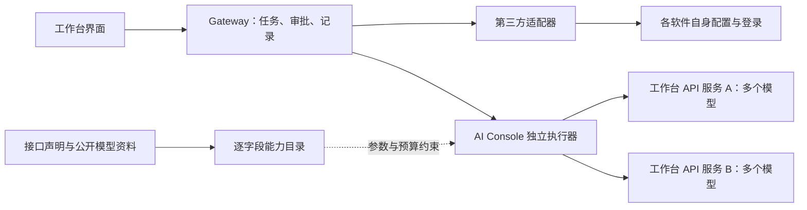

# 调研：AI Console 独立 Agent 的模型配置与固有能力

> 2026-11-08 · 用户要求的专项调研，配套 design.md 6.4、phase-1 9.15 / 9.16。
> 由三路子智能体分别核查 CCSwitch、执行引擎、模型能力识别，主 Agent 汇总并复查关键来源。本报告是设计与选型依据，不是实现或真实 API 验收结果。

## 1. 用户要求与本项目现状

用户决定：第三方 Agent 始终沿用自己的 API、认证与模型；AI Console 独立 Agent 使用工作台自己的配置。独立 Agent 必须支持多个 API 服务、每个服务多个模型，并自动识别上下文大小、图片、思考强度等能力。新增服务和模型都是追加，保留原有项和默认值。能力识别参考 CCSwitch，执行器的固有能力参考文章与开源项目。

本仓库在提交 `2b3d6be` 的实际状态：

- 第三方原生配置边界已整改，不能再通过第三方账号表单注入工作台 Key；演示 Agent 只模拟工具，不是独立执行器。
- `packages/protocol/src/index.ts` 的 `ModelInfo` 只有 id、name、contextWindow 和可选 vision；思考选项目前主要在 Agent / 账号级，不能完整表达一个服务中各模型的不同参数。
- `packages/gateway/src/http/agents.ts` 的旧模型拉取只保留模型 id 和名称，contextWindow 固定为 null，刷新还会替换整个列表；该旧入口已对真实第三方停用。它不能原样承担新的能力识别、追加合并与来源追溯。
- 现有任务状态、事件、审批、草稿、附件、鉴权与 DPAPI 可作为独立 Agent 的外围基础；自有模型请求循环、工具执行、会话恢复和能力目录仍需实现与验证。

详细核查分为三份：

| 报告 | 回答的问题 |
|---|---|
| [CCSwitch 源码核查](cc-switch-model-metadata.md) | 它怎样补全模型信息，哪些做法适用，哪些会违反第三方配置边界 |
| [模型能力识别](model-capability-detection.md) | 各接口真正返回什么，如何保留来源、未知和冲突，如何处理协议差异 |
| [开源执行引擎](independent-agent-engines.md) | 工具、审批、恢复、上下文与扩展如何实现，嵌入与自建的成本和隔离要求 |

## 2. 先区分三层能力

“能选模型”不足以说明“这个 Agent 能完成项目任务”。建议在数据和界面中分开以下三层，再计算可用操作：

| 层 | 示例 | 判断依据 |
|---|---|---|
| 模型 | 最大输入 / 输出、图片理解、工具调用、可调推理参数 | 所选服务实际返回的元数据、服务官方资料、已匹配目录、用户修订、有限实测 |
| 接口适配器 | 当前协议能否编码图片、流式工具调用、推理参数、工具结果续传 | 工作台适配器实现与契约测试；不能由模型名称代替 |
| Agent 执行器 | 读写文件、搜索、命令、审批、取消、持久化、上下文整理、MCP | 工作台执行逻辑、工具权限、运行环境和实际测试；不能从模型 API 的能力字段推导 |

有效能力取三层约束的交集。例如模型支持图片，当前服务协议不支持图片传输时仍不可发送；模型支持工具调用但尚无获准的命令工具时，不能宣称可以执行项目测试。支持推理不等于支持调整推理强度，也不等于接口会返回可展示的思考文本。

图中 A、B 是可选择的服务，单次模型调用只走明确选中的一项。资料目录用于补全能力，不负责替换请求地址或认证。

## 3. 多 API、多模型与自动识别的建议

以“API 服务 → 服务内模型”为配置主轴：服务保存协议、地址和自有加密密钥；模型保存远端 id、显示名、能力与来源。任务绑定服务 id 与模型 id，不能只凭同名模型寻找另一服务。添加第二个 API 不改变第一个 API，添加第二个模型不替换第一个模型；设置默认值是单独操作。

自动识别应是有来源的发现和补全流程：先解析所选服务的模型信息，再用能够准确匹配供应商与模型的公开目录补全缺项，允许用户只在本服务内修订。某个接口没有提供字段时保持未知，不把“没返回”解释成“不支持”，也不把社区资料包装成当前服务已实测。自定义代理或别名需要明确映射；不能凭包含某段模型名就继承原厂能力。

这与原设计 6.6 中用户已要求的“模型资料自动联网调研”分开：后者是独立后台任务，使用明确选定的调研服务和预算，单列调用；它的输出仍是待核查资料。本轮不启动该任务，也不以本次“不付费探测”的发现流程取消原有用户决定。

上下文至少区分总窗口、最大输入和最大输出；运行预算另扣系统提示、工具定义、消息、附件以及输出预留。无法确认窗口时显示未知，保守预算仅是运行保护，不能显示成模型规格。推理参数按所选模型与协议展示合法选项，换模型后重新校验；不支持或未知时不发送猜出的参数。

读取目录不发模型消息；主动识图、工具或推理测试属于单独的实测，会产生调用，必须先写预算并由用户确认。不通过试填超长上下文、不断切换参数或让模型自报规格来“自动识别”。成功一例只说明该例通过，不能证明最大上下文或整套功能。

## 4. 独立 Agent 应具备什么

以下是本项目的能力建议及验收方向，不是对当前代码的完成声明。

| 能力 | 第一个可用执行器需达到 | 之后的扩展 |
|---|---|---|
| 任务执行循环 | 接收任务 → 请求所选模型 → 校验工具请求 → 执行 / 等审批 → 回传结果 → 继续或结束；有调用、时间、输出上限 | 复杂任务调度与子 Agent 协作 |
| 理解项目 | 读取项目规则、按路径找文件、按内容搜索、分段读取；结果带位置和截断说明 | 语义索引、LSP、依赖分析 |
| 文件修改 | 创建 / 修改文件、检查旧内容或版本冲突、给出改动摘要；通过权限与审批，不能盲写旧内容 | 独立 worktree、自动检查点、合并 / 回滚按既定 1.5 计划落实 |
| 命令与验证 | 经审批执行明确命令、显示退出状态与有界输出、取消进程树；验证失败允许模型继续修正 | 后台服务、运行环境预设、游戏引擎专用验证工具 |
| 用户控制 | 只读 / 需审批实际生效；拒绝后工具未执行，理由进入后续上下文；等待审批不当作卡死 | 统一权限规则、工作区内自动执行按 1.5 开放 |
| 连续会话 | 持久化用户 / 助手 / 工具的有序记录，重启可恢复；中断的工具状态可见，不能默认重跑可能已生效的操作 | 跨 Agent 交接与长期项目记忆按 1.6 落实 |
| 上下文管理 | 发送前检查预算、工具输出限量、保留任务与拒绝约束；支持可回查的压缩并保留原始记录，换模型后重新计算；无法安全整理时停止并说明 | 跨任务项目记忆与更复杂的检索，不能用摘要代替执行记录 |
| 图片与附件 | 按模型、协议和执行器能力发送；不支持时拦截；未知明确提示，不悄悄丢弃 | 音频、视频、三维等资产经专用工具处理 |
| 可观测性 | 流式消息、工具状态、计划、错误、用量来源、停止原因；没有费用数据就显示未知 | 成本预测、预算策略与监控 |
| 工具扩展 | 保留统一工具注册和权限入口；不得从项目或模型目录自动执行扩展 | MCP、Skill、浏览器及 Blender / Houdini 工具按能力中心设计接入 |

工具集可以保持清楚简洁，执行闭环必须完整。一个“发 HTTP 请求后显示回复”的聊天客户端不满足上述 Agent 定义；只有“模型调用工具”的样例，也不足以证明审批、取消和恢复可靠。

工作目录、路径检查和审批也不等于操作系统沙箱。若开放任意命令或代码，必须单独验证 Windows 的文件 / 网络权限边界与进程收尾；私有 HOME、环境白名单或 SDK 回调本身都不能证明命令无法访问工作区之外的文件。没有这项证据时明确说明实际保护范围，不宣称已实现彻底隔离。

对于游戏项目，C# 文本改动可以走受控文件工具，Unity / Unreal 的测试应通过明确的引擎命令或专用工具。不能把读取二进制资产的字节视为理解资产，也不能把改扩展名 / 改 JSON 当作 Blender、Houdini 或蓝图操作。专用软件接入由相应 MCP / 工具提供，不是所有语言模型天然具备的能力。

## 5. 文章与最小执行循环的证据

这些材料用于推导能力与模块边界，不用于宣称某个框架一定更强，也不直接采用其生产配置：

- Anthropic 的 [Building effective agents](https://www.anthropic.com/research/building-effective-agents)（2024-12-19，页面提示部分工具信息已变化）区分固定工作流与模型自主选择工具的 Agent，并建议理解抽象层下的实现。对本项目的启发是先建立可审计的循环与工具契约，避免只拼接聊天接口或先叠加编排框架。
- [Writing effective tools for AI agents](https://www.anthropic.com/research/writing-tools-for-agents)（2025-09-11）强调工具边界、有效返回值、输出效率和基于真实任务的评估。对应本项目应检查搜索定位、修改冲突和命令结果，而不是只测工具函数能被调用。
- [Effective context engineering](https://www.anthropic.com/research/effective-context-engineering-for-ai-agents)（2025-09-29）介绍按需检索、压缩与结构化笔记。对应本项目，窗口大小识别只是预算输入，不能代替上下文整理；检索和笔记仍要保留事实来源。
- [Effective harnesses for long-running agents](https://www.anthropic.com/research/effective-harnesses-for-long-running-agents)（2025-11-26）展示跨会话进度记录与逐项验证。对应本项目，恢复应知道已做、失败和未做的事项，不能凭模型说“完成”就通过验收。
- [Scaling Managed Agents](https://www.anthropic.com/research/managed-agents)（2026-04-08）把会话记录、执行循环和执行环境分开，并指出旧模型所需的补丁可能在新模型上成为负担。对应本项目，可稳定保留 Gateway 事件与审批接口，在外围验证不同执行器，而不把某家模型的行为写死成通用能力。
- mini-swe-agent [v2.4.6 循环源码](https://github.com/SWE-agent/mini-swe-agent/blob/v2.4.6/src/minisweagent/agents/default.py) 能直接看到请求、动作、观察、调用 / 费用 / 时间限制与轨迹保存；[本机环境](https://github.com/SWE-agent/mini-swe-agent/blob/v2.4.6/src/minisweagent/environments/local.py) 则继承环境并直接执行命令。可借鉴结构，不能直接拿其本机环境满足本项目权限和凭据隔离要求；未安装或运行该项目。

## 6. 执行器选型建议

优先做 **Pi 底层模型适配与执行循环的离线 PoC**：只验证 `pi-ai` / `pi-agent-core` 是否能接入 Gateway 自有配置、工具、审批和存储，不启动完整 CLI，也不继承其默认认证发现。选择依据是其 TypeScript 分层和可注入接口贴近当前工程；这是本项目的工程判断，不是基准排名或已经选定依赖。必须验证请求固定到所选服务、没有环境认证回退、工具副作用前完成持久记录、Windows 取消进程树和会话恢复。

Cline 的 Agents 层保留为第二候选；OpenCode、Goose 的完整运行时更适合独立服务或参考实现，会带来第二套会话、配置和运行环境，需要更多整合。若候选无法满足以上边界，则自建清楚而完整的执行循环，不能以复用框架为由削减审批、恢复或上下文管理。详细矩阵、许可证、固定版本及源码接缝见[引擎报告](independent-agent-engines.md)。

底层接口少不代表依赖少。固定快照中的 `@earendil-works/pi-agent-core` / `@earendil-works/pi-ai` 为 `1.5.0`，模型层仍包含多家 SDK 等传递依赖；将来实际引入前还要审计发行包、依赖图和默认行为并锁版本。本轮没有安装这些依赖，Windows 兼容性仍未验证。

## 7. 建议的验证门槛

1. **配置与能力**：两个服务分别添加至少两个模型，验证追加、刷新、重名 id、默认值、能力冲突、未知、用户修订及离线缓存；断言某服务的 Key 和模型不会用于另一服务。
2. **工具闭环**：假模型按顺序请求搜索、读文件、修改与命令；真实操作临时文件并检查结果。拒绝修改 / 命令时文件与进程均不产生副作用，拒绝理由能被下一次请求看见。
3. **恢复与中断**：流式过程中取消、工具执行期间取消、审批期间重启，核对界面和持久化状态。恢复不会自动重放未确认是否已执行的工具。
4. **上下文与协议**：不同窗口与输出限制、图片未知 / 不支持、无效推理档位、协议切换及工具消息配对；过量输入在上游请求前停止或按已记录策略整理。
5. **安全与隐私**：请求仍走 `/api/v1` 并校验令牌、Host、Origin；不读写第三方凭据，子命令不继承工作台服务 Key；日志、事件不含密钥或附件正文；目录下载不能变成代码执行。
6. **界面与真实补验**：所有配置和审批在界面完成；离线检查通过后，真实调用单独列消息、工具循环的上游请求上限与费用，用户同意后再执行。不能只统计“发了几条用户消息”而漏掉多轮工具调用的费用。

## 8. 当前结论的边界

本轮完成公开资料与源码静态调研、仓库现状核对，以及设计建议。没有新增运行时依赖、启动候选引擎、调用用户 API 或读取第三方凭据。候选引擎的 Windows 运行、审批回调、彻底取消与隔离能力仍需离线验证；不能用维护状态、README 功能表或别人的基准分数代替本项目验收。
